# Screenshot atlas: every screen with its governing equations

This part of the manual shows every screen of the workbench, one after another, each accompanied by the equations that produce what it displays. The screenshots were taken from the SWAFL workbench itself (the window in `app/index.html`) with the default settings (Coarse Loam, conventional tillage, cereal/oilseed rotation, wheat-straw mulch of strength 1.0, Surface irrigation, typical year). For each screen the first picture is the whole workbench and the second is the drawing area at higher magnification. For the fourteen single layers, whose drawing is longer than the drawing area and is scrolled inside it, the pictures of the whole drawing from top to bottom follow, together with its playback states and with one picture for each control that changes the drawing (every mulch material, every zoom and view of the soil section, every irrigation layout, every day button, and so on). Every picture carries numbered arrows, each ending on the item that its legend entry names. Below the pictures every equation that the screen draws on is printed in full, with its number, the chapter that explains it and its provenance label, so that no number on a screen is without its equation. A reverse index at the end lists, for each of the 134 numbered equations, the screens that use it.

Equation numbers are those of the chapters (for example Eq. 5.4 is the fourth equation of the chapter on the engines). The symbols are defined where the equation first appears; the *Where explained* line gives that place.

## The window and its controls

### The welcome dialog

Shown on first start; it carries no equations.

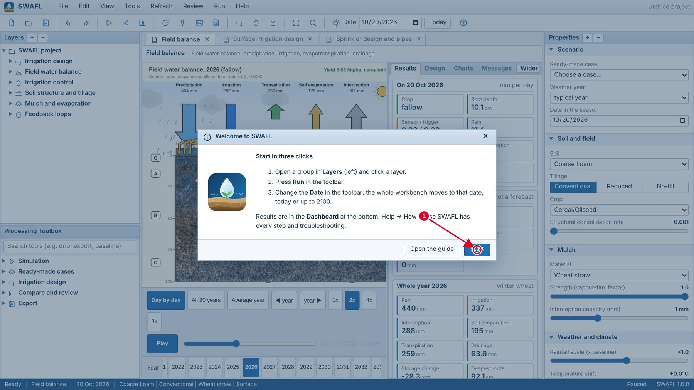{width=100%}

**What the arrows point to.**

- **1** The Start button closes the dialog and opens the workbench; the dialog carries no equation.

\newpage

### The workbench

Layers (left), drawing area (centre), Dashboard (below and right of the drawing) and Properties (right). The date shown in the toolbar sets the whole workbench to that day.

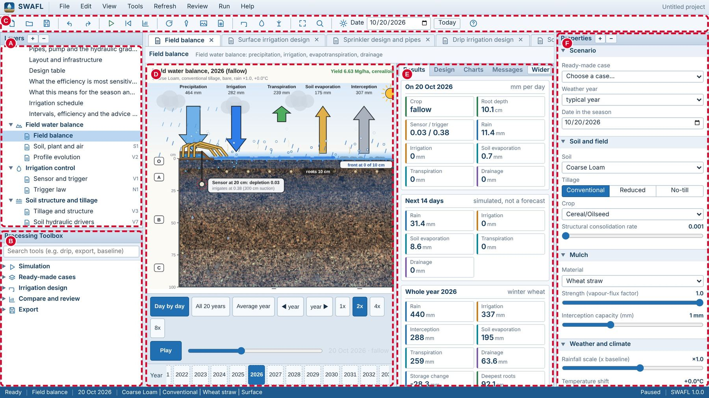{width=100%}

**What the arrows point to.**

- **L** Layers panel: choose a layer or one of its sections. Every choice is one screen of this atlas.
- **X** Processing Toolbox: run, cases, design, compare and export commands.
- **T** Toolbar with the Date control: the date sets the whole workbench to that day (Eqs. 4.1 and 4.2).
- **D** Drawing area: the picture produced by the equations printed under each screen.
- **R** Dashboard: the numerical results of the same equations (Engine 1, Eqs. 5.4 to 5.12; Engine 2, Eqs. 5.13 to 5.25).
- **C** Properties panel: the controls that move the equations (soil, tillage, mulch, weather, irrigation, nutrients).

**Equations behind this screen.** Eq. 4.1, Eq. 4.2.

*Eq. 4.1. Where explained: chapter "Dates", section "The date control".*

$$
k_{\mathrm{start}} = 365\,a + d_{\mathrm{oy}}, \qquad
\text{date}(k) = \text{1 Jan of year } \bigl(Y_0 + \lfloor k/365\rfloor - a\bigr) + \bigl(k - 365\lfloor k/365\rfloor\bigr)\ \text{days},
\tag{4.1}
$$

*Provenance (Eq. 4.1):* **[Engineered]**: calendar bookkeeping and choice of analogue year; no physical law.

*Eq. 4.2. Where explained: chapter "Dates", section "The date control".*

$$
a = \begin{cases}
\mathrm{argsort}_y\,(P_{\mathrm{thr},y})_{[10]} & \text{typical (median, 11th smallest of 20)}\\
\arg\min_y P_{\mathrm{thr},y} & \text{dry}\\
\arg\max_y P_{\mathrm{thr},y} & \text{wet}\\
Y_0 - 1980 & 1980\le Y_0\le 1999
\end{cases}
\tag{4.2}
$$

*Provenance (Eq. 4.2):* **[Engineered]**: calendar bookkeeping and choice of analogue year; no physical law.

\newpage

### The File menu

Menu commands. Every command is described in the chapter "The window: a guided tour", section "Menu bar reference"; the commands that run the engines are those of the Run and Refresh menus.

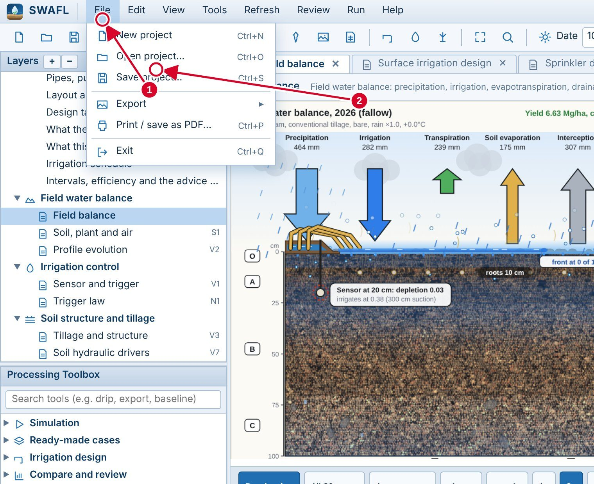{width=75%}

**What the arrows point to.**

- **1** The File menu in the menu bar.
- **2** Its list of commands.

\newpage

### The Edit menu

Menu commands. Every command is described in the chapter "The window: a guided tour", section "Menu bar reference"; the commands that run the engines are those of the Run and Refresh menus.

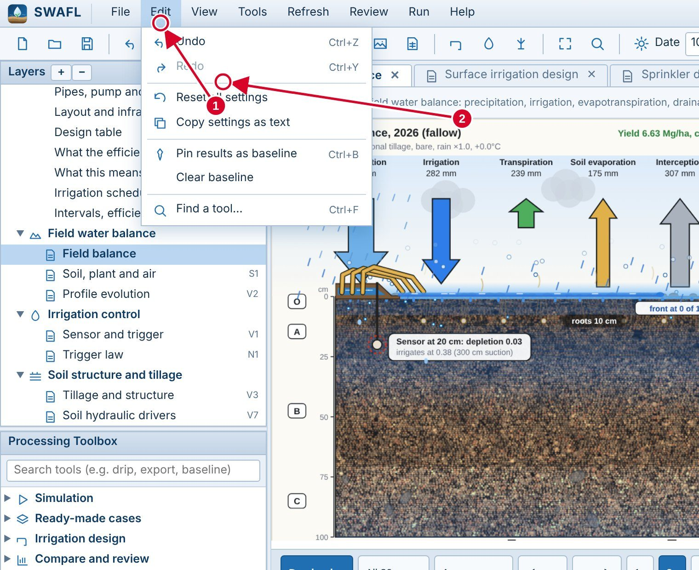{width=75%}

**What the arrows point to.**

- **1** The Edit menu in the menu bar.
- **2** Its list of commands.

\newpage

### The View menu

Menu commands. Every command is described in the chapter "The window: a guided tour", section "Menu bar reference"; the commands that run the engines are those of the Run and Refresh menus.

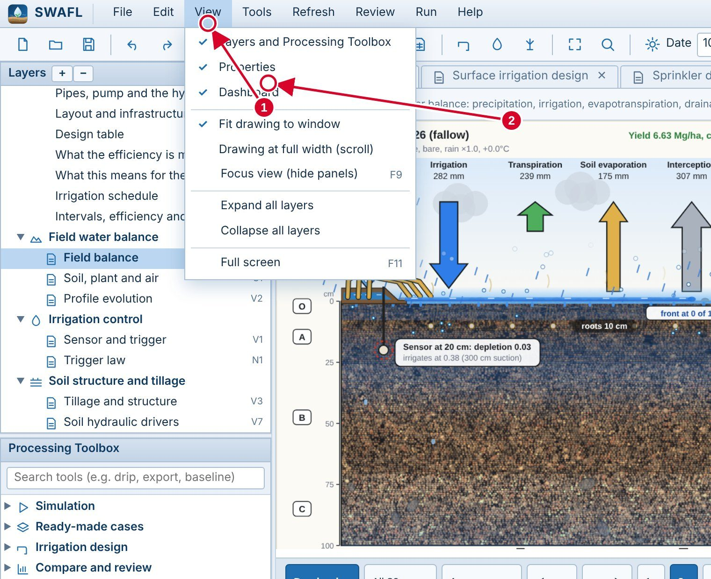{width=75%}

**What the arrows point to.**

- **1** The View menu in the menu bar.
- **2** Its list of commands.

\newpage

### The Tools menu

Menu commands. Every command is described in the chapter "The window: a guided tour", section "Menu bar reference"; the commands that run the engines are those of the Run and Refresh menus.

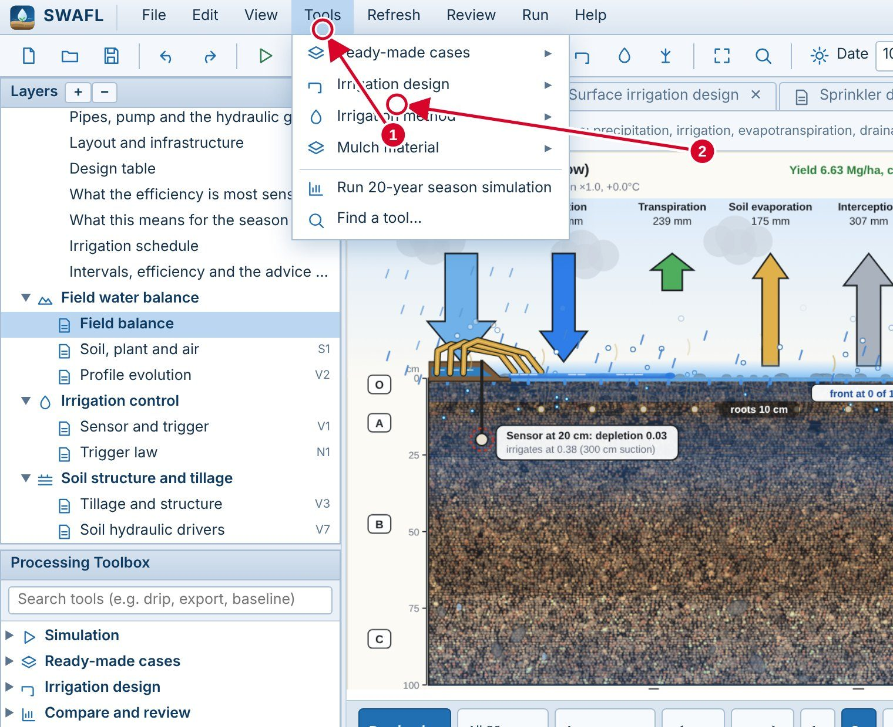{width=75%}

**What the arrows point to.**

- **1** The Tools menu in the menu bar.
- **2** Its list of commands.

\newpage

### The Refresh menu

Menu commands. Every command is described in the chapter "The window: a guided tour", section "Menu bar reference"; the commands that run the engines are those of the Run and Refresh menus.

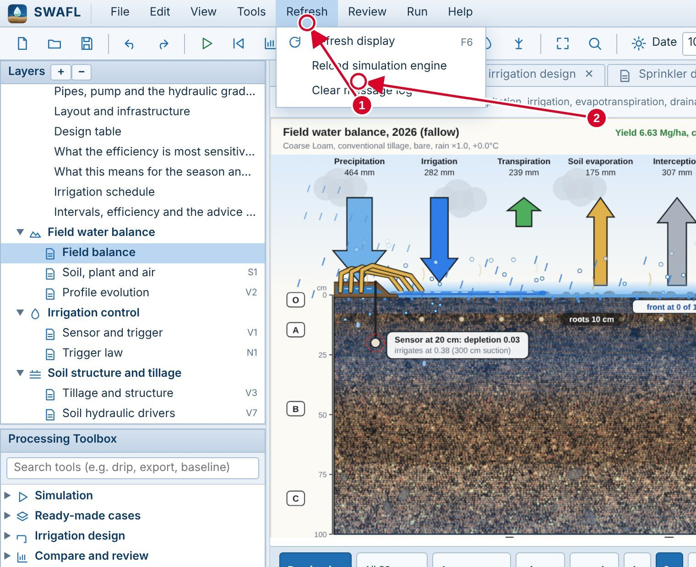{width=75%}

**What the arrows point to.**

- **1** The Refresh menu in the menu bar.
- **2** Its list of commands.

\newpage

### The Review menu

Menu commands. Every command is described in the chapter "The window: a guided tour", section "Menu bar reference"; the commands that run the engines are those of the Run and Refresh menus.

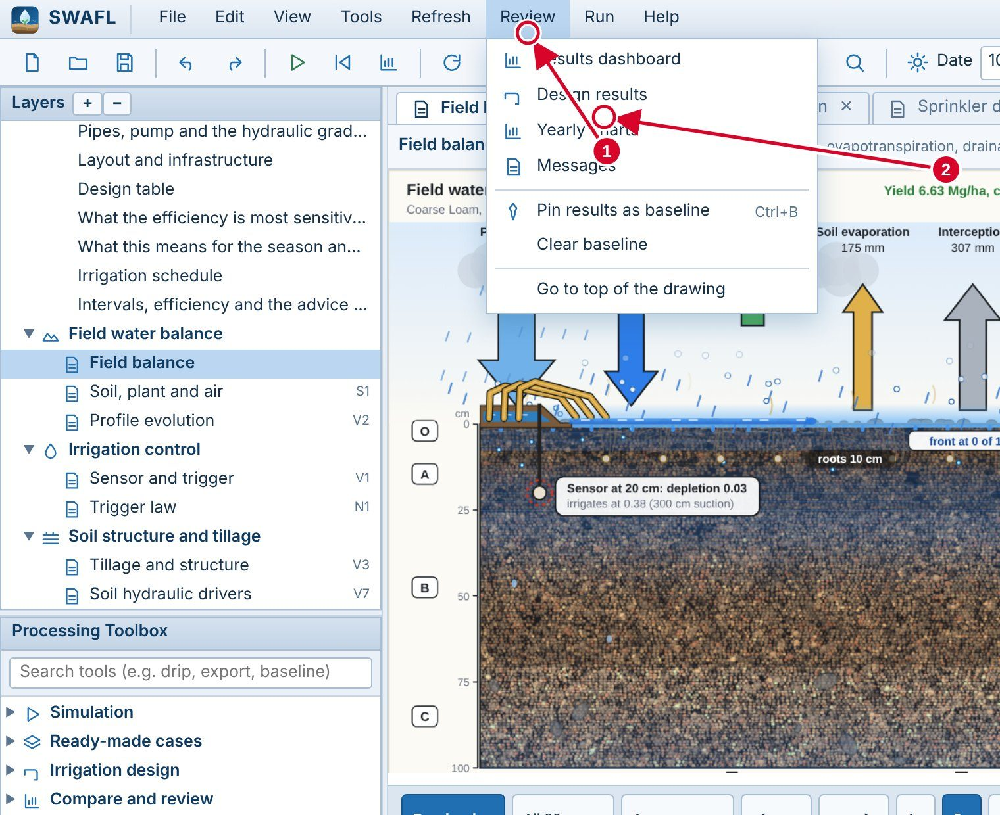{width=75%}

**What the arrows point to.**

- **1** The Review menu in the menu bar.
- **2** Its list of commands.

\newpage

### The Run menu

Menu commands. Every command is described in the chapter "The window: a guided tour", section "Menu bar reference"; the commands that run the engines are those of the Run and Refresh menus.

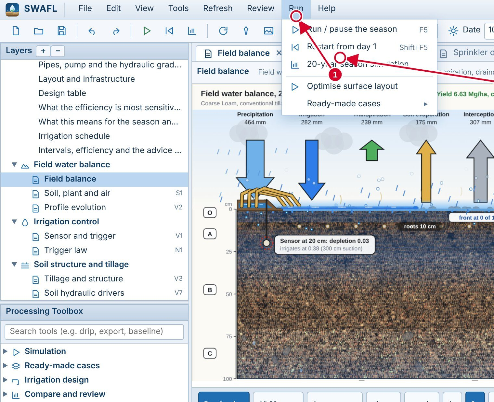{width=75%}

**What the arrows point to.**

- **1** The Run menu in the menu bar.
- **2** Its list of commands.

\newpage

### The Help menu

Menu commands. Every command is described in the chapter "The window: a guided tour", section "Menu bar reference"; the commands that run the engines are those of the Run and Refresh menus.

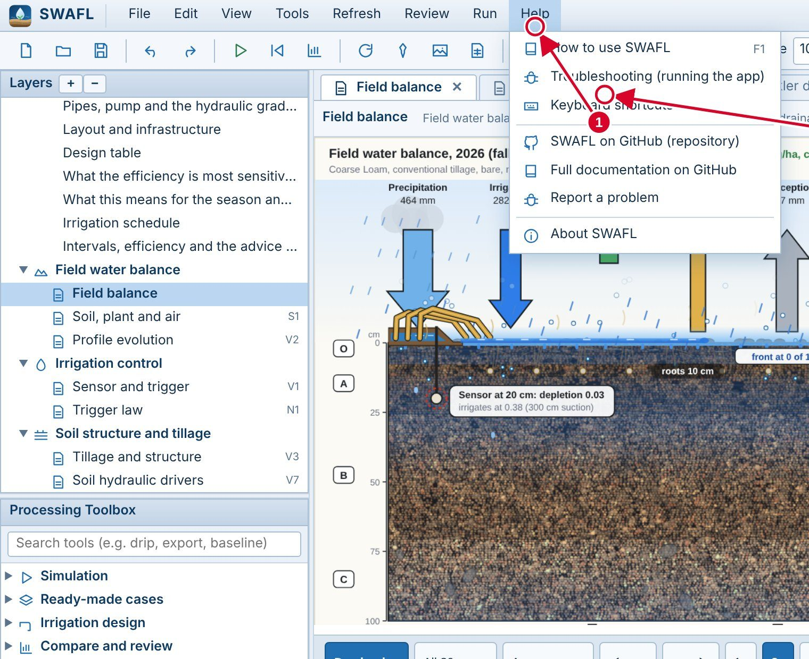{width=75%}

**What the arrows point to.**

- **1** The Help menu in the menu bar.
- **2** Its list of commands.

\newpage

### The command palette (Ctrl+K)

Searches every layer, control and tool by name.

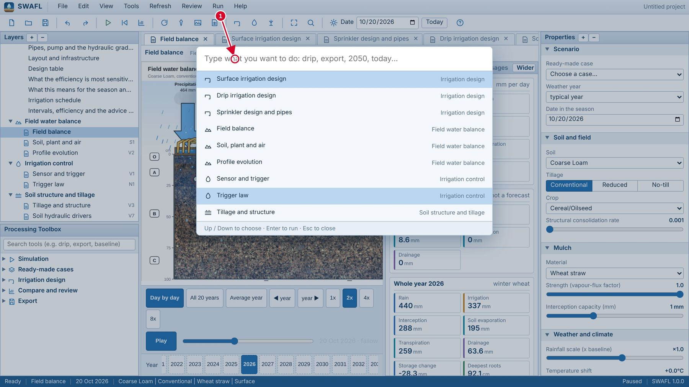{width=100%}

**What the arrows point to.**

- **1** Search box of the command palette (Ctrl+K): type a layer, control or tool and press Enter.

\newpage

### The Processing Toolbox

Simulation, ready-made cases, irrigation design, compare and review, export.

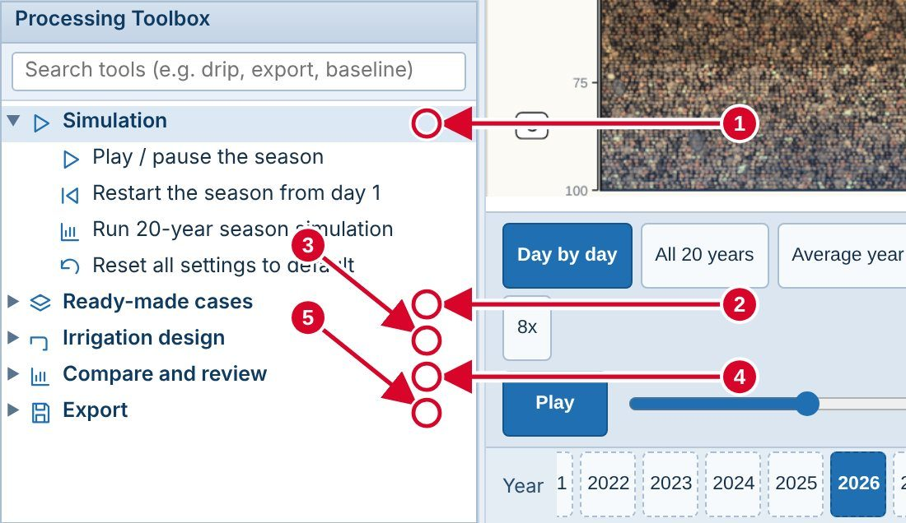{width=48%}

**What the arrows point to.**

- **1** Simulation: play or pause the season, restart, 20-year run (Engine 2, Eqs. 5.13 to 5.25).
- **2** Ready-made cases: load a stored combination of soil, tillage, mulch, weather and irrigation.
- **3** Irrigation design: open the surface, drip or sprinkler design layer (Eqs. 11.1 to 13.23).
- **4** Compare and review: pin the current results as the baseline (Eqs. 14.4 and 14.5), clear it, show the dashboard.
- **5** Export: picture, yearly results (CSV), design results (CSV), project, print.

\newpage

### The toolbar

Run, restart, 20-year run, refresh, baseline, picture, focus, search and the Date control (Eqs. 4.1, 4.2).

{width=100%}

**What the arrows point to.**

- **1** Run or pause the season (Engine 2).
- **2** Run the 20-year simulation.
- **3** Pin results as baseline (Eq. 14.4).
- **4** Open a design layer: Surface, Drip or Sprinklers.
- **5** Date control: the working date, Eqs. 4.1 and 4.2.

**Equations behind this screen.** Eq. 4.1, Eq. 4.2.

*Eq. 4.1. Where explained: chapter "Dates", section "The date control".*

$$
k_{\mathrm{start}} = 365\,a + d_{\mathrm{oy}}, \qquad
\text{date}(k) = \text{1 Jan of year } \bigl(Y_0 + \lfloor k/365\rfloor - a\bigr) + \bigl(k - 365\lfloor k/365\rfloor\bigr)\ \text{days},
\tag{4.1}
$$

*Provenance (Eq. 4.1):* **[Engineered]**: calendar bookkeeping and choice of analogue year; no physical law.

*Eq. 4.2. Where explained: chapter "Dates", section "The date control".*

$$
a = \begin{cases}
\mathrm{argsort}_y\,(P_{\mathrm{thr},y})_{[10]} & \text{typical (median, 11th smallest of 20)}\\
\arg\min_y P_{\mathrm{thr},y} & \text{dry}\\
\arg\max_y P_{\mathrm{thr},y} & \text{wet}\\
Y_0 - 1980 & 1980\le Y_0\le 1999
\end{cases}
\tag{4.2}
$$

*Provenance (Eq. 4.2):* **[Engineered]**: calendar bookkeeping and choice of analogue year; no physical law.

\newpage

### The status bar

The current layer, date, soil, tillage, mulch and irrigation method.

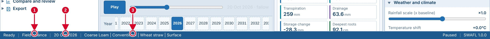{width=100%}

**What the arrows point to.**

- **1** Layer and section on screen.
- **2** Working date.
- **3** Soil, tillage, mulch and irrigation method in force.

\newpage

### The Dashboard, Results tab

Working day, next 14 days, whole year and 20-year averages.

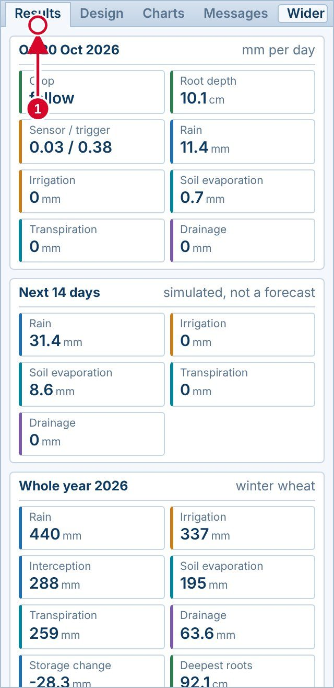{width=42%}

**What the arrows point to.**

- **1** Working day: crop, root depth, sensor against trigger (Eq. 5.3), rain, irrigation, evaporation, transpiration and drainage of that day, Eqs. 14.1 to 14.3.
- **2** Next 14 days: simulated, not a forecast, from Engine 2.
- **3** Whole year: the annual fluxes of Engine 1, Eqs. 5.4 to 5.12, and the closure of Eq. 5.12.
- **4** Tabs: Results, Design, Charts and Messages.

**Equations behind this screen.** Eq. 6.1, Eq. 14.1, Eq. 14.2, Eq. 14.3, Eq. 14.4.

*Eq. 6.1. Where explained: chapter "Irrigation control layers", section "How the numbers are generated".*

$$
N_y(h_T) = \#\bigl\{\,d \in \text{growing season of year } y : h_d > h_T\,\bigr\}\quad(183\ \text{days from 1 April}),
\tag{6.1}
$$

*Provenance (Eq. 6.1):* **[Data-driven]**: counts over the simulated daily series.

*Eq. 14.1. Where explained: chapter "The Dashboard", section "Results".*

$$
\mathrm{Rain}=P_k,\quad \mathrm{Irr}=I_k,\quad \mathrm{Evap}=E_k,\quad \mathrm{Transp}=T_k,\quad \mathrm{Drain}=D_k\ \ (\mathrm{mm\,d^{-1}}).
\tag{14.1}
$$

*Provenance (Eq. 14.1):* **[Engineered]**: bookkeeping of Engine 2 series.

*Eq. 14.2. Where explained: chapter "The Dashboard", section "Results".*

$$
\Sigma X=\sum_{j=1}^{N}X_{k+j},\qquad X\in\{P,I,E,T,D\}.
\tag{14.2}
$$

*Provenance (Eq. 14.2):* **[Engineered]**: bookkeeping of Engine 2 series.

*Eq. 14.3. Where explained: chapter "The Dashboard", section "Results".*

$$
\Delta S=P+I-E_{\mathrm{int}}-E-T-D,
\tag{14.3}
$$

*Provenance (Eq. 14.3):* **[Literature]**: water-balance identity.

*Eq. 14.4. Where explained: chapter "The Dashboard", section "The pinned baseline".*

$$
\Delta_i=x_i-x_i^{\mathrm{pin}},
\tag{14.4}
$$

*Provenance (Eq. 14.4):* **[Engineered]**: bookkeeping of Engine 2 series.

\newpage

### The Dashboard, Design tab

Results of the open design layer.

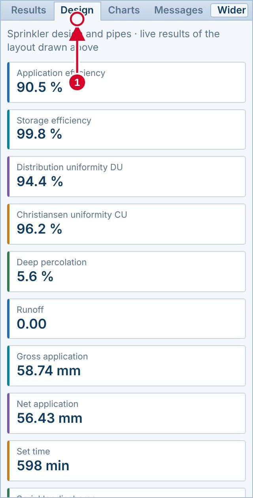{width=42%}

**What the arrows point to.**

- **1** Design tab with a design layer open: efficiencies, uniformity, times and volumes of the system being designed.
- **2** Tabs.

**Equations behind this screen.** Eq. 11.18, Eq. 11.19, Eq. 12.19, Eq. 13.11.

*Eq. 11.18. Where explained: chapter "Surface irrigation design", section "Volumes, efficiencies and uniformity".*

$$
\begin{aligned}
V_{\mathrm{app}} &= Q\,t_{co}\quad\bigl(\text{with cutback } c_b<1:\ Q\,t_L + c_b\,Q\,(t_{co}-t_L)\bigr), & V_{\mathrm{req}} &= Z_n\,L\,w,\\
V_{\mathrm{inf}} &= w\!\int_0^L Z\,dx, & V_{\mathrm{st}} &= w\!\int_0^L \min(Z, Z_n)\,dx,\\
V_{\mathrm{dp}} &= w\!\int_0^L \max(Z-Z_n,0)\,dx, & V_{\mathrm{df}} &= w\!\int_0^L \max(Z_n - Z,0)\,dx,\\
V_{\mathrm{ro}} &= \max(V_{\mathrm{app}} - V_{\mathrm{inf}},\ 0).
\end{aligned}
\tag{11.18}
$$

*Provenance (Eq. 11.18):* **[Literature]**: standard opportunity-time and performance-index definitions (Walker and Skogerboe, 1987; Burt et al., 1997).

*Eq. 11.19. Where explained: chapter "Surface irrigation design", section "Volumes, efficiencies and uniformity".*

$$
E_a = \frac{V_{\mathrm{st}}}{V_{\mathrm{app}}},\quad
E_s = \frac{V_{\mathrm{st}}}{V_{\mathrm{req}}},\quad
\mathrm{DP} = \frac{V_{\mathrm{dp}}}{V_{\mathrm{app}}},\quad
\mathrm{RO} = \frac{V_{\mathrm{ro}}}{V_{\mathrm{app}}},\quad
\mathrm{CU} = 100\Bigl(1 - \frac{\tfrac{1}{N+1}\sum_{i=0}^{N}|Z_i-\bar Z|}{\bar Z}\Bigr)\ \%.
\tag{11.19}
$$

*Provenance (Eq. 11.19):* **[Literature]**: standard opportunity-time and performance-index definitions (Walker and Skogerboe, 1987; Burt et al., 1997).

*Eq. 12.19. Where explained: chapter "Drip irrigation design", section "Spread between emitters and the efficiencies".*

$$
E_a = \frac{\langle V_{\mathrm{st}}\rangle}{\langle V\rangle},\quad
E_s = \frac{\langle V_{\mathrm{st}}\rangle}{V_{\mathrm{req}}},\quad
\mathrm{DP} = \frac{\langle V_{\mathrm{dp}}^{(1)}+V_{\mathrm{ex}}\rangle}{\langle V\rangle},\quad
\mathrm{EV} = \frac{\langle V_{\mathrm{ev}}\rangle}{\langle V\rangle},\quad
Z_{\mathrm{gross}}=\frac{\bar V}{S_eS_l},
\tag{12.19}
$$

*Provenance (Eq. 12.19):* **[Engineered]**: five-quantile delivery and run-time rules chosen for the workbench.

*Eq. 13.11. Where explained: chapter "Sprinkler design", section "Efficiencies and run time".*

$$
\begin{aligned}
E_a &= \frac{\overline{\min(Z_k,Z_n)}}{\mathrm{gross}}, & E_s &= \frac{\overline{\min(Z_k,Z_n)}}{Z_n}, & \mathrm{DU}&=\frac{\overline{Z}_{25}}{\overline{Z}},\\
\mathrm{DP} &= \frac{\overline{\max(Z_k-Z_n,0)}}{\mathrm{gross}}, & \mathrm{RO}&=\frac{\overline{\mathrm{RO}_k}}{\mathrm{gross}}, & \mathrm{WD}&=w_d+\frac{\overline{I_c}}{\mathrm{gross}},
\end{aligned}
\tag{13.11}
$$

*Provenance (Eq. 13.11):* **[Literature]**: efficiency and distribution uniformity of Merriam and Keller (1978).

\newpage

### The Dashboard, Charts tab

Yearly charts and the pinned baseline.

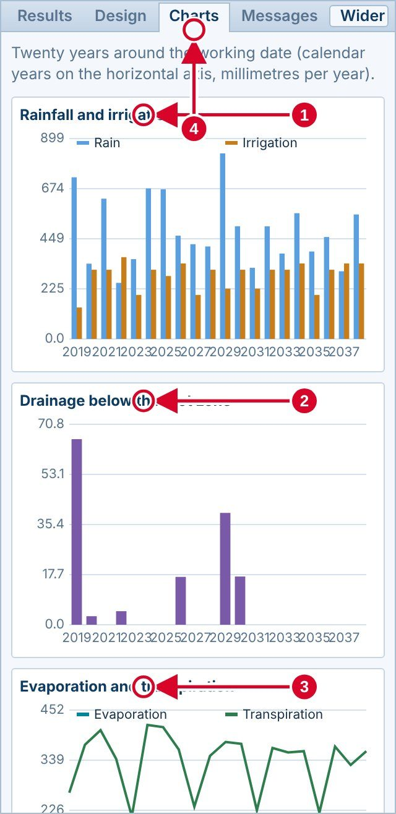{width=42%}

**What the arrows point to.**

- **1** Rainfall and irrigation for twenty years (Engine 1 annual values, Eqs. 5.4 to 5.12), with the pinned baseline of Eq. 14.5.
- **2** Drainage below the root zone, D of Eq. 5.9.
- **3** Evaporation and transpiration, E and T of Eqs. 5.4 to 5.12.

**Equations behind this screen.** Eq. 14.5.

*Eq. 14.5. Where explained: chapter "The Dashboard", section "The pinned baseline".*

$$
Y^{(y)}=\sum_{d\in y}X_d,\qquad X\in\{P,I,D,E,T\}.
\tag{14.5}
$$

*Provenance (Eq. 14.5):* **[Engineered]**: bookkeeping of Engine 2 series.

\newpage

### The Dashboard, Messages tab

Plain-language messages.

{width=42%}

**What the arrows point to.**

- **1** Message log: engine start and plain-language notices.

\newpage

### The Properties panel

Every control; the equations are those that the controls move.

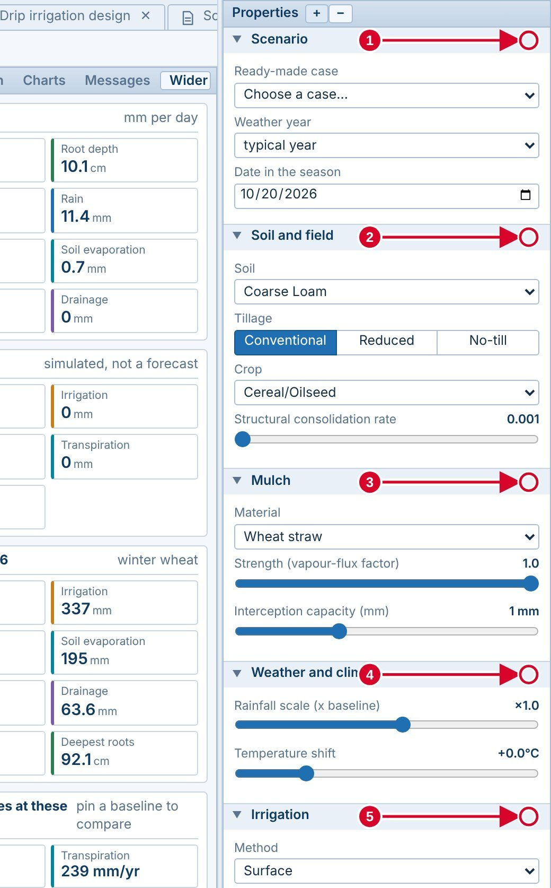{width=31%} 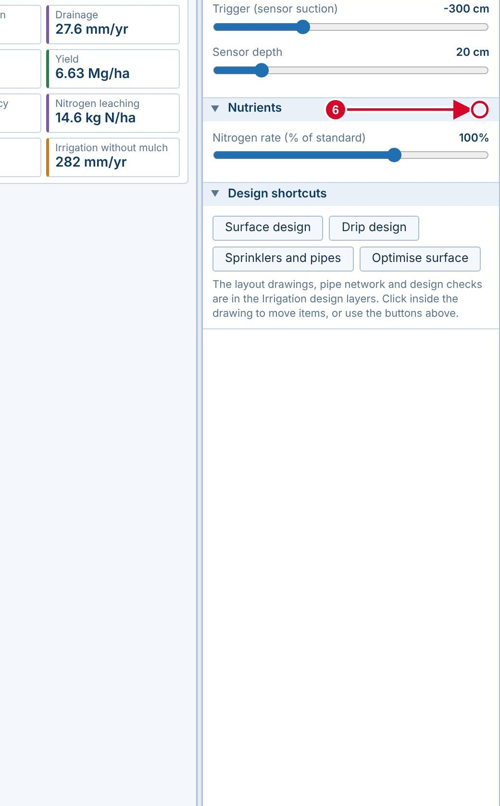{width=31%} {width=31%}

**What the arrows point to.**

- **1** Scenario: ready-made case, weather year and date (Eqs. 4.1 and 4.2).
- **2** Soil and field: soil, tillage, crop and consolidation rate tau_c (Eqs. 5.1, 5.2, 8.1).
- **3** Mulch: material, strength phi and interception capacity c (Eqs. 5.4 to 5.10, 9.1).
- **4** Weather and climate: rainfall scale rho and temperature shift (Eqs. 5.4 to 5.10).
- **5** Irrigation: method, trigger suction h_T and sensor depth (Eqs. 5.3, 5.11, 5.27).
- **6** Nutrients: nitrogen rate (Eqs. 5.10, 5.11).

**Equations behind this screen.** Eq. 5.18, Eq. 5.26, Eq. 8.1, Eq. 13.9.

*Eq. 5.18. Where explained: chapter "The two computing engines", section "Roots".*

$$
R_{\max} = \mathrm{clip}\Bigl(R_{c}\,(0.85 + 0.3\,\mathrm{sand})\bigl[1 + 0.12\log_{10}(|h_T|/300)\bigr]\bigl[1 - 0.18\,\tfrac{N-100}{100}\bigr];\ 25,\ 100\Bigr)\ \mathrm{cm},
\tag{5.18}
$$

*Provenance (Eq. 5.18):* **[Engineered]**: rooting rules with constants chosen for the workbench.

*Eq. 5.26. Where explained: chapter "The two computing engines", section "Evaporation under warming (used by the E1 layer)".*

$$
E_{0,\mathrm{bare}} = 4.2\,(1 + 0.07\,\Delta T)\,\frac{0.35 + 0.65\cdot\tfrac12[1 + \sin(2\pi(\mathrm{doy}-100)/365)]}{0.675}\,\mathrm{clip}\bigl(1 - 0.12(\rho-1);\,0.85,\,1.12\bigr)\sqrt{\gamma_y}\ \ \mathrm{mm\,d^{-1}},
\tag{5.26}
$$

*Provenance (Eq. 5.26):* **[Engineered]**: atmosphere factor with chosen constants.

*Eq. 8.1. Where explained: chapter "Soil structure and tillage layers", section "Pore index and consolidation".*

$$
p(t) = p_c + (p_0 - p_c)\,e^{-\tau_c t},\qquad p_0 = 1.00\ (\text{conventional}),\ 0.72\ (\text{reduced}),
\tag{8.1}
$$

*Provenance (Eq. 8.1):* **[Engineered]**: exponential relaxation with chosen constants.

*Eq. 13.9. Where explained: chapter "Sprinkler design", section "The soil intake, ponding and runoff".*

$$
t_p=\Bigl(\frac aK\Bigr)^{1/(A-1)},\qquad
F=\begin{cases}\mathrm{sup}, & T\le t_p\\ K\,T^{A}, & T>t_p\end{cases}\qquad
R=\mathrm{sup}-F,\quad \mathrm{RO}=\max(0,R-S_d^{\mathrm{eff}}),\quad I=\mathrm{sup}-\mathrm{RO}.
\tag{13.9}
$$

*Provenance (Eq. 13.9):* **[Engineered]**: loss and ponding rules chosen for the workbench.

\newpage

## S2 Surface irrigation design

### The whole layer: inputs and overview

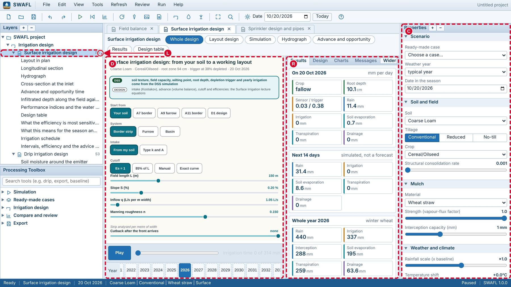{width=100%}

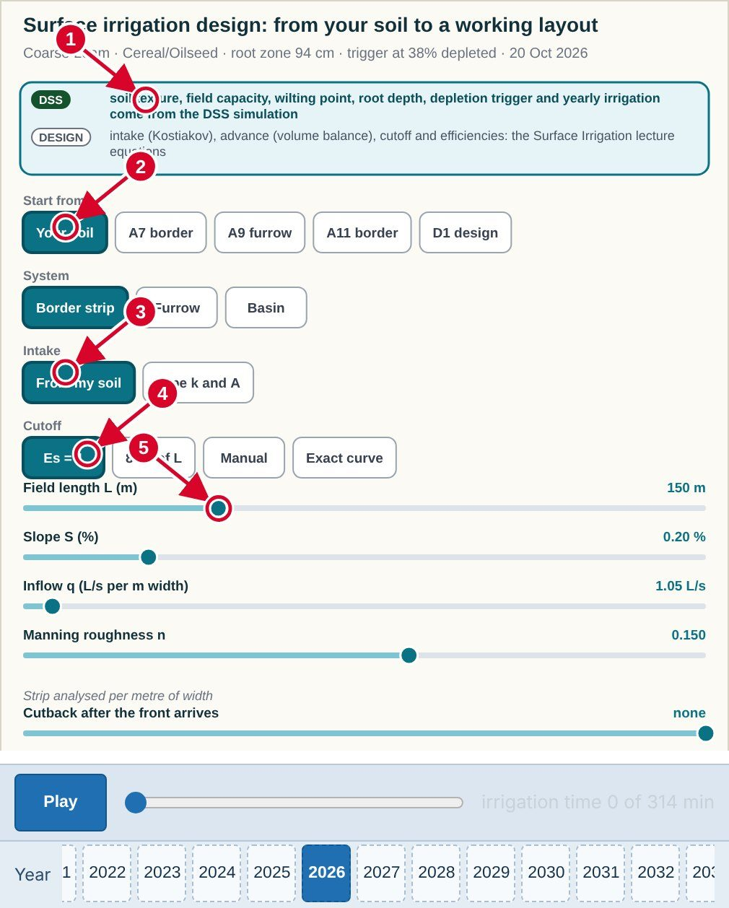{width=70%}

**What the arrows point to.** The dashed outlines in the whole-workbench picture mark the layer chosen in the Layers panel (**L**), the drawing (**D**), the Dashboard (**R**) and the controls in Properties (**C**). In the drawing, each numbered arrow ends on the item it names.

- **1** DSS badge: soil, root zone, trigger and yearly irrigation come from the Engine 1 and 2 results (Eqs. 5.1 to 5.12, 5.27).
- **2** "Start from": in Your soil mode intake, Z_n and the best inflow are derived from the soil, Eqs. 11.1 to 11.7, 5.27 and 11.22.
- **3** Intake "From my soil": Saxton-Rawls, Green-Ampt and Kostiakov, Eqs. 11.1 to 11.7.
- **4** Cut-off "Es = 1": cut-off time t_co, Eq. 11.16.
- **5** Field length L, slope S, inflow q and Manning n: the inputs of Eqs. 11.8 and 11.9.

**Equations behind this screen.** Eq. 5.27, Eq. 11.1, Eq. 11.2, Eq. 11.3, Eq. 11.4, Eq. 11.5, Eq. 11.6, Eq. 11.7, Eq. 11.8, Eq. 11.9, Eq. 11.10, Eq. 11.11, Eq. 11.12, Eq. 11.13.

*Eq. 5.27. Where explained: chapter "The two computing engines", section "Evaporation under warming (used by the E1 layer)".*

$$
Z_n = \mathrm{clip}\bigl(f_T\cdot \mathrm{AWC}\cdot R_{\max};\ 25,\ 150\bigr)\ \mathrm{mm}\qquad(\text{surface; drip and sprinkler use their own limits})
\tag{5.27}
$$

*Provenance (Eq. 5.27):* **[Literature]**: readily available water as in FAO-56 practice, with an engineered clip.

*Eq. 11.1. Where explained: chapter "Surface irrigation design", section "Intake from your soil (Saxton–Rawls $\to$ Green–Ampt $\to$ Kostiakov)".*

$$
\begin{aligned}
\theta_{1500,t} &= -0.024\,S + 0.487\,C + 0.006\,\mathrm{OM} + 0.005\,S\,\mathrm{OM} - 0.013\,C\,\mathrm{OM} + 0.068\,S\,C + 0.031,\\
\theta_{1500} &= \theta_{1500,t} + \bigl(0.14\,\theta_{1500,t} - 0.02\bigr),\\
\theta_{33,t} &= -0.251\,S + 0.195\,C + 0.011\,\mathrm{OM} + 0.006\,S\,\mathrm{OM} - 0.027\,C\,\mathrm{OM} + 0.452\,S\,C + 0.299,\\
\theta_{33} &= \theta_{33,t} + \bigl(1.283\,\theta_{33,t}^{2} - 0.374\,\theta_{33,t} - 0.015\bigr),
\end{aligned}
\tag{11.1}
$$

*Provenance (Eq. 11.1):* **[Literature]**: Saxton and Rawls (2006), implemented as written.

*Eq. 11.2. Where explained: chapter "Surface irrigation design", section "Intake from your soil (Saxton–Rawls $\to$ Green–Ampt $\to$ Kostiakov)".*

$$
\begin{aligned}
\theta_{(S-33),t} &= 0.278\,S + 0.034\,C + 0.022\,\mathrm{OM} - 0.018\,S\,\mathrm{OM} - 0.027\,C\,\mathrm{OM} - 0.584\,S\,C + 0.078,\\
\theta_{(S-33)} &= \theta_{(S-33),t} + \bigl(0.636\,\theta_{(S-33),t} - 0.107\bigr),\qquad
\theta_{s} = \theta_{33} + \theta_{(S-33)} - 0.097\,S + 0.043,\\
B &= \frac{\ln 1500 - \ln 33}{\ln\theta_{33} - \ln\theta_{1500}},\qquad \lambda = \frac1B,\qquad
K_s = 1930\,(\theta_s - \theta_{33})^{\,3-\lambda}.
\end{aligned}
\tag{11.2}
$$

*Provenance (Eq. 11.2):* **[Literature]**: Saxton and Rawls (2006), implemented as written.

*Eq. 11.3. Where explained: chapter "Surface irrigation design", section "Intake from your soil (Saxton–Rawls $\to$ Green–Ampt $\to$ Kostiakov)".*

$$
\psi_f = \frac{10}{\alpha}\,\frac{0.046\,m + 2.07\,m^{2} + 19.5\,m^{3}}{1 + 4.7\,m + 16\,m^{2}}.
\tag{11.3}
$$

*Provenance (Eq. 11.3):* **[Engineered]**: rational-polynomial approximation of a Rawls-type suction.

*Eq. 11.4. Where explained: chapter "Surface irrigation design", section "Intake from your soil (Saxton–Rawls $\to$ Green–Ampt $\to$ Kostiakov)".*

$$
\theta_0 = \theta_{fc} - f_T\,(\theta_{fc} - \theta_{wp}),\qquad
\Delta\theta = \max\{0.05,\ 0.95\,\theta_s - \theta_0\}.
\tag{11.4}
$$

*Provenance (Eq. 11.4):* **[Engineered]**: initial and wetted water contents chosen for the workbench.

*Eq. 11.5. Where explained: chapter "Surface irrigation design", section "Intake from your soil (Saxton–Rawls $\to$ Green–Ampt $\to$ Kostiakov)".*

$$
F - \psi_f\,\Delta\theta\,\ln\!\Bigl(1 + \frac{F}{\psi_f\,\Delta\theta}\Bigr) = K_s\,\frac{t}{60}\quad(t\ \text{in min}),
\tag{11.5}
$$

*Provenance (Eq. 11.5):* **[Literature]**: Green and Ampt (1911).

*Eq. 11.6. Where explained: chapter "Surface irrigation design", section "Intake from your soil (Saxton–Rawls $\to$ Green–Ampt $\to$ Kostiakov)".*

$$
Z(\tau) = k\,\tau^{A}\qquad (Z\ \text{in m},\ \tau\ \text{in min}),
\tag{11.6}
$$

*Provenance (Eq. 11.6):* **[Literature]**: Kostiakov (1932).

*Eq. 11.7. Where explained: chapter "Surface irrigation design", section "Intake from your soil (Saxton–Rawls $\to$ Green–Ampt $\to$ Kostiakov)".*

$$
A = \frac{\sum (x_i - \bar x)(y_i - \bar y)}{\sum (x_i - \bar x)^2},\quad
\ln k = \bar y - A\,\bar x,\qquad x_i=\ln\tau_i,\ y_i=\ln\bigl(F(\tau_i)/1000\bigr),
\tag{11.7}
$$

*Provenance (Eq. 11.7):* **[Literature]**: ordinary least squares on the log--log plot.

*Eq. 11.8. Where explained: chapter "Surface irrigation design", section "Inlet flow area (Manning)".*

$$
Q = \frac{1}{n}\,A\,R_h^{2/3}\,S^{1/2},\qquad R_h=\frac{A}{P}.
\tag{11.8}
$$

*Provenance (Eq. 11.8):* **[Literature]**: Manning (1891).

*Eq. 11.9. Where explained: chapter "Surface irrigation design", section "Advance (volume balance)".*

$$
Q\,t = \sigma_y\,A_0\,x + \sigma_z\,k\,t^{A}\,w\,x
\ \Longrightarrow\ x(t) = \frac{Q\,t}{\sigma_y A_0 + \sigma_z\,k\,t^{A}\,w}.
\tag{11.9}
$$

*Provenance (Eq. 11.9):* **[Literature]**: volume balance of Walker and Skogerboe (1987) and Elliott and Walker (1982); tested against FAO-45 examples (Paper 3).

*Eq. 11.10. Where explained: chapter "Surface irrigation design", section "Advance (volume balance)".*

$$
\sigma_z = \frac{A + r\,(1 - A) + 1}{(1 + A)(1 + r)},
\tag{11.10}
$$

*Provenance (Eq. 11.10):* **[Literature]**: volume balance of Walker and Skogerboe (1987) and Elliott and Walker (1982); tested against FAO-45 examples (Paper 3).

*Eq. 11.11. Where explained: chapter "Surface irrigation design", section "Advance (volume balance)".*

$$
r = \frac{\ln 2}{\ln (t_L / t_{L/2})},
\tag{11.11}
$$

*Provenance (Eq. 11.11):* **[Literature]**: volume balance of Walker and Skogerboe (1987) and Elliott and Walker (1982); tested against FAO-45 examples (Paper 3).

*Eq. 11.12. Where explained: chapter "Surface irrigation design", section "Advance (volume balance)".*

$$
t_x(x)=t_L\Bigl(\frac{x}{L}\Bigr)^{1/r}\quad\text{(given advance)},\qquad t_x(x)=c\,q^{-q_e}\,x^{x_e}\quad\text{(field advance)}.
\tag{11.12}
$$

*Provenance (Eq. 11.12):* **[Engineered]**: alternative advance models set by worked examples and course notes.

*Eq. 11.13. Where explained: chapter "Surface irrigation design", section "Advance (volume balance)".*

$$
t_L = (1 + 0.15\,A)\,\frac{A_0 L}{Q} + \Bigl(\frac{\sigma_F\,k\,w\,L}{Q}\Bigr)^{\frac{1}{1-A}},\qquad
\sigma_F = \frac{\pi A (1 - A)}{\sin(\pi A)},\qquad t_x(x) = t_{V}(x)\,\frac{t_L}{t_{V}(L)},
\tag{11.13}
$$

*Provenance (Eq. 11.13):* **[Engineered]**: alternative advance models set by worked examples and course notes.

\newpage

### Layout in plan: the advance front, shaded by the depth already infiltrated

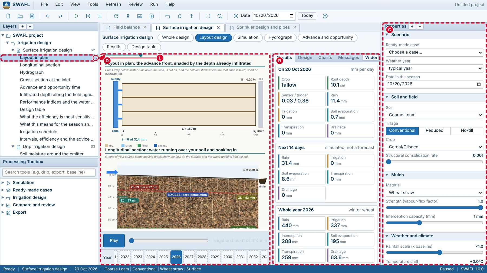{width=100%}

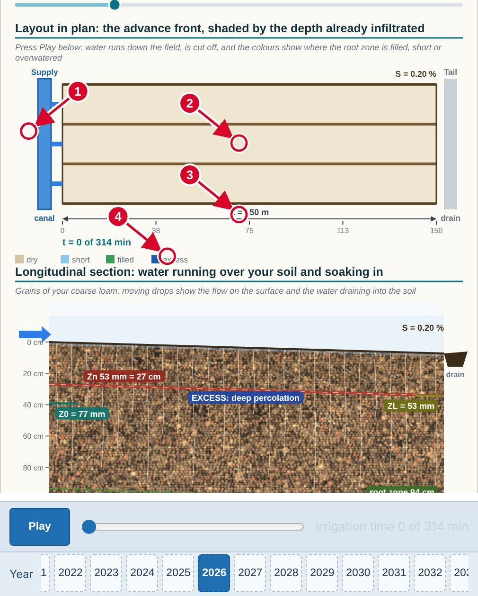{width=70%}

**What the arrows point to.** The dashed outlines in the whole-workbench picture mark the layer chosen in the Layers panel (**L**), the drawing (**D**), the Dashboard (**R**) and the controls in Properties (**C**). In the drawing, each numbered arrow ends on the item it names.

- **1** Supply canal: inflow q enters the strip (flow area A_0 from Manning, Eq. 11.8).
- **2** Strip in plan: front position x(t) from Eq. 11.9; colours show infiltrated depth Z(x) against Z_n, Eq. 11.17.
- **3** Field length L (input).
- **4** Legend dry / short / filled / excess: classes of Z(x) against Z_n, Eq. 11.17.

**Equations behind this screen.** Eq. 5.27, Eq. 11.8, Eq. 11.9, Eq. 11.10, Eq. 11.11, Eq. 11.12, Eq. 11.13.

*Eq. 5.27. Where explained: chapter "The two computing engines", section "Evaporation under warming (used by the E1 layer)".*

$$
Z_n = \mathrm{clip}\bigl(f_T\cdot \mathrm{AWC}\cdot R_{\max};\ 25,\ 150\bigr)\ \mathrm{mm}\qquad(\text{surface; drip and sprinkler use their own limits})
\tag{5.27}
$$

*Provenance (Eq. 5.27):* **[Literature]**: readily available water as in FAO-56 practice, with an engineered clip.

*Eq. 11.8. Where explained: chapter "Surface irrigation design", section "Inlet flow area (Manning)".*

$$
Q = \frac{1}{n}\,A\,R_h^{2/3}\,S^{1/2},\qquad R_h=\frac{A}{P}.
\tag{11.8}
$$

*Provenance (Eq. 11.8):* **[Literature]**: Manning (1891).

*Eq. 11.9. Where explained: chapter "Surface irrigation design", section "Advance (volume balance)".*

$$
Q\,t = \sigma_y\,A_0\,x + \sigma_z\,k\,t^{A}\,w\,x
\ \Longrightarrow\ x(t) = \frac{Q\,t}{\sigma_y A_0 + \sigma_z\,k\,t^{A}\,w}.
\tag{11.9}
$$

*Provenance (Eq. 11.9):* **[Literature]**: volume balance of Walker and Skogerboe (1987) and Elliott and Walker (1982); tested against FAO-45 examples (Paper 3).

*Eq. 11.10. Where explained: chapter "Surface irrigation design", section "Advance (volume balance)".*

$$
\sigma_z = \frac{A + r\,(1 - A) + 1}{(1 + A)(1 + r)},
\tag{11.10}
$$

*Provenance (Eq. 11.10):* **[Literature]**: volume balance of Walker and Skogerboe (1987) and Elliott and Walker (1982); tested against FAO-45 examples (Paper 3).

*Eq. 11.11. Where explained: chapter "Surface irrigation design", section "Advance (volume balance)".*

$$
r = \frac{\ln 2}{\ln (t_L / t_{L/2})},
\tag{11.11}
$$

*Provenance (Eq. 11.11):* **[Literature]**: volume balance of Walker and Skogerboe (1987) and Elliott and Walker (1982); tested against FAO-45 examples (Paper 3).

*Eq. 11.12. Where explained: chapter "Surface irrigation design", section "Advance (volume balance)".*

$$
t_x(x)=t_L\Bigl(\frac{x}{L}\Bigr)^{1/r}\quad\text{(given advance)},\qquad t_x(x)=c\,q^{-q_e}\,x^{x_e}\quad\text{(field advance)}.
\tag{11.12}
$$

*Provenance (Eq. 11.12):* **[Engineered]**: alternative advance models set by worked examples and course notes.

*Eq. 11.13. Where explained: chapter "Surface irrigation design", section "Advance (volume balance)".*

$$
t_L = (1 + 0.15\,A)\,\frac{A_0 L}{Q} + \Bigl(\frac{\sigma_F\,k\,w\,L}{Q}\Bigr)^{\frac{1}{1-A}},\qquad
\sigma_F = \frac{\pi A (1 - A)}{\sin(\pi A)},\qquad t_x(x) = t_{V}(x)\,\frac{t_L}{t_{V}(L)},
\tag{11.13}
$$

*Provenance (Eq. 11.13):* **[Engineered]**: alternative advance models set by worked examples and course notes.

\newpage

### Longitudinal section: water running over your soil and soaking in

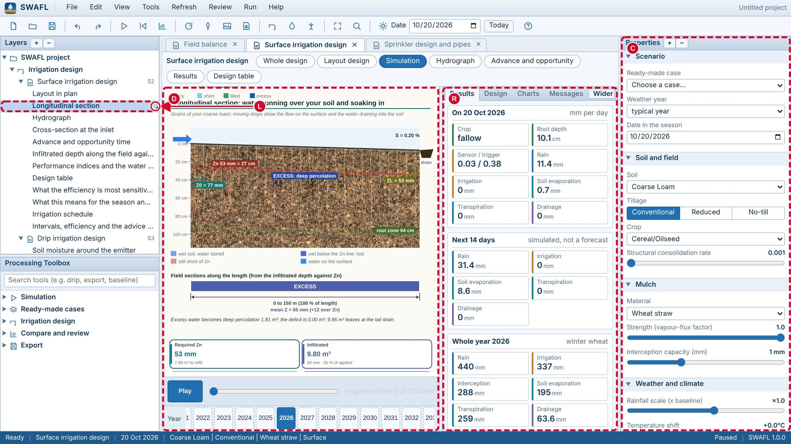{width=100%}

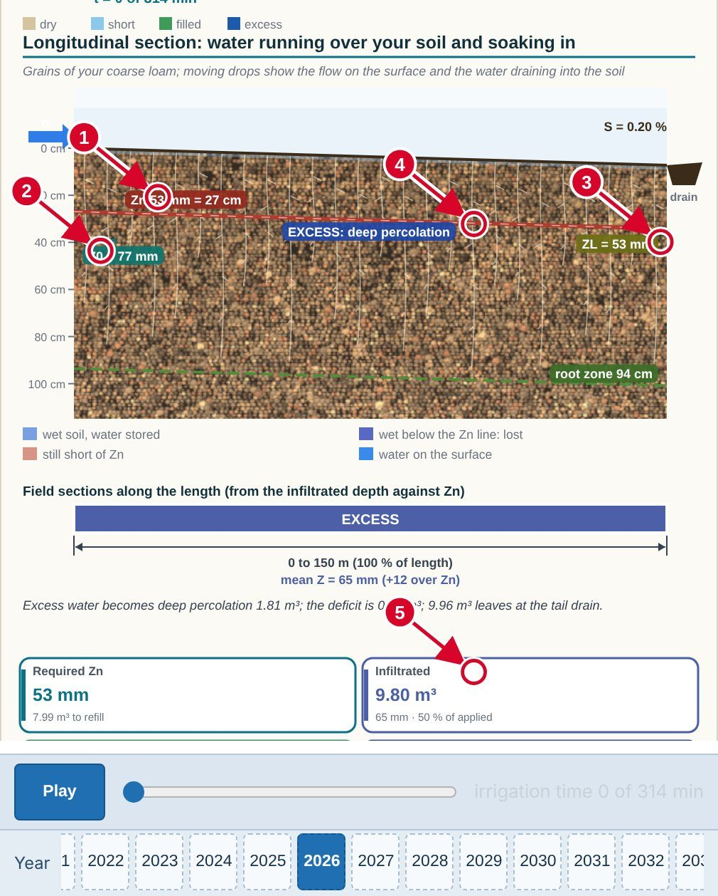{width=70%}

**What the arrows point to.** The dashed outlines in the whole-workbench picture mark the layer chosen in the Layers panel (**L**), the drawing (**D**), the Dashboard (**R**) and the controls in Properties (**C**). In the drawing, each numbered arrow ends on the item it names.

- **1** Z_n line: required depth from the DSS (Eq. 5.27) drawn as depth of wetted soil.
- **2** Z_0: depth infiltrated at the inlet, Eq. 11.17.
- **3** Z_L: depth infiltrated at the tail, Eq. 11.17.
- **4** EXCESS: water below the Z_n line is lost to deep percolation, V_dp of Eq. 11.18.
- **5** Infiltrated volume V_inf (tile at the foot), Eq. 11.18.

**Equations behind this screen.** Eq. 11.6, Eq. 11.9, Eq. 11.10, Eq. 11.11, Eq. 11.12, Eq. 11.13, Eq. 11.15, Eq. 11.16, Eq. 11.17.

*Eq. 11.6. Where explained: chapter "Surface irrigation design", section "Intake from your soil (Saxton–Rawls $\to$ Green–Ampt $\to$ Kostiakov)".*

$$
Z(\tau) = k\,\tau^{A}\qquad (Z\ \text{in m},\ \tau\ \text{in min}),
\tag{11.6}
$$

*Provenance (Eq. 11.6):* **[Literature]**: Kostiakov (1932).

*Eq. 11.9. Where explained: chapter "Surface irrigation design", section "Advance (volume balance)".*

$$
Q\,t = \sigma_y\,A_0\,x + \sigma_z\,k\,t^{A}\,w\,x
\ \Longrightarrow\ x(t) = \frac{Q\,t}{\sigma_y A_0 + \sigma_z\,k\,t^{A}\,w}.
\tag{11.9}
$$

*Provenance (Eq. 11.9):* **[Literature]**: volume balance of Walker and Skogerboe (1987) and Elliott and Walker (1982); tested against FAO-45 examples (Paper 3).

*Eq. 11.10. Where explained: chapter "Surface irrigation design", section "Advance (volume balance)".*

$$
\sigma_z = \frac{A + r\,(1 - A) + 1}{(1 + A)(1 + r)},
\tag{11.10}
$$

*Provenance (Eq. 11.10):* **[Literature]**: volume balance of Walker and Skogerboe (1987) and Elliott and Walker (1982); tested against FAO-45 examples (Paper 3).

*Eq. 11.11. Where explained: chapter "Surface irrigation design", section "Advance (volume balance)".*

$$
r = \frac{\ln 2}{\ln (t_L / t_{L/2})},
\tag{11.11}
$$

*Provenance (Eq. 11.11):* **[Literature]**: volume balance of Walker and Skogerboe (1987) and Elliott and Walker (1982); tested against FAO-45 examples (Paper 3).

*Eq. 11.12. Where explained: chapter "Surface irrigation design", section "Advance (volume balance)".*

$$
t_x(x)=t_L\Bigl(\frac{x}{L}\Bigr)^{1/r}\quad\text{(given advance)},\qquad t_x(x)=c\,q^{-q_e}\,x^{x_e}\quad\text{(field advance)}.
\tag{11.12}
$$

*Provenance (Eq. 11.12):* **[Engineered]**: alternative advance models set by worked examples and course notes.

*Eq. 11.13. Where explained: chapter "Surface irrigation design", section "Advance (volume balance)".*

$$
t_L = (1 + 0.15\,A)\,\frac{A_0 L}{Q} + \Bigl(\frac{\sigma_F\,k\,w\,L}{Q}\Bigr)^{\frac{1}{1-A}},\qquad
\sigma_F = \frac{\pi A (1 - A)}{\sin(\pi A)},\qquad t_x(x) = t_{V}(x)\,\frac{t_L}{t_{V}(L)},
\tag{11.13}
$$

*Provenance (Eq. 11.13):* **[Engineered]**: alternative advance models set by worked examples and course notes.

*Eq. 11.15. Where explained: chapter "Surface irrigation design", section "Cut-off, opportunity time and the infiltrated depth".*

$$
t_{st} = \Bigl(\frac{Z_n}{k}\Bigr)^{1/A}.
\tag{11.15}
$$

*Provenance (Eq. 11.15):* **[Literature]**: inversion of the Kostiakov law.

*Eq. 11.16. Where explained: chapter "Surface irrigation design", section "Cut-off, opportunity time and the infiltrated depth".*

$$
t_{co} = \begin{cases}
t_L + t_{st} & \text{“}E_s=1\text{”: the tail receives exactly } Z_n\\
t_x(0.85\,L) + t_{st} & \text{“85 \% of L”}\\
t_{co}^{\,\mathrm{set}} & \text{“Manual”}
\end{cases}
\tag{11.16}
$$

*Provenance (Eq. 11.16):* **[Engineered]**: cut-off rules chosen as design options.

*Eq. 11.17. Where explained: chapter "Surface irrigation design", section "Cut-off, opportunity time and the infiltrated depth".*

$$
Z(x) = k\,\bigl[t_{co} - t_x(x)\bigr]^{A},\quad Z_0 = k\,t_{co}^{A}\ (\text{inlet}),\qquad Z_L = k\,(t_{co}-t_L)^{A}\ (\text{tail}).
\tag{11.17}
$$

*Provenance (Eq. 11.17):* **[Literature]**: standard opportunity-time and performance-index definitions (Walker and Skogerboe, 1987; Burt et al., 1997).

\newpage

### Hydrograph: inflow, infiltration and runoff through time

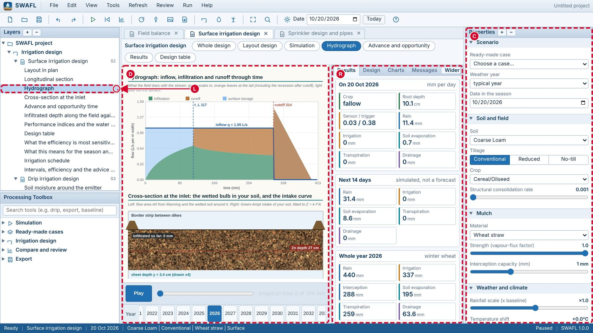{width=100%}

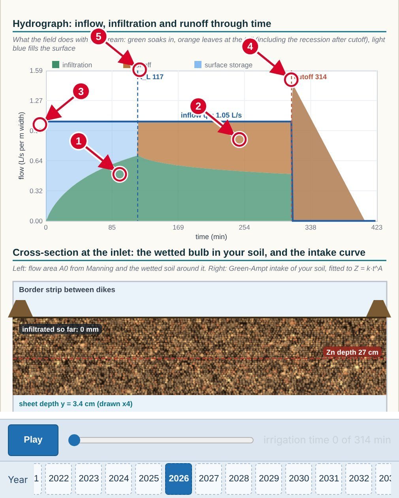{width=70%}

**What the arrows point to.** The dashed outlines in the whole-workbench picture mark the layer chosen in the Layers panel (**L**), the drawing (**D**), the Dashboard (**R**) and the controls in Properties (**C**). In the drawing, each numbered arrow ends on the item it names.

- **1** Green: infiltration I(t): Eq. 11.20.
- **2** Orange: runoff R(t) with its recession after cut-off: Eqs. 11.20 and 11.21.
- **3** Blue: water stored on the surface: Eq. 11.21.
- **4** Cut-off time t_co: Eq. 11.16.
- **5** t_L: advance time to the tail, Eq. 11.9.

**Equations behind this screen.** Eq. 11.18, Eq. 11.20, Eq. 11.21.

*Eq. 11.18. Where explained: chapter "Surface irrigation design", section "Volumes, efficiencies and uniformity".*

$$
\begin{aligned}
V_{\mathrm{app}} &= Q\,t_{co}\quad\bigl(\text{with cutback } c_b<1:\ Q\,t_L + c_b\,Q\,(t_{co}-t_L)\bigr), & V_{\mathrm{req}} &= Z_n\,L\,w,\\
V_{\mathrm{inf}} &= w\!\int_0^L Z\,dx, & V_{\mathrm{st}} &= w\!\int_0^L \min(Z, Z_n)\,dx,\\
V_{\mathrm{dp}} &= w\!\int_0^L \max(Z-Z_n,0)\,dx, & V_{\mathrm{df}} &= w\!\int_0^L \max(Z_n - Z,0)\,dx,\\
V_{\mathrm{ro}} &= \max(V_{\mathrm{app}} - V_{\mathrm{inf}},\ 0).
\end{aligned}
\tag{11.18}
$$

*Provenance (Eq. 11.18):* **[Literature]**: standard opportunity-time and performance-index definitions (Walker and Skogerboe, 1987; Burt et al., 1997).

*Eq. 11.20. Where explained: chapter "Surface irrigation design", section "Hydrograph".*

$$
V_c(t) = w\sum_i k\,\bigl[\min(t,t_{co}) - \bar t_{x,i}\bigr]_{+}^{A}\,\Delta x\ \cdot s_c,\qquad
s_c = \frac{V_{\mathrm{inf}}}{V_c(t_{co})},\qquad I(t)=\frac{dV_c}{dt},
\tag{11.20}
$$

*Provenance (Eq. 11.20):* **[Engineered]**: hydrograph shapes chosen for drawing; volume conserving.

*Eq. 11.21. Where explained: chapter "Surface irrigation design", section "Hydrograph".*

$$
R(t) = \frac{2V_s}{t_r}\Bigl(1 - \frac{t - t_{co}}{t_r}\Bigr),\quad t_{co}<t<t_{co}+t_r.
\tag{11.21}
$$

*Provenance (Eq. 11.21):* **[Engineered]**: hydrograph shapes chosen for drawing; volume conserving.

\newpage

### Cross-section at the inlet: the wetted bulb in your soil, and the intake curve

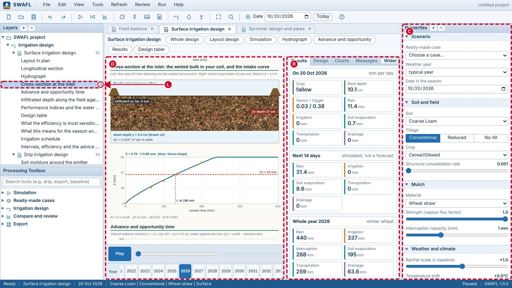{width=100%}

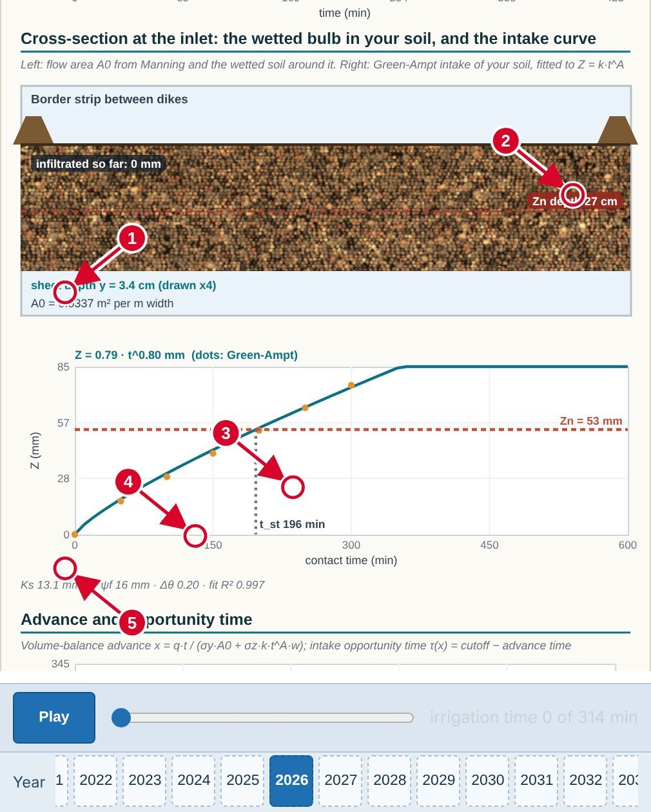{width=70%}

**What the arrows point to.** The dashed outlines in the whole-workbench picture mark the layer chosen in the Layers panel (**L**), the drawing (**D**), the Dashboard (**R**) and the controls in Properties (**C**). In the drawing, each numbered arrow ends on the item it names.

- **1** Sheet depth and flow area A_0 from Manning: Eq. 11.8.
- **2** Z_n depth: the required depth Z_n as a depth of wetted soil (storage of Eq. 11.4).
- **3** Intake curve Z = k tau^A fitted to Green-Ampt: Eqs. 11.5 to 11.7.
- **4** t_st: time to infiltrate the required depth, Eq. 11.15.
- **5** Ks, psi_f and Delta theta of the soil: Eqs. 11.2 to 11.4.

**Equations behind this screen.** Eq. 5.27, Eq. 11.1, Eq. 11.2, Eq. 11.3, Eq. 11.4, Eq. 11.5, Eq. 11.6, Eq. 11.7.

*Eq. 5.27. Where explained: chapter "The two computing engines", section "Evaporation under warming (used by the E1 layer)".*

$$
Z_n = \mathrm{clip}\bigl(f_T\cdot \mathrm{AWC}\cdot R_{\max};\ 25,\ 150\bigr)\ \mathrm{mm}\qquad(\text{surface; drip and sprinkler use their own limits})
\tag{5.27}
$$

*Provenance (Eq. 5.27):* **[Literature]**: readily available water as in FAO-56 practice, with an engineered clip.

*Eq. 11.1. Where explained: chapter "Surface irrigation design", section "Intake from your soil (Saxton–Rawls $\to$ Green–Ampt $\to$ Kostiakov)".*

$$
\begin{aligned}
\theta_{1500,t} &= -0.024\,S + 0.487\,C + 0.006\,\mathrm{OM} + 0.005\,S\,\mathrm{OM} - 0.013\,C\,\mathrm{OM} + 0.068\,S\,C + 0.031,\\
\theta_{1500} &= \theta_{1500,t} + \bigl(0.14\,\theta_{1500,t} - 0.02\bigr),\\
\theta_{33,t} &= -0.251\,S + 0.195\,C + 0.011\,\mathrm{OM} + 0.006\,S\,\mathrm{OM} - 0.027\,C\,\mathrm{OM} + 0.452\,S\,C + 0.299,\\
\theta_{33} &= \theta_{33,t} + \bigl(1.283\,\theta_{33,t}^{2} - 0.374\,\theta_{33,t} - 0.015\bigr),
\end{aligned}
\tag{11.1}
$$

*Provenance (Eq. 11.1):* **[Literature]**: Saxton and Rawls (2006), implemented as written.

*Eq. 11.2. Where explained: chapter "Surface irrigation design", section "Intake from your soil (Saxton–Rawls $\to$ Green–Ampt $\to$ Kostiakov)".*

$$
\begin{aligned}
\theta_{(S-33),t} &= 0.278\,S + 0.034\,C + 0.022\,\mathrm{OM} - 0.018\,S\,\mathrm{OM} - 0.027\,C\,\mathrm{OM} - 0.584\,S\,C + 0.078,\\
\theta_{(S-33)} &= \theta_{(S-33),t} + \bigl(0.636\,\theta_{(S-33),t} - 0.107\bigr),\qquad
\theta_{s} = \theta_{33} + \theta_{(S-33)} - 0.097\,S + 0.043,\\
B &= \frac{\ln 1500 - \ln 33}{\ln\theta_{33} - \ln\theta_{1500}},\qquad \lambda = \frac1B,\qquad
K_s = 1930\,(\theta_s - \theta_{33})^{\,3-\lambda}.
\end{aligned}
\tag{11.2}
$$

*Provenance (Eq. 11.2):* **[Literature]**: Saxton and Rawls (2006), implemented as written.

*Eq. 11.3. Where explained: chapter "Surface irrigation design", section "Intake from your soil (Saxton–Rawls $\to$ Green–Ampt $\to$ Kostiakov)".*

$$
\psi_f = \frac{10}{\alpha}\,\frac{0.046\,m + 2.07\,m^{2} + 19.5\,m^{3}}{1 + 4.7\,m + 16\,m^{2}}.
\tag{11.3}
$$

*Provenance (Eq. 11.3):* **[Engineered]**: rational-polynomial approximation of a Rawls-type suction.

*Eq. 11.4. Where explained: chapter "Surface irrigation design", section "Intake from your soil (Saxton–Rawls $\to$ Green–Ampt $\to$ Kostiakov)".*

$$
\theta_0 = \theta_{fc} - f_T\,(\theta_{fc} - \theta_{wp}),\qquad
\Delta\theta = \max\{0.05,\ 0.95\,\theta_s - \theta_0\}.
\tag{11.4}
$$

*Provenance (Eq. 11.4):* **[Engineered]**: initial and wetted water contents chosen for the workbench.

*Eq. 11.5. Where explained: chapter "Surface irrigation design", section "Intake from your soil (Saxton–Rawls $\to$ Green–Ampt $\to$ Kostiakov)".*

$$
F - \psi_f\,\Delta\theta\,\ln\!\Bigl(1 + \frac{F}{\psi_f\,\Delta\theta}\Bigr) = K_s\,\frac{t}{60}\quad(t\ \text{in min}),
\tag{11.5}
$$

*Provenance (Eq. 11.5):* **[Literature]**: Green and Ampt (1911).

*Eq. 11.6. Where explained: chapter "Surface irrigation design", section "Intake from your soil (Saxton–Rawls $\to$ Green–Ampt $\to$ Kostiakov)".*

$$
Z(\tau) = k\,\tau^{A}\qquad (Z\ \text{in m},\ \tau\ \text{in min}),
\tag{11.6}
$$

*Provenance (Eq. 11.6):* **[Literature]**: Kostiakov (1932).

*Eq. 11.7. Where explained: chapter "Surface irrigation design", section "Intake from your soil (Saxton–Rawls $\to$ Green–Ampt $\to$ Kostiakov)".*

$$
A = \frac{\sum (x_i - \bar x)(y_i - \bar y)}{\sum (x_i - \bar x)^2},\quad
\ln k = \bar y - A\,\bar x,\qquad x_i=\ln\tau_i,\ y_i=\ln\bigl(F(\tau_i)/1000\bigr),
\tag{11.7}
$$

*Provenance (Eq. 11.7):* **[Literature]**: ordinary least squares on the log--log plot.

\newpage

### Advance and opportunity time

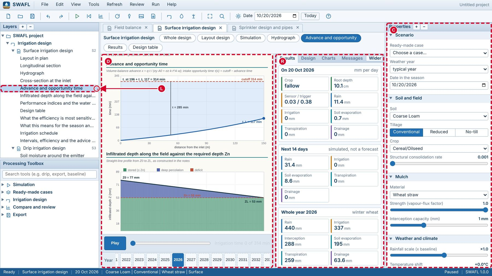{width=100%}

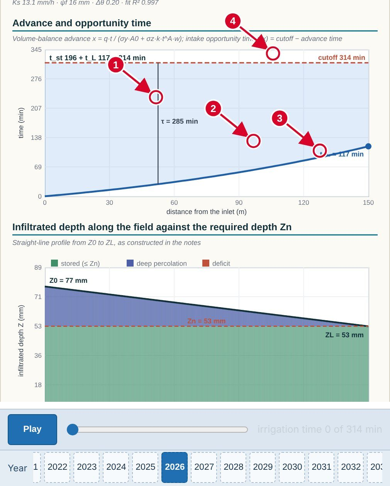{width=70%}

**What the arrows point to.** The dashed outlines in the whole-workbench picture mark the layer chosen in the Layers panel (**L**), the drawing (**D**), the Dashboard (**R**) and the controls in Properties (**C**). In the drawing, each numbered arrow ends on the item it names.

- **1** Opportunity time tau = t_co - t_x: Eq. 11.17.
- **2** Advance curve x(t) from the volume balance: Eq. 11.9.
- **3** t_L: time for the front to reach the tail.
- **4** Cut-off 314 min = t_st + t_L: Eqs. 11.15 and 11.16.

**Equations behind this screen.** Eq. 11.6, Eq. 11.9, Eq. 11.10, Eq. 11.11, Eq. 11.12, Eq. 11.13, Eq. 11.15, Eq. 11.16, Eq. 11.17.

*Eq. 11.6. Where explained: chapter "Surface irrigation design", section "Intake from your soil (Saxton–Rawls $\to$ Green–Ampt $\to$ Kostiakov)".*

$$
Z(\tau) = k\,\tau^{A}\qquad (Z\ \text{in m},\ \tau\ \text{in min}),
\tag{11.6}
$$

*Provenance (Eq. 11.6):* **[Literature]**: Kostiakov (1932).

*Eq. 11.9. Where explained: chapter "Surface irrigation design", section "Advance (volume balance)".*

$$
Q\,t = \sigma_y\,A_0\,x + \sigma_z\,k\,t^{A}\,w\,x
\ \Longrightarrow\ x(t) = \frac{Q\,t}{\sigma_y A_0 + \sigma_z\,k\,t^{A}\,w}.
\tag{11.9}
$$

*Provenance (Eq. 11.9):* **[Literature]**: volume balance of Walker and Skogerboe (1987) and Elliott and Walker (1982); tested against FAO-45 examples (Paper 3).

*Eq. 11.10. Where explained: chapter "Surface irrigation design", section "Advance (volume balance)".*

$$
\sigma_z = \frac{A + r\,(1 - A) + 1}{(1 + A)(1 + r)},
\tag{11.10}
$$

*Provenance (Eq. 11.10):* **[Literature]**: volume balance of Walker and Skogerboe (1987) and Elliott and Walker (1982); tested against FAO-45 examples (Paper 3).

*Eq. 11.11. Where explained: chapter "Surface irrigation design", section "Advance (volume balance)".*

$$
r = \frac{\ln 2}{\ln (t_L / t_{L/2})},
\tag{11.11}
$$

*Provenance (Eq. 11.11):* **[Literature]**: volume balance of Walker and Skogerboe (1987) and Elliott and Walker (1982); tested against FAO-45 examples (Paper 3).

*Eq. 11.12. Where explained: chapter "Surface irrigation design", section "Advance (volume balance)".*

$$
t_x(x)=t_L\Bigl(\frac{x}{L}\Bigr)^{1/r}\quad\text{(given advance)},\qquad t_x(x)=c\,q^{-q_e}\,x^{x_e}\quad\text{(field advance)}.
\tag{11.12}
$$

*Provenance (Eq. 11.12):* **[Engineered]**: alternative advance models set by worked examples and course notes.

*Eq. 11.13. Where explained: chapter "Surface irrigation design", section "Advance (volume balance)".*

$$
t_L = (1 + 0.15\,A)\,\frac{A_0 L}{Q} + \Bigl(\frac{\sigma_F\,k\,w\,L}{Q}\Bigr)^{\frac{1}{1-A}},\qquad
\sigma_F = \frac{\pi A (1 - A)}{\sin(\pi A)},\qquad t_x(x) = t_{V}(x)\,\frac{t_L}{t_{V}(L)},
\tag{11.13}
$$

*Provenance (Eq. 11.13):* **[Engineered]**: alternative advance models set by worked examples and course notes.

*Eq. 11.15. Where explained: chapter "Surface irrigation design", section "Cut-off, opportunity time and the infiltrated depth".*

$$
t_{st} = \Bigl(\frac{Z_n}{k}\Bigr)^{1/A}.
\tag{11.15}
$$

*Provenance (Eq. 11.15):* **[Literature]**: inversion of the Kostiakov law.

*Eq. 11.16. Where explained: chapter "Surface irrigation design", section "Cut-off, opportunity time and the infiltrated depth".*

$$
t_{co} = \begin{cases}
t_L + t_{st} & \text{“}E_s=1\text{”: the tail receives exactly } Z_n\\
t_x(0.85\,L) + t_{st} & \text{“85 \% of L”}\\
t_{co}^{\,\mathrm{set}} & \text{“Manual”}
\end{cases}
\tag{11.16}
$$

*Provenance (Eq. 11.16):* **[Engineered]**: cut-off rules chosen as design options.

*Eq. 11.17. Where explained: chapter "Surface irrigation design", section "Cut-off, opportunity time and the infiltrated depth".*

$$
Z(x) = k\,\bigl[t_{co} - t_x(x)\bigr]^{A},\quad Z_0 = k\,t_{co}^{A}\ (\text{inlet}),\qquad Z_L = k\,(t_{co}-t_L)^{A}\ (\text{tail}).
\tag{11.17}
$$

*Provenance (Eq. 11.17):* **[Literature]**: standard opportunity-time and performance-index definitions (Walker and Skogerboe, 1987; Burt et al., 1997).

\newpage

### Infiltrated depth along the field against the required depth Zn

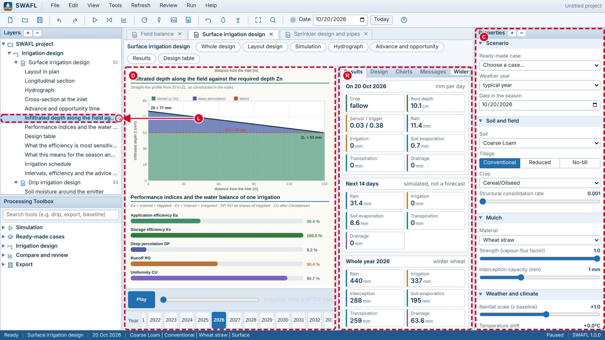{width=100%}

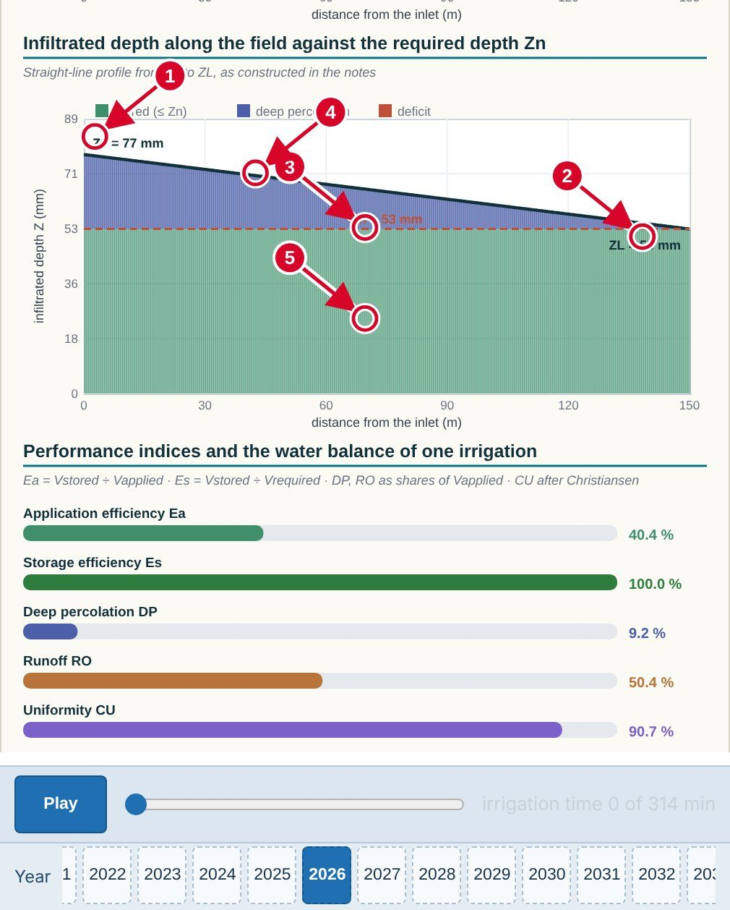{width=70%}

**What the arrows point to.** The dashed outlines in the whole-workbench picture mark the layer chosen in the Layers panel (**L**), the drawing (**D**), the Dashboard (**R**) and the controls in Properties (**C**). In the drawing, each numbered arrow ends on the item it names.

- **1** Z_0: depth at the inlet, Eq. 11.17.
- **2** Z_L: depth at the tail, Eq. 11.17.
- **3** Z_n: required depth, Eq. 5.27.
- **4** Indigo: depth above Z_n, lost to deep percolation, V_dp of Eq. 11.18.
- **5** Green: water stored in the root zone, V_st of Eq. 11.18.

**Equations behind this screen.** Eq. 11.6, Eq. 11.15, Eq. 11.16, Eq. 11.17.

*Eq. 11.6. Where explained: chapter "Surface irrigation design", section "Intake from your soil (Saxton–Rawls $\to$ Green–Ampt $\to$ Kostiakov)".*

$$
Z(\tau) = k\,\tau^{A}\qquad (Z\ \text{in m},\ \tau\ \text{in min}),
\tag{11.6}
$$

*Provenance (Eq. 11.6):* **[Literature]**: Kostiakov (1932).

*Eq. 11.15. Where explained: chapter "Surface irrigation design", section "Cut-off, opportunity time and the infiltrated depth".*

$$
t_{st} = \Bigl(\frac{Z_n}{k}\Bigr)^{1/A}.
\tag{11.15}
$$

*Provenance (Eq. 11.15):* **[Literature]**: inversion of the Kostiakov law.

*Eq. 11.16. Where explained: chapter "Surface irrigation design", section "Cut-off, opportunity time and the infiltrated depth".*

$$
t_{co} = \begin{cases}
t_L + t_{st} & \text{“}E_s=1\text{”: the tail receives exactly } Z_n\\
t_x(0.85\,L) + t_{st} & \text{“85 \% of L”}\\
t_{co}^{\,\mathrm{set}} & \text{“Manual”}
\end{cases}
\tag{11.16}
$$

*Provenance (Eq. 11.16):* **[Engineered]**: cut-off rules chosen as design options.

*Eq. 11.17. Where explained: chapter "Surface irrigation design", section "Cut-off, opportunity time and the infiltrated depth".*

$$
Z(x) = k\,\bigl[t_{co} - t_x(x)\bigr]^{A},\quad Z_0 = k\,t_{co}^{A}\ (\text{inlet}),\qquad Z_L = k\,(t_{co}-t_L)^{A}\ (\text{tail}).
\tag{11.17}
$$

*Provenance (Eq. 11.17):* **[Literature]**: standard opportunity-time and performance-index definitions (Walker and Skogerboe, 1987; Burt et al., 1997).

\newpage

### Performance indices and the water balance of one irrigation

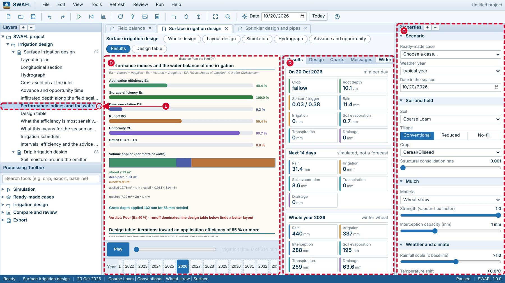{width=100%}

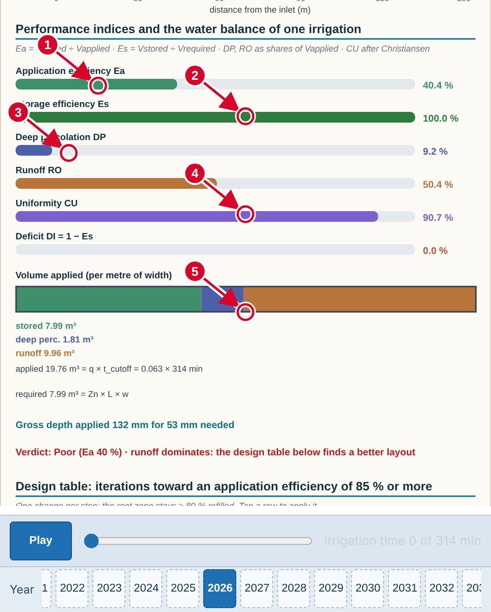{width=70%}

**What the arrows point to.** The dashed outlines in the whole-workbench picture mark the layer chosen in the Layers panel (**L**), the drawing (**D**), the Dashboard (**R**) and the controls in Properties (**C**). In the drawing, each numbered arrow ends on the item it names.

- **1** Application efficiency E_a = V_st / V_app: Eq. 11.19.
- **2** Storage efficiency E_s = V_st / V_req: Eq. 11.19.
- **3** Deep percolation DP and runoff RO as shares of the applied volume: Eq. 11.19.
- **4** Uniformity CU after Christiansen: Eq. 11.19.
- **5** Volumes applied, stored, percolated and run off: Eq. 11.18.

**Equations behind this screen.** Eq. 11.18, Eq. 11.19.

*Eq. 11.18. Where explained: chapter "Surface irrigation design", section "Volumes, efficiencies and uniformity".*

$$
\begin{aligned}
V_{\mathrm{app}} &= Q\,t_{co}\quad\bigl(\text{with cutback } c_b<1:\ Q\,t_L + c_b\,Q\,(t_{co}-t_L)\bigr), & V_{\mathrm{req}} &= Z_n\,L\,w,\\
V_{\mathrm{inf}} &= w\!\int_0^L Z\,dx, & V_{\mathrm{st}} &= w\!\int_0^L \min(Z, Z_n)\,dx,\\
V_{\mathrm{dp}} &= w\!\int_0^L \max(Z-Z_n,0)\,dx, & V_{\mathrm{df}} &= w\!\int_0^L \max(Z_n - Z,0)\,dx,\\
V_{\mathrm{ro}} &= \max(V_{\mathrm{app}} - V_{\mathrm{inf}},\ 0).
\end{aligned}
\tag{11.18}
$$

*Provenance (Eq. 11.18):* **[Literature]**: standard opportunity-time and performance-index definitions (Walker and Skogerboe, 1987; Burt et al., 1997).

*Eq. 11.19. Where explained: chapter "Surface irrigation design", section "Volumes, efficiencies and uniformity".*

$$
E_a = \frac{V_{\mathrm{st}}}{V_{\mathrm{app}}},\quad
E_s = \frac{V_{\mathrm{st}}}{V_{\mathrm{req}}},\quad
\mathrm{DP} = \frac{V_{\mathrm{dp}}}{V_{\mathrm{app}}},\quad
\mathrm{RO} = \frac{V_{\mathrm{ro}}}{V_{\mathrm{app}}},\quad
\mathrm{CU} = 100\Bigl(1 - \frac{\tfrac{1}{N+1}\sum_{i=0}^{N}|Z_i-\bar Z|}{\bar Z}\Bigr)\ \%.
\tag{11.19}
$$

*Provenance (Eq. 11.19):* **[Literature]**: standard opportunity-time and performance-index definitions (Walker and Skogerboe, 1987; Burt et al., 1997).

\newpage

### Design table: iterations toward an application efficiency of 85 % or more

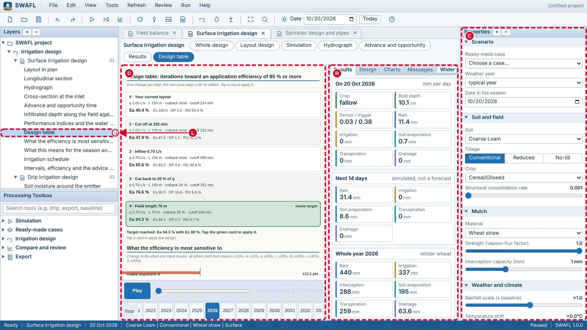{width=100%}

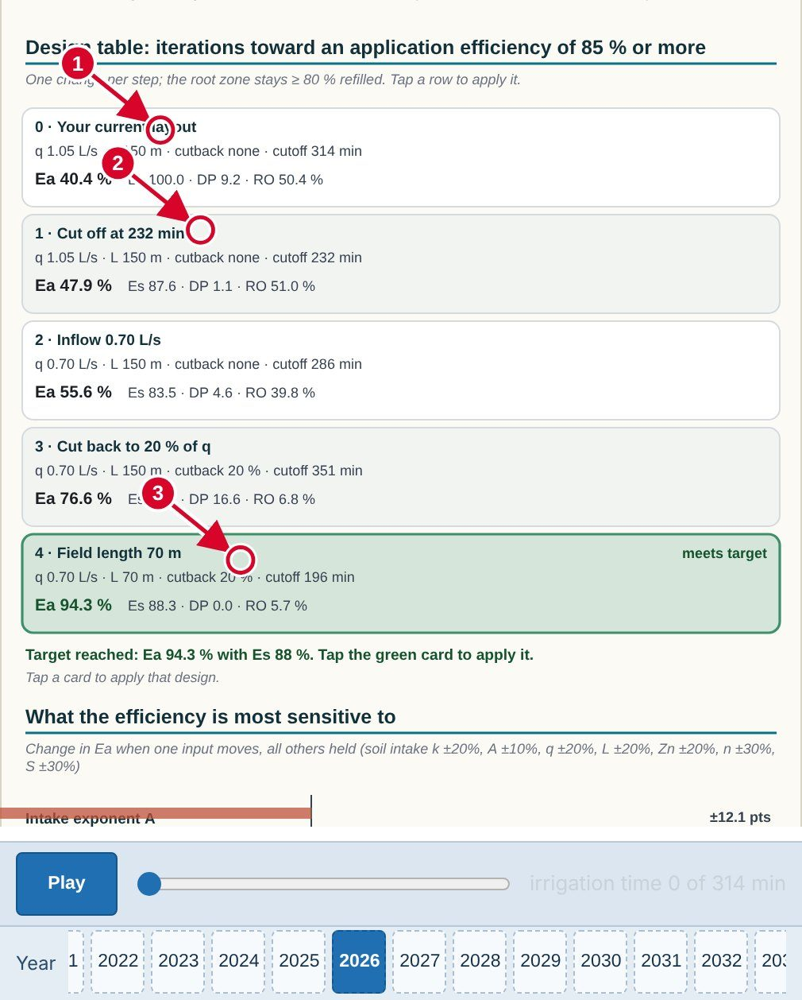{width=70%}

**What the arrows point to.** The dashed outlines in the whole-workbench picture mark the layer chosen in the Layers panel (**L**), the drawing (**D**), the Dashboard (**R**) and the controls in Properties (**C**). In the drawing, each numbered arrow ends on the item it names.

- **1** Row 0: your current layout; its score is Eq. 11.23.
- **2** Candidate moves in cut-off time, Eq. 11.16, then inflow (Eq. 11.22), cutback and length.
- **3** Winning design: E_a of at least 85 % with E_s of at least 80 %, chosen by the score of Eq. 11.23.

**Equations behind this screen.** Eq. 11.22, Eq. 11.23.

*Eq. 11.22. Where explained: chapter "Surface irrigation design", section "Best inflow ("Your soil" mode)".*

$$
q_{\max} = \min\Bigl\{q_{\max}^{\mathrm{sys}},\ \frac{0.04}{S}\cdot\frac{1000}{60}\Bigr\}\ \mathrm{L\,s^{-1}}\quad(S\ \text{in \%}),
\tag{11.22}
$$

*Provenance (Eq. 11.22):* **[Engineered]**: search limit; the furrow stream limit follows Criddle et al. (1956).

*Eq. 11.23. Where explained: chapter "Surface irrigation design", section "The design table".*

$$
\mathrm{score} = \min(E_a,1) - 3\max(0,\,0.8 - E_s) - 3\,[c_b<1]\,\max(0,\,0.05 - \mathrm{RO}) - 5\max(0,\,E_a-1).
\tag{11.23}
$$

*Provenance (Eq. 11.23):* **[Engineered]**: optimisation score and seasonal bookkeeping chosen for the workbench.

\newpage

### What the efficiency is most sensitive to

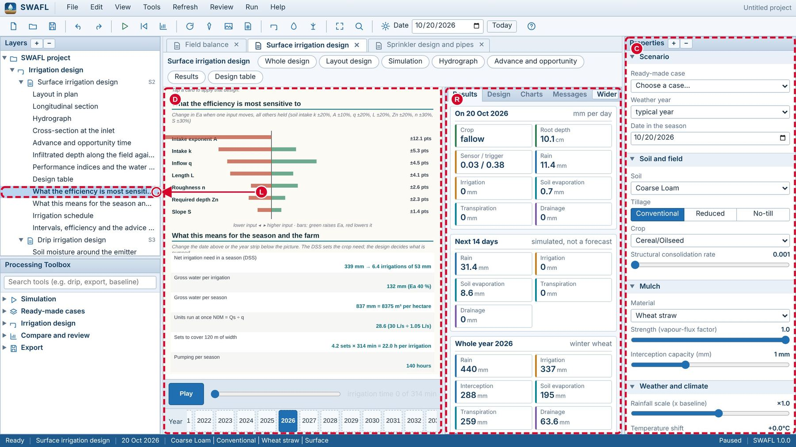{width=100%}

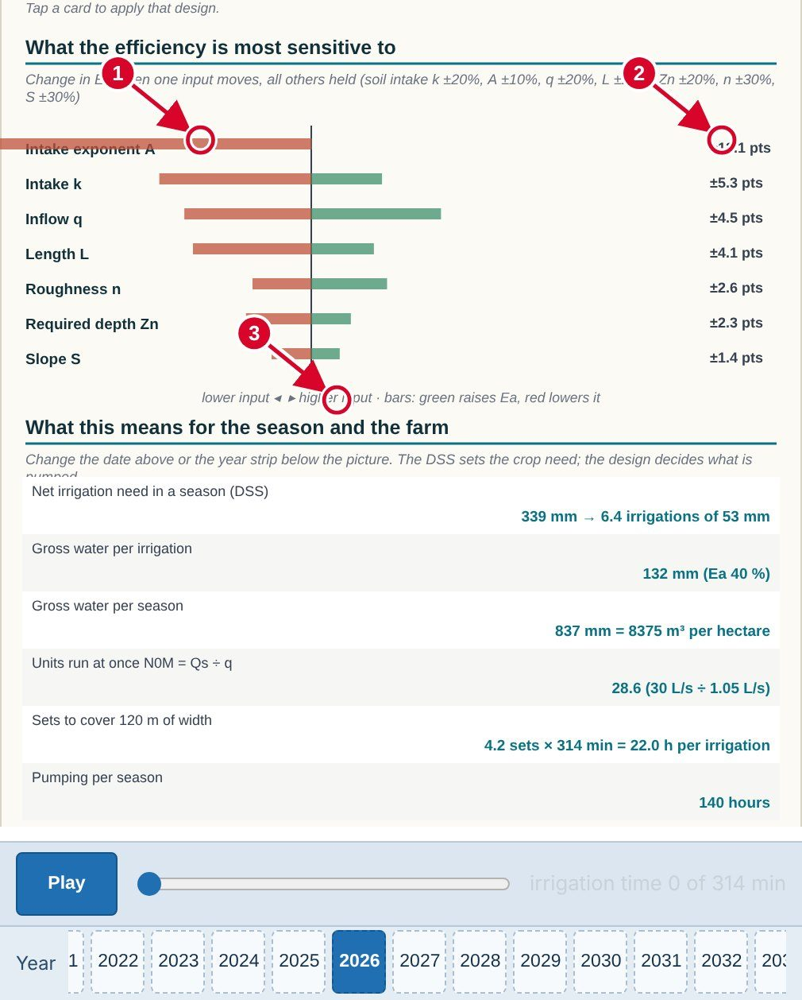{width=70%}

**What the arrows point to.** The dashed outlines in the whole-workbench picture mark the layer chosen in the Layers panel (**L**), the drawing (**D**), the Dashboard (**R**) and the controls in Properties (**C**). In the drawing, each numbered arrow ends on the item it names.

- **1** Tornado bar: change in E_a (Eq. 11.19) when this input moves by 10 to 30 %.
- **2** Size of the change in percentage points.
- **3** Green raises E_a, red lowers it.

**Equations behind this screen.** none (the screen shows stored results).

\newpage

### What this means for the season and the farm

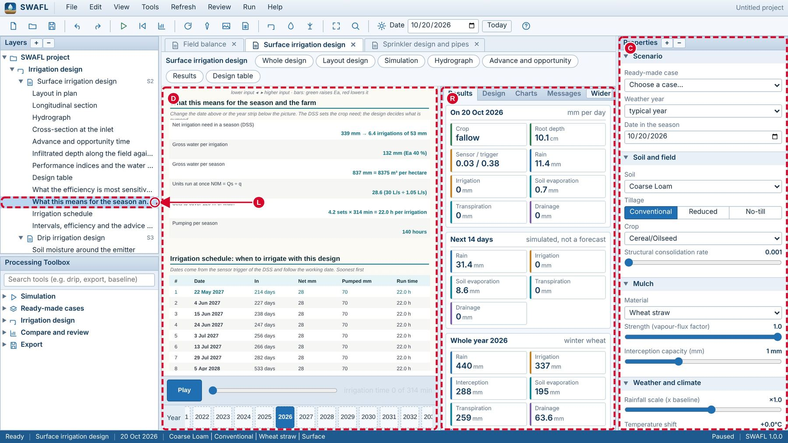{width=100%}

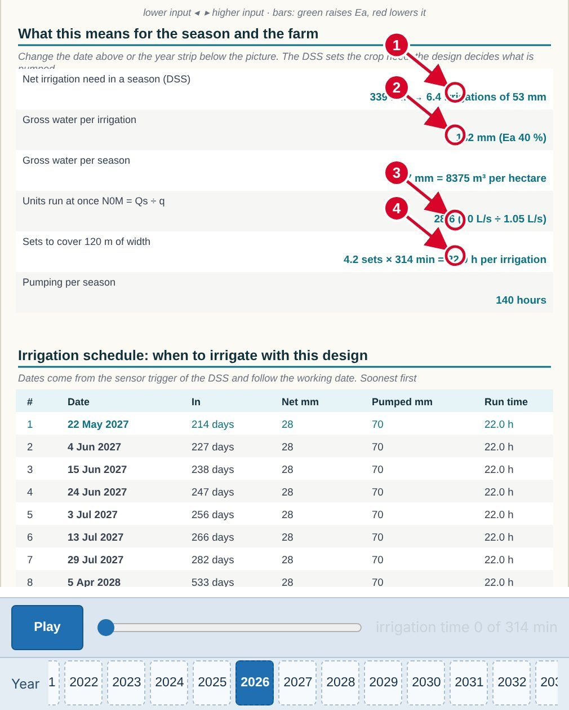{width=70%}

**What the arrows point to.** The dashed outlines in the whole-workbench picture mark the layer chosen in the Layers panel (**L**), the drawing (**D**), the Dashboard (**R**) and the controls in Properties (**C**). In the drawing, each numbered arrow ends on the item it names.

- **1** Irrigations in a season, n_ev = sum I / Z_n: Eq. 11.24.
- **2** Gross depth per irrigation, Z_g = Z_n / E_a: Eq. 11.24.
- **3** Units run at once, Q_s / q: Eq. 11.24.
- **4** Sets and hours per irrigation: Eq. 11.24.

**Equations behind this screen.** Eq. 11.24.

*Eq. 11.24. Where explained: chapter "Surface irrigation design", section "Season and farm".*

$$
\begin{aligned}
n_{\mathrm{ev}} &= \sum I\,/\,Z_n, & Z_g &= \frac{V_{\mathrm{app}}}{L\,w}\times1000\ \ (\mathrm{mm}), & Z_{\mathrm{season}} &= n_{\mathrm{ev}}\,Z_g,\\
N_{0M} &= \frac{Q_s}{q}, & N_{\mathrm{units}} &= \frac{W_f}{w},\quad N_{\mathrm{sets}}=\max\Bigl(1,\frac{N_{\mathrm{units}}}{N_{0M}}\Bigr), & T_{\mathrm{tot}} &= \frac{N_{\mathrm{sets}}\,t_{co}}{60}\ \ (\mathrm h),
\end{aligned}
\tag{11.24}
$$

*Provenance (Eq. 11.24):* **[Engineered]**: optimisation score and seasonal bookkeeping chosen for the workbench.

\newpage

### Irrigation schedule: when to irrigate with this design

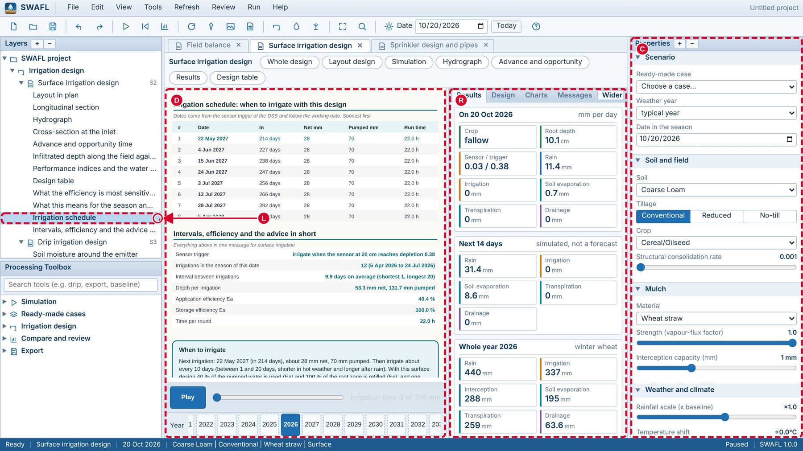{width=100%}

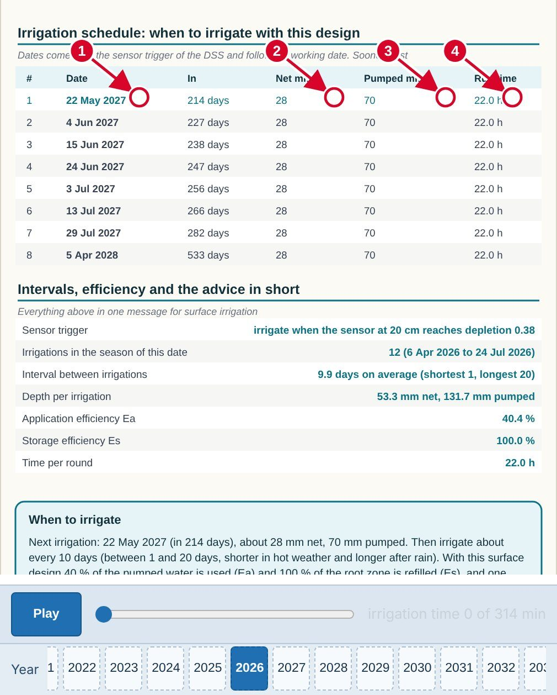{width=70%}

**What the arrows point to.** The dashed outlines in the whole-workbench picture mark the layer chosen in the Layers panel (**L**), the drawing (**D**), the Dashboard (**R**) and the controls in Properties (**C**). In the drawing, each numbered arrow ends on the item it names.

- **1** Dates: from the Engine 2 irrigation record of the analogue year (Eqs. 4.1 and 4.2).
- **2** Net mm, I_k: the DSS irrigation depth that day.
- **3** Pumped mm = I_k / E_a: Eq. 11.24.
- **4** Run time of one round: Eq. 11.24.

**Equations behind this screen.** none (the screen shows stored results).

\newpage

### Intervals, efficiency and the advice in short

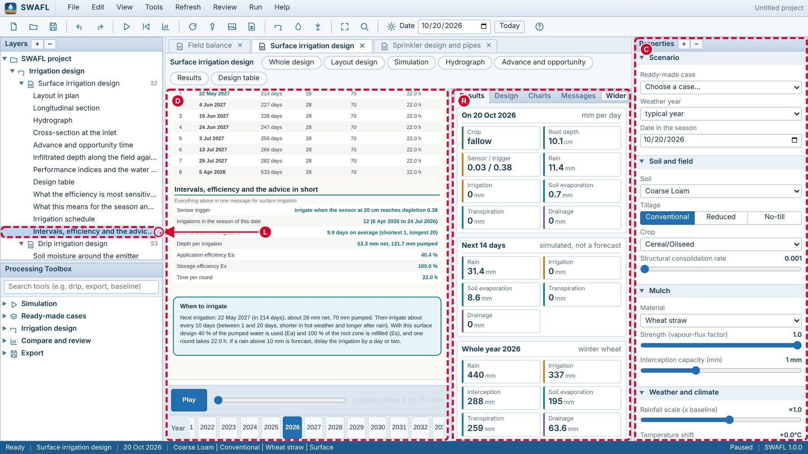{width=100%}

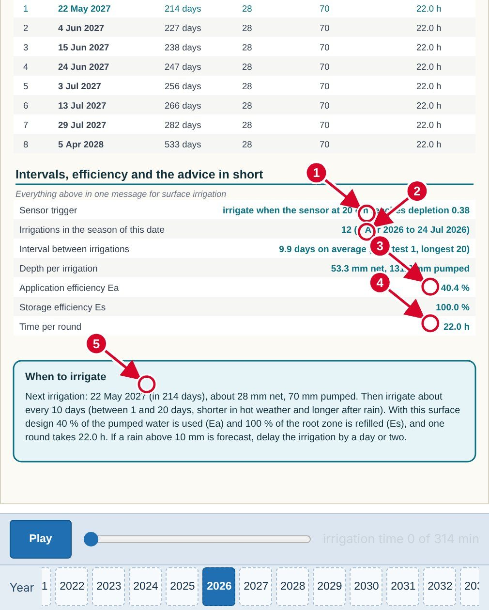{width=70%}

**What the arrows point to.** The dashed outlines in the whole-workbench picture mark the layer chosen in the Layers panel (**L**), the drawing (**D**), the Dashboard (**R**) and the controls in Properties (**C**). In the drawing, each numbered arrow ends on the item it names.

- **1** Sensor trigger: depletion f_T, Eqs. 5.3 and 5.27.
- **2** Irrigations in the season: n_ev, Eq. 11.24.
- **3** Application efficiency E_a: Eq. 11.19.
- **4** Time per round: Eq. 11.24.
- **5** "When to irrigate": a message assembled from the schedule and from E_a and E_s (Eqs. 11.19 and 11.24).

**Equations behind this screen.** Eq. 11.24.

*Eq. 11.24. Where explained: chapter "Surface irrigation design", section "Season and farm".*

$$
\begin{aligned}
n_{\mathrm{ev}} &= \sum I\,/\,Z_n, & Z_g &= \frac{V_{\mathrm{app}}}{L\,w}\times1000\ \ (\mathrm{mm}), & Z_{\mathrm{season}} &= n_{\mathrm{ev}}\,Z_g,\\
N_{0M} &= \frac{Q_s}{q}, & N_{\mathrm{units}} &= \frac{W_f}{w},\quad N_{\mathrm{sets}}=\max\Bigl(1,\frac{N_{\mathrm{units}}}{N_{0M}}\Bigr), & T_{\mathrm{tot}} &= \frac{N_{\mathrm{sets}}\,t_{co}}{60}\ \ (\mathrm h),
\end{aligned}
\tag{11.24}
$$

*Provenance (Eq. 11.24):* **[Engineered]**: optimisation score and seasonal bookkeeping chosen for the workbench.

\newpage

## S3 Drip irrigation design

### The whole layer: inputs and overview

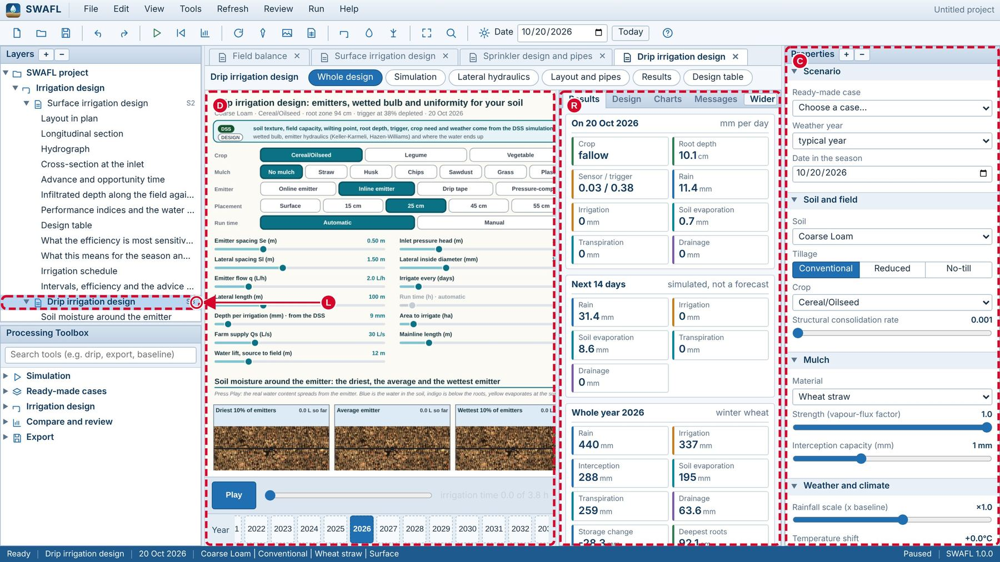{width=100%}

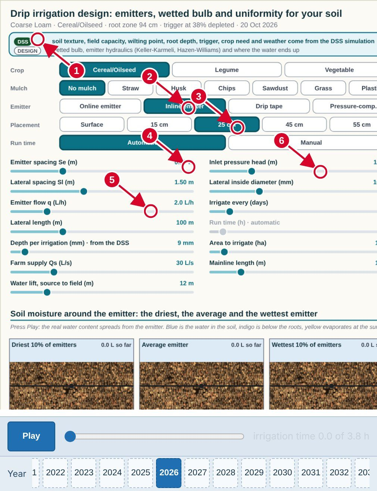{width=70%}

**What the arrows point to.** The dashed outlines in the whole-workbench picture mark the layer chosen in the Layers panel (**L**), the drawing (**D**), the Dashboard (**R**) and the controls in Properties (**C**). In the drawing, each numbered arrow ends on the item it names.

- **1** DSS badge: soil, root depth, trigger and crop need come from Engines 1 and 2.
- **2** Emitter type sets the discharge exponent x: Eqs. 12.4 and 12.5.
- **3** Emitter depth z_d sets the bulb geometry: Eq. 12.10.
- **4** Emitter and lateral spacing, S_e and S_l: area served by one emitter, Eq. 12.17.
- **5** Emitter flow q at the inlet head H_0: Eq. 12.4.
- **6** Inlet pressure head H_0: Eqs. 12.3 and 12.4.

**Equations behind this screen.** Eq. 5.27, Eq. 11.3, Eq. 12.1, Eq. 12.2, Eq. 12.3, Eq. 12.4, Eq. 12.5, Eq. 12.6, Eq. 12.7, Eq. 12.8, Eq. 12.9, Eq. 12.10, Eq. 12.11, Eq. 12.12, Eq. 12.13, Eq. 12.14, Eq. 12.15, Eq. 12.16, Eq. 12.17, Eq. 12.18, Eq. 12.19.

*Eq. 5.27. Where explained: chapter "The two computing engines", section "Evaporation under warming (used by the E1 layer)".*

$$
Z_n = \mathrm{clip}\bigl(f_T\cdot \mathrm{AWC}\cdot R_{\max};\ 25,\ 150\bigr)\ \mathrm{mm}\qquad(\text{surface; drip and sprinkler use their own limits})
\tag{5.27}
$$

*Provenance (Eq. 5.27):* **[Literature]**: readily available water as in FAO-56 practice, with an engineered clip.

*Eq. 11.3. Where explained: chapter "Surface irrigation design", section "Intake from your soil (Saxton–Rawls $\to$ Green–Ampt $\to$ Kostiakov)".*

$$
\psi_f = \frac{10}{\alpha}\,\frac{0.046\,m + 2.07\,m^{2} + 19.5\,m^{3}}{1 + 4.7\,m + 16\,m^{2}}.
\tag{11.3}
$$

*Provenance (Eq. 11.3):* **[Engineered]**: rational-polynomial approximation of a Rawls-type suction.

*Eq. 12.1. Where explained: chapter "Drip irrigation design", section "Inputs, step by step".*

$$
Z_n = \min\bigl\{Z_{n}^{\mathrm{DSS}},\ \max(4,\ \mathrm{ET}_{\mathrm{pk}}\,\Delta t)\bigr\}\ \ \mathrm{mm},
\tag{12.1}
$$

*Provenance (Eq. 12.1):* **[Engineered]**: depth and demand rules chosen for the workbench.

*Eq. 12.2. Where explained: chapter "Drip irrigation design", section "Inputs, step by step".*

$$
\mathrm{ET}_{\mathrm{pk}} = \mathrm{clip}\Bigl\{\max_d \tfrac15\sum_{j=0}^{4}\bigl(E_{d+j}+T_{d+j}\bigr);\ 2.5,\ 9\Bigr\}.
\tag{12.2}
$$

*Provenance (Eq. 12.2):* **[Engineered]**: depth and demand rules chosen for the workbench.

*Eq. 12.3. Where explained: chapter "Drip irrigation design", section "Lateral hydraulics: head loss and flow along the lateral".*

$$
h_{f,j} = \frac{10.67\,S_e\,Q_j^{1.852}}{C^{1.852}\,D^{4.871}},\qquad Q_j=\sum_{i\ge j+1} q_i\ \ (\mathrm{m^3\,s^{-1}}),\quad D\ \text{in m}.
\tag{12.3}
$$

*Provenance (Eq. 12.3):* **[Literature]**: Hazen and Williams (1905).

*Eq. 12.4. Where explained: chapter "Drip irrigation design", section "Lateral hydraulics: head loss and flow along the lateral".*

$$
q_j = q\Bigl(\frac{h_j}{H_0}\Bigr)^{x}\quad(\text{non-compensating; } h_j/H_0\ge0.01),
\tag{12.4}
$$

*Provenance (Eq. 12.4):* **[Literature]**: Keller and Karmeli (1974) emitter law.

*Eq. 12.5. Where explained: chapter "Drip irrigation design", section "Lateral hydraulics: head loss and flow along the lateral".*

$$
q_j = \begin{cases} q\bigl[1 + 0.04\,(h_j-H_0)/H_0\bigr], & h_j\ge H_{\min},\\[2pt] q\,\bigl(\max(h_j,0.1)/H_{\min}\bigr)^{0.5}, & h_j<H_{\min},\end{cases}
\tag{12.5}
$$

*Provenance (Eq. 12.5):* **[Engineered]**: pressure-compensating emitter model with chosen constants.

*Eq. 12.6. Where explained: chapter "Drip irrigation design", section "Lateral hydraulics: head loss and flow along the lateral".*

$$
\bar q = \frac{1}{N+1}\sum_{j=0}^{N} q_j,\qquad q_{\min}=\min_j q_j,\qquad
Q_{\mathrm{lat}} = \frac{N\,\bar q}{3600}\ \ (\mathrm{L\,s^{-1}}),
\tag{12.6}
$$

*Provenance (Eq. 12.6):* **[Literature]**: definitions of mean and minimum discharge.

*Eq. 12.7. Where explained: chapter "Drip irrigation design", section "Lateral hydraulics: head loss and flow along the lateral".*

$$
E_u = \mathrm{clip}\Bigl\{\Bigl(1 - \frac{1.27\,c_v}{\sqrt{n_e}}\Bigr)\frac{q_{\min}}{\bar q};\ 0.3,\ 1\Bigr\}.
\tag{12.7}
$$

*Provenance (Eq. 12.7):* **[Literature]**: Keller and Karmeli (1974).

*Eq. 12.8. Where explained: chapter "Drip irrigation design", section "Lateral hydraulics: head loss and flow along the lateral".*

$$
\sigma_q = \sqrt{c_v^{2} + \sigma_P^{2}},\qquad
\sigma_P^{2} = \frac{1}{N+1}\sum_{j=0}^{N}\Bigl(\frac{q_j}{\bar q}-1\Bigr)^{2}.
\tag{12.8}
$$

*Provenance (Eq. 12.8):* **[Engineered]**: combined spread chosen to drive the bulb quantiles.

*Eq. 12.9. Where explained: chapter "Drip irrigation design", section "The wetted bulb".*

$$
\Delta\theta = \max\{0.03,\ f_T\,(\theta_{fc}-\theta_{wp})\}.
\tag{12.9}
$$

*Provenance (Eq. 12.9):* **[Engineered]**: wetted-bulb geometry and loss partition; constants chosen for the workbench.

*Eq. 12.10. Where explained: chapter "Drip irrigation design", section "The wetted bulb".*

$$
\rho(z) = r\,\sqrt{1 - \zeta^{2}},\qquad
\zeta = \begin{cases} (z - z_d)/(a\,r), & z\ge z_d,\\ (z_d - z)/(u\,r), & z<z_d,\end{cases}\qquad \rho=0\ \text{for}\ |\zeta|\ge1.
\tag{12.10}
$$

*Provenance (Eq. 12.10):* **[Engineered]**: wetted-bulb geometry and loss partition; constants chosen for the workbench.

*Eq. 12.11. Where explained: chapter "Drip irrigation design", section "The wetted bulb".*

$$
a = \mathrm{clip}\Bigl\{1 + 0.6\,\log_{10}\Bigl(1 + \frac{K_s}{q\cdot10^{6}/(2\pi\lambda^{2})}\Bigr);\ 1,\ 1.9\Bigr\},\qquad \lambda=\max(40,\psi_f),
\tag{12.11}
$$

*Provenance (Eq. 12.11):* **[Engineered]**: wetted-bulb geometry and loss partition; constants chosen for the workbench.

*Eq. 12.12. Where explained: chapter "Drip irrigation design", section "The wetted bulb".*

$$
V_w = \int \pi\,\rho(z)^{2}\,dz,
\tag{12.12}
$$

*Provenance (Eq. 12.12):* **[Engineered]**: wetted-bulb geometry and loss partition; constants chosen for the workbench.

*Eq. 12.13. Where explained: chapter "Drip irrigation design", section "The wetted bulb".*

$$
P_w = \mathrm{clip}\Bigl\{\frac{2r}{1000\,S_l};\ 0,\ 1\Bigr\}.
\tag{12.13}
$$

*Provenance (Eq. 12.13):* **[Engineered]**: wetted-bulb geometry and loss partition; constants chosen for the workbench.

*Eq. 12.14. Where explained: chapter "Drip irrigation design", section "The wetted bulb".*

$$
V_{\mathrm{dp}}^{(1)} = V\,\frac{\int_{z>R_{\max}}\pi\rho^{2}\,dz}{V_w},
\tag{12.14}
$$

*Provenance (Eq. 12.14):* **[Engineered]**: wetted-bulb geometry and loss partition; constants chosen for the workbench.

*Eq. 12.15. Where explained: chapter "Drip irrigation design", section "The wetted bulb".*

$$
V_{\mathrm{ev}} = \min\bigl\{0.5\,V,\ \pi\rho(0)^{2}\cdot10^{-6}\cdot 2E_0\bigr\}\quad(\text{L},\ \text{area in m}^{2},\ E_0\ \text{in mm d}^{-1}),
\tag{12.15}
$$

*Provenance (Eq. 12.15):* **[Engineered]**: wetted-bulb geometry and loss partition; constants chosen for the workbench.

*Eq. 12.16. Where explained: chapter "Drip irrigation design", section "Spread between emitters and the efficiencies".*

$$
V_i = \max\bigl\{0.02\,\bar V,\ \bar V\,(1+\sigma_q z_i)\bigr\},\qquad \bar V=\bar q\,t,
\tag{12.16}
$$

*Provenance (Eq. 12.16):* **[Engineered]**: five-quantile delivery and run-time rules chosen for the workbench.

*Eq. 12.17. Where explained: chapter "Drip irrigation design", section "Spread between emitters and the efficiencies".*

$$
V_{\mathrm{req}} = Z_n\,S_e\,S_l\ \ (\mathrm L),\qquad
V_{\mathrm{st},i}=\min\{V_{\mathrm{root},i},\ V_{\mathrm{req}}\},\qquad V_{\mathrm{ex},i} = V_{\mathrm{root},i}-V_{\mathrm{st},i}.
\tag{12.17}
$$

*Provenance (Eq. 12.17):* **[Literature]**: definition of the requirement over the area served by one emitter.

*Eq. 12.18. Where explained: chapter "Drip irrigation design", section "Spread between emitters and the efficiencies".*

$$
t = \mathrm{clip}\Bigl\{\frac{V_{\mathrm{req}}}{\bar q\,E_u};\ 0.05,\ 96\Bigr\}\ \ \mathrm h.
\tag{12.18}
$$

*Provenance (Eq. 12.18):* **[Engineered]**: five-quantile delivery and run-time rules chosen for the workbench.

*Eq. 12.19. Where explained: chapter "Drip irrigation design", section "Spread between emitters and the efficiencies".*

$$
E_a = \frac{\langle V_{\mathrm{st}}\rangle}{\langle V\rangle},\quad
E_s = \frac{\langle V_{\mathrm{st}}\rangle}{V_{\mathrm{req}}},\quad
\mathrm{DP} = \frac{\langle V_{\mathrm{dp}}^{(1)}+V_{\mathrm{ex}}\rangle}{\langle V\rangle},\quad
\mathrm{EV} = \frac{\langle V_{\mathrm{ev}}\rangle}{\langle V\rangle},\quad
Z_{\mathrm{gross}}=\frac{\bar V}{S_eS_l},
\tag{12.19}
$$

*Provenance (Eq. 12.19):* **[Engineered]**: five-quantile delivery and run-time rules chosen for the workbench.

\newpage

### Soil moisture around the emitter: the driest, the average and the wettest emitter

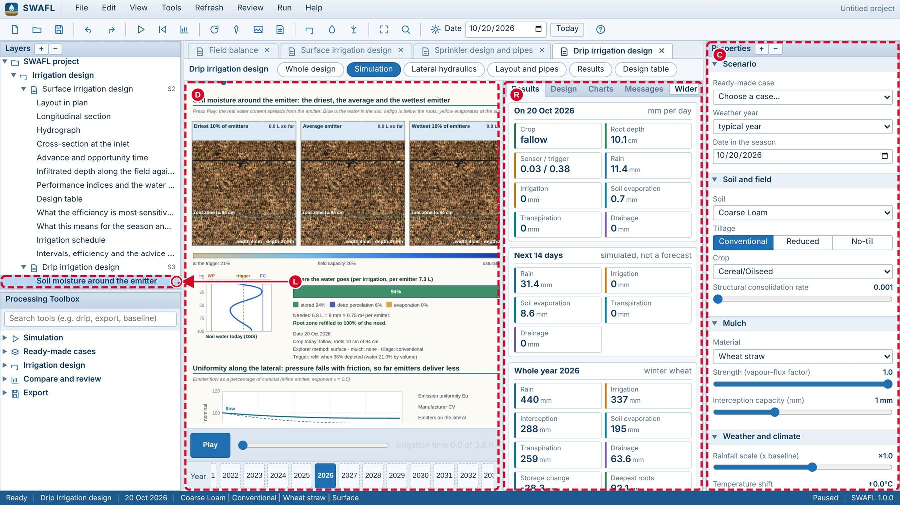{width=100%}

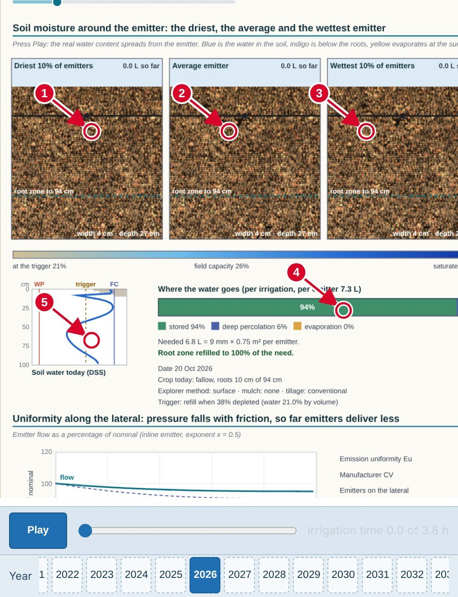{width=70%}

**What the arrows point to.** The dashed outlines in the whole-workbench picture mark the layer chosen in the Layers panel (**L**), the drawing (**D**), the Dashboard (**R**) and the controls in Properties (**C**). In the drawing, each numbered arrow ends on the item it names.

- **1** Bulb under the driest 10 % of emitters (low quantile of Eq. 12.16).
- **2** Bulb under the average emitter: Eqs. 12.10 to 12.12.
- **3** Bulb under the wettest 10 % of emitters (high quantile of Eq. 12.16).
- **4** Where the water goes: stored, deep percolation (Eq. 12.14) and evaporation (Eq. 12.15).
- **5** Soil water today from the DSS profile.

**Equations behind this screen.** Eq. 11.3, Eq. 12.9, Eq. 12.10, Eq. 12.11, Eq. 12.12, Eq. 12.13, Eq. 12.14, Eq. 12.15.

*Eq. 11.3. Where explained: chapter "Surface irrigation design", section "Intake from your soil (Saxton–Rawls $\to$ Green–Ampt $\to$ Kostiakov)".*

$$
\psi_f = \frac{10}{\alpha}\,\frac{0.046\,m + 2.07\,m^{2} + 19.5\,m^{3}}{1 + 4.7\,m + 16\,m^{2}}.
\tag{11.3}
$$

*Provenance (Eq. 11.3):* **[Engineered]**: rational-polynomial approximation of a Rawls-type suction.

*Eq. 12.9. Where explained: chapter "Drip irrigation design", section "The wetted bulb".*

$$
\Delta\theta = \max\{0.03,\ f_T\,(\theta_{fc}-\theta_{wp})\}.
\tag{12.9}
$$

*Provenance (Eq. 12.9):* **[Engineered]**: wetted-bulb geometry and loss partition; constants chosen for the workbench.

*Eq. 12.10. Where explained: chapter "Drip irrigation design", section "The wetted bulb".*

$$
\rho(z) = r\,\sqrt{1 - \zeta^{2}},\qquad
\zeta = \begin{cases} (z - z_d)/(a\,r), & z\ge z_d,\\ (z_d - z)/(u\,r), & z<z_d,\end{cases}\qquad \rho=0\ \text{for}\ |\zeta|\ge1.
\tag{12.10}
$$

*Provenance (Eq. 12.10):* **[Engineered]**: wetted-bulb geometry and loss partition; constants chosen for the workbench.

*Eq. 12.11. Where explained: chapter "Drip irrigation design", section "The wetted bulb".*

$$
a = \mathrm{clip}\Bigl\{1 + 0.6\,\log_{10}\Bigl(1 + \frac{K_s}{q\cdot10^{6}/(2\pi\lambda^{2})}\Bigr);\ 1,\ 1.9\Bigr\},\qquad \lambda=\max(40,\psi_f),
\tag{12.11}
$$

*Provenance (Eq. 12.11):* **[Engineered]**: wetted-bulb geometry and loss partition; constants chosen for the workbench.

*Eq. 12.12. Where explained: chapter "Drip irrigation design", section "The wetted bulb".*

$$
V_w = \int \pi\,\rho(z)^{2}\,dz,
\tag{12.12}
$$

*Provenance (Eq. 12.12):* **[Engineered]**: wetted-bulb geometry and loss partition; constants chosen for the workbench.

*Eq. 12.13. Where explained: chapter "Drip irrigation design", section "The wetted bulb".*

$$
P_w = \mathrm{clip}\Bigl\{\frac{2r}{1000\,S_l};\ 0,\ 1\Bigr\}.
\tag{12.13}
$$

*Provenance (Eq. 12.13):* **[Engineered]**: wetted-bulb geometry and loss partition; constants chosen for the workbench.

*Eq. 12.14. Where explained: chapter "Drip irrigation design", section "The wetted bulb".*

$$
V_{\mathrm{dp}}^{(1)} = V\,\frac{\int_{z>R_{\max}}\pi\rho^{2}\,dz}{V_w},
\tag{12.14}
$$

*Provenance (Eq. 12.14):* **[Engineered]**: wetted-bulb geometry and loss partition; constants chosen for the workbench.

*Eq. 12.15. Where explained: chapter "Drip irrigation design", section "The wetted bulb".*

$$
V_{\mathrm{ev}} = \min\bigl\{0.5\,V,\ \pi\rho(0)^{2}\cdot10^{-6}\cdot 2E_0\bigr\}\quad(\text{L},\ \text{area in m}^{2},\ E_0\ \text{in mm d}^{-1}),
\tag{12.15}
$$

*Provenance (Eq. 12.15):* **[Engineered]**: wetted-bulb geometry and loss partition; constants chosen for the workbench.

\newpage

### Uniformity along the lateral: pressure falls with friction, so far emitters deliver less

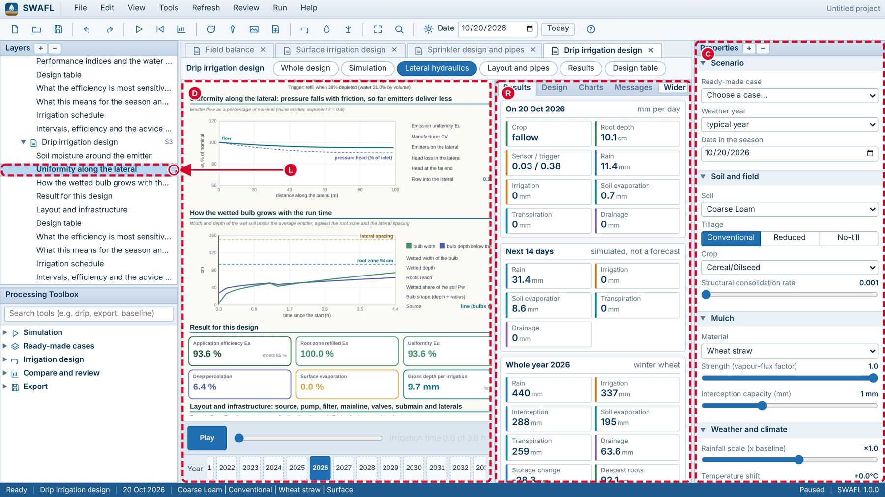{width=100%}

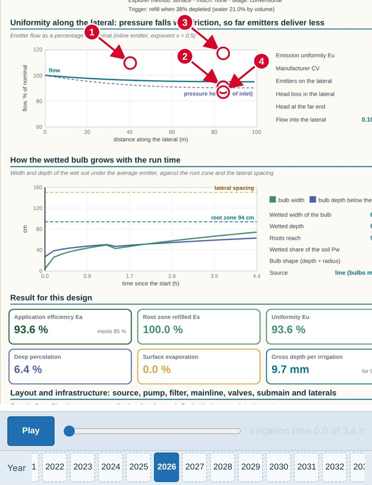{width=70%}

**What the arrows point to.** The dashed outlines in the whole-workbench picture mark the layer chosen in the Layers panel (**L**), the drawing (**D**), the Dashboard (**R**) and the controls in Properties (**C**). In the drawing, each numbered arrow ends on the item it names.

- **1** Emitter flow q_j along the lateral: Eq. 12.4.
- **2** Pressure head h_j along the lateral, falling with friction: Eq. 12.3.
- **3** Emission uniformity E_u: Eq. 12.7.
- **4** Head loss in the lateral, sum of h_f: Eq. 12.3.

**Equations behind this screen.** Eq. 12.3, Eq. 12.4, Eq. 12.5, Eq. 12.6, Eq. 12.7, Eq. 12.8, Eq. 12.10, Eq. 12.15, Eq. 12.16, Eq. 12.17, Eq. 12.18, Eq. 12.19.

*Eq. 12.3. Where explained: chapter "Drip irrigation design", section "Lateral hydraulics: head loss and flow along the lateral".*

$$
h_{f,j} = \frac{10.67\,S_e\,Q_j^{1.852}}{C^{1.852}\,D^{4.871}},\qquad Q_j=\sum_{i\ge j+1} q_i\ \ (\mathrm{m^3\,s^{-1}}),\quad D\ \text{in m}.
\tag{12.3}
$$

*Provenance (Eq. 12.3):* **[Literature]**: Hazen and Williams (1905).

*Eq. 12.4. Where explained: chapter "Drip irrigation design", section "Lateral hydraulics: head loss and flow along the lateral".*

$$
q_j = q\Bigl(\frac{h_j}{H_0}\Bigr)^{x}\quad(\text{non-compensating; } h_j/H_0\ge0.01),
\tag{12.4}
$$

*Provenance (Eq. 12.4):* **[Literature]**: Keller and Karmeli (1974) emitter law.

*Eq. 12.5. Where explained: chapter "Drip irrigation design", section "Lateral hydraulics: head loss and flow along the lateral".*

$$
q_j = \begin{cases} q\bigl[1 + 0.04\,(h_j-H_0)/H_0\bigr], & h_j\ge H_{\min},\\[2pt] q\,\bigl(\max(h_j,0.1)/H_{\min}\bigr)^{0.5}, & h_j<H_{\min},\end{cases}
\tag{12.5}
$$

*Provenance (Eq. 12.5):* **[Engineered]**: pressure-compensating emitter model with chosen constants.

*Eq. 12.6. Where explained: chapter "Drip irrigation design", section "Lateral hydraulics: head loss and flow along the lateral".*

$$
\bar q = \frac{1}{N+1}\sum_{j=0}^{N} q_j,\qquad q_{\min}=\min_j q_j,\qquad
Q_{\mathrm{lat}} = \frac{N\,\bar q}{3600}\ \ (\mathrm{L\,s^{-1}}),
\tag{12.6}
$$

*Provenance (Eq. 12.6):* **[Literature]**: definitions of mean and minimum discharge.

*Eq. 12.7. Where explained: chapter "Drip irrigation design", section "Lateral hydraulics: head loss and flow along the lateral".*

$$
E_u = \mathrm{clip}\Bigl\{\Bigl(1 - \frac{1.27\,c_v}{\sqrt{n_e}}\Bigr)\frac{q_{\min}}{\bar q};\ 0.3,\ 1\Bigr\}.
\tag{12.7}
$$

*Provenance (Eq. 12.7):* **[Literature]**: Keller and Karmeli (1974).

*Eq. 12.8. Where explained: chapter "Drip irrigation design", section "Lateral hydraulics: head loss and flow along the lateral".*

$$
\sigma_q = \sqrt{c_v^{2} + \sigma_P^{2}},\qquad
\sigma_P^{2} = \frac{1}{N+1}\sum_{j=0}^{N}\Bigl(\frac{q_j}{\bar q}-1\Bigr)^{2}.
\tag{12.8}
$$

*Provenance (Eq. 12.8):* **[Engineered]**: combined spread chosen to drive the bulb quantiles.

*Eq. 12.10. Where explained: chapter "Drip irrigation design", section "The wetted bulb".*

$$
\rho(z) = r\,\sqrt{1 - \zeta^{2}},\qquad
\zeta = \begin{cases} (z - z_d)/(a\,r), & z\ge z_d,\\ (z_d - z)/(u\,r), & z<z_d,\end{cases}\qquad \rho=0\ \text{for}\ |\zeta|\ge1.
\tag{12.10}
$$

*Provenance (Eq. 12.10):* **[Engineered]**: wetted-bulb geometry and loss partition; constants chosen for the workbench.

*Eq. 12.15. Where explained: chapter "Drip irrigation design", section "The wetted bulb".*

$$
V_{\mathrm{ev}} = \min\bigl\{0.5\,V,\ \pi\rho(0)^{2}\cdot10^{-6}\cdot 2E_0\bigr\}\quad(\text{L},\ \text{area in m}^{2},\ E_0\ \text{in mm d}^{-1}),
\tag{12.15}
$$

*Provenance (Eq. 12.15):* **[Engineered]**: wetted-bulb geometry and loss partition; constants chosen for the workbench.

*Eq. 12.16. Where explained: chapter "Drip irrigation design", section "Spread between emitters and the efficiencies".*

$$
V_i = \max\bigl\{0.02\,\bar V,\ \bar V\,(1+\sigma_q z_i)\bigr\},\qquad \bar V=\bar q\,t,
\tag{12.16}
$$

*Provenance (Eq. 12.16):* **[Engineered]**: five-quantile delivery and run-time rules chosen for the workbench.

*Eq. 12.17. Where explained: chapter "Drip irrigation design", section "Spread between emitters and the efficiencies".*

$$
V_{\mathrm{req}} = Z_n\,S_e\,S_l\ \ (\mathrm L),\qquad
V_{\mathrm{st},i}=\min\{V_{\mathrm{root},i},\ V_{\mathrm{req}}\},\qquad V_{\mathrm{ex},i} = V_{\mathrm{root},i}-V_{\mathrm{st},i}.
\tag{12.17}
$$

*Provenance (Eq. 12.17):* **[Literature]**: definition of the requirement over the area served by one emitter.

*Eq. 12.18. Where explained: chapter "Drip irrigation design", section "Spread between emitters and the efficiencies".*

$$
t = \mathrm{clip}\Bigl\{\frac{V_{\mathrm{req}}}{\bar q\,E_u};\ 0.05,\ 96\Bigr\}\ \ \mathrm h.
\tag{12.18}
$$

*Provenance (Eq. 12.18):* **[Engineered]**: five-quantile delivery and run-time rules chosen for the workbench.

*Eq. 12.19. Where explained: chapter "Drip irrigation design", section "Spread between emitters and the efficiencies".*

$$
E_a = \frac{\langle V_{\mathrm{st}}\rangle}{\langle V\rangle},\quad
E_s = \frac{\langle V_{\mathrm{st}}\rangle}{V_{\mathrm{req}}},\quad
\mathrm{DP} = \frac{\langle V_{\mathrm{dp}}^{(1)}+V_{\mathrm{ex}}\rangle}{\langle V\rangle},\quad
\mathrm{EV} = \frac{\langle V_{\mathrm{ev}}\rangle}{\langle V\rangle},\quad
Z_{\mathrm{gross}}=\frac{\bar V}{S_eS_l},
\tag{12.19}
$$

*Provenance (Eq. 12.19):* **[Engineered]**: five-quantile delivery and run-time rules chosen for the workbench.

\newpage

### How the wetted bulb grows with the run time

{width=100%}

{width=70%}

**What the arrows point to.** The dashed outlines in the whole-workbench picture mark the layer chosen in the Layers panel (**L**), the drawing (**D**), the Dashboard (**R**) and the controls in Properties (**C**). In the drawing, each numbered arrow ends on the item it names.

- **1** Bulb width (green) and depth (indigo) against time: Eqs. 12.10 to 12.12.
- **2** Root-zone depth R_max, against which the bulb depth gives deep percolation: Eq. 12.14.
- **3** Lateral spacing S_l: the bulbs merge when the width reaches it, P_w of Eq. 12.13.

**Equations behind this screen.** Eq. 11.3, Eq. 12.9, Eq. 12.10, Eq. 12.11, Eq. 12.12, Eq. 12.13, Eq. 12.14, Eq. 12.15.

*Eq. 11.3. Where explained: chapter "Surface irrigation design", section "Intake from your soil (Saxton–Rawls $\to$ Green–Ampt $\to$ Kostiakov)".*

$$
\psi_f = \frac{10}{\alpha}\,\frac{0.046\,m + 2.07\,m^{2} + 19.5\,m^{3}}{1 + 4.7\,m + 16\,m^{2}}.
\tag{11.3}
$$

*Provenance (Eq. 11.3):* **[Engineered]**: rational-polynomial approximation of a Rawls-type suction.

*Eq. 12.9. Where explained: chapter "Drip irrigation design", section "The wetted bulb".*

$$
\Delta\theta = \max\{0.03,\ f_T\,(\theta_{fc}-\theta_{wp})\}.
\tag{12.9}
$$

*Provenance (Eq. 12.9):* **[Engineered]**: wetted-bulb geometry and loss partition; constants chosen for the workbench.

*Eq. 12.10. Where explained: chapter "Drip irrigation design", section "The wetted bulb".*

$$
\rho(z) = r\,\sqrt{1 - \zeta^{2}},\qquad
\zeta = \begin{cases} (z - z_d)/(a\,r), & z\ge z_d,\\ (z_d - z)/(u\,r), & z<z_d,\end{cases}\qquad \rho=0\ \text{for}\ |\zeta|\ge1.
\tag{12.10}
$$

*Provenance (Eq. 12.10):* **[Engineered]**: wetted-bulb geometry and loss partition; constants chosen for the workbench.

*Eq. 12.11. Where explained: chapter "Drip irrigation design", section "The wetted bulb".*

$$
a = \mathrm{clip}\Bigl\{1 + 0.6\,\log_{10}\Bigl(1 + \frac{K_s}{q\cdot10^{6}/(2\pi\lambda^{2})}\Bigr);\ 1,\ 1.9\Bigr\},\qquad \lambda=\max(40,\psi_f),
\tag{12.11}
$$

*Provenance (Eq. 12.11):* **[Engineered]**: wetted-bulb geometry and loss partition; constants chosen for the workbench.

*Eq. 12.12. Where explained: chapter "Drip irrigation design", section "The wetted bulb".*

$$
V_w = \int \pi\,\rho(z)^{2}\,dz,
\tag{12.12}
$$

*Provenance (Eq. 12.12):* **[Engineered]**: wetted-bulb geometry and loss partition; constants chosen for the workbench.

*Eq. 12.13. Where explained: chapter "Drip irrigation design", section "The wetted bulb".*

$$
P_w = \mathrm{clip}\Bigl\{\frac{2r}{1000\,S_l};\ 0,\ 1\Bigr\}.
\tag{12.13}
$$

*Provenance (Eq. 12.13):* **[Engineered]**: wetted-bulb geometry and loss partition; constants chosen for the workbench.

*Eq. 12.14. Where explained: chapter "Drip irrigation design", section "The wetted bulb".*

$$
V_{\mathrm{dp}}^{(1)} = V\,\frac{\int_{z>R_{\max}}\pi\rho^{2}\,dz}{V_w},
\tag{12.14}
$$

*Provenance (Eq. 12.14):* **[Engineered]**: wetted-bulb geometry and loss partition; constants chosen for the workbench.

*Eq. 12.15. Where explained: chapter "Drip irrigation design", section "The wetted bulb".*

$$
V_{\mathrm{ev}} = \min\bigl\{0.5\,V,\ \pi\rho(0)^{2}\cdot10^{-6}\cdot 2E_0\bigr\}\quad(\text{L},\ \text{area in m}^{2},\ E_0\ \text{in mm d}^{-1}),
\tag{12.15}
$$

*Provenance (Eq. 12.15):* **[Engineered]**: wetted-bulb geometry and loss partition; constants chosen for the workbench.

\newpage

### Result for this design

{width=100%}

{width=70%}

**What the arrows point to.** The dashed outlines in the whole-workbench picture mark the layer chosen in the Layers panel (**L**), the drawing (**D**), the Dashboard (**R**) and the controls in Properties (**C**). In the drawing, each numbered arrow ends on the item it names.

- **1** Application efficiency E_a: Eq. 12.19.
- **2** Root-zone refilled E_s: Eq. 12.19.
- **3** Emission uniformity E_u: Eq. 12.7.
- **4** Deep percolation: Eq. 12.14.
- **5** Surface evaporation: Eq. 12.15.
- **6** Gross depth per irrigation: Eqs. 12.17 and 12.18.

**Equations behind this screen.** Eq. 12.10, Eq. 12.15, Eq. 12.16, Eq. 12.17, Eq. 12.18, Eq. 12.19.

*Eq. 12.10. Where explained: chapter "Drip irrigation design", section "The wetted bulb".*

$$
\rho(z) = r\,\sqrt{1 - \zeta^{2}},\qquad
\zeta = \begin{cases} (z - z_d)/(a\,r), & z\ge z_d,\\ (z_d - z)/(u\,r), & z<z_d,\end{cases}\qquad \rho=0\ \text{for}\ |\zeta|\ge1.
\tag{12.10}
$$

*Provenance (Eq. 12.10):* **[Engineered]**: wetted-bulb geometry and loss partition; constants chosen for the workbench.

*Eq. 12.15. Where explained: chapter "Drip irrigation design", section "The wetted bulb".*

$$
V_{\mathrm{ev}} = \min\bigl\{0.5\,V,\ \pi\rho(0)^{2}\cdot10^{-6}\cdot 2E_0\bigr\}\quad(\text{L},\ \text{area in m}^{2},\ E_0\ \text{in mm d}^{-1}),
\tag{12.15}
$$

*Provenance (Eq. 12.15):* **[Engineered]**: wetted-bulb geometry and loss partition; constants chosen for the workbench.

*Eq. 12.16. Where explained: chapter "Drip irrigation design", section "Spread between emitters and the efficiencies".*

$$
V_i = \max\bigl\{0.02\,\bar V,\ \bar V\,(1+\sigma_q z_i)\bigr\},\qquad \bar V=\bar q\,t,
\tag{12.16}
$$

*Provenance (Eq. 12.16):* **[Engineered]**: five-quantile delivery and run-time rules chosen for the workbench.

*Eq. 12.17. Where explained: chapter "Drip irrigation design", section "Spread between emitters and the efficiencies".*

$$
V_{\mathrm{req}} = Z_n\,S_e\,S_l\ \ (\mathrm L),\qquad
V_{\mathrm{st},i}=\min\{V_{\mathrm{root},i},\ V_{\mathrm{req}}\},\qquad V_{\mathrm{ex},i} = V_{\mathrm{root},i}-V_{\mathrm{st},i}.
\tag{12.17}
$$

*Provenance (Eq. 12.17):* **[Literature]**: definition of the requirement over the area served by one emitter.

*Eq. 12.18. Where explained: chapter "Drip irrigation design", section "Spread between emitters and the efficiencies".*

$$
t = \mathrm{clip}\Bigl\{\frac{V_{\mathrm{req}}}{\bar q\,E_u};\ 0.05,\ 96\Bigr\}\ \ \mathrm h.
\tag{12.18}
$$

*Provenance (Eq. 12.18):* **[Engineered]**: five-quantile delivery and run-time rules chosen for the workbench.

*Eq. 12.19. Where explained: chapter "Drip irrigation design", section "Spread between emitters and the efficiencies".*

$$
E_a = \frac{\langle V_{\mathrm{st}}\rangle}{\langle V\rangle},\quad
E_s = \frac{\langle V_{\mathrm{st}}\rangle}{V_{\mathrm{req}}},\quad
\mathrm{DP} = \frac{\langle V_{\mathrm{dp}}^{(1)}+V_{\mathrm{ex}}\rangle}{\langle V\rangle},\quad
\mathrm{EV} = \frac{\langle V_{\mathrm{ev}}\rangle}{\langle V\rangle},\quad
Z_{\mathrm{gross}}=\frac{\bar V}{S_eS_l},
\tag{12.19}
$$

*Provenance (Eq. 12.19):* **[Engineered]**: five-quantile delivery and run-time rules chosen for the workbench.

\newpage

### Layout and infrastructure: source, pump, filter, mainline, valves, submain and laterals

{width=100%}

{width=70%}

**What the arrows point to.** The dashed outlines in the whole-workbench picture mark the layer chosen in the Layers panel (**L**), the drawing (**D**), the Dashboard (**R**) and the controls in Properties (**C**). In the drawing, each numbered arrow ends on the item it names.

- **1** Source, pump, filter and valves: pump power from the head of Eq. 12.23.
- **2** Laterals across the field, N_L = field width / S_l: Eq. 12.20.
- **3** Head along the flow path: TDH of Eq. 12.23.
- **4** Pipe table: smallest commercial diameter, losses by Eq. 12.22 (Hazen-Williams, Eq. 12.3).
- **5** Zones, laterals and emitters: Eq. 12.20.

**Equations behind this screen.** Eq. 12.3, Eq. 12.20, Eq. 12.21, Eq. 12.22, Eq. 12.23.

*Eq. 12.3. Where explained: chapter "Drip irrigation design", section "Lateral hydraulics: head loss and flow along the lateral".*

$$
h_{f,j} = \frac{10.67\,S_e\,Q_j^{1.852}}{C^{1.852}\,D^{4.871}},\qquad Q_j=\sum_{i\ge j+1} q_i\ \ (\mathrm{m^3\,s^{-1}}),\quad D\ \text{in m}.
\tag{12.3}
$$

*Provenance (Eq. 12.3):* **[Literature]**: Hazen and Williams (1905).

*Eq. 12.20. Where explained: chapter "Drip irrigation design", section "Layout and infrastructure".*

$$
W_f=\frac{10^{4}A_f}{L_L},\quad N_L=\Bigl\lfloor \frac{W_f}{S_l}\Bigr\rfloor,\quad
n_{\mathrm{zone}}=\Bigl\lceil \frac{N_L\,Q_{\mathrm{lat}}}{Q_s}\Bigr\rceil,\quad
n_{l}=\Bigl\lceil\frac{N_L}{n_{\mathrm{zone}}}\Bigr\rceil,\quad Q_z=n_l\,Q_{\mathrm{lat}},
\tag{12.20}
$$

*Provenance (Eq. 12.20):* **[Engineered]**: layout, sizing and scoring rules; the 1.5 m/s velocity limit is a common practice.

*Eq. 12.21. Where explained: chapter "Drip irrigation design", section "Layout and infrastructure".*

$$
D\in\{32,40,50,63,75,90,110,125,160,200,250,315\}\ \mathrm{mm}
\tag{12.21}
$$

*Provenance (Eq. 12.21):* **[Engineered]**: layout, sizing and scoring rules; the 1.5 m/s velocity limit is a common practice.

*Eq. 12.22. Where explained: chapter "Drip irrigation design", section "Layout and infrastructure".*

$$
h_{f,sm}=0.4\,\frac{10.67\,L_{sm}\,Q_z^{1.852}}{C^{1.852}D_{sm}^{4.871}},\qquad
h_{f,m}=\frac{10.67\,L_m\,Q_z^{1.852}}{C^{1.852}D_m^{4.871}}.
\tag{12.22}
$$

*Provenance (Eq. 12.22):* **[Engineered]**: Christiansen-type reduction with a chosen factor 0.4.

*Eq. 12.23. Where explained: chapter "Drip irrigation design", section "Layout and infrastructure".*

$$
\mathrm{TDH} = z_{\mathrm{lift}} + H_0 + h_{f,sm} + h_{f,m} + 9\ \mathrm m,\qquad
P = \frac{\rho g\,Q_z\,\mathrm{TDH}}{\eta} = \frac{9.81\,(Q_z/1000)\,\mathrm{TDH}}{0.65}\ \ \mathrm{kW}.
\tag{12.23}
$$

*Provenance (Eq. 12.23):* **[Engineered]**: layout, sizing and scoring rules; the 1.5 m/s velocity limit is a common practice.

\newpage

### Design table: iterations toward an application efficiency of 85 % or more

{width=100%}

{width=70%}

**What the arrows point to.** The dashed outlines in the whole-workbench picture mark the layer chosen in the Layers panel (**L**), the drawing (**D**), the Dashboard (**R**) and the controls in Properties (**C**). In the drawing, each numbered arrow ends on the item it names.

- **1** Row 0: your current design; its score is Eq. 12.26.
- **2** Column E_a: Eq. 12.19.
- **3** Target reached: score = min(E_a, 1) - 2.5 max(0, 0.9 - E_s), Eq. 12.26.

**Equations behind this screen.** Eq. 12.26.

*Eq. 12.26. Where explained: chapter "Drip irrigation design", section "The design table".*

$$
\mathrm{score} = \min(E_a,1) - 2.5\,\max(0,\ 0.9 - E_s),
\tag{12.26}
$$

*Provenance (Eq. 12.26):* **[Engineered]**: layout, sizing and scoring rules; the 1.5 m/s velocity limit is a common practice.

\newpage

### What the efficiency is most sensitive to

{width=100%}

{width=70%}

**What the arrows point to.** The dashed outlines in the whole-workbench picture mark the layer chosen in the Layers panel (**L**), the drawing (**D**), the Dashboard (**R**) and the controls in Properties (**C**). In the drawing, each numbered arrow ends on the item it names.

- **1** Tornado bar: change in E_a (Eq. 12.19) when the run time moves by 25 to 30 %.
- **2** Size of the change in percentage points.

**Equations behind this screen.** none (the screen shows stored results).

\newpage

### What this means for the season and the farm

{width=100%}

{width=70%}

**What the arrows point to.** The dashed outlines in the whole-workbench picture mark the layer chosen in the Layers panel (**L**), the drawing (**D**), the Dashboard (**R**) and the controls in Properties (**C**). In the drawing, each numbered arrow ends on the item it names.

- **1** Irrigations in a season, n_ev = y_I / Z_n: Eq. 12.24.
- **2** Gross depth per irrigation: Eq. 12.24.
- **3** System flow per hectare: Eq. 12.24.
- **4** Sets and hours: Eq. 12.25.

**Equations behind this screen.** Eq. 12.24, Eq. 12.25.

*Eq. 12.24. Where explained: chapter "Drip irrigation design", section "Season and farm".*

$$
n_{\mathrm{ev}}=\frac{y_I}{Z_n},\quad
Z_{\mathrm{season}} = n_{\mathrm{ev}}\,Z_{\mathrm{gross}},\quad
q_{ha}=\frac{q}{3600}\,\frac{10^{4}}{S_eS_l}\ \ (\mathrm{L\,s^{-1}\,ha^{-1}}),
\tag{12.24}
$$

*Provenance (Eq. 12.24):* **[Engineered]**: layout, sizing and scoring rules; the 1.5 m/s velocity limit is a common practice.

*Eq. 12.25. Where explained: chapter "Drip irrigation design", section "Season and farm".*

$$
n_{\mathrm{set}}=\Bigl\lceil \frac{q_{ha}A_f}{Q_s}\Bigr\rceil,\qquad
t_{\mathrm{round}}=n_{\mathrm{set}}\,t,\qquad
H_{\mathrm{pump}}=n_{\mathrm{ev}}\,t_{\mathrm{round}},\qquad
E_{\mathrm{kWh}}=H_{\mathrm{pump}}\,P.
\tag{12.25}
$$

*Provenance (Eq. 12.25):* **[Engineered]**: layout, sizing and scoring rules; the 1.5 m/s velocity limit is a common practice.

\newpage

### Irrigation schedule: when to irrigate with this design

{width=100%}

{width=70%}

**What the arrows point to.** The dashed outlines in the whole-workbench picture mark the layer chosen in the Layers panel (**L**), the drawing (**D**), the Dashboard (**R**) and the controls in Properties (**C**). In the drawing, each numbered arrow ends on the item it names.

- **1** Dates from the Engine 2 irrigation record.
- **2** Pumped mm = I_k / E_a: Eq. 12.24.
- **3** Run time: Eq. 12.18 (automatic run time).

**Equations behind this screen.** Eq. 12.24, Eq. 12.25.

*Eq. 12.24. Where explained: chapter "Drip irrigation design", section "Season and farm".*

$$
n_{\mathrm{ev}}=\frac{y_I}{Z_n},\quad
Z_{\mathrm{season}} = n_{\mathrm{ev}}\,Z_{\mathrm{gross}},\quad
q_{ha}=\frac{q}{3600}\,\frac{10^{4}}{S_eS_l}\ \ (\mathrm{L\,s^{-1}\,ha^{-1}}),
\tag{12.24}
$$

*Provenance (Eq. 12.24):* **[Engineered]**: layout, sizing and scoring rules; the 1.5 m/s velocity limit is a common practice.

*Eq. 12.25. Where explained: chapter "Drip irrigation design", section "Season and farm".*

$$
n_{\mathrm{set}}=\Bigl\lceil \frac{q_{ha}A_f}{Q_s}\Bigr\rceil,\qquad
t_{\mathrm{round}}=n_{\mathrm{set}}\,t,\qquad
H_{\mathrm{pump}}=n_{\mathrm{ev}}\,t_{\mathrm{round}},\qquad
E_{\mathrm{kWh}}=H_{\mathrm{pump}}\,P.
\tag{12.25}
$$

*Provenance (Eq. 12.25):* **[Engineered]**: layout, sizing and scoring rules; the 1.5 m/s velocity limit is a common practice.

\newpage

### Intervals, efficiency and the advice in short

{width=100%}

{width=70%}

**What the arrows point to.** The dashed outlines in the whole-workbench picture mark the layer chosen in the Layers panel (**L**), the drawing (**D**), the Dashboard (**R**) and the controls in Properties (**C**). In the drawing, each numbered arrow ends on the item it names.

- **1** Sensor trigger: Eqs. 5.3 and 5.27.
- **2** Application efficiency E_a: Eq. 12.19.
- **3** "When to irrigate": message built from the schedule and from E_a and E_s.

**Equations behind this screen.** Eq. 12.24, Eq. 12.25.

*Eq. 12.24. Where explained: chapter "Drip irrigation design", section "Season and farm".*

$$
n_{\mathrm{ev}}=\frac{y_I}{Z_n},\quad
Z_{\mathrm{season}} = n_{\mathrm{ev}}\,Z_{\mathrm{gross}},\quad
q_{ha}=\frac{q}{3600}\,\frac{10^{4}}{S_eS_l}\ \ (\mathrm{L\,s^{-1}\,ha^{-1}}),
\tag{12.24}
$$

*Provenance (Eq. 12.24):* **[Engineered]**: layout, sizing and scoring rules; the 1.5 m/s velocity limit is a common practice.

*Eq. 12.25. Where explained: chapter "Drip irrigation design", section "Season and farm".*

$$
n_{\mathrm{set}}=\Bigl\lceil \frac{q_{ha}A_f}{Q_s}\Bigr\rceil,\qquad
t_{\mathrm{round}}=n_{\mathrm{set}}\,t,\qquad
H_{\mathrm{pump}}=n_{\mathrm{ev}}\,t_{\mathrm{round}},\qquad
E_{\mathrm{kWh}}=H_{\mathrm{pump}}\,P.
\tag{12.25}
$$

*Provenance (Eq. 12.25):* **[Engineered]**: layout, sizing and scoring rules; the 1.5 m/s velocity limit is a common practice.

\newpage

## S4 Sprinkler design and pipes

### The whole layer: inputs and overview

{width=100%}

{width=70%}

**What the arrows point to.** The dashed outlines in the whole-workbench picture mark the layer chosen in the Layers panel (**L**), the drawing (**D**), the Dashboard (**R**) and the controls in Properties (**C**). In the drawing, each numbered arrow ends on the item it names.

- **1** Selected soil: intake K and A and the maximum allowable application rate, Eq. 13.9 and the course table.
- **2** Wind speed u: Eqs. 13.5 and 13.8.
- **3** Banner: application rate against the maximum allowed, Eqs. 13.9 and 13.10.
- **4** Nozzle diameter d: Eqs. 13.2 and 13.3.
- **5** Operating pressure P gives the head h = P / 9.81: Eq. 13.2.
- **6** Trajectory angle alpha: f_alpha in Eq. 13.3.
- **7** Spacing between laterals S_l: Eq. 13.6.

**Equations behind this screen.** Eq. 5.27, Eq. 11.6, Eq. 13.1, Eq. 13.2, Eq. 13.3, Eq. 13.4, Eq. 13.5, Eq. 13.6, Eq. 13.7, Eq. 13.9, Eq. 13.10.

*Eq. 5.27. Where explained: chapter "The two computing engines", section "Evaporation under warming (used by the E1 layer)".*

$$
Z_n = \mathrm{clip}\bigl(f_T\cdot \mathrm{AWC}\cdot R_{\max};\ 25,\ 150\bigr)\ \mathrm{mm}\qquad(\text{surface; drip and sprinkler use their own limits})
\tag{5.27}
$$

*Provenance (Eq. 5.27):* **[Literature]**: readily available water as in FAO-56 practice, with an engineered clip.

*Eq. 11.6. Where explained: chapter "Surface irrigation design", section "Intake from your soil (Saxton–Rawls $\to$ Green–Ampt $\to$ Kostiakov)".*

$$
Z(\tau) = k\,\tau^{A}\qquad (Z\ \text{in m},\ \tau\ \text{in min}),
\tag{11.6}
$$

*Provenance (Eq. 11.6):* **[Literature]**: Kostiakov (1932).

*Eq. 13.1. Where explained: chapter "Sprinkler design", section "Inputs, step by step".*

$$
S_{d}^{\mathrm{eff}} = \frac{\max(0,S_d)}{1+0.25\,S}\qquad(S\ \text{in \%}).
\tag{13.1}
$$

*Provenance (Eq. 13.1):* **[Engineered]**: depression storage reduction with slope.

*Eq. 13.2. Where explained: chapter "Sprinkler design", section "Nozzle discharge and wetted radius".*

$$
q = 0.95\,A_n\sqrt{2g\,h}\times6\times10^{4}\ \ (\mathrm{L\,min^{-1}}),\qquad A_n=\pi\Bigl(\frac{d}{2000}\Bigr)^{2}\ \mathrm{m^2},
\tag{13.2}
$$

*Provenance (Eq. 13.2):* **[Literature]**: Torricelli orifice equation.

*Eq. 13.3. Where explained: chapter "Sprinkler design", section "Nozzle discharge and wetted radius".*

$$
R = c_R\sqrt{d\,h}\;f_\alpha(\alpha),\qquad
f_\alpha(\alpha)=\Bigl[\frac{\max\{0.05,\ \sin(3.1\,\alpha)\}}{0.9763}\Bigr]^{0.45},
\tag{13.3}
$$

*Provenance (Eq. 13.3):* **[Engineered]**: range law of the Keller and Bliesner (1990) form; the impact coefficient 1.35 is the published value and is verified against their worked example (Paper 3); the coefficients of the other types and the angle function are chosen.

*Eq. 13.4. Where explained: chapter "Sprinkler design", section "The spray pattern and the overlap".*

$$
\hat p(x)=\begin{cases}
1-x^{m}, & \text{impact } (m=1.3),\ \text{gun } (m=1),\\
(0.5+0.5x)(1-x^{6}), & \text{rotating spray (ring)},\\
(0.55+0.45x)(1-x^{5}), & \text{micro-sprinkler (ring-2)},
\end{cases}\qquad \hat p=0\ \text{for}\ x\ge1.
\tag{13.4}
$$

*Provenance (Eq. 13.4):* **[Engineered]**: pattern and wind shapes chosen to reproduce published qualitative patterns.

*Eq. 13.5. Where explained: chapter "Sprinkler design", section "The spray pattern and the overlap".*

$$
R_e(\theta)=R\,\mathrm{clip}\{1+0.022\,u\cos\theta;\ 0.7,\ 1.4\},\qquad \text{shift}=0.03\,u\,R,
\tag{13.5}
$$

*Provenance (Eq. 13.5):* **[Engineered]**: pattern and wind shapes chosen to reproduce published qualitative patterns.

*Eq. 13.6. Where explained: chapter "Sprinkler design", section "The spray pattern and the overlap".*

$$
a(x,y) = \sum_{i,j} p\bigl(x-x_{ij},\,y-y_{ij}\bigr)\quad(\mathrm{mm\,min^{-1}}),\qquad
\bar a=\frac1n\sum_k a_k,
\tag{13.6}
$$

*Provenance (Eq. 13.6):* **[Literature]**: overlap by superposition of single-sprinkler patterns.

*Eq. 13.7. Where explained: chapter "Sprinkler design", section "The spray pattern and the overlap".*

$$
\mathrm{CU}=1-\frac{\sum_k |a_k-\bar a|}{n\,\bar a}.
\tag{13.7}
$$

*Provenance (Eq. 13.7):* **[Literature]**: Christiansen (1942).

*Eq. 13.9. Where explained: chapter "Sprinkler design", section "The soil intake, ponding and runoff".*

$$
t_p=\Bigl(\frac aK\Bigr)^{1/(A-1)},\qquad
F=\begin{cases}\mathrm{sup}, & T\le t_p\\ K\,T^{A}, & T>t_p\end{cases}\qquad
R=\mathrm{sup}-F,\quad \mathrm{RO}=\max(0,R-S_d^{\mathrm{eff}}),\quad I=\mathrm{sup}-\mathrm{RO}.
\tag{13.9}
$$

*Provenance (Eq. 13.9):* **[Engineered]**: loss and ponding rules chosen for the workbench.

*Eq. 13.10. Where explained: chapter "Sprinkler design", section "The soil intake, ponding and runoff".*

$$
I_c=\min\{I,\ I_{\mathrm{int}}\},\qquad I_{\mathrm{int}} = 0.6\,\mathrm{CAP}\,[\mathrm{VFF}<0.95] + 1.2\,\mathrm{LAI}_{\mathrm{live}},
\tag{13.10}
$$

*Provenance (Eq. 13.10):* **[Engineered]**: loss and ponding rules chosen for the workbench.

\newpage

### Layout in plan: depth infiltrated so far, from the overlapping spray patterns

{width=100%}

{width=70%}

**What the arrows point to.** The dashed outlines in the whole-workbench picture mark the layer chosen in the Layers panel (**L**), the drawing (**D**), the Dashboard (**R**) and the controls in Properties (**C**). In the drawing, each numbered arrow ends on the item it names.

- **1** Wind arrow: wind lengthens and shifts the pattern, Eq. 13.5.
- **2** Overlapping spray patterns: sum over neighbours, Eq. 13.6, with the radial profile of Eq. 13.4.
- **3** Wetted radius R: Eq. 13.3.
- **4** Spacing along the lateral S_s.
- **5** Colour shows infiltrated depth against Z_n: Eq. 13.11.

**Equations behind this screen.** Eq. 13.4, Eq. 13.5, Eq. 13.6, Eq. 13.7.

*Eq. 13.4. Where explained: chapter "Sprinkler design", section "The spray pattern and the overlap".*

$$
\hat p(x)=\begin{cases}
1-x^{m}, & \text{impact } (m=1.3),\ \text{gun } (m=1),\\
(0.5+0.5x)(1-x^{6}), & \text{rotating spray (ring)},\\
(0.55+0.45x)(1-x^{5}), & \text{micro-sprinkler (ring-2)},
\end{cases}\qquad \hat p=0\ \text{for}\ x\ge1.
\tag{13.4}
$$

*Provenance (Eq. 13.4):* **[Engineered]**: pattern and wind shapes chosen to reproduce published qualitative patterns.

*Eq. 13.5. Where explained: chapter "Sprinkler design", section "The spray pattern and the overlap".*

$$
R_e(\theta)=R\,\mathrm{clip}\{1+0.022\,u\cos\theta;\ 0.7,\ 1.4\},\qquad \text{shift}=0.03\,u\,R,
\tag{13.5}
$$

*Provenance (Eq. 13.5):* **[Engineered]**: pattern and wind shapes chosen to reproduce published qualitative patterns.

*Eq. 13.6. Where explained: chapter "Sprinkler design", section "The spray pattern and the overlap".*

$$
a(x,y) = \sum_{i,j} p\bigl(x-x_{ij},\,y-y_{ij}\bigr)\quad(\mathrm{mm\,min^{-1}}),\qquad
\bar a=\frac1n\sum_k a_k,
\tag{13.6}
$$

*Provenance (Eq. 13.6):* **[Literature]**: overlap by superposition of single-sprinkler patterns.

*Eq. 13.7. Where explained: chapter "Sprinkler design", section "The spray pattern and the overlap".*

$$
\mathrm{CU}=1-\frac{\sum_k |a_k-\bar a|}{n\,\bar a}.
\tag{13.7}
$$

*Provenance (Eq. 13.7):* **[Literature]**: Christiansen (1942).

\newpage

### Along the lateral: depth applied, depth infiltrated and where it ends up in the soil

{width=100%}

{width=70%}

**What the arrows point to.** The dashed outlines in the whole-workbench picture mark the layer chosen in the Layers panel (**L**), the drawing (**D**), the Dashboard (**R**) and the controls in Properties (**C**). In the drawing, each numbered arrow ends on the item it names.

- **1** Sprinkler positions.
- **2** Z_n: required depth, Eq. 5.27.
- **3** Infiltrated depth in each cell, Z_k: Eq. 13.11.
- **4** Root-zone depth (94 cm).
- **5** Soil water today from the DSS profile.

**Equations behind this screen.** Eq. 11.6, Eq. 13.9, Eq. 13.10, Eq. 13.11, Eq. 13.12.

*Eq. 11.6. Where explained: chapter "Surface irrigation design", section "Intake from your soil (Saxton–Rawls $\to$ Green–Ampt $\to$ Kostiakov)".*

$$
Z(\tau) = k\,\tau^{A}\qquad (Z\ \text{in m},\ \tau\ \text{in min}),
\tag{11.6}
$$

*Provenance (Eq. 11.6):* **[Literature]**: Kostiakov (1932).

*Eq. 13.9. Where explained: chapter "Sprinkler design", section "The soil intake, ponding and runoff".*

$$
t_p=\Bigl(\frac aK\Bigr)^{1/(A-1)},\qquad
F=\begin{cases}\mathrm{sup}, & T\le t_p\\ K\,T^{A}, & T>t_p\end{cases}\qquad
R=\mathrm{sup}-F,\quad \mathrm{RO}=\max(0,R-S_d^{\mathrm{eff}}),\quad I=\mathrm{sup}-\mathrm{RO}.
\tag{13.9}
$$

*Provenance (Eq. 13.9):* **[Engineered]**: loss and ponding rules chosen for the workbench.

*Eq. 13.10. Where explained: chapter "Sprinkler design", section "The soil intake, ponding and runoff".*

$$
I_c=\min\{I,\ I_{\mathrm{int}}\},\qquad I_{\mathrm{int}} = 0.6\,\mathrm{CAP}\,[\mathrm{VFF}<0.95] + 1.2\,\mathrm{LAI}_{\mathrm{live}},
\tag{13.10}
$$

*Provenance (Eq. 13.10):* **[Engineered]**: loss and ponding rules chosen for the workbench.

*Eq. 13.11. Where explained: chapter "Sprinkler design", section "Efficiencies and run time".*

$$
\begin{aligned}
E_a &= \frac{\overline{\min(Z_k,Z_n)}}{\mathrm{gross}}, & E_s &= \frac{\overline{\min(Z_k,Z_n)}}{Z_n}, & \mathrm{DU}&=\frac{\overline{Z}_{25}}{\overline{Z}},\\
\mathrm{DP} &= \frac{\overline{\max(Z_k-Z_n,0)}}{\mathrm{gross}}, & \mathrm{RO}&=\frac{\overline{\mathrm{RO}_k}}{\mathrm{gross}}, & \mathrm{WD}&=w_d+\frac{\overline{I_c}}{\mathrm{gross}},
\end{aligned}
\tag{13.11}
$$

*Provenance (Eq. 13.11):* **[Literature]**: efficiency and distribution uniformity of Merriam and Keller (1978).

*Eq. 13.12. Where explained: chapter "Sprinkler design", section "Efficiencies and run time".*

$$
T=\min\{T:\ \overline{Z}_{25}(T)\ge Z_n\},\qquad T\in[1,\,2400]\ \mathrm{min},
\tag{13.12}
$$

*Provenance (Eq. 13.12):* **[Engineered]**: run-time, wind-spacing and set rules; the wind factors follow the practice of Keller and Bliesner (1990) but are not independently verified.

\newpage

### Soil intake against the application rate: when the soil cannot keep up, water runs off

{width=100%}

{width=70%}

**What the arrows point to.** The dashed outlines in the whole-workbench picture mark the layer chosen in the Layers panel (**L**), the drawing (**D**), the Dashboard (**R**) and the controls in Properties (**C**). In the drawing, each numbered arrow ends on the item it names.

- **1** Soil intake rate K t^(A-1) (Kostiakov): Eq. 13.9.
- **2** Applied rate a = 60 times the mean depth: Eq. 13.7.
- **3** Ponding starts after t_p: Eq. 13.9.
- **4** Runoff share: Eqs. 13.9 and 13.10.
- **5** Surface storage S_d: Eq. 13.1.

**Equations behind this screen.** Eq. 11.6, Eq. 13.9, Eq. 13.10.

*Eq. 11.6. Where explained: chapter "Surface irrigation design", section "Intake from your soil (Saxton–Rawls $\to$ Green–Ampt $\to$ Kostiakov)".*

$$
Z(\tau) = k\,\tau^{A}\qquad (Z\ \text{in m},\ \tau\ \text{in min}),
\tag{11.6}
$$

*Provenance (Eq. 11.6):* **[Literature]**: Kostiakov (1932).

*Eq. 13.9. Where explained: chapter "Sprinkler design", section "The soil intake, ponding and runoff".*

$$
t_p=\Bigl(\frac aK\Bigr)^{1/(A-1)},\qquad
F=\begin{cases}\mathrm{sup}, & T\le t_p\\ K\,T^{A}, & T>t_p\end{cases}\qquad
R=\mathrm{sup}-F,\quad \mathrm{RO}=\max(0,R-S_d^{\mathrm{eff}}),\quad I=\mathrm{sup}-\mathrm{RO}.
\tag{13.9}
$$

*Provenance (Eq. 13.9):* **[Engineered]**: loss and ponding rules chosen for the workbench.

*Eq. 13.10. Where explained: chapter "Sprinkler design", section "The soil intake, ponding and runoff".*

$$
I_c=\min\{I,\ I_{\mathrm{int}}\},\qquad I_{\mathrm{int}} = 0.6\,\mathrm{CAP}\,[\mathrm{VFF}<0.95] + 1.2\,\mathrm{LAI}_{\mathrm{live}},
\tag{13.10}
$$

*Provenance (Eq. 13.10):* **[Engineered]**: loss and ponding rules chosen for the workbench.

\newpage

### Result for this design

{width=100%}

{width=70%}

**What the arrows point to.** The dashed outlines in the whole-workbench picture mark the layer chosen in the Layers panel (**L**), the drawing (**D**), the Dashboard (**R**) and the controls in Properties (**C**). In the drawing, each numbered arrow ends on the item it names.

- **1** Application efficiency E_a: Eq. 13.11.
- **2** Root-zone refilled E_s: Eq. 13.11.
- **3** Christiansen CU: Eq. 13.7.
- **4** Runoff: Eqs. 13.9 and 13.10.
- **5** Deep percolation: Eq. 13.11.
- **6** Drift, evaporation and interception: Eqs. 13.8 and 13.10.

**Equations behind this screen.** Eq. 13.11, Eq. 13.12.

*Eq. 13.11. Where explained: chapter "Sprinkler design", section "Efficiencies and run time".*

$$
\begin{aligned}
E_a &= \frac{\overline{\min(Z_k,Z_n)}}{\mathrm{gross}}, & E_s &= \frac{\overline{\min(Z_k,Z_n)}}{Z_n}, & \mathrm{DU}&=\frac{\overline{Z}_{25}}{\overline{Z}},\\
\mathrm{DP} &= \frac{\overline{\max(Z_k-Z_n,0)}}{\mathrm{gross}}, & \mathrm{RO}&=\frac{\overline{\mathrm{RO}_k}}{\mathrm{gross}}, & \mathrm{WD}&=w_d+\frac{\overline{I_c}}{\mathrm{gross}},
\end{aligned}
\tag{13.11}
$$

*Provenance (Eq. 13.11):* **[Literature]**: efficiency and distribution uniformity of Merriam and Keller (1978).

*Eq. 13.12. Where explained: chapter "Sprinkler design", section "Efficiencies and run time".*

$$
T=\min\{T:\ \overline{Z}_{25}(T)\ge Z_n\},\qquad T\in[1,\,2400]\ \mathrm{min},
\tag{13.12}
$$

*Provenance (Eq. 13.12):* **[Engineered]**: run-time, wind-spacing and set rules; the wind factors follow the practice of Keller and Bliesner (1990) but are not independently verified.

\newpage

### Does your design pass? The course checks

{width=100%}

{width=70%}

**What the arrows point to.** The dashed outlines in the whole-workbench picture mark the layer chosen in the Layers panel (**L**), the drawing (**D**), the Dashboard (**R**) and the controls in Properties (**C**). In the drawing, each numbered arrow ends on the item it names.

- **1** Spacing along the lateral S_s <= k R_w: Eqs. 13.13 and 13.14.
- **2** Wind below 16 km/h: Eq. 13.13.
- **3** Lateral head loss <= 20 % of the head: Eq. 13.18.
- **4** Whole field done within the interval T: Eqs. 13.14 to 13.16.
- **5** Christiansen CU >= 85 %: Eq. 13.7.
- **6** Mainline gradient J < 0.05: Eq. 13.17.

**Equations behind this screen.** Eq. 13.13, Eq. 13.14, Eq. 13.15, Eq. 13.16, Eq. 13.17, Eq. 13.18, Eq. 13.19, Eq. 13.20.

*Eq. 13.13. Where explained: chapter "Sprinkler design", section "The ten textbook checks".*

$$
k=\begin{cases}1,&W\le5.5\\0.9,&5.5<W\le13\\0.8,&13<W\le22\\0.7,&W>22.\end{cases}
\tag{13.13}
$$

*Provenance (Eq. 13.13):* **[Engineered]**: run-time, wind-spacing and set rules; the wind factors follow the practice of Keller and Bliesner (1990) but are not independently verified.

*Eq. 13.14. Where explained: chapter "Sprinkler design", section "The ten textbook checks".*

$$
S_s\le k\,R_w,\qquad S_l\le1.5\,R_w,\qquad
L_y=\frac{10^{4}A_f}{L_x},\quad N=\lfloor L_x/S_s\rfloor,\quad N_m=\lfloor L_y/S_l\rfloor,
\tag{13.14}
$$

*Provenance (Eq. 13.14):* **[Engineered]**: run-time, wind-spacing and set rules; the wind factors follow the practice of Keller and Bliesner (1990) but are not independently verified.

*Eq. 13.15. Where explained: chapter "Sprinkler design", section "The ten textbook checks".*

$$
t_{\mathrm{set}}=\frac{Z_{\mathrm{gross}}}{\mathrm{AR}}\ \ (\mathrm h),\qquad
n_{\mathrm{sets/day}}=\Bigl\lfloor\frac{h_{\mathrm{op}}}{t_{\mathrm{set}}}\Bigr\rfloor,\qquad T_{\mathrm{int}}=\max\Bigl(1,\Bigl\lfloor\frac{Z_n}{\mathrm{ET}_{\mathrm{pk}}}\Bigr\rfloor\Bigr)\ \mathrm{days},
\tag{13.15}
$$

*Provenance (Eq. 13.15):* **[Engineered]**: run-time, wind-spacing and set rules; the wind factors follow the practice of Keller and Bliesner (1990) but are not independently verified.

*Eq. 13.16. Where explained: chapter "Sprinkler design", section "The ten textbook checks".*

$$
N_d(n)=\Bigl\lceil\frac{N_m}{n\,n_{\mathrm{sets/day}}}\Bigr\rceil,\qquad Q_{\mathrm{in}}(n)=n\,N\,q_h,
\tag{13.16}
$$

*Provenance (Eq. 13.16):* **[Engineered]**: run-time, wind-spacing and set rules; the wind factors follow the practice of Keller and Bliesner (1990) but are not independently verified.

*Eq. 13.17. Where explained: chapter "Sprinkler design", section "The ten textbook checks".*

$$
J=\frac{0.472\,Q^{1.75}}{D^{4.75}}\ \ (\mathrm{m\,m^{-1}};\ Q\ \text{in L h}^{-1},\ D\ \text{in mm}),
\tag{13.17}
$$

*Provenance (Eq. 13.17):* **[Literature]**: Blasius friction law for smooth pipe.

*Eq. 13.18. Where explained: chapter "Sprinkler design", section "The ten textbook checks".*

$$
h_{f,\mathrm{lat}}=1.1\,F\,J(Q_L,D)\,\bigl(L_x-S_s/2\bigr)\le0.2\,h_s,\qquad Q_L=1000\,N\,q_h,
\tag{13.18}
$$

*Provenance (Eq. 13.18):* **[Literature]**: 20 % rule of Keller and Bliesner (1990).

*Eq. 13.19. Where explained: chapter "Sprinkler design", section "The ten textbook checks".*

$$
H_{\mathrm{man}} = z_{\mathrm{lift}} + J\,L_{\mathrm{conv}} + J\,L_{\mathrm{main}} + h_s + 0.75\,h_{f,\mathrm{lat}},
\tag{13.19}
$$

*Provenance (Eq. 13.19):* **[Engineered]**: head and sets bookkeeping.

*Eq. 13.20. Where explained: chapter "Sprinkler design", section "The ten textbook checks".*

$$
P_{\mathrm{CV}} = \frac{1000\,(Q_m/3.6\times10^{6})\,H_{\mathrm{man}}}{75\,\eta},\quad \eta=0.75,\qquad P_{\mathrm{kW}}=0.7355\,P_{\mathrm{CV}},
\tag{13.20}
$$

*Provenance (Eq. 13.20):* **[Literature]**: hydraulic power definition.

\newpage

### Kinds of sprinkler system

{width=100%}

{width=70%}

**What the arrows point to.** The dashed outlines in the whole-workbench picture mark the layer chosen in the Layers panel (**L**), the drawing (**D**), the Dashboard (**R**) and the controls in Properties (**C**). In the drawing, each numbered arrow ends on the item it names.

- **1** System type (solid-set selected): sets the efficiency range of the course table.
- **2** This design's E_a against the course range: Eq. 13.11.
- **3** Field plan to scale: laterals and sets, Eq. 13.21.

**Equations behind this screen.** none (the screen shows stored results).

\newpage

### The sprinkler: parts and pressure class

{width=100%}

{width=70%}

**What the arrows point to.** The dashed outlines in the whole-workbench picture mark the layer chosen in the Layers panel (**L**), the drawing (**D**), the Dashboard (**R**) and the controls in Properties (**C**). In the drawing, each numbered arrow ends on the item it names.

- **1** "Yours": head h = P / 9.81 and discharge q (Eq. 13.2), throw R (Eq. 13.3).
- **2** Formulas q = c d^2 sqrt(h) and R = k_r h^0.25: Eqs. 13.2 and 13.3.
- **3** Pressure classes (low, medium, high): table, no equation.

**Equations behind this screen.** Eq. 13.2, Eq. 13.3.

*Eq. 13.2. Where explained: chapter "Sprinkler design", section "Nozzle discharge and wetted radius".*

$$
q = 0.95\,A_n\sqrt{2g\,h}\times6\times10^{4}\ \ (\mathrm{L\,min^{-1}}),\qquad A_n=\pi\Bigl(\frac{d}{2000}\Bigr)^{2}\ \mathrm{m^2},
\tag{13.2}
$$

*Provenance (Eq. 13.2):* **[Literature]**: Torricelli orifice equation.

*Eq. 13.3. Where explained: chapter "Sprinkler design", section "Nozzle discharge and wetted radius".*

$$
R = c_R\sqrt{d\,h}\;f_\alpha(\alpha),\qquad
f_\alpha(\alpha)=\Bigl[\frac{\max\{0.05,\ \sin(3.1\,\alpha)\}}{0.9763}\Bigr]^{0.45},
\tag{13.3}
$$

*Provenance (Eq. 13.3):* **[Engineered]**: range law of the Keller and Bliesner (1990) form; the impact coefficient 1.35 is the published value and is verified against their worked example (Paper 3); the coefficients of the other types and the angle function are chosen.

\newpage

### The jet: trajectory angle, throw radius and droplet size

{width=100%}

{width=70%}

**What the arrows point to.** The dashed outlines in the whole-workbench picture mark the layer chosen in the Layers panel (**L**), the drawing (**D**), the Dashboard (**R**) and the controls in Properties (**C**). In the drawing, each numbered arrow ends on the item it names.

- **1** Trajectory angle alpha: f_alpha(alpha) in Eq. 13.3.
- **2** Throw radius R_w: Eq. 13.3.
- **3** Throw against angle, best near 29 degrees: Eq. 13.3.
- **4** Drift and evaporation loss w_d: Eq. 13.8.
- **5** Wind speed u: Eqs. 13.5 and 13.8.

**Equations behind this screen.** Eq. 13.2, Eq. 13.3, Eq. 13.8.

*Eq. 13.2. Where explained: chapter "Sprinkler design", section "Nozzle discharge and wetted radius".*

$$
q = 0.95\,A_n\sqrt{2g\,h}\times6\times10^{4}\ \ (\mathrm{L\,min^{-1}}),\qquad A_n=\pi\Bigl(\frac{d}{2000}\Bigr)^{2}\ \mathrm{m^2},
\tag{13.2}
$$

*Provenance (Eq. 13.2):* **[Literature]**: Torricelli orifice equation.

*Eq. 13.3. Where explained: chapter "Sprinkler design", section "Nozzle discharge and wetted radius".*

$$
R = c_R\sqrt{d\,h}\;f_\alpha(\alpha),\qquad
f_\alpha(\alpha)=\Bigl[\frac{\max\{0.05,\ \sin(3.1\,\alpha)\}}{0.9763}\Bigr]^{0.45},
\tag{13.3}
$$

*Provenance (Eq. 13.3):* **[Engineered]**: range law of the Keller and Bliesner (1990) form; the impact coefficient 1.35 is the published value and is verified against their worked example (Paper 3); the coefficients of the other types and the angle function are chosen.

*Eq. 13.8. Where explained: chapter "Sprinkler design", section "Wind drift and evaporation loss".*

$$
w_d=\frac{1}{100}\,\mathrm{clip}\Bigl\{\bigl(1.2+0.5u+0.04u^{2}\bigr)\,F\Bigl(\frac{P}{250}\Bigr)^{0.7}\bigl[1+0.025\,(T_a-20)\bigr]\Bigl[0.6+0.4\,\frac{\sin\alpha}{0.4226}\Bigr];\ 0.5,\ 45\Bigr\}.
\tag{13.8}
$$

*Provenance (Eq. 13.8):* **[Engineered]**: loss and ponding rules chosen for the workbench.

\newpage

### The water pattern of one sprinkler, and how overlap evens it out

{width=100%}

{width=70%}

**What the arrows point to.** The dashed outlines in the whole-workbench picture mark the layer chosen in the Layers panel (**L**), the drawing (**D**), the Dashboard (**R**) and the controls in Properties (**C**). In the drawing, each numbered arrow ends on the item it names.

- **1** Radial profile of one sprinkler, p(x): Eq. 13.4, skewed by the wind of Eq. 13.5.
- **2** Sum over neighbouring sprinklers, a(x, y): Eq. 13.6; the dashed line is the mean rate.
- **3** Christiansen coefficient of the whole pattern: Eq. 13.7.
- **4** One sprinkler seen from above with three spokes of catch cans.

**Equations behind this screen.** Eq. 13.4, Eq. 13.5, Eq. 13.6, Eq. 13.7.

*Eq. 13.4. Where explained: chapter "Sprinkler design", section "The spray pattern and the overlap".*

$$
\hat p(x)=\begin{cases}
1-x^{m}, & \text{impact } (m=1.3),\ \text{gun } (m=1),\\
(0.5+0.5x)(1-x^{6}), & \text{rotating spray (ring)},\\
(0.55+0.45x)(1-x^{5}), & \text{micro-sprinkler (ring-2)},
\end{cases}\qquad \hat p=0\ \text{for}\ x\ge1.
\tag{13.4}
$$

*Provenance (Eq. 13.4):* **[Engineered]**: pattern and wind shapes chosen to reproduce published qualitative patterns.

*Eq. 13.5. Where explained: chapter "Sprinkler design", section "The spray pattern and the overlap".*

$$
R_e(\theta)=R\,\mathrm{clip}\{1+0.022\,u\cos\theta;\ 0.7,\ 1.4\},\qquad \text{shift}=0.03\,u\,R,
\tag{13.5}
$$

*Provenance (Eq. 13.5):* **[Engineered]**: pattern and wind shapes chosen to reproduce published qualitative patterns.

*Eq. 13.6. Where explained: chapter "Sprinkler design", section "The spray pattern and the overlap".*

$$
a(x,y) = \sum_{i,j} p\bigl(x-x_{ij},\,y-y_{ij}\bigr)\quad(\mathrm{mm\,min^{-1}}),\qquad
\bar a=\frac1n\sum_k a_k,
\tag{13.6}
$$

*Provenance (Eq. 13.6):* **[Literature]**: overlap by superposition of single-sprinkler patterns.

*Eq. 13.7. Where explained: chapter "Sprinkler design", section "The spray pattern and the overlap".*

$$
\mathrm{CU}=1-\frac{\sum_k |a_k-\bar a|}{n\,\bar a}.
\tag{13.7}
$$

*Provenance (Eq. 13.7):* **[Literature]**: Christiansen (1942).

\newpage

### Layouts: rectangular, square and triangular spacing for this sprinkler

{width=100%}

{width=70%}

**What the arrows point to.** The dashed outlines in the whole-workbench picture mark the layer chosen in the Layers panel (**L**), the drawing (**D**), the Dashboard (**R**) and the controls in Properties (**C**). In the drawing, each numbered arrow ends on the item it names.

- **1** Your layout: S_s <= k R_w and S_l <= 1.5 R_w, Eq. 13.14.
- **2** Area per sprinkler and application rate: Eq. 13.7.
- **3** Triangular layout: every second lateral shifted by S_s / 2, Eq. 13.6.
- **4** Wind factor k: Eq. 13.13.

**Equations behind this screen.** Eq. 13.4, Eq. 13.5, Eq. 13.6, Eq. 13.7.

*Eq. 13.4. Where explained: chapter "Sprinkler design", section "The spray pattern and the overlap".*

$$
\hat p(x)=\begin{cases}
1-x^{m}, & \text{impact } (m=1.3),\ \text{gun } (m=1),\\
(0.5+0.5x)(1-x^{6}), & \text{rotating spray (ring)},\\
(0.55+0.45x)(1-x^{5}), & \text{micro-sprinkler (ring-2)},
\end{cases}\qquad \hat p=0\ \text{for}\ x\ge1.
\tag{13.4}
$$

*Provenance (Eq. 13.4):* **[Engineered]**: pattern and wind shapes chosen to reproduce published qualitative patterns.

*Eq. 13.5. Where explained: chapter "Sprinkler design", section "The spray pattern and the overlap".*

$$
R_e(\theta)=R\,\mathrm{clip}\{1+0.022\,u\cos\theta;\ 0.7,\ 1.4\},\qquad \text{shift}=0.03\,u\,R,
\tag{13.5}
$$

*Provenance (Eq. 13.5):* **[Engineered]**: pattern and wind shapes chosen to reproduce published qualitative patterns.

*Eq. 13.6. Where explained: chapter "Sprinkler design", section "The spray pattern and the overlap".*

$$
a(x,y) = \sum_{i,j} p\bigl(x-x_{ij},\,y-y_{ij}\bigr)\quad(\mathrm{mm\,min^{-1}}),\qquad
\bar a=\frac1n\sum_k a_k,
\tag{13.6}
$$

*Provenance (Eq. 13.6):* **[Literature]**: overlap by superposition of single-sprinkler patterns.

*Eq. 13.7. Where explained: chapter "Sprinkler design", section "The spray pattern and the overlap".*

$$
\mathrm{CU}=1-\frac{\sum_k |a_k-\bar a|}{n\,\bar a}.
\tag{13.7}
$$

*Provenance (Eq. 13.7):* **[Literature]**: Christiansen (1942).

\newpage

### What wind and soil allow

{width=100%}

{width=70%}

**What the arrows point to.** The dashed outlines in the whole-workbench picture mark the layer chosen in the Layers panel (**L**), the drawing (**D**), the Dashboard (**R**) and the controls in Properties (**C**). In the drawing, each numbered arrow ends on the item it names.

- **1** Step line of the wind factor k: Eq. 13.13.
- **2** "Yours": your wind speed and spacing.
- **3** Maximum allowable application rate by soil and slope (course table), used in Eqs. 13.9 and 13.13.

**Equations behind this screen.** Eq. 13.8.

*Eq. 13.8. Where explained: chapter "Sprinkler design", section "Wind drift and evaporation loss".*

$$
w_d=\frac{1}{100}\,\mathrm{clip}\Bigl\{\bigl(1.2+0.5u+0.04u^{2}\bigr)\,F\Bigl(\frac{P}{250}\Bigr)^{0.7}\bigl[1+0.025\,(T_a-20)\bigr]\Bigl[0.6+0.4\,\frac{\sin\alpha}{0.4226}\Bigr];\ 0.5,\ 45\Bigr\}.
\tag{13.8}
$$

*Provenance (Eq. 13.8):* **[Engineered]**: loss and ponding rules chosen for the workbench.

\newpage

### Catch-can test: measuring the uniformity the way it is done in the field

{width=100%}

{width=70%}

**What the arrows point to.** The dashed outlines in the whole-workbench picture mark the layer chosen in the Layers panel (**L**), the drawing (**D**), the Dashboard (**R**) and the controls in Properties (**C**). In the drawing, each numbered arrow ends on the item it names.

- **1** Catch cans: depth a_k in each can from the pattern of Eq. 13.6.
- **2** CU from the cans = 1 - sum |a_k - mean| / (n mean): Eq. 13.7.
- **3** Cans sorted from driest to wettest, with the mean depth.

**Equations behind this screen.** Eq. 13.4, Eq. 13.5, Eq. 13.6, Eq. 13.7.

*Eq. 13.4. Where explained: chapter "Sprinkler design", section "The spray pattern and the overlap".*

$$
\hat p(x)=\begin{cases}
1-x^{m}, & \text{impact } (m=1.3),\ \text{gun } (m=1),\\
(0.5+0.5x)(1-x^{6}), & \text{rotating spray (ring)},\\
(0.55+0.45x)(1-x^{5}), & \text{micro-sprinkler (ring-2)},
\end{cases}\qquad \hat p=0\ \text{for}\ x\ge1.
\tag{13.4}
$$

*Provenance (Eq. 13.4):* **[Engineered]**: pattern and wind shapes chosen to reproduce published qualitative patterns.

*Eq. 13.5. Where explained: chapter "Sprinkler design", section "The spray pattern and the overlap".*

$$
R_e(\theta)=R\,\mathrm{clip}\{1+0.022\,u\cos\theta;\ 0.7,\ 1.4\},\qquad \text{shift}=0.03\,u\,R,
\tag{13.5}
$$

*Provenance (Eq. 13.5):* **[Engineered]**: pattern and wind shapes chosen to reproduce published qualitative patterns.

*Eq. 13.6. Where explained: chapter "Sprinkler design", section "The spray pattern and the overlap".*

$$
a(x,y) = \sum_{i,j} p\bigl(x-x_{ij},\,y-y_{ij}\bigr)\quad(\mathrm{mm\,min^{-1}}),\qquad
\bar a=\frac1n\sum_k a_k,
\tag{13.6}
$$

*Provenance (Eq. 13.6):* **[Literature]**: overlap by superposition of single-sprinkler patterns.

*Eq. 13.7. Where explained: chapter "Sprinkler design", section "The spray pattern and the overlap".*

$$
\mathrm{CU}=1-\frac{\sum_k |a_k-\bar a|}{n\,\bar a}.
\tag{13.7}
$$

*Provenance (Eq. 13.7):* **[Literature]**: Christiansen (1942).

\newpage

### Soil water as a reservoir: interval, sets per day and the flow the field needs

{width=100%}

{width=70%}

**What the arrows point to.** The dashed outlines in the whole-workbench picture mark the layer chosen in the Layers panel (**L**), the drawing (**D**), the Dashboard (**R**) and the controls in Properties (**C**). In the drawing, each numbered arrow ends on the item it names.

- **1** Root-zone store drawn down by ET_c and refilled every T days.
- **2** Refill at Z_n from the DSS: Eq. 5.27.
- **3** Gross depth Z_G = Z_n / E_a: Eq. 13.15.
- **4** Set time t = Z_G / r: Eq. 13.15.
- **5** Laterals running together, days to finish and inflow: Eq. 13.16.

**Equations behind this screen.** Eq. 13.11, Eq. 13.12, Eq. 13.23.

*Eq. 13.11. Where explained: chapter "Sprinkler design", section "Efficiencies and run time".*

$$
\begin{aligned}
E_a &= \frac{\overline{\min(Z_k,Z_n)}}{\mathrm{gross}}, & E_s &= \frac{\overline{\min(Z_k,Z_n)}}{Z_n}, & \mathrm{DU}&=\frac{\overline{Z}_{25}}{\overline{Z}},\\
\mathrm{DP} &= \frac{\overline{\max(Z_k-Z_n,0)}}{\mathrm{gross}}, & \mathrm{RO}&=\frac{\overline{\mathrm{RO}_k}}{\mathrm{gross}}, & \mathrm{WD}&=w_d+\frac{\overline{I_c}}{\mathrm{gross}},
\end{aligned}
\tag{13.11}
$$

*Provenance (Eq. 13.11):* **[Literature]**: efficiency and distribution uniformity of Merriam and Keller (1978).

*Eq. 13.12. Where explained: chapter "Sprinkler design", section "Efficiencies and run time".*

$$
T=\min\{T:\ \overline{Z}_{25}(T)\ge Z_n\},\qquad T\in[1,\,2400]\ \mathrm{min},
\tag{13.12}
$$

*Provenance (Eq. 13.12):* **[Engineered]**: run-time, wind-spacing and set rules; the wind factors follow the practice of Keller and Bliesner (1990) but are not independently verified.

*Eq. 13.23. Where explained: chapter "Sprinkler design", section "Season and farm".*

$$
n_{\mathrm{ev}}=\frac{y_I}{Z_n},\qquad n_{\mathrm{sp}}=\mathrm{round}\Bigl(\frac{10^{4}A_f}{S_sS_l}\Bigr),\qquad
Q_{\mathrm{tot}}=\frac{n_{\mathrm{sp}}\,q}{60},\qquad n_{\mathrm{set}}=\Bigl\lceil\frac{Q_{\mathrm{tot}}}{Q_s}\Bigr\rceil,\qquad t_{\mathrm{round}}=\frac{n_{\mathrm{set}}\,T}{60}\ \mathrm h.
\tag{13.23}
$$

*Provenance (Eq. 13.23):* **[Engineered]**: head and sets bookkeeping.

\newpage

### Pipes, pump and the hydraulic grade line (the course sizing)

{width=100%}

{width=70%}

**What the arrows point to.** The dashed outlines in the whole-workbench picture mark the layer chosen in the Layers panel (**L**), the drawing (**D**), the Dashboard (**R**) and the controls in Properties (**C**). In the drawing, each numbered arrow ends on the item it names.

- **1** Gradient J of the pipe (Blasius form): Eq. 13.17.
- **2** Lateral pipe: smallest standard diameter meeting the loss limit, Eq. 13.18.
- **3** Mainline: gradient below 0.05, Eq. 13.17.
- **4** Head along the flow path to the pump, H_man: Eq. 13.19.
- **5** Pump power: Eq. 13.20.

**Equations behind this screen.** Eq. 12.3, Eq. 12.21, Eq. 12.22, Eq. 12.23, Eq. 13.21, Eq. 13.22.

*Eq. 12.3. Where explained: chapter "Drip irrigation design", section "Lateral hydraulics: head loss and flow along the lateral".*

$$
h_{f,j} = \frac{10.67\,S_e\,Q_j^{1.852}}{C^{1.852}\,D^{4.871}},\qquad Q_j=\sum_{i\ge j+1} q_i\ \ (\mathrm{m^3\,s^{-1}}),\quad D\ \text{in m}.
\tag{12.3}
$$

*Provenance (Eq. 12.3):* **[Literature]**: Hazen and Williams (1905).

*Eq. 12.21. Where explained: chapter "Drip irrigation design", section "Layout and infrastructure".*

$$
D\in\{32,40,50,63,75,90,110,125,160,200,250,315\}\ \mathrm{mm}
\tag{12.21}
$$

*Provenance (Eq. 12.21):* **[Engineered]**: layout, sizing and scoring rules; the 1.5 m/s velocity limit is a common practice.

*Eq. 12.22. Where explained: chapter "Drip irrigation design", section "Layout and infrastructure".*

$$
h_{f,sm}=0.4\,\frac{10.67\,L_{sm}\,Q_z^{1.852}}{C^{1.852}D_{sm}^{4.871}},\qquad
h_{f,m}=\frac{10.67\,L_m\,Q_z^{1.852}}{C^{1.852}D_m^{4.871}}.
\tag{12.22}
$$

*Provenance (Eq. 12.22):* **[Engineered]**: Christiansen-type reduction with a chosen factor 0.4.

*Eq. 12.23. Where explained: chapter "Drip irrigation design", section "Layout and infrastructure".*

$$
\mathrm{TDH} = z_{\mathrm{lift}} + H_0 + h_{f,sm} + h_{f,m} + 9\ \mathrm m,\qquad
P = \frac{\rho g\,Q_z\,\mathrm{TDH}}{\eta} = \frac{9.81\,(Q_z/1000)\,\mathrm{TDH}}{0.65}\ \ \mathrm{kW}.
\tag{12.23}
$$

*Provenance (Eq. 12.23):* **[Engineered]**: layout, sizing and scoring rules; the 1.5 m/s velocity limit is a common practice.

*Eq. 13.21. Where explained: chapter "Sprinkler design", section "Layout and infrastructure".*

$$
N_L=\Bigl\lfloor\frac{10^4A_f/L_L}{S_l}\Bigr\rfloor,\quad
n_l=\min\Bigl(N_L,\ \Bigl\lfloor\frac{Q_s}{Q_{\mathrm{lat}}}\Bigr\rfloor\Bigr),\quad
n_{\mathrm{set}}=\Bigl\lceil\frac{N_L}{n_l}\Bigr\rceil,\quad Q_z=n_l Q_{\mathrm{lat}}.
\tag{13.21}
$$

*Provenance (Eq. 13.21):* **[Engineered]**: head and sets bookkeeping.

*Eq. 13.22. Where explained: chapter "Sprinkler design", section "Layout and infrastructure".*

$$
F_m=\frac1{2.852}+\frac1{2N_s}+\frac{\sqrt{0.852}}{6N_s^{2}},\qquad h_{f,\mathrm{lat}}=F_m\,h_{HW}(Q_{\mathrm{lat}},D,L_L),
\tag{13.22}
$$

*Provenance (Eq. 13.22):* **[Literature]**: Christiansen reduction factor with Hazen--Williams exponent.

\newpage

### Layout and infrastructure: source, pump, filter, mainline, valves, submain and sprinkler laterals

{width=100%}

{width=70%}

**What the arrows point to.** The dashed outlines in the whole-workbench picture mark the layer chosen in the Layers panel (**L**), the drawing (**D**), the Dashboard (**R**) and the controls in Properties (**C**). In the drawing, each numbered arrow ends on the item it names.

- **1** Source, pump, filter, fertigation and valves in order.
- **2** Laterals, N_L = field length / S_l, and laterals running together: Eq. 13.21.
- **3** Head along the flow path: Eqs. 13.19 and 13.22.
- **4** Lateral head loss with the Christiansen factor F_m: Eq. 13.22.
- **5** Pipe table: Eq. 13.18.

**Equations behind this screen.** Eq. 12.3, Eq. 12.21, Eq. 12.22, Eq. 12.23, Eq. 13.21, Eq. 13.22.

*Eq. 12.3. Where explained: chapter "Drip irrigation design", section "Lateral hydraulics: head loss and flow along the lateral".*

$$
h_{f,j} = \frac{10.67\,S_e\,Q_j^{1.852}}{C^{1.852}\,D^{4.871}},\qquad Q_j=\sum_{i\ge j+1} q_i\ \ (\mathrm{m^3\,s^{-1}}),\quad D\ \text{in m}.
\tag{12.3}
$$

*Provenance (Eq. 12.3):* **[Literature]**: Hazen and Williams (1905).

*Eq. 12.21. Where explained: chapter "Drip irrigation design", section "Layout and infrastructure".*

$$
D\in\{32,40,50,63,75,90,110,125,160,200,250,315\}\ \mathrm{mm}
\tag{12.21}
$$

*Provenance (Eq. 12.21):* **[Engineered]**: layout, sizing and scoring rules; the 1.5 m/s velocity limit is a common practice.

*Eq. 12.22. Where explained: chapter "Drip irrigation design", section "Layout and infrastructure".*

$$
h_{f,sm}=0.4\,\frac{10.67\,L_{sm}\,Q_z^{1.852}}{C^{1.852}D_{sm}^{4.871}},\qquad
h_{f,m}=\frac{10.67\,L_m\,Q_z^{1.852}}{C^{1.852}D_m^{4.871}}.
\tag{12.22}
$$

*Provenance (Eq. 12.22):* **[Engineered]**: Christiansen-type reduction with a chosen factor 0.4.

*Eq. 12.23. Where explained: chapter "Drip irrigation design", section "Layout and infrastructure".*

$$
\mathrm{TDH} = z_{\mathrm{lift}} + H_0 + h_{f,sm} + h_{f,m} + 9\ \mathrm m,\qquad
P = \frac{\rho g\,Q_z\,\mathrm{TDH}}{\eta} = \frac{9.81\,(Q_z/1000)\,\mathrm{TDH}}{0.65}\ \ \mathrm{kW}.
\tag{12.23}
$$

*Provenance (Eq. 12.23):* **[Engineered]**: layout, sizing and scoring rules; the 1.5 m/s velocity limit is a common practice.

*Eq. 13.21. Where explained: chapter "Sprinkler design", section "Layout and infrastructure".*

$$
N_L=\Bigl\lfloor\frac{10^4A_f/L_L}{S_l}\Bigr\rfloor,\quad
n_l=\min\Bigl(N_L,\ \Bigl\lfloor\frac{Q_s}{Q_{\mathrm{lat}}}\Bigr\rfloor\Bigr),\quad
n_{\mathrm{set}}=\Bigl\lceil\frac{N_L}{n_l}\Bigr\rceil,\quad Q_z=n_l Q_{\mathrm{lat}}.
\tag{13.21}
$$

*Provenance (Eq. 13.21):* **[Engineered]**: head and sets bookkeeping.

*Eq. 13.22. Where explained: chapter "Sprinkler design", section "Layout and infrastructure".*

$$
F_m=\frac1{2.852}+\frac1{2N_s}+\frac{\sqrt{0.852}}{6N_s^{2}},\qquad h_{f,\mathrm{lat}}=F_m\,h_{HW}(Q_{\mathrm{lat}},D,L_L),
\tag{13.22}
$$

*Provenance (Eq. 13.22):* **[Literature]**: Christiansen reduction factor with Hazen--Williams exponent.

\newpage

### Design table: iterations toward an application efficiency of 85 % or more

{width=100%}

{width=70%}

**What the arrows point to.** The dashed outlines in the whole-workbench picture mark the layer chosen in the Layers panel (**L**), the drawing (**D**), the Dashboard (**R**) and the controls in Properties (**C**). In the drawing, each numbered arrow ends on the item it names.

- **1** Row 0: your current design (pressure, nozzle, spacing, run time, E_a, E_s).
- **2** Column E_a: Eq. 13.11.
- **3** Run time T: Eq. 13.12.
- **4** Target reached: E_a of at least 85 % with CU of at least 85 %, Eqs. 13.7 and 13.11.

**Equations behind this screen.** Eq. 12.26.

*Eq. 12.26. Where explained: chapter "Drip irrigation design", section "The design table".*

$$
\mathrm{score} = \min(E_a,1) - 2.5\,\max(0,\ 0.9 - E_s),
\tag{12.26}
$$

*Provenance (Eq. 12.26):* **[Engineered]**: layout, sizing and scoring rules; the 1.5 m/s velocity limit is a common practice.

\newpage

### What the efficiency is most sensitive to

{width=100%}

{width=70%}

**What the arrows point to.** The dashed outlines in the whole-workbench picture mark the layer chosen in the Layers panel (**L**), the drawing (**D**), the Dashboard (**R**) and the controls in Properties (**C**). In the drawing, each numbered arrow ends on the item it names.

- **1** Tornado bar: change in E_a (Eq. 13.11) when the input moves.
- **2** Pressure: second most sensitive input.
- **3** Green raises E_a, red lowers it.

**Equations behind this screen.** Eq. 12.26.

*Eq. 12.26. Where explained: chapter "Drip irrigation design", section "The design table".*

$$
\mathrm{score} = \min(E_a,1) - 2.5\,\max(0,\ 0.9 - E_s),
\tag{12.26}
$$

*Provenance (Eq. 12.26):* **[Engineered]**: layout, sizing and scoring rules; the 1.5 m/s velocity limit is a common practice.

\newpage

### What this means for the season and the farm

{width=100%}

{width=70%}

**What the arrows point to.** The dashed outlines in the whole-workbench picture mark the layer chosen in the Layers panel (**L**), the drawing (**D**), the Dashboard (**R**) and the controls in Properties (**C**). In the drawing, each numbered arrow ends on the item it names.

- **1** Irrigations in a season: Eq. 13.23.
- **2** Gross depth per irrigation: Eq. 13.23.
- **3** One sprinkler discharge q: Eq. 13.2.
- **4** Sprinklers for the farm area, N_s: Eq. 13.21.
- **5** Sets and run time: Eqs. 13.12 and 13.21.

**Equations behind this screen.** Eq. 13.23.

*Eq. 13.23. Where explained: chapter "Sprinkler design", section "Season and farm".*

$$
n_{\mathrm{ev}}=\frac{y_I}{Z_n},\qquad n_{\mathrm{sp}}=\mathrm{round}\Bigl(\frac{10^{4}A_f}{S_sS_l}\Bigr),\qquad
Q_{\mathrm{tot}}=\frac{n_{\mathrm{sp}}\,q}{60},\qquad n_{\mathrm{set}}=\Bigl\lceil\frac{Q_{\mathrm{tot}}}{Q_s}\Bigr\rceil,\qquad t_{\mathrm{round}}=\frac{n_{\mathrm{set}}\,T}{60}\ \mathrm h.
\tag{13.23}
$$

*Provenance (Eq. 13.23):* **[Engineered]**: head and sets bookkeeping.

\newpage

### Irrigation schedule: when to irrigate with this design

{width=100%}

{width=70%}

**What the arrows point to.** The dashed outlines in the whole-workbench picture mark the layer chosen in the Layers panel (**L**), the drawing (**D**), the Dashboard (**R**) and the controls in Properties (**C**). In the drawing, each numbered arrow ends on the item it names.

- **1** Dates from the Engine 2 irrigation record.
- **2** Pumped mm = I_k / E_a: Eq. 13.23.
- **3** Run time of one round: Eq. 13.12.

**Equations behind this screen.** Eq. 13.23.

*Eq. 13.23. Where explained: chapter "Sprinkler design", section "Season and farm".*

$$
n_{\mathrm{ev}}=\frac{y_I}{Z_n},\qquad n_{\mathrm{sp}}=\mathrm{round}\Bigl(\frac{10^{4}A_f}{S_sS_l}\Bigr),\qquad
Q_{\mathrm{tot}}=\frac{n_{\mathrm{sp}}\,q}{60},\qquad n_{\mathrm{set}}=\Bigl\lceil\frac{Q_{\mathrm{tot}}}{Q_s}\Bigr\rceil,\qquad t_{\mathrm{round}}=\frac{n_{\mathrm{set}}\,T}{60}\ \mathrm h.
\tag{13.23}
$$

*Provenance (Eq. 13.23):* **[Engineered]**: head and sets bookkeeping.

\newpage

### Intervals, efficiency and the advice in short

{width=100%}

{width=70%}

**What the arrows point to.** The dashed outlines in the whole-workbench picture mark the layer chosen in the Layers panel (**L**), the drawing (**D**), the Dashboard (**R**) and the controls in Properties (**C**). In the drawing, each numbered arrow ends on the item it names.

- **1** Sensor trigger: Eqs. 5.3 and 5.27.
- **2** Application efficiency E_a: Eq. 13.11.
- **3** "When to irrigate": message built from the schedule and from E_a and E_s.

**Equations behind this screen.** Eq. 13.23.

*Eq. 13.23. Where explained: chapter "Sprinkler design", section "Season and farm".*

$$
n_{\mathrm{ev}}=\frac{y_I}{Z_n},\qquad n_{\mathrm{sp}}=\mathrm{round}\Bigl(\frac{10^{4}A_f}{S_sS_l}\Bigr),\qquad
Q_{\mathrm{tot}}=\frac{n_{\mathrm{sp}}\,q}{60},\qquad n_{\mathrm{set}}=\Bigl\lceil\frac{Q_{\mathrm{tot}}}{Q_s}\Bigr\rceil,\qquad t_{\mathrm{round}}=\frac{n_{\mathrm{set}}\,T}{60}\ \mathrm h.
\tag{13.23}
$$

*Provenance (Eq. 13.23):* **[Engineered]**: head and sets bookkeeping.

\newpage

## Field balance

{width=100%}

{width=70%}

**What the arrows point to.** The dashed outlines in the whole-workbench picture mark the layer chosen in the Layers panel (**L**), the drawing (**D**), the Dashboard (**R**) and the controls in Properties (**C**). In the drawing, each numbered arrow ends on the item it names.

- **1** Precipitation arrow, P: annual value from Eqs. 5.4 to 5.12 (Average year); daily value from the rainfall generator, Eqs. 5.15 and 5.16 (Day by day).
- **2** Transpiration arrow, T: Eqs. 5.4 to 5.12 (annual) and Eqs. 5.21 to 5.25 (daily).
- **3** Soil evaporation arrow, E: Eqs. 5.4 to 5.12 (annual) and Eqs. 5.21 to 5.26 (daily).
- **4** Interception arrow, E_other: the closure term of Eq. 5.12.
- **5** Sensor tag: depletion f of the sensor layer against the trigger f_T, Eq. 5.3 (Engine 2 layer j_s).
- **6** Roots (depth and density): Eqs. 5.19 and 5.20.

**Equations behind this screen.** Eq. 5.4, Eq. 5.5, Eq. 5.6, Eq. 5.7, Eq. 5.8, Eq. 5.9, Eq. 5.10, Eq. 5.11, Eq. 5.12, Eq. 5.13, Eq. 5.14, Eq. 5.15, Eq. 5.16, Eq. 5.17, Eq. 5.18, Eq. 5.19, Eq. 5.20, Eq. 5.21, Eq. 5.22, Eq. 5.23, Eq. 5.24, Eq. 5.25, Eq. 8.1.

*Eq. 5.4. Where explained: chapter "The two computing engines", section "The meta-model".*

$$
\begin{aligned}
E &= \bar E(\mathrm{soil},\varphi,c)\ \Bigl[\tfrac{\mathrm{now}.E}{\mathrm{ref}.E}\Bigr]\Bigl[\tfrac{\mathrm{tN}.E}{\mathrm{tB}.E}\Bigr]\Bigl[\tfrac{E_b}{E_{b,\mathrm{ref}}}\Bigr] &&(5.4)\\
T &= T_b\ \Bigl[\tfrac{\mathrm{now}.T}{\mathrm{bare}.T}\Bigr]\ \mathrm{clip}\Bigl(\tfrac{\mathrm{tN}.T}{\mathrm{tB}.T};\,0.3,\,2.5\Bigr) &&(5.5)\\
ET &= ET_b\ \Bigl[\tfrac{\mathrm{now}.ET}{\mathrm{bare}.ET}\Bigr]\ \mathrm{clip}\Bigl(\tfrac{\mathrm{tN}.ET}{\mathrm{tB}.ET};\,0.5,\,2\Bigr) &&(5.6)\\
I &= I_b\ \Bigl[\tfrac{\mathrm{now}.I}{\mathrm{bare}.I}\Bigr]\ \mathrm{clip}\Bigl(\tfrac{\mathrm{tN}.I}{\mathrm{tB}.I};\,0.4,\,2.5\Bigr) &&(5.7)\\
Y &= Y_b\ \Bigl[\tfrac{\mathrm{tN}.Y}{\mathrm{tR}.Y}\Bigr]\Bigl[\tfrac{\mathrm{now}.Y}{\mathrm{nm}.Y}\Bigr] &&(5.8)\\
D &= D_b + (\mathrm{now}.D-\mathrm{bare}.D) + (\mathrm{tN}.D-\mathrm{tB}.D) &&(5.9)\\
N_L &= N_b + (\mathrm{now}.N-\mathrm{bare}.N) + (\mathrm{tN}.N-\mathrm{tB}.N) &&(5.10)
\end{aligned}
$$

*Provenance (Eq. 5.4--5.10):* **[Data-driven]**: ratios of Daisy ensemble results (run sets E2--E14); the clip bounds are engineered limits.

*Eq. 5.5. Where explained: chapter "The two computing engines", section "The meta-model".*

$$
\begin{aligned}
E &= \bar E(\mathrm{soil},\varphi,c)\ \Bigl[\tfrac{\mathrm{now}.E}{\mathrm{ref}.E}\Bigr]\Bigl[\tfrac{\mathrm{tN}.E}{\mathrm{tB}.E}\Bigr]\Bigl[\tfrac{E_b}{E_{b,\mathrm{ref}}}\Bigr] &&(5.4)\\
T &= T_b\ \Bigl[\tfrac{\mathrm{now}.T}{\mathrm{bare}.T}\Bigr]\ \mathrm{clip}\Bigl(\tfrac{\mathrm{tN}.T}{\mathrm{tB}.T};\,0.3,\,2.5\Bigr) &&(5.5)\\
ET &= ET_b\ \Bigl[\tfrac{\mathrm{now}.ET}{\mathrm{bare}.ET}\Bigr]\ \mathrm{clip}\Bigl(\tfrac{\mathrm{tN}.ET}{\mathrm{tB}.ET};\,0.5,\,2\Bigr) &&(5.6)\\
I &= I_b\ \Bigl[\tfrac{\mathrm{now}.I}{\mathrm{bare}.I}\Bigr]\ \mathrm{clip}\Bigl(\tfrac{\mathrm{tN}.I}{\mathrm{tB}.I};\,0.4,\,2.5\Bigr) &&(5.7)\\
Y &= Y_b\ \Bigl[\tfrac{\mathrm{tN}.Y}{\mathrm{tR}.Y}\Bigr]\Bigl[\tfrac{\mathrm{now}.Y}{\mathrm{nm}.Y}\Bigr] &&(5.8)\\
D &= D_b + (\mathrm{now}.D-\mathrm{bare}.D) + (\mathrm{tN}.D-\mathrm{tB}.D) &&(5.9)\\
N_L &= N_b + (\mathrm{now}.N-\mathrm{bare}.N) + (\mathrm{tN}.N-\mathrm{tB}.N) &&(5.10)
\end{aligned}
$$

*Provenance (Eq. 5.4--5.10):* **[Data-driven]**: ratios of Daisy ensemble results (run sets E2--E14); the clip bounds are engineered limits.

*Eq. 5.6. Where explained: chapter "The two computing engines", section "The meta-model".*

$$
\begin{aligned}
E &= \bar E(\mathrm{soil},\varphi,c)\ \Bigl[\tfrac{\mathrm{now}.E}{\mathrm{ref}.E}\Bigr]\Bigl[\tfrac{\mathrm{tN}.E}{\mathrm{tB}.E}\Bigr]\Bigl[\tfrac{E_b}{E_{b,\mathrm{ref}}}\Bigr] &&(5.4)\\
T &= T_b\ \Bigl[\tfrac{\mathrm{now}.T}{\mathrm{bare}.T}\Bigr]\ \mathrm{clip}\Bigl(\tfrac{\mathrm{tN}.T}{\mathrm{tB}.T};\,0.3,\,2.5\Bigr) &&(5.5)\\
ET &= ET_b\ \Bigl[\tfrac{\mathrm{now}.ET}{\mathrm{bare}.ET}\Bigr]\ \mathrm{clip}\Bigl(\tfrac{\mathrm{tN}.ET}{\mathrm{tB}.ET};\,0.5,\,2\Bigr) &&(5.6)\\
I &= I_b\ \Bigl[\tfrac{\mathrm{now}.I}{\mathrm{bare}.I}\Bigr]\ \mathrm{clip}\Bigl(\tfrac{\mathrm{tN}.I}{\mathrm{tB}.I};\,0.4,\,2.5\Bigr) &&(5.7)\\
Y &= Y_b\ \Bigl[\tfrac{\mathrm{tN}.Y}{\mathrm{tR}.Y}\Bigr]\Bigl[\tfrac{\mathrm{now}.Y}{\mathrm{nm}.Y}\Bigr] &&(5.8)\\
D &= D_b + (\mathrm{now}.D-\mathrm{bare}.D) + (\mathrm{tN}.D-\mathrm{tB}.D) &&(5.9)\\
N_L &= N_b + (\mathrm{now}.N-\mathrm{bare}.N) + (\mathrm{tN}.N-\mathrm{tB}.N) &&(5.10)
\end{aligned}
$$

*Provenance (Eq. 5.4--5.10):* **[Data-driven]**: ratios of Daisy ensemble results (run sets E2--E14); the clip bounds are engineered limits.

*Eq. 5.7. Where explained: chapter "The two computing engines", section "The meta-model".*

$$
\begin{aligned}
E &= \bar E(\mathrm{soil},\varphi,c)\ \Bigl[\tfrac{\mathrm{now}.E}{\mathrm{ref}.E}\Bigr]\Bigl[\tfrac{\mathrm{tN}.E}{\mathrm{tB}.E}\Bigr]\Bigl[\tfrac{E_b}{E_{b,\mathrm{ref}}}\Bigr] &&(5.4)\\
T &= T_b\ \Bigl[\tfrac{\mathrm{now}.T}{\mathrm{bare}.T}\Bigr]\ \mathrm{clip}\Bigl(\tfrac{\mathrm{tN}.T}{\mathrm{tB}.T};\,0.3,\,2.5\Bigr) &&(5.5)\\
ET &= ET_b\ \Bigl[\tfrac{\mathrm{now}.ET}{\mathrm{bare}.ET}\Bigr]\ \mathrm{clip}\Bigl(\tfrac{\mathrm{tN}.ET}{\mathrm{tB}.ET};\,0.5,\,2\Bigr) &&(5.6)\\
I &= I_b\ \Bigl[\tfrac{\mathrm{now}.I}{\mathrm{bare}.I}\Bigr]\ \mathrm{clip}\Bigl(\tfrac{\mathrm{tN}.I}{\mathrm{tB}.I};\,0.4,\,2.5\Bigr) &&(5.7)\\
Y &= Y_b\ \Bigl[\tfrac{\mathrm{tN}.Y}{\mathrm{tR}.Y}\Bigr]\Bigl[\tfrac{\mathrm{now}.Y}{\mathrm{nm}.Y}\Bigr] &&(5.8)\\
D &= D_b + (\mathrm{now}.D-\mathrm{bare}.D) + (\mathrm{tN}.D-\mathrm{tB}.D) &&(5.9)\\
N_L &= N_b + (\mathrm{now}.N-\mathrm{bare}.N) + (\mathrm{tN}.N-\mathrm{tB}.N) &&(5.10)
\end{aligned}
$$

*Provenance (Eq. 5.4--5.10):* **[Data-driven]**: ratios of Daisy ensemble results (run sets E2--E14); the clip bounds are engineered limits.

*Eq. 5.8. Where explained: chapter "The two computing engines", section "The meta-model".*

$$
\begin{aligned}
E &= \bar E(\mathrm{soil},\varphi,c)\ \Bigl[\tfrac{\mathrm{now}.E}{\mathrm{ref}.E}\Bigr]\Bigl[\tfrac{\mathrm{tN}.E}{\mathrm{tB}.E}\Bigr]\Bigl[\tfrac{E_b}{E_{b,\mathrm{ref}}}\Bigr] &&(5.4)\\
T &= T_b\ \Bigl[\tfrac{\mathrm{now}.T}{\mathrm{bare}.T}\Bigr]\ \mathrm{clip}\Bigl(\tfrac{\mathrm{tN}.T}{\mathrm{tB}.T};\,0.3,\,2.5\Bigr) &&(5.5)\\
ET &= ET_b\ \Bigl[\tfrac{\mathrm{now}.ET}{\mathrm{bare}.ET}\Bigr]\ \mathrm{clip}\Bigl(\tfrac{\mathrm{tN}.ET}{\mathrm{tB}.ET};\,0.5,\,2\Bigr) &&(5.6)\\
I &= I_b\ \Bigl[\tfrac{\mathrm{now}.I}{\mathrm{bare}.I}\Bigr]\ \mathrm{clip}\Bigl(\tfrac{\mathrm{tN}.I}{\mathrm{tB}.I};\,0.4,\,2.5\Bigr) &&(5.7)\\
Y &= Y_b\ \Bigl[\tfrac{\mathrm{tN}.Y}{\mathrm{tR}.Y}\Bigr]\Bigl[\tfrac{\mathrm{now}.Y}{\mathrm{nm}.Y}\Bigr] &&(5.8)\\
D &= D_b + (\mathrm{now}.D-\mathrm{bare}.D) + (\mathrm{tN}.D-\mathrm{tB}.D) &&(5.9)\\
N_L &= N_b + (\mathrm{now}.N-\mathrm{bare}.N) + (\mathrm{tN}.N-\mathrm{tB}.N) &&(5.10)
\end{aligned}
$$

*Provenance (Eq. 5.4--5.10):* **[Data-driven]**: ratios of Daisy ensemble results (run sets E2--E14); the clip bounds are engineered limits.

*Eq. 5.9. Where explained: chapter "The two computing engines", section "The meta-model".*

$$
\begin{aligned}
E &= \bar E(\mathrm{soil},\varphi,c)\ \Bigl[\tfrac{\mathrm{now}.E}{\mathrm{ref}.E}\Bigr]\Bigl[\tfrac{\mathrm{tN}.E}{\mathrm{tB}.E}\Bigr]\Bigl[\tfrac{E_b}{E_{b,\mathrm{ref}}}\Bigr] &&(5.4)\\
T &= T_b\ \Bigl[\tfrac{\mathrm{now}.T}{\mathrm{bare}.T}\Bigr]\ \mathrm{clip}\Bigl(\tfrac{\mathrm{tN}.T}{\mathrm{tB}.T};\,0.3,\,2.5\Bigr) &&(5.5)\\
ET &= ET_b\ \Bigl[\tfrac{\mathrm{now}.ET}{\mathrm{bare}.ET}\Bigr]\ \mathrm{clip}\Bigl(\tfrac{\mathrm{tN}.ET}{\mathrm{tB}.ET};\,0.5,\,2\Bigr) &&(5.6)\\
I &= I_b\ \Bigl[\tfrac{\mathrm{now}.I}{\mathrm{bare}.I}\Bigr]\ \mathrm{clip}\Bigl(\tfrac{\mathrm{tN}.I}{\mathrm{tB}.I};\,0.4,\,2.5\Bigr) &&(5.7)\\
Y &= Y_b\ \Bigl[\tfrac{\mathrm{tN}.Y}{\mathrm{tR}.Y}\Bigr]\Bigl[\tfrac{\mathrm{now}.Y}{\mathrm{nm}.Y}\Bigr] &&(5.8)\\
D &= D_b + (\mathrm{now}.D-\mathrm{bare}.D) + (\mathrm{tN}.D-\mathrm{tB}.D) &&(5.9)\\
N_L &= N_b + (\mathrm{now}.N-\mathrm{bare}.N) + (\mathrm{tN}.N-\mathrm{tB}.N) &&(5.10)
\end{aligned}
$$

*Provenance (Eq. 5.4--5.10):* **[Data-driven]**: ratios of Daisy ensemble results (run sets E2--E14); the clip bounds are engineered limits.

*Eq. 5.10. Where explained: chapter "The two computing engines", section "The meta-model".*

$$
\begin{aligned}
E &= \bar E(\mathrm{soil},\varphi,c)\ \Bigl[\tfrac{\mathrm{now}.E}{\mathrm{ref}.E}\Bigr]\Bigl[\tfrac{\mathrm{tN}.E}{\mathrm{tB}.E}\Bigr]\Bigl[\tfrac{E_b}{E_{b,\mathrm{ref}}}\Bigr] &&(5.4)\\
T &= T_b\ \Bigl[\tfrac{\mathrm{now}.T}{\mathrm{bare}.T}\Bigr]\ \mathrm{clip}\Bigl(\tfrac{\mathrm{tN}.T}{\mathrm{tB}.T};\,0.3,\,2.5\Bigr) &&(5.5)\\
ET &= ET_b\ \Bigl[\tfrac{\mathrm{now}.ET}{\mathrm{bare}.ET}\Bigr]\ \mathrm{clip}\Bigl(\tfrac{\mathrm{tN}.ET}{\mathrm{tB}.ET};\,0.5,\,2\Bigr) &&(5.6)\\
I &= I_b\ \Bigl[\tfrac{\mathrm{now}.I}{\mathrm{bare}.I}\Bigr]\ \mathrm{clip}\Bigl(\tfrac{\mathrm{tN}.I}{\mathrm{tB}.I};\,0.4,\,2.5\Bigr) &&(5.7)\\
Y &= Y_b\ \Bigl[\tfrac{\mathrm{tN}.Y}{\mathrm{tR}.Y}\Bigr]\Bigl[\tfrac{\mathrm{now}.Y}{\mathrm{nm}.Y}\Bigr] &&(5.8)\\
D &= D_b + (\mathrm{now}.D-\mathrm{bare}.D) + (\mathrm{tN}.D-\mathrm{tB}.D) &&(5.9)\\
N_L &= N_b + (\mathrm{now}.N-\mathrm{bare}.N) + (\mathrm{tN}.N-\mathrm{tB}.N) &&(5.10)
\end{aligned}
$$

*Provenance (Eq. 5.4--5.10):* **[Data-driven]**: ratios of Daisy ensemble results (run sets E2--E14); the clip bounds are engineered limits.

*Eq. 5.11. Where explained: chapter "The two computing engines", section "The meta-model".*

$$
Q \leftarrow Q\ \mathrm{clip}\Bigl(\tfrac{r_\kappa.Q}{r_{\kappa_0}.Q};\,0.05,\,6\Bigr)\ \ (Q\in\{E,T,ET,I,Y\}),\qquad
D \leftarrow D + (r_\kappa.D - r_{\kappa_0}.D),\quad N_L \leftarrow N_L + (r_\kappa.N - r_{\kappa_0}.N).
\tag{5.11}
$$

*Provenance (Eq. 5.11):* **[Data-driven]**: set-specific corrections from the Daisy run sets; clip bounds engineered.

*Eq. 5.12. Where explained: chapter "The two computing engines", section "The meta-model".*

$$
\begin{gathered}
ET \in [\,P + I - D - 30,\ P + I - D + 15\,]\ \text{(if not, } ET\ \text{is clipped and } E, T \text{ are scaled by the same factor)},\\
E_{\mathrm{other}} = \max(0,\ ET - T - E),\qquad \Delta S = P + I - ET - D,\qquad
\mathrm{IE} = \frac{100\,Y}{I}\ \ [\mathrm{kg\ m^{-3}}].
\end{gathered}
\tag{5.12}
$$

*Provenance (Eq. 5.12):* **[Engineered]**: closure constraint and bounds chosen for the workbench.

*Eq. 5.13. Where explained: chapter "The two computing engines", section "Crop calendar and canopy cover".*

$$
c_{\text{spring}}(d) = \frac{1}{1 + \exp\bigl(-(d - d_{\mathrm{mid}})/s\bigr)},\quad s = 13\ (\text{vegetable } 8),
\tag{5.13}
$$

*Provenance (Eq. 5.13):* **[Engineered]**: canopy curves, parameters chosen for the workbench; not a measured leaf-area record.

*Eq. 5.14. Where explained: chapter "The two computing engines", section "Crop calendar and canopy cover".*

$$
c_{\text{winter}}(d) = \begin{cases}0.08 + 0.12\,\min\{1,(d-d_{\mathrm{sow}})/60\} & d < d_{\mathrm{pk}} - 90\\[2pt] 0.2 + \dfrac{0.8}{1 + \exp\bigl(-(d - d_{\mathrm{pk}} + 45)/12\bigr)} & \text{otherwise}\end{cases}
\tag{5.14}
$$

*Provenance (Eq. 5.14):* **[Engineered]**: canopy curves, parameters chosen for the workbench; not a measured leaf-area record.

*Eq. 5.15. Where explained: chapter "The two computing engines", section "Rainfall generator".*

$$
R = \min\bigl\{70,\ \mu_0\,\gamma_y\,(-\ln U)\bigr\},\qquad U\sim\mathrm{Uniform}(0,1),
\tag{5.15}
$$

*Provenance (Eq. 5.15):* **[Engineered]**: stochastic rain and interception generator; the exponential wet-day depth is a standard weather-generator form, the constants are chosen.

*Eq. 5.16. Where explained: chapter "The two computing engines", section "Rainfall generator".*

$$
I_c = \mu_0 \ln\!\frac{1}{r},\qquad r = \frac{\max\{40,\ P - P_{\mathrm{other}}\}}{P},
\qquad T_f = \max\{0,\,R - I_c\}.
\tag{5.16}
$$

*Provenance (Eq. 5.16):* **[Engineered]**: stochastic rain and interception generator; the exponential wet-day depth is a standard weather-generator form, the constants are chosen.

*Eq. 5.17. Where explained: chapter "The two computing engines", section "Infiltration, redistribution and drainage".*

$$
q_{i} = 0.08\,(w_{i+1} - w_i),\qquad w_i \leftarrow w_i + q_i,\ \ w_{i+1}\leftarrow w_{i+1} - q_i,
\tag{5.17}
$$

*Provenance (Eq. 5.17):* **[Engineered]**: tipping-bucket redistribution with a chosen coefficient.

*Eq. 5.18. Where explained: chapter "The two computing engines", section "Roots".*

$$
R_{\max} = \mathrm{clip}\Bigl(R_{c}\,(0.85 + 0.3\,\mathrm{sand})\bigl[1 + 0.12\log_{10}(|h_T|/300)\bigr]\bigl[1 - 0.18\,\tfrac{N-100}{100}\bigr];\ 25,\ 100\Bigr)\ \mathrm{cm},
\tag{5.18}
$$

*Provenance (Eq. 5.18):* **[Engineered]**: rooting rules with constants chosen for the workbench.

*Eq. 5.19. Where explained: chapter "The two computing engines", section "Roots".*

$$
R_d \leftarrow \max\Bigl\{R_d,\ \min\bigl\{R_{\max}\,\mathrm{clip}\bigl(\tfrac{c-0.04}{0.96};0,1\bigr)^{0.8},\ R_{\max},\ R_d + 1.7\,(0.35 + \bar s_{\mathrm{wet}})\,\kappa\bigr\}\Bigr\},
\tag{5.19}
$$

*Provenance (Eq. 5.19):* **[Engineered]**: rooting rules with constants chosen for the workbench.

*Eq. 5.20. Where explained: chapter "The two computing engines", section "Roots".*

$$
\rho_i \propto \exp\!\Bigl(-\frac{z_i}{\lambda R_d + 8}\Bigr)\bigl(0.45 + 0.9\,s_i\bigr)\Bigl[1 + 3\,e^{-((z_i - z_d)/12)^2}\Bigr]_{\text{drip only}},\quad z_i\le R_d,\qquad \sum_i \rho_i = 1,
\tag{5.20}
$$

*Provenance (Eq. 5.20):* **[Engineered]**: rooting rules with constants chosen for the workbench.

*Eq. 5.21. Where explained: chapter "The two computing engines", section "Transpiration, evaporation".*

$$
E_d = E_{\mathrm{yr}}\,\frac{w(\mathrm{doy})}{\sum_{k=0}^{364} w(k)}\,(1 - 0.3\,c),\qquad w(\mathrm{doy}) = 0.35 + 0.65\cdot\tfrac12\Bigl[1 + \sin\tfrac{2\pi(\mathrm{doy} - 100)}{365}\Bigr],
\tag{5.21}
$$

*Provenance (Eq. 5.21):* **[Engineered]**: demand partitioning with chosen weights and a calibration factor.

*Eq. 5.22. Where explained: chapter "The two computing engines", section "Transpiration, evaporation".*

$$
T_d = k_t\,T_{\mathrm{yr}}\,\frac{c(d)}{\bar C},\qquad \bar C = \tfrac{1}{20}\sum_{\text{20 yr}} c,
\tag{5.22}
$$

*Provenance (Eq. 5.22):* **[Engineered]**: demand partitioning with chosen weights and a calibration factor.

*Eq. 5.23. Where explained: chapter "The two computing engines", section "Transpiration, evaporation".*

$$
q^{T}_i = T_d\,\frac{\rho_i\,a_i}{\sum_j \rho_j a_j},\qquad a_i = \mathrm{clip}\Bigl(\frac{s_i - 0.15}{0.6};\,0,\,1\Bigr),
\tag{5.23}
$$

*Provenance (Eq. 5.23):* **[Engineered]**: demand partitioning with chosen weights and a calibration factor.

*Eq. 5.24. Where explained: chapter "The two computing engines", section "Scaling to the annual model".*

$$
S_P = \frac{P}{\overline{P_{\mathrm{sim}}}},\quad
S_{\mathrm{thr}} = \frac{P - P_{\mathrm{other}}}{\overline{T_{f,\mathrm{sim}}}},\quad
S_E = \frac{E}{\overline{E_{\mathrm{sim}}}},\quad
S_T = \frac{T}{\overline{T_{\mathrm{sim}}}},\quad
S_D = \frac{D}{\overline{D_{\mathrm{sim}}}},
\tag{5.24}
$$

*Provenance (Eq. 5.24):* **[Data-driven]**: scaling of the daily series to the Engine 1 twenty-year means.

*Eq. 5.25. Where explained: chapter "The two computing engines", section "Scaling to the annual model".*

$$
\Delta S_d = T_f + I - E - T - D.
\tag{5.25}
$$

*Provenance (Eq. 5.25):* **[Literature]**: water-balance identity.

*Eq. 8.1. Where explained: chapter "Soil structure and tillage layers", section "Pore index and consolidation".*

$$
p(t) = p_c + (p_0 - p_c)\,e^{-\tau_c t},\qquad p_0 = 1.00\ (\text{conventional}),\ 0.72\ (\text{reduced}),
\tag{8.1}
$$

*Provenance (Eq. 8.1):* **[Engineered]**: exponential relaxation with chosen constants.

### The whole layer, part by part

The picture below is the complete drawing of the layer Field balance, which in the workbench is scrolled inside the drawing area; here it is shown from top to bottom in 1 part, with the playback bar at its start. Each numbered arrow ends on the item that its entry names.

{width=78%}

**What the arrows point to.**

- **1** The title gives the year, the crop state and the scenario in force (soil, tillage, mulch, rain scaling and warming).
- **2** The yield of the year, with the crop that produced it.
- **3** Precipitation, the wet input of the budget, in mm for the year.
- **4** Irrigation, the applied water decided by the sensor trigger, in mm for the year.
- **5** Transpiration, the water taken up through the roots and released by the leaves.
- **6** Soil evaporation, the water lost directly from the soil surface.
- **7** Interception, the rain held on leaves and mulch and evaporated before reaching the soil.
- **8** The soil sensor at 20 cm, with its depletion and the depletion at which irrigation starts.
- **9** The depth of the roots at this moment of the season.
- **10** The horizons O, A, B and C of the soil profile, with the depth scale in cm.
- **11** The topsoil pore space, the fraction of the topsoil volume that is air and water.
- **12** Drainage below 1 m, the water that leaves the root zone downward.
- **13** Nitrogen leaching carried out of the root zone with the drainage.
- **14** The closed budget strip, in which the inputs equal the outputs plus the change in storage.

### The layer through its playback

The playback bar runs the layer through time. The pictures below show the parts of the drawing that change, at a third of the run, at two thirds and at the end, with the same arrows and numbers as in the corresponding part above.

{width=70%}

{width=70%}

{width=70%}

### The controls of the layer, one state at a time

Each picture below shows the layer after one control has been pressed or dragged, with the same arrows and numbers as in the corresponding part of the layer above. The caption names the control and what it does.

{width=70%}

{width=70%}

{width=70%}

\newpage

## Soil, plant and air (S1)

{width=100%}

{width=70%}

**What the arrows point to.** The dashed outlines in the whole-workbench picture mark the layer chosen in the Layers panel (**L**), the drawing (**D**), the Dashboard (**R**) and the controls in Properties (**C**). In the drawing, each numbered arrow ends on the item it names.

- **1** Water potential of the air, psi_air = 135.5 ln RH: Eq. 7.5.
- **2** Leaf potential, psi_leaf: Eq. 7.4.
- **3** Stem and root-surface potentials, psi_stem and psi_root: Eqs. 7.2 and 7.3.
- **4** Root-zone soil potential from the layer suctions: Eq. 7.1 (inverse of Eq. 5.3), with Eqs. 5.1 and 5.2 for the conductivity.
- **5** Sensor at 20 cm: the suction of layer j_s, Eq. 7.1.

**Equations behind this screen.** Eq. 5.1, Eq. 5.2, Eq. 5.3, Eq. 5.25, Eq. 7.1, Eq. 7.2, Eq. 7.3, Eq. 7.4, Eq. 7.5.

*Eq. 5.1. Where explained: chapter "The two computing engines", section "The simulation campaign".*

$$
S_e(h) = \Bigl[\,1 + (\alpha |h|)^{n}\Bigr]^{-m},\quad m = 1 - \tfrac{1}{n}, \qquad
\theta(h) = \theta_r + (\theta_s - \theta_r)\,S_e(h)
\tag{5.1}
$$

*Provenance (Eq. 5.1):* **[Literature]**: van Genuchten (1980).

*Eq. 5.2. Where explained: chapter "The two computing engines", section "The simulation campaign".*

$$
K_r(S_e) = S_e^{\,1/2}\Bigl[\,1 - \bigl(1 - S_e^{\,1/m}\bigr)^{m}\Bigr]^{2}.
\tag{5.2}
$$

*Provenance (Eq. 5.2):* **[Literature]**: Mualem (1976) with van Genuchten (1980).

*Eq. 5.3. Where explained: chapter "The two computing engines", section "Plant-available water and depletion".*

$$
f(h) \;=\; \frac{S_e(100) - S_e(|h|)}{S_e(100) - S_e(15\,849)},
\qquad f_{\mathrm{used}} = \min\{1,\max\{0, f\}\}.
\tag{5.3}
$$

*Provenance (Eq. 5.3):* **[Literature]**: standard definition of plant-available water between field capacity and wilting point.

*Eq. 5.25. Where explained: chapter "The two computing engines", section "Scaling to the annual model".*

$$
\Delta S_d = T_f + I - E - T - D.
\tag{5.25}
$$

*Provenance (Eq. 5.25):* **[Literature]**: water-balance identity.

*Eq. 7.1. Where explained: chapter "Field water balance layers", section "Governing equations".*

$$
h_i = \max\{30,\ h(f_i)\},\qquad f_i = 1 - s_i,\qquad
\psi_{\mathrm{soil},i} = -h_i\cdot 9.807\times10^{-5}\ \mathrm{MPa\ cm^{-1}}.
\tag{7.1}
$$

*Provenance (Eq. 7.1):* **[Literature]**: inverse of Eq. (5.3); the 30 cm floor is engineered.

*Eq. 7.2. Where explained: chapter "Field water balance layers", section "Governing equations".*

$$
\begin{aligned}
R_{\mathrm{soil}} &= 0.03\,\max\{K_r,\,0.002\}^{-0.55}, \quad R_{\mathrm{root}} = 0.10,\quad R_{\mathrm{xyl}} = 0.05,\quad R_{\mathrm{leaf}} = 0.08 &&(7.2)\\
\psi_{\mathrm{root}} &= \psi_{RZ} - a\,E\,R_{\mathrm{soil}}, \qquad
\psi_{\mathrm{stem}} = \psi_{\mathrm{root}} - a\,E\,R_{\mathrm{root}}, &&(7.3)\\
\psi_{\mathrm{leaf}} &= \mathrm{clip}\bigl(\psi_{\mathrm{stem}} - a\,E\,(R_{\mathrm{xyl}} + R_{\mathrm{leaf}});\ -3.2,\ 0\bigr), &&(7.4)
\end{aligned}
$$

*Provenance (Eq. 7.2--7.4):* **[Engineered]**: series-resistance chain after van den Honert (1948); resistance values chosen for the workbench.

*Eq. 7.3. Where explained: chapter "Field water balance layers", section "Governing equations".*

$$
\begin{aligned}
R_{\mathrm{soil}} &= 0.03\,\max\{K_r,\,0.002\}^{-0.55}, \quad R_{\mathrm{root}} = 0.10,\quad R_{\mathrm{xyl}} = 0.05,\quad R_{\mathrm{leaf}} = 0.08 &&(7.2)\\
\psi_{\mathrm{root}} &= \psi_{RZ} - a\,E\,R_{\mathrm{soil}}, \qquad
\psi_{\mathrm{stem}} = \psi_{\mathrm{root}} - a\,E\,R_{\mathrm{root}}, &&(7.3)\\
\psi_{\mathrm{leaf}} &= \mathrm{clip}\bigl(\psi_{\mathrm{stem}} - a\,E\,(R_{\mathrm{xyl}} + R_{\mathrm{leaf}});\ -3.2,\ 0\bigr), &&(7.4)
\end{aligned}
$$

*Provenance (Eq. 7.2--7.4):* **[Engineered]**: series-resistance chain after van den Honert (1948); resistance values chosen for the workbench.

*Eq. 7.4. Where explained: chapter "Field water balance layers", section "Governing equations".*

$$
\begin{aligned}
R_{\mathrm{soil}} &= 0.03\,\max\{K_r,\,0.002\}^{-0.55}, \quad R_{\mathrm{root}} = 0.10,\quad R_{\mathrm{xyl}} = 0.05,\quad R_{\mathrm{leaf}} = 0.08 &&(7.2)\\
\psi_{\mathrm{root}} &= \psi_{RZ} - a\,E\,R_{\mathrm{soil}}, \qquad
\psi_{\mathrm{stem}} = \psi_{\mathrm{root}} - a\,E\,R_{\mathrm{root}}, &&(7.3)\\
\psi_{\mathrm{leaf}} &= \mathrm{clip}\bigl(\psi_{\mathrm{stem}} - a\,E\,(R_{\mathrm{xyl}} + R_{\mathrm{leaf}});\ -3.2,\ 0\bigr), &&(7.4)
\end{aligned}
$$

*Provenance (Eq. 7.2--7.4):* **[Engineered]**: series-resistance chain after van den Honert (1948); resistance values chosen for the workbench.

*Eq. 7.5. Where explained: chapter "Field water balance layers", section "Governing equations".*

$$
\psi_{\mathrm{air}} = \frac{R\,T}{V_w}\,\ln \mathrm{RH} \;\approx\; 135.5\,\ln\mathrm{RH}\ \ \mathrm{MPa}
\tag{7.5}
$$

*Provenance (Eq. 7.5):* **[Literature]**: Nobel (2009).

### The whole layer, part by part

The picture below is the complete drawing of the layer Soil, plant and air (S1), which in the workbench is scrolled inside the drawing area; here it is shown from top to bottom in 3 parts, with the playback bar at its start. Each numbered arrow ends on the item that its entry names.

{width=78%}

**What the arrows point to.**

- **1** The title and the date of the water column shown, from the groundwater up to the air.
- **2** The YOUR DATA badge marks quantities read from the Daisy simulations of the ten soils.
- **3** The DERIVED badge marks quantities computed along the path from Ohm's law, the leaf and the air potentials.
- **4** The irrigation layout buttons, here Furrow; the other layouts are Basin, Border strip, Sprinkler and Drip.
- **5** The label of the irrigation event with the depth applied in the run of the Daisy model.
- **6** The soil sensor at 20 cm, which can be dragged or tapped to another depth.
- **7** The roots of the crop, with the depth they have reached.
- **8** The potential of the air at the current relative humidity, the strongest pull on the water.
- **9** The potential of the leaf, set by the stomata and the transpiration.
- **10** The potential of the soil in the root zone, mean over the roots.
- **11** The potential of the soil at the sensor depth.
- **12** The potential of the deep soil below the roots.
- **13** The groundwater, the free water surface at zero potential.

{width=78%}

**What the arrows point to.**

- **1** The cards give the same water as numbers, from rain and irrigation to the soil store.
- **2** The root uptake card, the transpiration drawn through the roots in mm per year.
- **3** The partition of rain and irrigation into transpiration, soil evaporation and the other losses.
- **4** The message that compares the pull of the air with the hold of the soil.
- **5** A section of the root surrounded by the real soil particles, with root hairs in the water films.
- **6** The measured texture of the soil, the sand, silt and clay fractions.
- **7** The grain, fine matrix and pore fractions of this section.

{width=78%}

**What the arrows point to.**

- **1** The particle lab, the soil shown live and in colour.
- **2** The left view colours the grains by mineral type.
- **3** The right view shows the solid in grey, the air in white and the water in blue.
- **4** The Colour by buttons choose minerals, grain size or phases.
- **5** The Zoom buttons set the width of the section to 0.6, 2.5 or 10 mm.
- **6** The Look at buttons choose the depth, or follow your season.
- **7** The slider dries or wets the soil, with the field capacity, your trigger and the wilting point marked.
- **8** The suction, the water content and the pores holding water at the chosen state.
- **9** The plant stress flag, past or inside your trigger at this suction.
- **10** The mineral mix of the grains in this section.

### The layer through its playback

The playback bar runs the layer through time. The pictures below show the parts of the drawing that change, at a third of the run, at two thirds and at the end, with the same arrows and numbers as in the corresponding part above.

{width=70%}

{width=70%}

{width=70%}

### The controls of the layer, one state at a time

Each picture below shows the layer after one control has been pressed or dragged, with the same arrows and numbers as in the corresponding part of the layer above. The caption names the control and what it does.

{width=70%}

{width=70%}

{width=70%}

{width=70%}

{width=70%}

{width=70%}

{width=70%}

{width=70%}

{width=70%}

{width=70%}

{width=70%}

{width=70%}

{width=70%}

\newpage

## Profile evolution (V2)

{width=100%}

{width=70%}

**What the arrows point to.** The dashed outlines in the whole-workbench picture mark the layer chosen in the Layers panel (**L**), the drawing (**D**), the Dashboard (**R**) and the controls in Properties (**C**). In the drawing, each numbered arrow ends on the item it names.

- **1** Daily suction at the 20 cm sensor: stored Daisy series (data-driven, no equation).
- **2** Trigger h_T (dashed red line), set by the slider; the share of the root zone beyond it is Eq. 7.6.
- **3** Heat strip: geometric mean suction of each growing season, text under Eq. 7.6.

**Equations behind this screen.** Eq. 5.15, Eq. 5.17, Eq. 7.6.

*Eq. 5.15. Where explained: chapter "The two computing engines", section "Rainfall generator".*

$$
R = \min\bigl\{70,\ \mu_0\,\gamma_y\,(-\ln U)\bigr\},\qquad U\sim\mathrm{Uniform}(0,1),
\tag{5.15}
$$

*Provenance (Eq. 5.15):* **[Engineered]**: stochastic rain and interception generator; the exponential wet-day depth is a standard weather-generator form, the constants are chosen.

*Eq. 5.17. Where explained: chapter "The two computing engines", section "Infiltration, redistribution and drainage".*

$$
q_{i} = 0.08\,(w_{i+1} - w_i),\qquad w_i \leftarrow w_i + q_i,\ \ w_{i+1}\leftarrow w_{i+1} - q_i,
\tag{5.17}
$$

*Provenance (Eq. 5.17):* **[Engineered]**: tipping-bucket redistribution with a chosen coefficient.

*Eq. 7.6. Where explained: chapter "Field water balance layers", section "How it is generated".*

$$
\mathrm{share} = \frac{\sum_{i:\ z_i\le 60\,\mathrm{cm},\ h_i>h_T}\Delta z_i}{\sum_{i:\ z_i\le 60\,\mathrm{cm}}\Delta z_i},
\tag{7.6}
$$

*Provenance (Eq. 7.6):* **[Engineered]**: indicator defined for the workbench.

### The whole layer, part by part

The picture below is the complete drawing of the layer Profile evolution (V2), which in the workbench is scrolled inside the drawing area; here it is shown from top to bottom in 1 part, with the playback bar at its start. Each numbered arrow ends on the item that its entry names.

{width=78%}

**What the arrows point to.**

- **1** The title, the daily suction at the 20 cm sensor for every year of the record.
- **2** The legend of the traces, irrigated in blue and rainfed in orange.
- **3** The trigger legend, the dashed red line at the suction that starts an irrigation.
- **4** The suction axis in cm of water on a log scale.
- **5** The bold blue trace, the irrigated season of the year shown.
- **6** The bold orange trace, the rainfed season of the same year.
- **7** The trigger line at 300 cm.
- **8** The faint traces, the other years of the record.
- **9** The marker of the day shown, moving along the year as the animation plays.
- **10** The rainfed soil column, shaded by the suction around the sensor.
- **11** The irrigated soil column.
- **12** The sensor ring at 20 cm, the only depth recorded in this year.
- **13** The strip of the mean suction of every growing season, darker for drier.
- **14** The selected year in the strip; clicking a column selects that year.
- **15** The dark cells are the dry rainfed seasons, far darker than the irrigated row.
- **16** The date of the day shown.
- **17** The suction on this day for the rainfed and the irrigated soil.
- **18** The days beyond the trigger in the growing season, irrigated against rainfed.
- **19** The driest and the wettest rainfed season of the record.
- **20** The annual result at the settings in force, the irrigation, the yield and the drainage.

### The layer through its playback

The playback bar runs the layer through time. The pictures below show the parts of the drawing that change, at a third of the run, at two thirds and at the end, with the same arrows and numbers as in the corresponding part above.

{width=70%}

{width=70%}

{width=70%}

### The controls of the layer, one state at a time

Each picture below shows the layer after one control has been pressed or dragged, with the same arrows and numbers as in the corresponding part of the layer above. The caption names the control and what it does.

{width=70%}

{width=70%}

\newpage

## Sensor and trigger (V1)

{width=100%}

{width=70%}

**What the arrows point to.** The dashed outlines in the whole-workbench picture mark the layer chosen in the Layers panel (**L**), the drawing (**D**), the Dashboard (**R**) and the controls in Properties (**C**). In the drawing, each numbered arrow ends on the item it names.

- **1** Daily suction at 20 cm, irrigated (blue) and rainfed (orange): stored Daisy series (data-driven).
- **2** Trigger h_T (red dashed line), set in Properties; days beyond it are counted by Eq. 6.1.
- **3** Growing-season days beyond the trigger for each year, N_y(h_T): Eq. 6.1.
- **4** "Irrigation removes 39 % of the days": X = 100(1 - N_irr / N_rainfed), Eq. 6.2.
- **5** Annual result at these settings (irrigation, yield, drainage): Engine 1, Eqs. 5.4 to 5.12.

**Equations behind this screen.** Eq. 5.4, Eq. 5.5, Eq. 5.6, Eq. 5.7, Eq. 5.8, Eq. 5.9, Eq. 5.10, Eq. 5.11, Eq. 5.12, Eq. 6.1, Eq. 6.2.

*Eq. 5.4. Where explained: chapter "The two computing engines", section "The meta-model".*

$$
\begin{aligned}
E &= \bar E(\mathrm{soil},\varphi,c)\ \Bigl[\tfrac{\mathrm{now}.E}{\mathrm{ref}.E}\Bigr]\Bigl[\tfrac{\mathrm{tN}.E}{\mathrm{tB}.E}\Bigr]\Bigl[\tfrac{E_b}{E_{b,\mathrm{ref}}}\Bigr] &&(5.4)\\
T &= T_b\ \Bigl[\tfrac{\mathrm{now}.T}{\mathrm{bare}.T}\Bigr]\ \mathrm{clip}\Bigl(\tfrac{\mathrm{tN}.T}{\mathrm{tB}.T};\,0.3,\,2.5\Bigr) &&(5.5)\\
ET &= ET_b\ \Bigl[\tfrac{\mathrm{now}.ET}{\mathrm{bare}.ET}\Bigr]\ \mathrm{clip}\Bigl(\tfrac{\mathrm{tN}.ET}{\mathrm{tB}.ET};\,0.5,\,2\Bigr) &&(5.6)\\
I &= I_b\ \Bigl[\tfrac{\mathrm{now}.I}{\mathrm{bare}.I}\Bigr]\ \mathrm{clip}\Bigl(\tfrac{\mathrm{tN}.I}{\mathrm{tB}.I};\,0.4,\,2.5\Bigr) &&(5.7)\\
Y &= Y_b\ \Bigl[\tfrac{\mathrm{tN}.Y}{\mathrm{tR}.Y}\Bigr]\Bigl[\tfrac{\mathrm{now}.Y}{\mathrm{nm}.Y}\Bigr] &&(5.8)\\
D &= D_b + (\mathrm{now}.D-\mathrm{bare}.D) + (\mathrm{tN}.D-\mathrm{tB}.D) &&(5.9)\\
N_L &= N_b + (\mathrm{now}.N-\mathrm{bare}.N) + (\mathrm{tN}.N-\mathrm{tB}.N) &&(5.10)
\end{aligned}
$$

*Provenance (Eq. 5.4--5.10):* **[Data-driven]**: ratios of Daisy ensemble results (run sets E2--E14); the clip bounds are engineered limits.

*Eq. 5.5. Where explained: chapter "The two computing engines", section "The meta-model".*

$$
\begin{aligned}
E &= \bar E(\mathrm{soil},\varphi,c)\ \Bigl[\tfrac{\mathrm{now}.E}{\mathrm{ref}.E}\Bigr]\Bigl[\tfrac{\mathrm{tN}.E}{\mathrm{tB}.E}\Bigr]\Bigl[\tfrac{E_b}{E_{b,\mathrm{ref}}}\Bigr] &&(5.4)\\
T &= T_b\ \Bigl[\tfrac{\mathrm{now}.T}{\mathrm{bare}.T}\Bigr]\ \mathrm{clip}\Bigl(\tfrac{\mathrm{tN}.T}{\mathrm{tB}.T};\,0.3,\,2.5\Bigr) &&(5.5)\\
ET &= ET_b\ \Bigl[\tfrac{\mathrm{now}.ET}{\mathrm{bare}.ET}\Bigr]\ \mathrm{clip}\Bigl(\tfrac{\mathrm{tN}.ET}{\mathrm{tB}.ET};\,0.5,\,2\Bigr) &&(5.6)\\
I &= I_b\ \Bigl[\tfrac{\mathrm{now}.I}{\mathrm{bare}.I}\Bigr]\ \mathrm{clip}\Bigl(\tfrac{\mathrm{tN}.I}{\mathrm{tB}.I};\,0.4,\,2.5\Bigr) &&(5.7)\\
Y &= Y_b\ \Bigl[\tfrac{\mathrm{tN}.Y}{\mathrm{tR}.Y}\Bigr]\Bigl[\tfrac{\mathrm{now}.Y}{\mathrm{nm}.Y}\Bigr] &&(5.8)\\
D &= D_b + (\mathrm{now}.D-\mathrm{bare}.D) + (\mathrm{tN}.D-\mathrm{tB}.D) &&(5.9)\\
N_L &= N_b + (\mathrm{now}.N-\mathrm{bare}.N) + (\mathrm{tN}.N-\mathrm{tB}.N) &&(5.10)
\end{aligned}
$$

*Provenance (Eq. 5.4--5.10):* **[Data-driven]**: ratios of Daisy ensemble results (run sets E2--E14); the clip bounds are engineered limits.

*Eq. 5.6. Where explained: chapter "The two computing engines", section "The meta-model".*

$$
\begin{aligned}
E &= \bar E(\mathrm{soil},\varphi,c)\ \Bigl[\tfrac{\mathrm{now}.E}{\mathrm{ref}.E}\Bigr]\Bigl[\tfrac{\mathrm{tN}.E}{\mathrm{tB}.E}\Bigr]\Bigl[\tfrac{E_b}{E_{b,\mathrm{ref}}}\Bigr] &&(5.4)\\
T &= T_b\ \Bigl[\tfrac{\mathrm{now}.T}{\mathrm{bare}.T}\Bigr]\ \mathrm{clip}\Bigl(\tfrac{\mathrm{tN}.T}{\mathrm{tB}.T};\,0.3,\,2.5\Bigr) &&(5.5)\\
ET &= ET_b\ \Bigl[\tfrac{\mathrm{now}.ET}{\mathrm{bare}.ET}\Bigr]\ \mathrm{clip}\Bigl(\tfrac{\mathrm{tN}.ET}{\mathrm{tB}.ET};\,0.5,\,2\Bigr) &&(5.6)\\
I &= I_b\ \Bigl[\tfrac{\mathrm{now}.I}{\mathrm{bare}.I}\Bigr]\ \mathrm{clip}\Bigl(\tfrac{\mathrm{tN}.I}{\mathrm{tB}.I};\,0.4,\,2.5\Bigr) &&(5.7)\\
Y &= Y_b\ \Bigl[\tfrac{\mathrm{tN}.Y}{\mathrm{tR}.Y}\Bigr]\Bigl[\tfrac{\mathrm{now}.Y}{\mathrm{nm}.Y}\Bigr] &&(5.8)\\
D &= D_b + (\mathrm{now}.D-\mathrm{bare}.D) + (\mathrm{tN}.D-\mathrm{tB}.D) &&(5.9)\\
N_L &= N_b + (\mathrm{now}.N-\mathrm{bare}.N) + (\mathrm{tN}.N-\mathrm{tB}.N) &&(5.10)
\end{aligned}
$$

*Provenance (Eq. 5.4--5.10):* **[Data-driven]**: ratios of Daisy ensemble results (run sets E2--E14); the clip bounds are engineered limits.

*Eq. 5.7. Where explained: chapter "The two computing engines", section "The meta-model".*

$$
\begin{aligned}
E &= \bar E(\mathrm{soil},\varphi,c)\ \Bigl[\tfrac{\mathrm{now}.E}{\mathrm{ref}.E}\Bigr]\Bigl[\tfrac{\mathrm{tN}.E}{\mathrm{tB}.E}\Bigr]\Bigl[\tfrac{E_b}{E_{b,\mathrm{ref}}}\Bigr] &&(5.4)\\
T &= T_b\ \Bigl[\tfrac{\mathrm{now}.T}{\mathrm{bare}.T}\Bigr]\ \mathrm{clip}\Bigl(\tfrac{\mathrm{tN}.T}{\mathrm{tB}.T};\,0.3,\,2.5\Bigr) &&(5.5)\\
ET &= ET_b\ \Bigl[\tfrac{\mathrm{now}.ET}{\mathrm{bare}.ET}\Bigr]\ \mathrm{clip}\Bigl(\tfrac{\mathrm{tN}.ET}{\mathrm{tB}.ET};\,0.5,\,2\Bigr) &&(5.6)\\
I &= I_b\ \Bigl[\tfrac{\mathrm{now}.I}{\mathrm{bare}.I}\Bigr]\ \mathrm{clip}\Bigl(\tfrac{\mathrm{tN}.I}{\mathrm{tB}.I};\,0.4,\,2.5\Bigr) &&(5.7)\\
Y &= Y_b\ \Bigl[\tfrac{\mathrm{tN}.Y}{\mathrm{tR}.Y}\Bigr]\Bigl[\tfrac{\mathrm{now}.Y}{\mathrm{nm}.Y}\Bigr] &&(5.8)\\
D &= D_b + (\mathrm{now}.D-\mathrm{bare}.D) + (\mathrm{tN}.D-\mathrm{tB}.D) &&(5.9)\\
N_L &= N_b + (\mathrm{now}.N-\mathrm{bare}.N) + (\mathrm{tN}.N-\mathrm{tB}.N) &&(5.10)
\end{aligned}
$$

*Provenance (Eq. 5.4--5.10):* **[Data-driven]**: ratios of Daisy ensemble results (run sets E2--E14); the clip bounds are engineered limits.

*Eq. 5.8. Where explained: chapter "The two computing engines", section "The meta-model".*

$$
\begin{aligned}
E &= \bar E(\mathrm{soil},\varphi,c)\ \Bigl[\tfrac{\mathrm{now}.E}{\mathrm{ref}.E}\Bigr]\Bigl[\tfrac{\mathrm{tN}.E}{\mathrm{tB}.E}\Bigr]\Bigl[\tfrac{E_b}{E_{b,\mathrm{ref}}}\Bigr] &&(5.4)\\
T &= T_b\ \Bigl[\tfrac{\mathrm{now}.T}{\mathrm{bare}.T}\Bigr]\ \mathrm{clip}\Bigl(\tfrac{\mathrm{tN}.T}{\mathrm{tB}.T};\,0.3,\,2.5\Bigr) &&(5.5)\\
ET &= ET_b\ \Bigl[\tfrac{\mathrm{now}.ET}{\mathrm{bare}.ET}\Bigr]\ \mathrm{clip}\Bigl(\tfrac{\mathrm{tN}.ET}{\mathrm{tB}.ET};\,0.5,\,2\Bigr) &&(5.6)\\
I &= I_b\ \Bigl[\tfrac{\mathrm{now}.I}{\mathrm{bare}.I}\Bigr]\ \mathrm{clip}\Bigl(\tfrac{\mathrm{tN}.I}{\mathrm{tB}.I};\,0.4,\,2.5\Bigr) &&(5.7)\\
Y &= Y_b\ \Bigl[\tfrac{\mathrm{tN}.Y}{\mathrm{tR}.Y}\Bigr]\Bigl[\tfrac{\mathrm{now}.Y}{\mathrm{nm}.Y}\Bigr] &&(5.8)\\
D &= D_b + (\mathrm{now}.D-\mathrm{bare}.D) + (\mathrm{tN}.D-\mathrm{tB}.D) &&(5.9)\\
N_L &= N_b + (\mathrm{now}.N-\mathrm{bare}.N) + (\mathrm{tN}.N-\mathrm{tB}.N) &&(5.10)
\end{aligned}
$$

*Provenance (Eq. 5.4--5.10):* **[Data-driven]**: ratios of Daisy ensemble results (run sets E2--E14); the clip bounds are engineered limits.

*Eq. 5.9. Where explained: chapter "The two computing engines", section "The meta-model".*

$$
\begin{aligned}
E &= \bar E(\mathrm{soil},\varphi,c)\ \Bigl[\tfrac{\mathrm{now}.E}{\mathrm{ref}.E}\Bigr]\Bigl[\tfrac{\mathrm{tN}.E}{\mathrm{tB}.E}\Bigr]\Bigl[\tfrac{E_b}{E_{b,\mathrm{ref}}}\Bigr] &&(5.4)\\
T &= T_b\ \Bigl[\tfrac{\mathrm{now}.T}{\mathrm{bare}.T}\Bigr]\ \mathrm{clip}\Bigl(\tfrac{\mathrm{tN}.T}{\mathrm{tB}.T};\,0.3,\,2.5\Bigr) &&(5.5)\\
ET &= ET_b\ \Bigl[\tfrac{\mathrm{now}.ET}{\mathrm{bare}.ET}\Bigr]\ \mathrm{clip}\Bigl(\tfrac{\mathrm{tN}.ET}{\mathrm{tB}.ET};\,0.5,\,2\Bigr) &&(5.6)\\
I &= I_b\ \Bigl[\tfrac{\mathrm{now}.I}{\mathrm{bare}.I}\Bigr]\ \mathrm{clip}\Bigl(\tfrac{\mathrm{tN}.I}{\mathrm{tB}.I};\,0.4,\,2.5\Bigr) &&(5.7)\\
Y &= Y_b\ \Bigl[\tfrac{\mathrm{tN}.Y}{\mathrm{tR}.Y}\Bigr]\Bigl[\tfrac{\mathrm{now}.Y}{\mathrm{nm}.Y}\Bigr] &&(5.8)\\
D &= D_b + (\mathrm{now}.D-\mathrm{bare}.D) + (\mathrm{tN}.D-\mathrm{tB}.D) &&(5.9)\\
N_L &= N_b + (\mathrm{now}.N-\mathrm{bare}.N) + (\mathrm{tN}.N-\mathrm{tB}.N) &&(5.10)
\end{aligned}
$$

*Provenance (Eq. 5.4--5.10):* **[Data-driven]**: ratios of Daisy ensemble results (run sets E2--E14); the clip bounds are engineered limits.

*Eq. 5.10. Where explained: chapter "The two computing engines", section "The meta-model".*

$$
\begin{aligned}
E &= \bar E(\mathrm{soil},\varphi,c)\ \Bigl[\tfrac{\mathrm{now}.E}{\mathrm{ref}.E}\Bigr]\Bigl[\tfrac{\mathrm{tN}.E}{\mathrm{tB}.E}\Bigr]\Bigl[\tfrac{E_b}{E_{b,\mathrm{ref}}}\Bigr] &&(5.4)\\
T &= T_b\ \Bigl[\tfrac{\mathrm{now}.T}{\mathrm{bare}.T}\Bigr]\ \mathrm{clip}\Bigl(\tfrac{\mathrm{tN}.T}{\mathrm{tB}.T};\,0.3,\,2.5\Bigr) &&(5.5)\\
ET &= ET_b\ \Bigl[\tfrac{\mathrm{now}.ET}{\mathrm{bare}.ET}\Bigr]\ \mathrm{clip}\Bigl(\tfrac{\mathrm{tN}.ET}{\mathrm{tB}.ET};\,0.5,\,2\Bigr) &&(5.6)\\
I &= I_b\ \Bigl[\tfrac{\mathrm{now}.I}{\mathrm{bare}.I}\Bigr]\ \mathrm{clip}\Bigl(\tfrac{\mathrm{tN}.I}{\mathrm{tB}.I};\,0.4,\,2.5\Bigr) &&(5.7)\\
Y &= Y_b\ \Bigl[\tfrac{\mathrm{tN}.Y}{\mathrm{tR}.Y}\Bigr]\Bigl[\tfrac{\mathrm{now}.Y}{\mathrm{nm}.Y}\Bigr] &&(5.8)\\
D &= D_b + (\mathrm{now}.D-\mathrm{bare}.D) + (\mathrm{tN}.D-\mathrm{tB}.D) &&(5.9)\\
N_L &= N_b + (\mathrm{now}.N-\mathrm{bare}.N) + (\mathrm{tN}.N-\mathrm{tB}.N) &&(5.10)
\end{aligned}
$$

*Provenance (Eq. 5.4--5.10):* **[Data-driven]**: ratios of Daisy ensemble results (run sets E2--E14); the clip bounds are engineered limits.

*Eq. 5.11. Where explained: chapter "The two computing engines", section "The meta-model".*

$$
Q \leftarrow Q\ \mathrm{clip}\Bigl(\tfrac{r_\kappa.Q}{r_{\kappa_0}.Q};\,0.05,\,6\Bigr)\ \ (Q\in\{E,T,ET,I,Y\}),\qquad
D \leftarrow D + (r_\kappa.D - r_{\kappa_0}.D),\quad N_L \leftarrow N_L + (r_\kappa.N - r_{\kappa_0}.N).
\tag{5.11}
$$

*Provenance (Eq. 5.11):* **[Data-driven]**: set-specific corrections from the Daisy run sets; clip bounds engineered.

*Eq. 5.12. Where explained: chapter "The two computing engines", section "The meta-model".*

$$
\begin{gathered}
ET \in [\,P + I - D - 30,\ P + I - D + 15\,]\ \text{(if not, } ET\ \text{is clipped and } E, T \text{ are scaled by the same factor)},\\
E_{\mathrm{other}} = \max(0,\ ET - T - E),\qquad \Delta S = P + I - ET - D,\qquad
\mathrm{IE} = \frac{100\,Y}{I}\ \ [\mathrm{kg\ m^{-3}}].
\end{gathered}
\tag{5.12}
$$

*Provenance (Eq. 5.12):* **[Engineered]**: closure constraint and bounds chosen for the workbench.

*Eq. 6.1. Where explained: chapter "Irrigation control layers", section "How the numbers are generated".*

$$
N_y(h_T) = \#\bigl\{\,d \in \text{growing season of year } y : h_d > h_T\,\bigr\}\quad(183\ \text{days from 1 April}),
\tag{6.1}
$$

*Provenance (Eq. 6.1):* **[Data-driven]**: counts over the simulated daily series.

*Eq. 6.2. Where explained: chapter "Irrigation control layers", section "How the numbers are generated".*

$$
X = 100\Bigl(1 - \frac{\bar N_{\mathrm{irr}}}{\bar N_{\mathrm{rainfed}}}\Bigr),\qquad \bar N = \tfrac{1}{20}\sum_{y} N_y.
\tag{6.2}
$$

*Provenance (Eq. 6.2):* **[Data-driven]**: counts over the simulated daily series.

### The whole layer, part by part

The picture below is the complete drawing of the layer Sensor and trigger (V1), which in the workbench is scrolled inside the drawing area; here it is shown from top to bottom in 1 part, with the playback bar at its start. Each numbered arrow ends on the item that its entry names.

{width=78%}

**What the arrows point to.**

- **1** The title, the daily sensor suction for every day of the twenty years.
- **2** The suction axis in cm on a log scale.
- **3** The shaded bands are the growing seasons.
- **4** The trigger line, the suction at which the sensor calls for irrigation.
- **5** The time axis in years.
- **6** The strip that marks the days on which the irrigated sensor is beyond the trigger.
- **7** The legend, irrigated in blue, rainfed in orange and the growing season in tan.
- **8** The chart of the growing-season days beyond the trigger, one pair of bars per year.
- **9** The irrigated bar of the selected year.
- **10** The rainfed bar of the selected year.
- **11** The faint bars are the other years.
- **12** The scale of the days, from 0 to the 183 days of the season.
- **13** The year selected.
- **14** The irrigated days beyond the trigger and the mean suction of the season.
- **15** The rainfed days beyond the trigger and the mean suction of the season.
- **16** The mean over the whole record, irrigated against rainfed.
- **17** The share of the days beyond the trigger that irrigation removes.
- **18** The annual result at the settings in force.

### The layer through its playback

The playback bar runs the layer through time. The pictures below show the parts of the drawing that change, at a third of the run, at two thirds and at the end, with the same arrows and numbers as in the corresponding part above.

{width=70%}

{width=70%}

{width=70%}

### The controls of the layer, one state at a time

Each picture below shows the layer after one control has been pressed or dragged, with the same arrows and numbers as in the corresponding part of the layer above. The caption names the control and what it does.

{width=70%}

{width=70%}

\newpage

## Trigger law (N1)

{width=100%}

{width=70%}

**What the arrows point to.** The dashed outlines in the whole-workbench picture mark the layer chosen in the Layers panel (**L**), the drawing (**D**), the Dashboard (**R**) and the controls in Properties (**C**). In the drawing, each numbered arrow ends on the item it names.

- **1** Soil column: each layer coloured by its depletion f, Eq. 5.3 (red = beyond the trigger).
- **2** Critical depletion f* = 0.45, the same for every soil (Eq. 5.3).
- **3** Soil-specific trigger suction h(f*), the inverse of the van Genuchten curve: Eq. 6.3.
- **4** Net irrigation per event Z_n = f AWC R_max: Eq. 6.4.
- **5** Relative yield at the trigger, Y_rel (Eq. 6.5) and the trigger suction (Eq. 6.3) for the selected soil.

**Equations behind this screen.** Eq. 5.3, Eq. 5.27, Eq. 6.3, Eq. 6.4, Eq. 6.5.

*Eq. 5.3. Where explained: chapter "The two computing engines", section "Plant-available water and depletion".*

$$
f(h) \;=\; \frac{S_e(100) - S_e(|h|)}{S_e(100) - S_e(15\,849)},
\qquad f_{\mathrm{used}} = \min\{1,\max\{0, f\}\}.
\tag{5.3}
$$

*Provenance (Eq. 5.3):* **[Literature]**: standard definition of plant-available water between field capacity and wilting point.

*Eq. 5.27. Where explained: chapter "The two computing engines", section "Evaporation under warming (used by the E1 layer)".*

$$
Z_n = \mathrm{clip}\bigl(f_T\cdot \mathrm{AWC}\cdot R_{\max};\ 25,\ 150\bigr)\ \mathrm{mm}\qquad(\text{surface; drip and sprinkler use their own limits})
\tag{5.27}
$$

*Provenance (Eq. 5.27):* **[Literature]**: readily available water as in FAO-56 practice, with an engineered clip.

*Eq. 6.3. Where explained: chapter "Irrigation control layers", section "Governing relations".*

$$
h(f) = \Bigl\{\,h : f(h) = f\,\Bigr\},
\tag{6.3}
$$

*Provenance (Eq. 6.3):* **[Literature]**: inverse of the van Genuchten curve, solved by bisection.

*Eq. 6.4. Where explained: chapter "Irrigation control layers", section "Governing relations".*

$$
Z_n = f\cdot \mathrm{AWC}\cdot R_{\max}\quad[\mathrm{mm}]
\tag{6.4}
$$

*Provenance (Eq. 6.4):* **[Literature]**: same relation as Eq. (5.27) without the clip.

*Eq. 6.5. Where explained: chapter "Irrigation control layers", section "Governing relations".*

$$
Y_{\mathrm{rel}} = \frac{Y(h_T)}{\max_{h}\,Y(h)},
\tag{6.5}
$$

*Provenance (Eq. 6.5):* **[Data-driven]**: ratio of Daisy run-set E2 yields.

### The whole layer, part by part

The picture below is the complete drawing of the layer Trigger law (N1), which in the workbench is scrolled inside the drawing area; here it is shown from top to bottom in 1 part, with the playback bar at its start. Each numbered arrow ends on the item that its entry names.

{width=78%}

**What the arrows point to.**

- **1** The title, the depletion of the root zone and the trigger law.
- **2** The instruction line, drag the trigger on the gauge and click the soil to move the sensor.
- **3** The soil whose column and gauge are shown.
- **4** The readout of the trigger, the critical depletion f* and the sensor depletion on the day.
- **5** The scenario in force, the tillage, mulch, rain scaling, warming, crop and nitrogen.
- **6** The statement that each soil has its own trigger at the same depletion.
- **7** The soil column by depth with the layers of the root zone.
- **8** The sensor tag, its depth, its reading and the trigger in cm of suction.
- **9** The blue bars are the layers inside the trigger on the day shown.
- **10** The red bars are the layers beyond the trigger.
- **11** The dashed line is the trigger carried down the column.
- **12** The depletion gauge from field capacity (FC) to wilting point (WP).
- **13** The sensor level on the gauge today.
- **14** The handle of the trigger, which is dragged to another depletion.
- **15** The soils ranked in the list, each with its own trigger in cm and its seasonal irrigation.
- **16** The soil selected, highlighted in the list.
- **17** The critical depletion f* as the red line across all ten soils.
- **18** The ring on each soil gives where its own trigger sits between f = 0 and f = 1.
- **19** The simulated yield of each soil at its own trigger, in Mg per ha.
- **20** The Replay button and the time slider that replay the season.
- **21** The date shown on the clock.
- **22** The conclusion, the stress at which the selected soil needs water.
- **23** The sentence that links the soil's own trigger to the critical point.

### The controls of the layer, one state at a time

Each picture below shows the layer after one control has been pressed or dragged, with the same arrows and numbers as in the corresponding part of the layer above. The caption names the control and what it does.

{width=70%}

{width=70%}

{width=70%}

\newpage

## Tillage and structure (V3)

{width=100%}

{width=70%}

**What the arrows point to.** The dashed outlines in the whole-workbench picture mark the layer chosen in the Layers panel (**L**), the drawing (**D**), the Dashboard (**R**) and the controls in Properties (**C**). In the drawing, each numbered arrow ends on the item it names.

- **1** Modelled thin section of the topsoil; the share of open pores follows the pore index p(t), Eq. 8.1.
- **2** Pore-size classes from the retention curve, theta(h): Eqs. 8.3 and 8.4 (capillary radius).
- **3** The same place under the three tillage systems; pore space 0.82, 0.61 and 0.42 from Eq. 8.1.
- **4** Relative pore space after tillage, p(t) = p_c + (p_0 - p_c) exp(-tau_c t): Eq. 8.1.

**Equations behind this screen.** Eq. 5.1, Eq. 8.1, Eq. 8.2, Eq. 8.3, Eq. 8.4.

*Eq. 5.1. Where explained: chapter "The two computing engines", section "The simulation campaign".*

$$
S_e(h) = \Bigl[\,1 + (\alpha |h|)^{n}\Bigr]^{-m},\quad m = 1 - \tfrac{1}{n}, \qquad
\theta(h) = \theta_r + (\theta_s - \theta_r)\,S_e(h)
\tag{5.1}
$$

*Provenance (Eq. 5.1):* **[Literature]**: van Genuchten (1980).

*Eq. 8.1. Where explained: chapter "Soil structure and tillage layers", section "Pore index and consolidation".*

$$
p(t) = p_c + (p_0 - p_c)\,e^{-\tau_c t},\qquad p_0 = 1.00\ (\text{conventional}),\ 0.72\ (\text{reduced}),
\tag{8.1}
$$

*Provenance (Eq. 8.1):* **[Engineered]**: exponential relaxation with chosen constants.

*Eq. 8.2. Where explained: chapter "Soil structure and tillage layers", section "How the section is generated".*

$$
\phi = \mathrm{clip}\bigl(0.36 + 0.0016\,\mathrm{clay} + 0.0009\,\mathrm{silt};\ 0.34,\ 0.50\bigr),\qquad
\theta_r = 0.01 + 0.0006\,\mathrm{clay},
\tag{8.2}
$$

*Provenance (Eq. 8.2):* **[Engineered]**: porosity relation with chosen coefficients.

*Eq. 8.3. Where explained: chapter "Soil structure and tillage layers", section "How the section is generated".*

$$
\theta(h) = \theta_r + (\phi - \theta_r)\,S_e(h).
\tag{8.3}
$$

*Provenance (Eq. 8.3):* **[Literature]**: van Genuchten (1980).

*Eq. 8.4. Where explained: chapter "Soil structure and tillage layers", section "How the section is generated".*

$$
r_c = \frac{2\,\sigma\cos\gamma}{\rho_w\, g\, h} \;\approx\; \frac{0.149\ \mathrm{cm^2}}{h}\quad(\mathrm{or}\ r_c[\mathrm{mm}] \approx 1.49/h[\mathrm{cm}]),
\tag{8.4}
$$

*Provenance (Eq. 8.4):* **[Literature]**: Young--Laplace (Jurin) capillary law.

### The whole layer, part by part

The picture below is the complete drawing of the layer Tillage and structure (V3), which in the workbench is scrolled inside the drawing area; here it is shown from top to bottom in 2 parts, with the playback bar at its start. Each numbered arrow ends on the item that its entry names.

{width=78%}

**What the arrows point to.**

- **1** The title, tillage and the structure of the topsoil under the microscope.
- **2** The scenario of the section, the soil, the tillage, the day after tillage and the consolidation rate.
- **3** The modelled thin section, with grains, pores and water films drawn at the chosen zoom.
- **4** The scale bar of the section.
- **5** The legend of the colours, quartz, feldspar, dark mineral, mica, organic matter and water.
- **6** The Zoom buttons, 10 mm, 2.5 mm and 0.6 mm wide pictures.
- **7** The zoom selected, here the 2.5 mm picture of sand grains and pores.
- **8** The drying slider, which sets the suction and so which pores hold water.
- **9** The note on the pore width that empties at this suction.
- **10** The view buttons, Natural, Particle sizes and Water and air.
- **11** The pore-size classes of this soil, macro, meso and micro, in percent of the volume.
- **12** The resolved pore space of the picture and the share of it holding water.
- **13** The conventional tillage tile, with its relative pore space of 1.00.
- **14** The reduced tillage tile, with a smaller relative pore space.
- **15** The no-till tile, with the smallest relative pore space.

{width=78%}

**What the arrows point to.**

- **1** The conventional line, which starts at 1.0 and consolidates with time.
- **2** The reduced tillage line.
- **3** The no-till line, flat because the soil is not loosened.
- **4** The time axis in days since tillage.
- **5** The change in drainage at the current settings.
- **6** The bar of drainage for conventional against no-till tillage.
- **7** The value of that difference in mm per year.
- **8** The bar for the consolidation rate, fastest against slowest.
- **9** The yield and the irrigation of the three tillage systems.
- **10** The conclusion, which factor drives the drainage in this soil.

### The layer through its playback

The playback bar runs the layer through time. The pictures below show the parts of the drawing that change, at a third of the run, at two thirds and at the end, with the same arrows and numbers as in the corresponding part above.

{width=70%}

{width=70%}

### The controls of the layer, one state at a time

Each picture below shows the layer after one control has been pressed or dragged, with the same arrows and numbers as in the corresponding part of the layer above. The caption names the control and what it does.

{width=70%}

{width=70%}

{width=70%}

{width=70%}

{width=70%}

{width=70%}

\newpage

## Soil hydraulic drivers (V7)

{width=100%}

{width=70%}

**What the arrows point to.** The dashed outlines in the whole-workbench picture mark the layer chosen in the Layers panel (**L**), the drawing (**D**), the Dashboard (**R**) and the controls in Properties (**C**). In the drawing, each numbered arrow ends on the item it names.

- **1** Blue bar: effect of tillage on drainage, Delta_till = D(conventional) - D(no-till): Eq. 8.5.
- **2** Orange bar: effect of the consolidation rate on drainage, Delta_cons: Eq. 8.5.
- **3** Scatter of each effect against clay content with the least-squares fit: Eq. 8.6.
- **4** "Leading driver": the larger of Delta_till and Delta_cons for the selected soil, Eq. 8.5.

**Equations behind this screen.** Eq. 5.4, Eq. 5.5, Eq. 5.6, Eq. 5.7, Eq. 5.8, Eq. 5.9, Eq. 5.10, Eq. 5.11, Eq. 5.12, Eq. 8.1, Eq. 8.5, Eq. 8.6.

*Eq. 5.4. Where explained: chapter "The two computing engines", section "The meta-model".*

$$
\begin{aligned}
E &= \bar E(\mathrm{soil},\varphi,c)\ \Bigl[\tfrac{\mathrm{now}.E}{\mathrm{ref}.E}\Bigr]\Bigl[\tfrac{\mathrm{tN}.E}{\mathrm{tB}.E}\Bigr]\Bigl[\tfrac{E_b}{E_{b,\mathrm{ref}}}\Bigr] &&(5.4)\\
T &= T_b\ \Bigl[\tfrac{\mathrm{now}.T}{\mathrm{bare}.T}\Bigr]\ \mathrm{clip}\Bigl(\tfrac{\mathrm{tN}.T}{\mathrm{tB}.T};\,0.3,\,2.5\Bigr) &&(5.5)\\
ET &= ET_b\ \Bigl[\tfrac{\mathrm{now}.ET}{\mathrm{bare}.ET}\Bigr]\ \mathrm{clip}\Bigl(\tfrac{\mathrm{tN}.ET}{\mathrm{tB}.ET};\,0.5,\,2\Bigr) &&(5.6)\\
I &= I_b\ \Bigl[\tfrac{\mathrm{now}.I}{\mathrm{bare}.I}\Bigr]\ \mathrm{clip}\Bigl(\tfrac{\mathrm{tN}.I}{\mathrm{tB}.I};\,0.4,\,2.5\Bigr) &&(5.7)\\
Y &= Y_b\ \Bigl[\tfrac{\mathrm{tN}.Y}{\mathrm{tR}.Y}\Bigr]\Bigl[\tfrac{\mathrm{now}.Y}{\mathrm{nm}.Y}\Bigr] &&(5.8)\\
D &= D_b + (\mathrm{now}.D-\mathrm{bare}.D) + (\mathrm{tN}.D-\mathrm{tB}.D) &&(5.9)\\
N_L &= N_b + (\mathrm{now}.N-\mathrm{bare}.N) + (\mathrm{tN}.N-\mathrm{tB}.N) &&(5.10)
\end{aligned}
$$

*Provenance (Eq. 5.4--5.10):* **[Data-driven]**: ratios of Daisy ensemble results (run sets E2--E14); the clip bounds are engineered limits.

*Eq. 5.5. Where explained: chapter "The two computing engines", section "The meta-model".*

$$
\begin{aligned}
E &= \bar E(\mathrm{soil},\varphi,c)\ \Bigl[\tfrac{\mathrm{now}.E}{\mathrm{ref}.E}\Bigr]\Bigl[\tfrac{\mathrm{tN}.E}{\mathrm{tB}.E}\Bigr]\Bigl[\tfrac{E_b}{E_{b,\mathrm{ref}}}\Bigr] &&(5.4)\\
T &= T_b\ \Bigl[\tfrac{\mathrm{now}.T}{\mathrm{bare}.T}\Bigr]\ \mathrm{clip}\Bigl(\tfrac{\mathrm{tN}.T}{\mathrm{tB}.T};\,0.3,\,2.5\Bigr) &&(5.5)\\
ET &= ET_b\ \Bigl[\tfrac{\mathrm{now}.ET}{\mathrm{bare}.ET}\Bigr]\ \mathrm{clip}\Bigl(\tfrac{\mathrm{tN}.ET}{\mathrm{tB}.ET};\,0.5,\,2\Bigr) &&(5.6)\\
I &= I_b\ \Bigl[\tfrac{\mathrm{now}.I}{\mathrm{bare}.I}\Bigr]\ \mathrm{clip}\Bigl(\tfrac{\mathrm{tN}.I}{\mathrm{tB}.I};\,0.4,\,2.5\Bigr) &&(5.7)\\
Y &= Y_b\ \Bigl[\tfrac{\mathrm{tN}.Y}{\mathrm{tR}.Y}\Bigr]\Bigl[\tfrac{\mathrm{now}.Y}{\mathrm{nm}.Y}\Bigr] &&(5.8)\\
D &= D_b + (\mathrm{now}.D-\mathrm{bare}.D) + (\mathrm{tN}.D-\mathrm{tB}.D) &&(5.9)\\
N_L &= N_b + (\mathrm{now}.N-\mathrm{bare}.N) + (\mathrm{tN}.N-\mathrm{tB}.N) &&(5.10)
\end{aligned}
$$

*Provenance (Eq. 5.4--5.10):* **[Data-driven]**: ratios of Daisy ensemble results (run sets E2--E14); the clip bounds are engineered limits.

*Eq. 5.6. Where explained: chapter "The two computing engines", section "The meta-model".*

$$
\begin{aligned}
E &= \bar E(\mathrm{soil},\varphi,c)\ \Bigl[\tfrac{\mathrm{now}.E}{\mathrm{ref}.E}\Bigr]\Bigl[\tfrac{\mathrm{tN}.E}{\mathrm{tB}.E}\Bigr]\Bigl[\tfrac{E_b}{E_{b,\mathrm{ref}}}\Bigr] &&(5.4)\\
T &= T_b\ \Bigl[\tfrac{\mathrm{now}.T}{\mathrm{bare}.T}\Bigr]\ \mathrm{clip}\Bigl(\tfrac{\mathrm{tN}.T}{\mathrm{tB}.T};\,0.3,\,2.5\Bigr) &&(5.5)\\
ET &= ET_b\ \Bigl[\tfrac{\mathrm{now}.ET}{\mathrm{bare}.ET}\Bigr]\ \mathrm{clip}\Bigl(\tfrac{\mathrm{tN}.ET}{\mathrm{tB}.ET};\,0.5,\,2\Bigr) &&(5.6)\\
I &= I_b\ \Bigl[\tfrac{\mathrm{now}.I}{\mathrm{bare}.I}\Bigr]\ \mathrm{clip}\Bigl(\tfrac{\mathrm{tN}.I}{\mathrm{tB}.I};\,0.4,\,2.5\Bigr) &&(5.7)\\
Y &= Y_b\ \Bigl[\tfrac{\mathrm{tN}.Y}{\mathrm{tR}.Y}\Bigr]\Bigl[\tfrac{\mathrm{now}.Y}{\mathrm{nm}.Y}\Bigr] &&(5.8)\\
D &= D_b + (\mathrm{now}.D-\mathrm{bare}.D) + (\mathrm{tN}.D-\mathrm{tB}.D) &&(5.9)\\
N_L &= N_b + (\mathrm{now}.N-\mathrm{bare}.N) + (\mathrm{tN}.N-\mathrm{tB}.N) &&(5.10)
\end{aligned}
$$

*Provenance (Eq. 5.4--5.10):* **[Data-driven]**: ratios of Daisy ensemble results (run sets E2--E14); the clip bounds are engineered limits.

*Eq. 5.7. Where explained: chapter "The two computing engines", section "The meta-model".*

$$
\begin{aligned}
E &= \bar E(\mathrm{soil},\varphi,c)\ \Bigl[\tfrac{\mathrm{now}.E}{\mathrm{ref}.E}\Bigr]\Bigl[\tfrac{\mathrm{tN}.E}{\mathrm{tB}.E}\Bigr]\Bigl[\tfrac{E_b}{E_{b,\mathrm{ref}}}\Bigr] &&(5.4)\\
T &= T_b\ \Bigl[\tfrac{\mathrm{now}.T}{\mathrm{bare}.T}\Bigr]\ \mathrm{clip}\Bigl(\tfrac{\mathrm{tN}.T}{\mathrm{tB}.T};\,0.3,\,2.5\Bigr) &&(5.5)\\
ET &= ET_b\ \Bigl[\tfrac{\mathrm{now}.ET}{\mathrm{bare}.ET}\Bigr]\ \mathrm{clip}\Bigl(\tfrac{\mathrm{tN}.ET}{\mathrm{tB}.ET};\,0.5,\,2\Bigr) &&(5.6)\\
I &= I_b\ \Bigl[\tfrac{\mathrm{now}.I}{\mathrm{bare}.I}\Bigr]\ \mathrm{clip}\Bigl(\tfrac{\mathrm{tN}.I}{\mathrm{tB}.I};\,0.4,\,2.5\Bigr) &&(5.7)\\
Y &= Y_b\ \Bigl[\tfrac{\mathrm{tN}.Y}{\mathrm{tR}.Y}\Bigr]\Bigl[\tfrac{\mathrm{now}.Y}{\mathrm{nm}.Y}\Bigr] &&(5.8)\\
D &= D_b + (\mathrm{now}.D-\mathrm{bare}.D) + (\mathrm{tN}.D-\mathrm{tB}.D) &&(5.9)\\
N_L &= N_b + (\mathrm{now}.N-\mathrm{bare}.N) + (\mathrm{tN}.N-\mathrm{tB}.N) &&(5.10)
\end{aligned}
$$

*Provenance (Eq. 5.4--5.10):* **[Data-driven]**: ratios of Daisy ensemble results (run sets E2--E14); the clip bounds are engineered limits.

*Eq. 5.8. Where explained: chapter "The two computing engines", section "The meta-model".*

$$
\begin{aligned}
E &= \bar E(\mathrm{soil},\varphi,c)\ \Bigl[\tfrac{\mathrm{now}.E}{\mathrm{ref}.E}\Bigr]\Bigl[\tfrac{\mathrm{tN}.E}{\mathrm{tB}.E}\Bigr]\Bigl[\tfrac{E_b}{E_{b,\mathrm{ref}}}\Bigr] &&(5.4)\\
T &= T_b\ \Bigl[\tfrac{\mathrm{now}.T}{\mathrm{bare}.T}\Bigr]\ \mathrm{clip}\Bigl(\tfrac{\mathrm{tN}.T}{\mathrm{tB}.T};\,0.3,\,2.5\Bigr) &&(5.5)\\
ET &= ET_b\ \Bigl[\tfrac{\mathrm{now}.ET}{\mathrm{bare}.ET}\Bigr]\ \mathrm{clip}\Bigl(\tfrac{\mathrm{tN}.ET}{\mathrm{tB}.ET};\,0.5,\,2\Bigr) &&(5.6)\\
I &= I_b\ \Bigl[\tfrac{\mathrm{now}.I}{\mathrm{bare}.I}\Bigr]\ \mathrm{clip}\Bigl(\tfrac{\mathrm{tN}.I}{\mathrm{tB}.I};\,0.4,\,2.5\Bigr) &&(5.7)\\
Y &= Y_b\ \Bigl[\tfrac{\mathrm{tN}.Y}{\mathrm{tR}.Y}\Bigr]\Bigl[\tfrac{\mathrm{now}.Y}{\mathrm{nm}.Y}\Bigr] &&(5.8)\\
D &= D_b + (\mathrm{now}.D-\mathrm{bare}.D) + (\mathrm{tN}.D-\mathrm{tB}.D) &&(5.9)\\
N_L &= N_b + (\mathrm{now}.N-\mathrm{bare}.N) + (\mathrm{tN}.N-\mathrm{tB}.N) &&(5.10)
\end{aligned}
$$

*Provenance (Eq. 5.4--5.10):* **[Data-driven]**: ratios of Daisy ensemble results (run sets E2--E14); the clip bounds are engineered limits.

*Eq. 5.9. Where explained: chapter "The two computing engines", section "The meta-model".*

$$
\begin{aligned}
E &= \bar E(\mathrm{soil},\varphi,c)\ \Bigl[\tfrac{\mathrm{now}.E}{\mathrm{ref}.E}\Bigr]\Bigl[\tfrac{\mathrm{tN}.E}{\mathrm{tB}.E}\Bigr]\Bigl[\tfrac{E_b}{E_{b,\mathrm{ref}}}\Bigr] &&(5.4)\\
T &= T_b\ \Bigl[\tfrac{\mathrm{now}.T}{\mathrm{bare}.T}\Bigr]\ \mathrm{clip}\Bigl(\tfrac{\mathrm{tN}.T}{\mathrm{tB}.T};\,0.3,\,2.5\Bigr) &&(5.5)\\
ET &= ET_b\ \Bigl[\tfrac{\mathrm{now}.ET}{\mathrm{bare}.ET}\Bigr]\ \mathrm{clip}\Bigl(\tfrac{\mathrm{tN}.ET}{\mathrm{tB}.ET};\,0.5,\,2\Bigr) &&(5.6)\\
I &= I_b\ \Bigl[\tfrac{\mathrm{now}.I}{\mathrm{bare}.I}\Bigr]\ \mathrm{clip}\Bigl(\tfrac{\mathrm{tN}.I}{\mathrm{tB}.I};\,0.4,\,2.5\Bigr) &&(5.7)\\
Y &= Y_b\ \Bigl[\tfrac{\mathrm{tN}.Y}{\mathrm{tR}.Y}\Bigr]\Bigl[\tfrac{\mathrm{now}.Y}{\mathrm{nm}.Y}\Bigr] &&(5.8)\\
D &= D_b + (\mathrm{now}.D-\mathrm{bare}.D) + (\mathrm{tN}.D-\mathrm{tB}.D) &&(5.9)\\
N_L &= N_b + (\mathrm{now}.N-\mathrm{bare}.N) + (\mathrm{tN}.N-\mathrm{tB}.N) &&(5.10)
\end{aligned}
$$

*Provenance (Eq. 5.4--5.10):* **[Data-driven]**: ratios of Daisy ensemble results (run sets E2--E14); the clip bounds are engineered limits.

*Eq. 5.10. Where explained: chapter "The two computing engines", section "The meta-model".*

$$
\begin{aligned}
E &= \bar E(\mathrm{soil},\varphi,c)\ \Bigl[\tfrac{\mathrm{now}.E}{\mathrm{ref}.E}\Bigr]\Bigl[\tfrac{\mathrm{tN}.E}{\mathrm{tB}.E}\Bigr]\Bigl[\tfrac{E_b}{E_{b,\mathrm{ref}}}\Bigr] &&(5.4)\\
T &= T_b\ \Bigl[\tfrac{\mathrm{now}.T}{\mathrm{bare}.T}\Bigr]\ \mathrm{clip}\Bigl(\tfrac{\mathrm{tN}.T}{\mathrm{tB}.T};\,0.3,\,2.5\Bigr) &&(5.5)\\
ET &= ET_b\ \Bigl[\tfrac{\mathrm{now}.ET}{\mathrm{bare}.ET}\Bigr]\ \mathrm{clip}\Bigl(\tfrac{\mathrm{tN}.ET}{\mathrm{tB}.ET};\,0.5,\,2\Bigr) &&(5.6)\\
I &= I_b\ \Bigl[\tfrac{\mathrm{now}.I}{\mathrm{bare}.I}\Bigr]\ \mathrm{clip}\Bigl(\tfrac{\mathrm{tN}.I}{\mathrm{tB}.I};\,0.4,\,2.5\Bigr) &&(5.7)\\
Y &= Y_b\ \Bigl[\tfrac{\mathrm{tN}.Y}{\mathrm{tR}.Y}\Bigr]\Bigl[\tfrac{\mathrm{now}.Y}{\mathrm{nm}.Y}\Bigr] &&(5.8)\\
D &= D_b + (\mathrm{now}.D-\mathrm{bare}.D) + (\mathrm{tN}.D-\mathrm{tB}.D) &&(5.9)\\
N_L &= N_b + (\mathrm{now}.N-\mathrm{bare}.N) + (\mathrm{tN}.N-\mathrm{tB}.N) &&(5.10)
\end{aligned}
$$

*Provenance (Eq. 5.4--5.10):* **[Data-driven]**: ratios of Daisy ensemble results (run sets E2--E14); the clip bounds are engineered limits.

*Eq. 5.11. Where explained: chapter "The two computing engines", section "The meta-model".*

$$
Q \leftarrow Q\ \mathrm{clip}\Bigl(\tfrac{r_\kappa.Q}{r_{\kappa_0}.Q};\,0.05,\,6\Bigr)\ \ (Q\in\{E,T,ET,I,Y\}),\qquad
D \leftarrow D + (r_\kappa.D - r_{\kappa_0}.D),\quad N_L \leftarrow N_L + (r_\kappa.N - r_{\kappa_0}.N).
\tag{5.11}
$$

*Provenance (Eq. 5.11):* **[Data-driven]**: set-specific corrections from the Daisy run sets; clip bounds engineered.

*Eq. 5.12. Where explained: chapter "The two computing engines", section "The meta-model".*

$$
\begin{gathered}
ET \in [\,P + I - D - 30,\ P + I - D + 15\,]\ \text{(if not, } ET\ \text{is clipped and } E, T \text{ are scaled by the same factor)},\\
E_{\mathrm{other}} = \max(0,\ ET - T - E),\qquad \Delta S = P + I - ET - D,\qquad
\mathrm{IE} = \frac{100\,Y}{I}\ \ [\mathrm{kg\ m^{-3}}].
\end{gathered}
\tag{5.12}
$$

*Provenance (Eq. 5.12):* **[Engineered]**: closure constraint and bounds chosen for the workbench.

*Eq. 8.1. Where explained: chapter "Soil structure and tillage layers", section "Pore index and consolidation".*

$$
p(t) = p_c + (p_0 - p_c)\,e^{-\tau_c t},\qquad p_0 = 1.00\ (\text{conventional}),\ 0.72\ (\text{reduced}),
\tag{8.1}
$$

*Provenance (Eq. 8.1):* **[Engineered]**: exponential relaxation with chosen constants.

*Eq. 8.5. Where explained: chapter "Soil structure and tillage layers", section "Generation".*

$$
\Delta_{\mathrm{till}}(s) = D_s(\mathrm{conv},\tau^\ast) - D_s(\mathrm{notill},\tau^\ast),\qquad
\Delta_{\mathrm{cons}}(s) = D_s(\mathrm{till}^\ast,\tau_{\mathrm{fast}}) - D_s(\mathrm{till}^\ast,\tau_{\mathrm{slow}}),
\tag{8.5}
$$

*Provenance (Eq. 8.5):* **[Data-driven]**: differences of Daisy run-set E5 results.

*Eq. 8.6. Where explained: chapter "Soil structure and tillage layers", section "Generation".*

$$
\hat\Delta = a + b\,c,\qquad b = \frac{\sum_s (c_s - \bar c)(\Delta_s - \bar\Delta)}{\sum_s (c_s - \bar c)^2},\quad a = \bar\Delta - b\,\bar c .
\tag{8.6}
$$

*Provenance (Eq. 8.6):* **[Data-driven]**: ordinary least squares applied to Daisy results.

### The whole layer, part by part

The picture below is the complete drawing of the layer Soil hydraulic drivers (V7), which in the workbench is scrolled inside the drawing area; here it is shown from top to bottom in 3 parts, with the playback bar at its start. Each numbered arrow ends on the item that its entry names.

{width=78%}

**What the arrows point to.**

- **1** The title, what drives the change in the hydraulic properties of the soil.
- **2** The subtitle, the change in annual drainage across ten soils sorted by clay content.
- **3** The clay content of each soil, the sorting key.
- **4** The soil highlighted in the list, here sand, which every panel below refers to.
- **5** The blue bar, the change in drainage from tillage, conventional against no-till.
- **6** The orange bar, the change in drainage from the consolidation rate.
- **7** The legend of the two bars.
- **8** The scatter chart of the two effects against the clay content.
- **9** The highlighted soil on the scatter chart.
- **10** The blue trend line, the tillage effect falls with clay.
- **11** The orange trend line, the consolidation effect rises with clay.
- **12** The card for the selected soil, with the two effects in mm per year.
- **13** The bar of the tillage effect against its largest value.
- **14** The value of the tillage effect and its share of the drainage now.
- **15** The bar of the consolidation effect.
- **16** The leading driver, tillage or the consolidation rate.
- **17** The reasoning behind the leading driver for this clay content.
- **18** The other changes of the conventional tillage against no-till, irrigation, evaporation, yield and nitrogen leaching.

{width=78%}

**What the arrows point to.**

- **1** The graph of the drainage against the consolidation rate, one line per tillage system.
- **2** A point of the graph, which applies that value when it is clicked.
- **3** The graph of the drainage against the clay content of the ten soils.
- **4** The readout of the soil selected, drainage of the conventional and no-till systems.
- **5** The system in the field, how tillage and settling change the pores.
- **6** The rain of the year.
- **7** The evaporation of the year.
- **8** The transpiration of the year.
- **9** The loosened layer just after the tillage.
- **10** The state of the layer after tillage at the consolidation rate in force.
- **11** The settling that closes the pores with time.
- **12** The drainage through the profile, from the Daisy simulation.
- **13** The aggregate drawn inside the tilled layer.

{width=78%}

**What the arrows point to.**

- **1** The buttons of the days since tillage, 0, 30, 120 and 365.
- **2** The tilled layer, the top 24 cm, the only layer that changes.
- **3** The boundary of the tilled layer and the subsoil at 25 cm.
- **4** The subsoil, the same in all three systems.
- **5** The conventional column, with the largest clods and cracks.
- **6** The reduced tillage column.
- **7** The no-till column, with fine cracks near the surface.
- **8** The pore index, the voids on the face and the share open to air.
- **9** The drainage below 1 m from the Daisy simulation, against no-till.
- **10** What each driver does, the tillage, the consolidation rate and the soil.

### The controls of the layer, one state at a time

Each picture below shows the layer after one control has been pressed or dragged, with the same arrows and numbers as in the corresponding part of the layer above. The caption names the control and what it does.

{width=70%}

{width=70%}

{width=70%}

{width=70%}

{width=70%}

\newpage

## Root structure (R1)

{width=100%}

{width=70%}

**What the arrows point to.** The dashed outlines in the whole-workbench picture mark the layer chosen in the Layers panel (**L**), the drawing (**D**), the Dashboard (**R**) and the controls in Properties (**C**). In the drawing, each numbered arrow ends on the item it names.

- **1** Heat map of relative root density by depth and day: Eq. 5.20.
- **2** Rooting depth through the season (black line): Eq. 5.18.
- **3** Heat map of water uptake per layer, u_i(d): Eqs. 5.21 to 5.23.
- **4** Root systems drawn on six dates from the same density: Eqs. 5.19 and 5.20.
- **5** Depth holding half of the uptake, z_p: Eq. 8.7.

**Equations behind this screen.** Eq. 5.18, Eq. 5.19, Eq. 5.20, Eq. 5.21, Eq. 5.22, Eq. 5.23, Eq. 8.7.

*Eq. 5.18. Where explained: chapter "The two computing engines", section "Roots".*

$$
R_{\max} = \mathrm{clip}\Bigl(R_{c}\,(0.85 + 0.3\,\mathrm{sand})\bigl[1 + 0.12\log_{10}(|h_T|/300)\bigr]\bigl[1 - 0.18\,\tfrac{N-100}{100}\bigr];\ 25,\ 100\Bigr)\ \mathrm{cm},
\tag{5.18}
$$

*Provenance (Eq. 5.18):* **[Engineered]**: rooting rules with constants chosen for the workbench.

*Eq. 5.19. Where explained: chapter "The two computing engines", section "Roots".*

$$
R_d \leftarrow \max\Bigl\{R_d,\ \min\bigl\{R_{\max}\,\mathrm{clip}\bigl(\tfrac{c-0.04}{0.96};0,1\bigr)^{0.8},\ R_{\max},\ R_d + 1.7\,(0.35 + \bar s_{\mathrm{wet}})\,\kappa\bigr\}\Bigr\},
\tag{5.19}
$$

*Provenance (Eq. 5.19):* **[Engineered]**: rooting rules with constants chosen for the workbench.

*Eq. 5.20. Where explained: chapter "The two computing engines", section "Roots".*

$$
\rho_i \propto \exp\!\Bigl(-\frac{z_i}{\lambda R_d + 8}\Bigr)\bigl(0.45 + 0.9\,s_i\bigr)\Bigl[1 + 3\,e^{-((z_i - z_d)/12)^2}\Bigr]_{\text{drip only}},\quad z_i\le R_d,\qquad \sum_i \rho_i = 1,
\tag{5.20}
$$

*Provenance (Eq. 5.20):* **[Engineered]**: rooting rules with constants chosen for the workbench.

*Eq. 5.21. Where explained: chapter "The two computing engines", section "Transpiration, evaporation".*

$$
E_d = E_{\mathrm{yr}}\,\frac{w(\mathrm{doy})}{\sum_{k=0}^{364} w(k)}\,(1 - 0.3\,c),\qquad w(\mathrm{doy}) = 0.35 + 0.65\cdot\tfrac12\Bigl[1 + \sin\tfrac{2\pi(\mathrm{doy} - 100)}{365}\Bigr],
\tag{5.21}
$$

*Provenance (Eq. 5.21):* **[Engineered]**: demand partitioning with chosen weights and a calibration factor.

*Eq. 5.22. Where explained: chapter "The two computing engines", section "Transpiration, evaporation".*

$$
T_d = k_t\,T_{\mathrm{yr}}\,\frac{c(d)}{\bar C},\qquad \bar C = \tfrac{1}{20}\sum_{\text{20 yr}} c,
\tag{5.22}
$$

*Provenance (Eq. 5.22):* **[Engineered]**: demand partitioning with chosen weights and a calibration factor.

*Eq. 5.23. Where explained: chapter "The two computing engines", section "Transpiration, evaporation".*

$$
q^{T}_i = T_d\,\frac{\rho_i\,a_i}{\sum_j \rho_j a_j},\qquad a_i = \mathrm{clip}\Bigl(\frac{s_i - 0.15}{0.6};\,0,\,1\Bigr),
\tag{5.23}
$$

*Provenance (Eq. 5.23):* **[Engineered]**: demand partitioning with chosen weights and a calibration factor.

*Eq. 8.7. Where explained: chapter "Soil structure and tillage layers", section "Generation".*

$$
z_p = k_p\,\Delta z,\qquad k_p = \min\Bigl\{k :\ \frac{\sum_{i\le k} U_i}{\sum_{i} U_i} \ge p\Bigr\},\qquad U_i=\sum_{d\in\text{year}}u_i(d),\quad p = 0.5,\ 0.9,
\tag{8.7}
$$

*Provenance (Eq. 8.7):* **[Engineered]**: diagnostic defined for the workbench.

### The whole layer, part by part

The picture below is the complete drawing of the layer Root structure (R1), which in the workbench is scrolled inside the drawing area; here it is shown from top to bottom in 4 parts, with the playback bar at its start. Each numbered arrow ends on the item that its entry names.

{width=78%}

**What the arrows point to.**

- **1** The title, the roots through the season as real model output, day by day.
- **2** The instruction, the day is moved by clicking or dragging on the graphs.
- **3** The root density by depth and day, darker where there are more roots.
- **4** The black line is the rooting depth, which falls and grows with the season.
- **5** The red day cursor, the day of the clock.
- **6** The label of the cursor, the date and the rooting depth on that day.
- **7** The uptake of water by depth and day, darker green for more water taken.
- **8** The blue triangles mark the irrigations.
- **9** The month axis of the season.
- **10** The six dates on which the root system is drawn, each clickable.
- **11** The root system on the first date, still small.
- **12** The root system in the middle of the season, deep and branched.
- **13** The root system late in the season with the uptake in blue.
- **14** The date and the rooting depth under each drawing.
- **15** The sentence that reports the deepest roots and where half of all the roots sit.
- **16** The second section, the root structure where the roots are and where the water is taken.
- **17** The rooting depth for every year of the record, with the season colours.

{width=78%}

**What the arrows point to.**

- **1** The day on the clock, four panels for the selected day.
- **2** The soil, roots and water of the day.
- **3** The dashed line carries the sensor depth across the panels.
- **4** The relative root density by depth on the day.
- **5** The water taken on the day by depth.
- **6** The water taken in the year by depth.
- **7** The depth by which half of the water was taken.
- **8** The depth by which nine tenths of the water was taken.
- **9** The deepest roots of each year and the depth of half and nine tenths of the uptake.
- **10** The legend of the deepest roots and of the two uptake depths.

{width=78%}

**What the arrows point to.**

- **1** What your choices do to the roots, as 20-year means; a row is clicked to switch to it.
- **2** The soil selected, highlighted in the list.
- **3** The bar of the deepest roots of the soil.
- **4** The dark tick, the depth of half of the water taken.
- **5** The light tick, the depth of nine tenths of the water taken.
- **6** The tillage systems compared, conventional, reduced and no-till.
- **7** The crops compared, cereal, legume and vegetable.
- **8** The rooting depth in all ten soils, on the same day and weather.
- **9** The soil column of the selected soil.
- **10** The green ticks, the depths of half and nine tenths of the uptake.
- **11** The dashed line, the deepest roots of the 20-year mean.

{width=78%}

**What the arrows point to.**

- **1** The table of the deepest roots and of the uptake depths of the ten soils.
- **2** The range of the deepest roots across the soils at these settings.
- **3** The rooting-depth runs, 1,000 Daisy runs on coarse loam.
- **4** The note that the runs exist for coarse loam only.
- **5** The metric buttons, Yield, Irrigation, Drainage, Transpiration, N leached, Water-stress days and Irrigation efficiency.
- **6** The yield against the rooting depth for ten application amounts.
- **7** The red line, where the roots stop near 120 cm.
- **8** The map of the rooting depth against the amount per application.
- **9** The black square, the run selected.
- **10** One run in the soil, with the roots drawn to scale.
- **11** The dashed line at 1 m, the border of the balance.
- **12** The red line, the rooting depth set for this run.
- **13** The table of the run against the reference run with roots of 30 cm.
- **14** The water-stress days of the run and their change.

### The controls of the layer, one state at a time

Each picture below shows the layer after one control has been pressed or dragged, with the same arrows and numbers as in the corresponding part of the layer above. The caption names the control and what it does.

{width=70%}

{width=70%}

{width=70%}

{width=70%}

{width=70%}

{width=70%}

{width=70%}

{width=70%}

{width=70%}

{width=70%}

{width=70%}

\newpage

## Mulch against bare soil (V4)

{width=100%}

{width=70%}

**What the arrows point to.** The dashed outlines in the whole-workbench picture mark the layer chosen in the Layers panel (**L**), the drawing (**D**), the Dashboard (**R**) and the controls in Properties (**C**). In the drawing, each numbered arrow ends on the item it names.

- **1** Bare-soil reference: Engine 1 at mulch factor 1, Eq. 5.4.
- **2** Selected mulch (strength phi, capacity c): the input of Eq. 9.1.
- **3** Evaporation, transpiration, irrigation, drainage and nitrogen leaching of bare soil, your mulch and the strongest mulch: Eqs. 5.4, 5.7, 5.9 and 5.10.
- **4** Differences between bare soil and the selected mulch, Delta E, Delta I, Delta D: Eq. 9.1.

**Equations behind this screen.** Eq. 5.4, Eq. 5.7, Eq. 5.9, Eq. 9.1.

*Eq. 5.4. Where explained: chapter "The two computing engines", section "The meta-model".*

$$
\begin{aligned}
E &= \bar E(\mathrm{soil},\varphi,c)\ \Bigl[\tfrac{\mathrm{now}.E}{\mathrm{ref}.E}\Bigr]\Bigl[\tfrac{\mathrm{tN}.E}{\mathrm{tB}.E}\Bigr]\Bigl[\tfrac{E_b}{E_{b,\mathrm{ref}}}\Bigr] &&(5.4)\\
T &= T_b\ \Bigl[\tfrac{\mathrm{now}.T}{\mathrm{bare}.T}\Bigr]\ \mathrm{clip}\Bigl(\tfrac{\mathrm{tN}.T}{\mathrm{tB}.T};\,0.3,\,2.5\Bigr) &&(5.5)\\
ET &= ET_b\ \Bigl[\tfrac{\mathrm{now}.ET}{\mathrm{bare}.ET}\Bigr]\ \mathrm{clip}\Bigl(\tfrac{\mathrm{tN}.ET}{\mathrm{tB}.ET};\,0.5,\,2\Bigr) &&(5.6)\\
I &= I_b\ \Bigl[\tfrac{\mathrm{now}.I}{\mathrm{bare}.I}\Bigr]\ \mathrm{clip}\Bigl(\tfrac{\mathrm{tN}.I}{\mathrm{tB}.I};\,0.4,\,2.5\Bigr) &&(5.7)\\
Y &= Y_b\ \Bigl[\tfrac{\mathrm{tN}.Y}{\mathrm{tR}.Y}\Bigr]\Bigl[\tfrac{\mathrm{now}.Y}{\mathrm{nm}.Y}\Bigr] &&(5.8)\\
D &= D_b + (\mathrm{now}.D-\mathrm{bare}.D) + (\mathrm{tN}.D-\mathrm{tB}.D) &&(5.9)\\
N_L &= N_b + (\mathrm{now}.N-\mathrm{bare}.N) + (\mathrm{tN}.N-\mathrm{tB}.N) &&(5.10)
\end{aligned}
$$

*Provenance (Eq. 5.4--5.10):* **[Data-driven]**: ratios of Daisy ensemble results (run sets E2--E14); the clip bounds are engineered limits.

*Eq. 5.7. Where explained: chapter "The two computing engines", section "The meta-model".*

$$
\begin{aligned}
E &= \bar E(\mathrm{soil},\varphi,c)\ \Bigl[\tfrac{\mathrm{now}.E}{\mathrm{ref}.E}\Bigr]\Bigl[\tfrac{\mathrm{tN}.E}{\mathrm{tB}.E}\Bigr]\Bigl[\tfrac{E_b}{E_{b,\mathrm{ref}}}\Bigr] &&(5.4)\\
T &= T_b\ \Bigl[\tfrac{\mathrm{now}.T}{\mathrm{bare}.T}\Bigr]\ \mathrm{clip}\Bigl(\tfrac{\mathrm{tN}.T}{\mathrm{tB}.T};\,0.3,\,2.5\Bigr) &&(5.5)\\
ET &= ET_b\ \Bigl[\tfrac{\mathrm{now}.ET}{\mathrm{bare}.ET}\Bigr]\ \mathrm{clip}\Bigl(\tfrac{\mathrm{tN}.ET}{\mathrm{tB}.ET};\,0.5,\,2\Bigr) &&(5.6)\\
I &= I_b\ \Bigl[\tfrac{\mathrm{now}.I}{\mathrm{bare}.I}\Bigr]\ \mathrm{clip}\Bigl(\tfrac{\mathrm{tN}.I}{\mathrm{tB}.I};\,0.4,\,2.5\Bigr) &&(5.7)\\
Y &= Y_b\ \Bigl[\tfrac{\mathrm{tN}.Y}{\mathrm{tR}.Y}\Bigr]\Bigl[\tfrac{\mathrm{now}.Y}{\mathrm{nm}.Y}\Bigr] &&(5.8)\\
D &= D_b + (\mathrm{now}.D-\mathrm{bare}.D) + (\mathrm{tN}.D-\mathrm{tB}.D) &&(5.9)\\
N_L &= N_b + (\mathrm{now}.N-\mathrm{bare}.N) + (\mathrm{tN}.N-\mathrm{tB}.N) &&(5.10)
\end{aligned}
$$

*Provenance (Eq. 5.4--5.10):* **[Data-driven]**: ratios of Daisy ensemble results (run sets E2--E14); the clip bounds are engineered limits.

*Eq. 5.9. Where explained: chapter "The two computing engines", section "The meta-model".*

$$
\begin{aligned}
E &= \bar E(\mathrm{soil},\varphi,c)\ \Bigl[\tfrac{\mathrm{now}.E}{\mathrm{ref}.E}\Bigr]\Bigl[\tfrac{\mathrm{tN}.E}{\mathrm{tB}.E}\Bigr]\Bigl[\tfrac{E_b}{E_{b,\mathrm{ref}}}\Bigr] &&(5.4)\\
T &= T_b\ \Bigl[\tfrac{\mathrm{now}.T}{\mathrm{bare}.T}\Bigr]\ \mathrm{clip}\Bigl(\tfrac{\mathrm{tN}.T}{\mathrm{tB}.T};\,0.3,\,2.5\Bigr) &&(5.5)\\
ET &= ET_b\ \Bigl[\tfrac{\mathrm{now}.ET}{\mathrm{bare}.ET}\Bigr]\ \mathrm{clip}\Bigl(\tfrac{\mathrm{tN}.ET}{\mathrm{tB}.ET};\,0.5,\,2\Bigr) &&(5.6)\\
I &= I_b\ \Bigl[\tfrac{\mathrm{now}.I}{\mathrm{bare}.I}\Bigr]\ \mathrm{clip}\Bigl(\tfrac{\mathrm{tN}.I}{\mathrm{tB}.I};\,0.4,\,2.5\Bigr) &&(5.7)\\
Y &= Y_b\ \Bigl[\tfrac{\mathrm{tN}.Y}{\mathrm{tR}.Y}\Bigr]\Bigl[\tfrac{\mathrm{now}.Y}{\mathrm{nm}.Y}\Bigr] &&(5.8)\\
D &= D_b + (\mathrm{now}.D-\mathrm{bare}.D) + (\mathrm{tN}.D-\mathrm{tB}.D) &&(5.9)\\
N_L &= N_b + (\mathrm{now}.N-\mathrm{bare}.N) + (\mathrm{tN}.N-\mathrm{tB}.N) &&(5.10)
\end{aligned}
$$

*Provenance (Eq. 5.4--5.10):* **[Data-driven]**: ratios of Daisy ensemble results (run sets E2--E14); the clip bounds are engineered limits.

*Eq. 9.1. Where explained: chapter "Mulch and evaporation layers", section "Mulch against bare soil (V4)".*

$$
\Delta E = E_{1.0} - E_{\varphi},\qquad
\Delta I = I_{1.0} - I_{\varphi},\qquad
\Delta D = D_{\varphi} - D_{1.0},
\tag{9.1}
$$

*Provenance (Eq. 9.1):* **[Data-driven]**: differences and ratios of Daisy run-set E14 and E11 results.

### The whole layer, part by part

The picture below is the complete drawing of the layer Mulch against bare soil (V4), which in the workbench is scrolled inside the drawing area; here it is shown from top to bottom in 1 part, with the playback bar at its start. Each numbered arrow ends on the item that its entry names.

{width=78%}

**What the arrows point to.**

- **1** The title, the mulched soil against the bare soil.
- **2** The instruction, a material is clicked to apply it.
- **3** The bare soil panel, with its evaporation and drainage for the year.
- **4** The panel of the mulch selected, here rice husk.
- **5** The mulch layer drawn on top of the soil.
- **6** The close-up lens that shows the mulch material.
- **7** The evaporation of the bare soil in mm.
- **8** The drainage of the mulched soil in mm.
- **9** The bare soil card, no layer.
- **10** The material selected, highlighted in red.
- **11** The plastic film card, the last of the six materials.
- **12** The strength and the water held by the material, in mm of rain.
- **13** The note that the typical values are assumed and the sliders change them.
- **14** The chart of the bare soil, your mulch and the strongest mulch.
- **15** The legend of the three bars.
- **16** The bar of the bare soil, grey.
- **17** The bar of the mulch selected, light green.
- **18** The bar of the strongest mulch, dark green.
- **19** The transpiration group, nearly the same for the three.
- **20** The irrigation group, lower under mulch.
- **21** The drainage group, higher under mulch.
- **22** The nitrogen leaching group, in kg per ha.
- **23** The unit of each group.
- **24** The result box, the mulch against the bare soil.
- **25** The change of the evaporation.
- **26** The change of the irrigation.
- **27** The change of the drainage.
- **28** The note that explains where the saved water goes.
- **29** The rain held by the layer before it reaches the soil.

### The controls of the layer, one state at a time

Each picture below shows the layer after one control has been pressed or dragged, with the same arrows and numbers as in the corresponding part of the layer above. The caption names the control and what it does.

{width=70%}

{width=70%}

{width=70%}

{width=70%}

{width=70%}

{width=70%}

\newpage

## Mulch control (V6)

{width=100%}

{width=70%}

**What the arrows point to.** The dashed outlines in the whole-workbench picture mark the layer chosen in the Layers panel (**L**), the drawing (**D**), the Dashboard (**R**) and the controls in Properties (**C**). In the drawing, each numbered arrow ends on the item it names.

- **1** Matrix of soil evaporation E(phi, c) for each mulch factor and interception capacity: Eq. 5.4.
- **2** Matrix of drainage D(tillage, consolidation rate): Eq. 5.9.
- **3** Evaporation against mulch factor for four capacities: Eq. 5.4.
- **4** Red dot: your current setting.
- **5** "Mulch removes 31 % of bare-soil evaporation": Eq. 9.1.

**Equations behind this screen.** Eq. 5.4, Eq. 5.9.

*Eq. 5.4. Where explained: chapter "The two computing engines", section "The meta-model".*

$$
\begin{aligned}
E &= \bar E(\mathrm{soil},\varphi,c)\ \Bigl[\tfrac{\mathrm{now}.E}{\mathrm{ref}.E}\Bigr]\Bigl[\tfrac{\mathrm{tN}.E}{\mathrm{tB}.E}\Bigr]\Bigl[\tfrac{E_b}{E_{b,\mathrm{ref}}}\Bigr] &&(5.4)\\
T &= T_b\ \Bigl[\tfrac{\mathrm{now}.T}{\mathrm{bare}.T}\Bigr]\ \mathrm{clip}\Bigl(\tfrac{\mathrm{tN}.T}{\mathrm{tB}.T};\,0.3,\,2.5\Bigr) &&(5.5)\\
ET &= ET_b\ \Bigl[\tfrac{\mathrm{now}.ET}{\mathrm{bare}.ET}\Bigr]\ \mathrm{clip}\Bigl(\tfrac{\mathrm{tN}.ET}{\mathrm{tB}.ET};\,0.5,\,2\Bigr) &&(5.6)\\
I &= I_b\ \Bigl[\tfrac{\mathrm{now}.I}{\mathrm{bare}.I}\Bigr]\ \mathrm{clip}\Bigl(\tfrac{\mathrm{tN}.I}{\mathrm{tB}.I};\,0.4,\,2.5\Bigr) &&(5.7)\\
Y &= Y_b\ \Bigl[\tfrac{\mathrm{tN}.Y}{\mathrm{tR}.Y}\Bigr]\Bigl[\tfrac{\mathrm{now}.Y}{\mathrm{nm}.Y}\Bigr] &&(5.8)\\
D &= D_b + (\mathrm{now}.D-\mathrm{bare}.D) + (\mathrm{tN}.D-\mathrm{tB}.D) &&(5.9)\\
N_L &= N_b + (\mathrm{now}.N-\mathrm{bare}.N) + (\mathrm{tN}.N-\mathrm{tB}.N) &&(5.10)
\end{aligned}
$$

*Provenance (Eq. 5.4--5.10):* **[Data-driven]**: ratios of Daisy ensemble results (run sets E2--E14); the clip bounds are engineered limits.

*Eq. 5.9. Where explained: chapter "The two computing engines", section "The meta-model".*

$$
\begin{aligned}
E &= \bar E(\mathrm{soil},\varphi,c)\ \Bigl[\tfrac{\mathrm{now}.E}{\mathrm{ref}.E}\Bigr]\Bigl[\tfrac{\mathrm{tN}.E}{\mathrm{tB}.E}\Bigr]\Bigl[\tfrac{E_b}{E_{b,\mathrm{ref}}}\Bigr] &&(5.4)\\
T &= T_b\ \Bigl[\tfrac{\mathrm{now}.T}{\mathrm{bare}.T}\Bigr]\ \mathrm{clip}\Bigl(\tfrac{\mathrm{tN}.T}{\mathrm{tB}.T};\,0.3,\,2.5\Bigr) &&(5.5)\\
ET &= ET_b\ \Bigl[\tfrac{\mathrm{now}.ET}{\mathrm{bare}.ET}\Bigr]\ \mathrm{clip}\Bigl(\tfrac{\mathrm{tN}.ET}{\mathrm{tB}.ET};\,0.5,\,2\Bigr) &&(5.6)\\
I &= I_b\ \Bigl[\tfrac{\mathrm{now}.I}{\mathrm{bare}.I}\Bigr]\ \mathrm{clip}\Bigl(\tfrac{\mathrm{tN}.I}{\mathrm{tB}.I};\,0.4,\,2.5\Bigr) &&(5.7)\\
Y &= Y_b\ \Bigl[\tfrac{\mathrm{tN}.Y}{\mathrm{tR}.Y}\Bigr]\Bigl[\tfrac{\mathrm{now}.Y}{\mathrm{nm}.Y}\Bigr] &&(5.8)\\
D &= D_b + (\mathrm{now}.D-\mathrm{bare}.D) + (\mathrm{tN}.D-\mathrm{tB}.D) &&(5.9)\\
N_L &= N_b + (\mathrm{now}.N-\mathrm{bare}.N) + (\mathrm{tN}.N-\mathrm{tB}.N) &&(5.10)
\end{aligned}
$$

*Provenance (Eq. 5.4--5.10):* **[Data-driven]**: ratios of Daisy ensemble results (run sets E2--E14); the clip bounds are engineered limits.

### The whole layer, part by part

The picture below is the complete drawing of the layer Mulch control (V6), which in the workbench is scrolled inside the drawing area; here it is shown from top to bottom in 1 part, with the playback bar at its start. Each numbered arrow ends on the item that its entry names.

{width=78%}

**What the arrows point to.**

- **1** The title, mulch and tillage as controls on evaporation and drainage.
- **2** The note that the red outline marks the current setting.
- **3** The map of the soil evaporation in mm per year.
- **4** The red outlined cell, the evaporation at the current mulch factor and interception capacity.
- **5** The top row, no mulch effect, the bare soil evaporation.
- **6** The mulch factor axis, from 1.0 for no mulch down to 0.1 for the strongest.
- **7** The interception capacity axis, from 0.5 to 4 mm.
- **8** The map of the drainage below 1 m in mm per year.
- **9** The red outlined cell, the drainage under the current tillage and consolidation rate.
- **10** The no-till row, with the smallest drainage.
- **11** The consolidation rate axis, per day.
- **12** The spread of the drainage across the map.
- **13** The curves of the evaporation against the mulch factor.
- **14** The legend of the interception capacities.
- **15** The thick line, the curve of the capacity in force.
- **16** The red dashed line, the current mulch factor.
- **17** The mulch vapour-flux factor axis.
- **18** The yield and the nitrogen leaching at these settings.
- **19** The share of the bare-soil evaporation that the mulch removes.
- **20** The system in the field, your mulch and your topsoil structure.
- **21** The lens that shows the mulch material.
- **22** The rain of the year.
- **23** The evaporation of the year under the mulch.
- **24** The transpiration of the year.
- **25** The mulch tag, its strength and the water held.
- **26** The infiltration arrow with the irrigation applied.
- **27** The drainage arrow.
- **28** The topsoil pores, drawn as an aggregate.
- **29** The groundwater.
- **30** The capillary rise.

### The controls of the layer, one state at a time

Each picture below shows the layer after one control has been pressed or dragged, with the same arrows and numbers as in the corresponding part of the layer above. The caption names the control and what it does.

{width=70%}

{width=70%}

\newpage

## Evaporation physics (E1)

{width=100%}

{width=70%}

**What the arrows point to.** The dashed outlines in the whole-workbench picture mark the layer chosen in the Layers panel (**L**), the drawing (**D**), the Dashboard (**R**) and the controls in Properties (**C**). In the drawing, each numbered arrow ends on the item it names.

- **1** Atmospheric demand under mulch and canopy, e_0 = e_0,b phi (1 - 0.4 c): Eq. 5.26.
- **2** Evaporation rate against time since wetting, stage 1 then stage 2: Eq. 9.2.
- **3** Cumulative water lost since wetting, Q(t): Eq. 9.3.
- **4** Section of soil: dry layer depth (Eq. 9.4) and water-filled pores from the capillary rule (Eq. 8.4) with the suction profile of Eq. 9.5.
- **5** Panel with the stage, the rate now and the water lost so far: Eqs. 9.2 and 9.3.

**Equations behind this screen.** Eq. 5.4, Eq. 5.26, Eq. 8.3, Eq. 8.4, Eq. 9.2, Eq. 9.3, Eq. 9.4, Eq. 9.5.

*Eq. 5.4. Where explained: chapter "The two computing engines", section "The meta-model".*

$$
\begin{aligned}
E &= \bar E(\mathrm{soil},\varphi,c)\ \Bigl[\tfrac{\mathrm{now}.E}{\mathrm{ref}.E}\Bigr]\Bigl[\tfrac{\mathrm{tN}.E}{\mathrm{tB}.E}\Bigr]\Bigl[\tfrac{E_b}{E_{b,\mathrm{ref}}}\Bigr] &&(5.4)\\
T &= T_b\ \Bigl[\tfrac{\mathrm{now}.T}{\mathrm{bare}.T}\Bigr]\ \mathrm{clip}\Bigl(\tfrac{\mathrm{tN}.T}{\mathrm{tB}.T};\,0.3,\,2.5\Bigr) &&(5.5)\\
ET &= ET_b\ \Bigl[\tfrac{\mathrm{now}.ET}{\mathrm{bare}.ET}\Bigr]\ \mathrm{clip}\Bigl(\tfrac{\mathrm{tN}.ET}{\mathrm{tB}.ET};\,0.5,\,2\Bigr) &&(5.6)\\
I &= I_b\ \Bigl[\tfrac{\mathrm{now}.I}{\mathrm{bare}.I}\Bigr]\ \mathrm{clip}\Bigl(\tfrac{\mathrm{tN}.I}{\mathrm{tB}.I};\,0.4,\,2.5\Bigr) &&(5.7)\\
Y &= Y_b\ \Bigl[\tfrac{\mathrm{tN}.Y}{\mathrm{tR}.Y}\Bigr]\Bigl[\tfrac{\mathrm{now}.Y}{\mathrm{nm}.Y}\Bigr] &&(5.8)\\
D &= D_b + (\mathrm{now}.D-\mathrm{bare}.D) + (\mathrm{tN}.D-\mathrm{tB}.D) &&(5.9)\\
N_L &= N_b + (\mathrm{now}.N-\mathrm{bare}.N) + (\mathrm{tN}.N-\mathrm{tB}.N) &&(5.10)
\end{aligned}
$$

*Provenance (Eq. 5.4--5.10):* **[Data-driven]**: ratios of Daisy ensemble results (run sets E2--E14); the clip bounds are engineered limits.

*Eq. 5.26. Where explained: chapter "The two computing engines", section "Evaporation under warming (used by the E1 layer)".*

$$
E_{0,\mathrm{bare}} = 4.2\,(1 + 0.07\,\Delta T)\,\frac{0.35 + 0.65\cdot\tfrac12[1 + \sin(2\pi(\mathrm{doy}-100)/365)]}{0.675}\,\mathrm{clip}\bigl(1 - 0.12(\rho-1);\,0.85,\,1.12\bigr)\sqrt{\gamma_y}\ \ \mathrm{mm\,d^{-1}},
\tag{5.26}
$$

*Provenance (Eq. 5.26):* **[Engineered]**: atmosphere factor with chosen constants.

*Eq. 8.3. Where explained: chapter "Soil structure and tillage layers", section "How the section is generated".*

$$
\theta(h) = \theta_r + (\phi - \theta_r)\,S_e(h).
\tag{8.3}
$$

*Provenance (Eq. 8.3):* **[Literature]**: van Genuchten (1980).

*Eq. 8.4. Where explained: chapter "Soil structure and tillage layers", section "How the section is generated".*

$$
r_c = \frac{2\,\sigma\cos\gamma}{\rho_w\, g\, h} \;\approx\; \frac{0.149\ \mathrm{cm^2}}{h}\quad(\mathrm{or}\ r_c[\mathrm{mm}] \approx 1.49/h[\mathrm{cm}]),
\tag{8.4}
$$

*Provenance (Eq. 8.4):* **[Literature]**: Young--Laplace (Jurin) capillary law.

*Eq. 9.2. Where explained: chapter "Mulch and evaporation layers", section "Evaporation physics (E1)".*

$$
t_1 = \frac{Q_1 - q_0}{e_0},\qquad
e(t) = \begin{cases} e_0, & t \le t_1\\[3pt] \dfrac{e_0}{\sqrt{1 + (t - t_1)/\tau}}, & t > t_1\end{cases}
\tag{9.2}
$$

*Provenance (Eq. 9.2):* **[Engineered]**: two-stage evaporation of the type described by Ritchie (1972) and Philip, with parameters chosen for the workbench.

*Eq. 9.3. Where explained: chapter "Mulch and evaporation layers", section "Evaporation physics (E1)".*

$$
Q(t) = q_0 + \begin{cases} e_0\,t, & t \le t_1\\[3pt] (Q_1 - q_0) + 2\,e_0\,\tau\Bigl(\sqrt{1 + (t - t_1)/\tau} - 1\Bigr), & t > t_1\end{cases}
\tag{9.3}
$$

*Provenance (Eq. 9.3):* **[Engineered]**: two-stage evaporation of the type described by Ritchie (1972) and Philip, with parameters chosen for the workbench.

*Eq. 9.4. Where explained: chapter "Mulch and evaporation layers", section "Evaporation physics (E1)".*

$$
\ell(t) = \min\Bigl\{60,\ \frac{Q(t) - Q_1}{\Delta\theta}\Bigr\}\ \mathrm{mm}\quad (Q > Q_1),
\tag{9.4}
$$

*Provenance (Eq. 9.4):* **[Engineered]**: drying-front geometry chosen for drawing.

*Eq. 9.5. Where explained: chapter "Mulch and evaporation layers", section "Evaporation physics (E1)".*

$$
\log_{10}h(z) = \log_{10}h_s + \bigl(\log_{10}h_i - \log_{10}h_s\bigr)\bigl(1 - e^{-(z-\ell)/\lambda}\bigr)\quad (z \ge \ell),\qquad h = 10^{5}\ \mathrm{cm\ for}\ z<\ell.
\tag{9.5}
$$

*Provenance (Eq. 9.5):* **[Engineered]**: drying-front geometry chosen for drawing.

### The whole layer, part by part

The picture below is the complete drawing of the layer Evaporation physics (E1), which in the workbench is scrolled inside the drawing area; here it is shown from top to bottom in 3 parts, with the playback bar at its start. Each numbered arrow ends on the item that its entry names.

{width=78%}

**What the arrows point to.**

- **1** The title, the evaporation from the pore to the atmosphere.
- **2** The subtitle, a modelled section of the soil drying after a wetting.
- **3** The atmospheric demand in mm per day, with the season and weather scaling.
- **4** The boundary layer through which the vapour must pass.
- **5** The sun, the energy that drives the demand.
- **6** The modelled section of the soil, 7 mm wide, with grains, films and the water in blue.
- **7** The depth scale of the section in mm.
- **8** The chart of the evaporation rate in mm per day against the days after wetting.
- **9** The stage 1 band, the films feed the surface.
- **10** The stage 2 band, the dry layer limits the loss.
- **11** The blue line, the rate with the mulch.
- **12** The grey dashed line, the same soil without mulch.
- **13** The red dot, the day shown, which moves with the play bar.
- **14** The chart of the water lost since wetting in mm.
- **15** The day shown on the clock.
- **16** The stage card, whether the films feed the surface or the dry layer limits the loss.
- **17** The rate now in mm per day and its share of the demand.
- **18** The water lost so far and the water saved by the mulch.
- **19** The share of the pore space still holding water in the top 10 mm.
- **20** The roots card, the uptake of the crop.
- **21** The yearly figures from your Daisy simulations for this soil.
- **22** The colour buttons of the section, Natural, Particle sizes and Water and air.
- **23** The Water paths button, which draws the flow of the water and the vapour.
- **24** The legend of the minerals and the water.
- **25** The blue arrows, the liquid water moving up by films and capillary flow.
- **26** The white dots, the vapour in the air-filled pores.
- **27** The drying front, below which the surface pores have emptied.
- **28** The duration of stage 1 with the mulch and without it.

{width=78%}

**What the arrows point to.**

- **1** The core-scale evaporation, from the matrix to the atmosphere.
- **2** The description of the modelled 250 cm³ core.
- **3** The Day shown buttons, 0.5, 1, 1.75, 2.5, 4 and 7 days.
- **4** The button that runs the core with the play bar.
- **5** The pore network, the matrix in colour and the air-filled voids in white.
- **6** The flux of the core to the atmosphere in g per day.
- **7** The conventional core, with large clods and open cracks.
- **8** The no-till core, with fine open voids.
- **9** The numbers of the two cores, voids on the face, open to air and the stage 1 supply.
- **10** The black dots, the two sensor depths of the core.
- **11** The flux to the atmosphere and the suction at 1.25 and 3.75 cm depth.
- **12** The evaporation flux of the two cores against the days.
- **13** The suction of the conventional core at the two depths.
- **14** The suction of the no-till core at the two depths.
- **15** The dark red line, the median suction at 1.25 cm, with the light line at 3.75 cm.

{width=78%}

**What the arrows point to.**

- **1** The conventional core, where the water moves.
- **2** The histogram of the number of cells by water speed.
- **3** The map of the water velocity.
- **4** The map of the water content.
- **5** The colour scale of the velocity in cm per day.
- **6** The no-till core, where the water moves.
- **7** The histogram of the no-till core.
- **8** The velocity map of the no-till core.
- **9** The water content map of the no-till core.
- **10** How to read the maps, drying from the void wall as well as from the top.

### The layer through its playback

The playback bar runs the layer through time. The pictures below show the parts of the drawing that change, at a third of the run, at two thirds and at the end, with the same arrows and numbers as in the corresponding part above.

{width=70%}

{width=70%}

{width=70%}

{width=70%}

{width=70%}

{width=70%}

{width=70%}

{width=70%}

{width=70%}

### The controls of the layer, one state at a time

Each picture below shows the layer after one control has been pressed or dragged, with the same arrows and numbers as in the corresponding part of the layer above. The caption names the control and what it does.

{width=70%}

{width=70%}

{width=70%}

{width=70%}

{width=70%}

{width=70%}

{width=70%}

{width=70%}

{width=70%}

{width=70%}

{width=70%}

\newpage

## Fate of saved water (N2)

{width=100%}

{width=70%}

**What the arrows point to.** The dashed outlines in the whole-workbench picture mark the layer chosen in the Layers panel (**L**), the drawing (**D**), the Dashboard (**R**) and the controls in Properties (**C**). In the drawing, each numbered arrow ends on the item it names.

- **1** Evaporation saved, irrigation saved, extra drainage and extra transpiration against rainfall scale: Eq. 9.6.
- **2** Rainfall at which drainage overtakes the irrigation saved: from the curves of Eq. 9.6.
- **3** Where each mm of evaporation saved goes (irrigation, drainage, transpiration, storage): Eq. 9.7.
- **4** The sentence under the picture is built from the shares of Eq. 9.7.

**Equations behind this screen.** Eq. 9.6, Eq. 9.7.

*Eq. 9.6. Where explained: chapter "Mulch and evaporation layers", section "Fate of saved water (N2)".*

$$
\begin{aligned}
\Delta E(\rho) &= E_{1.0}(\rho) - E_{\varphi^\ast}(\rho), & \Delta I(\rho) &= I_{1.0}(\rho) - I_{\varphi^\ast}(\rho),\\
\Delta D(\rho) &= D_{\varphi^\ast}(\rho) - D_{1.0}(\rho), & \Delta T(\rho) &= T_{\varphi^\ast}(\rho) - T_{1.0}(\rho),
\end{aligned}
\tag{9.6}
$$

*Provenance (Eq. 9.6):* **[Data-driven]**: differences and ratios of Daisy run-set E14 and E11 results.

*Eq. 9.7. Where explained: chapter "Mulch and evaporation layers", section "Fate of saved water (N2)".*

$$
f_I = \frac{\max\{\Delta I,0\}}{\max\{\Delta E,0.1\}},\ f_D = \frac{\max\{\Delta D,0\}}{\max\{\Delta E,0.1\}},\ f_T = \frac{\max\{\Delta T,0\}}{\max\{\Delta E,0.1\}},\ f_{\mathrm{rest}} = \max\{0,\ 1 - f_I - f_D - f_T\}.
\tag{9.7}
$$

*Provenance (Eq. 9.7):* **[Data-driven]**: differences and ratios of Daisy run-set E14 and E11 results.

### The whole layer, part by part

The picture below is the complete drawing of the layer Fate of saved water (N2), which in the workbench is scrolled inside the drawing area; here it is shown from top to bottom in 1 part, with the playback bar at its start. Each numbered arrow ends on the item that its entry names.

{width=78%}

**What the arrows point to.**

- **1** The title, the fate of the water saved by mulch.
- **2** The settings of the chart, the soil, the mulch factor and the capacity.
- **3** The legend of the four lines, evaporation saved, irrigation saved, extra drainage and extra transpiration.
- **4** The black dotted line, the evaporation saved by the mulch at each rainfall scale.
- **5** The orange line, the extra transpiration.
- **6** The green line, the irrigation saved.
- **7** The blue line, the extra drainage, which grows with the rainfall.
- **8** The red dashed line, the rainfall scale in force.
- **9** The point of the evaporation saved at that rainfall scale.
- **10** The rainfall scale above which the drainage takes over.
- **11** The rainfall scale axis, as a multiple of the baseline.
- **12** The partition of each mm of evaporation saved at the rainfall in force.
- **13** The share that returns as less irrigation, in green.
- **14** The share that stays as storage and other terms, in grey.
- **15** The legend of the partition with the values in mm.
- **16** The box with the conclusion for these settings.
- **17** The main destination of the saved water.
- **18** The rainfall above which the drainage exceeds the irrigation saved.
- **19** The yield and the nitrogen leaching before and after the mulch.
- **20** The message that dry years turn the mulch into irrigation saving and wet years into drainage.
- **21** The system in the field, where the saved water goes.
- **22** The tag of the evaporation saved by the mulch.
- **23** The saved water leaving the surface, drawn as the circle labelled saved.
- **24** The irrigation saved.
- **25** The extra transpiration.
- **26** The transpiration of the year.
- **27** The extra drainage.
- **28** The drainage arrow.
- **29** The groundwater.
- **30** The capillary rise.

\newpage

## Regime map (N3)

{width=100%}

{width=70%}

**What the arrows point to.** The dashed outlines in the whole-workbench picture mark the layer chosen in the Layers panel (**L**), the drawing (**D**), the Dashboard (**R**) and the controls in Properties (**C**). In the drawing, each numbered arrow ends on the item it names.

- **1** Rainfall columns: evaporation and drainage of Engine 1 at each rainfall scale, Eqs. 5.4 and 5.9.
- **2** Colour bar under each column: regime index I = (E - D) / max(1, E + D): Eq. 9.8.
- **3** Regime map over rainfall scale and mulch factor: Eq. 9.8 in every cell.
- **4** Red box: your current setting on the map.
- **5** "Now: evaporation, drainage, index": Eq. 9.8 at the current setting.

**Equations behind this screen.** Eq. 9.8.

*Eq. 9.8. Where explained: chapter "Mulch and evaporation layers", section "Regime map (N3)".*

$$
\mathcal{I} = \frac{E - D}{\max\{1,\ E + D\}},\qquad
\text{regime} = \begin{cases}
\text{evaporation-dominated} & \mathcal I > +0.05\\
\text{drainage-dominated} & \mathcal I < -0.05\\
\text{on the boundary} & |\mathcal I|\le 0.05
\end{cases}
\tag{9.8}
$$

*Provenance (Eq. 9.8):* **[Engineered]**: index defined for the workbench.

### The whole layer, part by part

The picture below is the complete drawing of the layer Regime map (N3), which in the workbench is scrolled inside the drawing area; here it is shown from top to bottom in 1 part, with the playback bar at its start. Each numbered arrow ends on the item that its entry names.

{width=78%}

**What the arrows point to.**

- **1** The title, the regime of the soil profile, vapour upward and drainage downward.
- **2** The settings of the five profiles, the soil, tillage, mulch factor, capacity and warming.
- **3** The tag of the profile that matches your own rain scaling.
- **4** The profile outlined in red, the rainfall scale in force.
- **5** The next profile, a wetter rainfall scale.
- **6** The rain arrow, thicker for more rain.
- **7** The rainfall scale of the profile.
- **8** The evaporation of the year at that rainfall scale, in mm.
- **9** The drainage of the year at that rainfall scale, in mm.
- **10** The regime scale from drainage-dominated to evaporation-dominated.
- **11** The marker of the regime index on that scale.
- **12** The label of the drainage-dominated end.
- **13** The label of the evaporation-dominated end.
- **14** The drainage of the wettest profile, far above its evaporation.
- **15** The map of where the mulch and the rainfall put you.
- **16** The regime map over the rainfall scale and the mulch factor.
- **17** The red outlined cell, your own setting on the map.
- **18** The mulch factor axis, lower means stronger.
- **19** The rainfall scale axis, as a multiple of the baseline.
- **20** The evaporation, the drainage and the regime index of your setting.
- **21** The sentence on the rainfall at which the drainage overtakes the evaporation.

\newpage

## Feedback loops (V5)

{width=100%}

{width=70%}

**What the arrows point to.** The dashed outlines in the whole-workbench picture mark the layer chosen in the Layers panel (**L**), the drawing (**D**), the Dashboard (**R**) and the controls in Properties (**C**). In the drawing, each numbered arrow ends on the item it names.

- **A** Arrow 1, temperature step: Engine 1 (Eqs. 5.4 to 5.12) re-evaluated; arrow width from Eq. 10.1.
- **B** Arrow 3, stronger mulch: change in evaporation and irrigation, Eqs. 5.4, 5.7 and 9.1.
- **C** Arrow 5, nitrate cost of drainage, kappa_N: Eq. 10.2.
- **D** List of the change produced by one step of each control; widths of the arrows: Eq. 10.1.

**Equations behind this screen.** Eq. 5.4, Eq. 5.5, Eq. 5.6, Eq. 5.7, Eq. 5.8, Eq. 5.9, Eq. 5.10, Eq. 5.11, Eq. 5.12, Eq. 10.1, Eq. 10.2.

*Eq. 5.4. Where explained: chapter "The two computing engines", section "The meta-model".*

$$
\begin{aligned}
E &= \bar E(\mathrm{soil},\varphi,c)\ \Bigl[\tfrac{\mathrm{now}.E}{\mathrm{ref}.E}\Bigr]\Bigl[\tfrac{\mathrm{tN}.E}{\mathrm{tB}.E}\Bigr]\Bigl[\tfrac{E_b}{E_{b,\mathrm{ref}}}\Bigr] &&(5.4)\\
T &= T_b\ \Bigl[\tfrac{\mathrm{now}.T}{\mathrm{bare}.T}\Bigr]\ \mathrm{clip}\Bigl(\tfrac{\mathrm{tN}.T}{\mathrm{tB}.T};\,0.3,\,2.5\Bigr) &&(5.5)\\
ET &= ET_b\ \Bigl[\tfrac{\mathrm{now}.ET}{\mathrm{bare}.ET}\Bigr]\ \mathrm{clip}\Bigl(\tfrac{\mathrm{tN}.ET}{\mathrm{tB}.ET};\,0.5,\,2\Bigr) &&(5.6)\\
I &= I_b\ \Bigl[\tfrac{\mathrm{now}.I}{\mathrm{bare}.I}\Bigr]\ \mathrm{clip}\Bigl(\tfrac{\mathrm{tN}.I}{\mathrm{tB}.I};\,0.4,\,2.5\Bigr) &&(5.7)\\
Y &= Y_b\ \Bigl[\tfrac{\mathrm{tN}.Y}{\mathrm{tR}.Y}\Bigr]\Bigl[\tfrac{\mathrm{now}.Y}{\mathrm{nm}.Y}\Bigr] &&(5.8)\\
D &= D_b + (\mathrm{now}.D-\mathrm{bare}.D) + (\mathrm{tN}.D-\mathrm{tB}.D) &&(5.9)\\
N_L &= N_b + (\mathrm{now}.N-\mathrm{bare}.N) + (\mathrm{tN}.N-\mathrm{tB}.N) &&(5.10)
\end{aligned}
$$

*Provenance (Eq. 5.4--5.10):* **[Data-driven]**: ratios of Daisy ensemble results (run sets E2--E14); the clip bounds are engineered limits.

*Eq. 5.5. Where explained: chapter "The two computing engines", section "The meta-model".*

$$
\begin{aligned}
E &= \bar E(\mathrm{soil},\varphi,c)\ \Bigl[\tfrac{\mathrm{now}.E}{\mathrm{ref}.E}\Bigr]\Bigl[\tfrac{\mathrm{tN}.E}{\mathrm{tB}.E}\Bigr]\Bigl[\tfrac{E_b}{E_{b,\mathrm{ref}}}\Bigr] &&(5.4)\\
T &= T_b\ \Bigl[\tfrac{\mathrm{now}.T}{\mathrm{bare}.T}\Bigr]\ \mathrm{clip}\Bigl(\tfrac{\mathrm{tN}.T}{\mathrm{tB}.T};\,0.3,\,2.5\Bigr) &&(5.5)\\
ET &= ET_b\ \Bigl[\tfrac{\mathrm{now}.ET}{\mathrm{bare}.ET}\Bigr]\ \mathrm{clip}\Bigl(\tfrac{\mathrm{tN}.ET}{\mathrm{tB}.ET};\,0.5,\,2\Bigr) &&(5.6)\\
I &= I_b\ \Bigl[\tfrac{\mathrm{now}.I}{\mathrm{bare}.I}\Bigr]\ \mathrm{clip}\Bigl(\tfrac{\mathrm{tN}.I}{\mathrm{tB}.I};\,0.4,\,2.5\Bigr) &&(5.7)\\
Y &= Y_b\ \Bigl[\tfrac{\mathrm{tN}.Y}{\mathrm{tR}.Y}\Bigr]\Bigl[\tfrac{\mathrm{now}.Y}{\mathrm{nm}.Y}\Bigr] &&(5.8)\\
D &= D_b + (\mathrm{now}.D-\mathrm{bare}.D) + (\mathrm{tN}.D-\mathrm{tB}.D) &&(5.9)\\
N_L &= N_b + (\mathrm{now}.N-\mathrm{bare}.N) + (\mathrm{tN}.N-\mathrm{tB}.N) &&(5.10)
\end{aligned}
$$

*Provenance (Eq. 5.4--5.10):* **[Data-driven]**: ratios of Daisy ensemble results (run sets E2--E14); the clip bounds are engineered limits.

*Eq. 5.6. Where explained: chapter "The two computing engines", section "The meta-model".*

$$
\begin{aligned}
E &= \bar E(\mathrm{soil},\varphi,c)\ \Bigl[\tfrac{\mathrm{now}.E}{\mathrm{ref}.E}\Bigr]\Bigl[\tfrac{\mathrm{tN}.E}{\mathrm{tB}.E}\Bigr]\Bigl[\tfrac{E_b}{E_{b,\mathrm{ref}}}\Bigr] &&(5.4)\\
T &= T_b\ \Bigl[\tfrac{\mathrm{now}.T}{\mathrm{bare}.T}\Bigr]\ \mathrm{clip}\Bigl(\tfrac{\mathrm{tN}.T}{\mathrm{tB}.T};\,0.3,\,2.5\Bigr) &&(5.5)\\
ET &= ET_b\ \Bigl[\tfrac{\mathrm{now}.ET}{\mathrm{bare}.ET}\Bigr]\ \mathrm{clip}\Bigl(\tfrac{\mathrm{tN}.ET}{\mathrm{tB}.ET};\,0.5,\,2\Bigr) &&(5.6)\\
I &= I_b\ \Bigl[\tfrac{\mathrm{now}.I}{\mathrm{bare}.I}\Bigr]\ \mathrm{clip}\Bigl(\tfrac{\mathrm{tN}.I}{\mathrm{tB}.I};\,0.4,\,2.5\Bigr) &&(5.7)\\
Y &= Y_b\ \Bigl[\tfrac{\mathrm{tN}.Y}{\mathrm{tR}.Y}\Bigr]\Bigl[\tfrac{\mathrm{now}.Y}{\mathrm{nm}.Y}\Bigr] &&(5.8)\\
D &= D_b + (\mathrm{now}.D-\mathrm{bare}.D) + (\mathrm{tN}.D-\mathrm{tB}.D) &&(5.9)\\
N_L &= N_b + (\mathrm{now}.N-\mathrm{bare}.N) + (\mathrm{tN}.N-\mathrm{tB}.N) &&(5.10)
\end{aligned}
$$

*Provenance (Eq. 5.4--5.10):* **[Data-driven]**: ratios of Daisy ensemble results (run sets E2--E14); the clip bounds are engineered limits.

*Eq. 5.7. Where explained: chapter "The two computing engines", section "The meta-model".*

$$
\begin{aligned}
E &= \bar E(\mathrm{soil},\varphi,c)\ \Bigl[\tfrac{\mathrm{now}.E}{\mathrm{ref}.E}\Bigr]\Bigl[\tfrac{\mathrm{tN}.E}{\mathrm{tB}.E}\Bigr]\Bigl[\tfrac{E_b}{E_{b,\mathrm{ref}}}\Bigr] &&(5.4)\\
T &= T_b\ \Bigl[\tfrac{\mathrm{now}.T}{\mathrm{bare}.T}\Bigr]\ \mathrm{clip}\Bigl(\tfrac{\mathrm{tN}.T}{\mathrm{tB}.T};\,0.3,\,2.5\Bigr) &&(5.5)\\
ET &= ET_b\ \Bigl[\tfrac{\mathrm{now}.ET}{\mathrm{bare}.ET}\Bigr]\ \mathrm{clip}\Bigl(\tfrac{\mathrm{tN}.ET}{\mathrm{tB}.ET};\,0.5,\,2\Bigr) &&(5.6)\\
I &= I_b\ \Bigl[\tfrac{\mathrm{now}.I}{\mathrm{bare}.I}\Bigr]\ \mathrm{clip}\Bigl(\tfrac{\mathrm{tN}.I}{\mathrm{tB}.I};\,0.4,\,2.5\Bigr) &&(5.7)\\
Y &= Y_b\ \Bigl[\tfrac{\mathrm{tN}.Y}{\mathrm{tR}.Y}\Bigr]\Bigl[\tfrac{\mathrm{now}.Y}{\mathrm{nm}.Y}\Bigr] &&(5.8)\\
D &= D_b + (\mathrm{now}.D-\mathrm{bare}.D) + (\mathrm{tN}.D-\mathrm{tB}.D) &&(5.9)\\
N_L &= N_b + (\mathrm{now}.N-\mathrm{bare}.N) + (\mathrm{tN}.N-\mathrm{tB}.N) &&(5.10)
\end{aligned}
$$

*Provenance (Eq. 5.4--5.10):* **[Data-driven]**: ratios of Daisy ensemble results (run sets E2--E14); the clip bounds are engineered limits.

*Eq. 5.8. Where explained: chapter "The two computing engines", section "The meta-model".*

$$
\begin{aligned}
E &= \bar E(\mathrm{soil},\varphi,c)\ \Bigl[\tfrac{\mathrm{now}.E}{\mathrm{ref}.E}\Bigr]\Bigl[\tfrac{\mathrm{tN}.E}{\mathrm{tB}.E}\Bigr]\Bigl[\tfrac{E_b}{E_{b,\mathrm{ref}}}\Bigr] &&(5.4)\\
T &= T_b\ \Bigl[\tfrac{\mathrm{now}.T}{\mathrm{bare}.T}\Bigr]\ \mathrm{clip}\Bigl(\tfrac{\mathrm{tN}.T}{\mathrm{tB}.T};\,0.3,\,2.5\Bigr) &&(5.5)\\
ET &= ET_b\ \Bigl[\tfrac{\mathrm{now}.ET}{\mathrm{bare}.ET}\Bigr]\ \mathrm{clip}\Bigl(\tfrac{\mathrm{tN}.ET}{\mathrm{tB}.ET};\,0.5,\,2\Bigr) &&(5.6)\\
I &= I_b\ \Bigl[\tfrac{\mathrm{now}.I}{\mathrm{bare}.I}\Bigr]\ \mathrm{clip}\Bigl(\tfrac{\mathrm{tN}.I}{\mathrm{tB}.I};\,0.4,\,2.5\Bigr) &&(5.7)\\
Y &= Y_b\ \Bigl[\tfrac{\mathrm{tN}.Y}{\mathrm{tR}.Y}\Bigr]\Bigl[\tfrac{\mathrm{now}.Y}{\mathrm{nm}.Y}\Bigr] &&(5.8)\\
D &= D_b + (\mathrm{now}.D-\mathrm{bare}.D) + (\mathrm{tN}.D-\mathrm{tB}.D) &&(5.9)\\
N_L &= N_b + (\mathrm{now}.N-\mathrm{bare}.N) + (\mathrm{tN}.N-\mathrm{tB}.N) &&(5.10)
\end{aligned}
$$

*Provenance (Eq. 5.4--5.10):* **[Data-driven]**: ratios of Daisy ensemble results (run sets E2--E14); the clip bounds are engineered limits.

*Eq. 5.9. Where explained: chapter "The two computing engines", section "The meta-model".*

$$
\begin{aligned}
E &= \bar E(\mathrm{soil},\varphi,c)\ \Bigl[\tfrac{\mathrm{now}.E}{\mathrm{ref}.E}\Bigr]\Bigl[\tfrac{\mathrm{tN}.E}{\mathrm{tB}.E}\Bigr]\Bigl[\tfrac{E_b}{E_{b,\mathrm{ref}}}\Bigr] &&(5.4)\\
T &= T_b\ \Bigl[\tfrac{\mathrm{now}.T}{\mathrm{bare}.T}\Bigr]\ \mathrm{clip}\Bigl(\tfrac{\mathrm{tN}.T}{\mathrm{tB}.T};\,0.3,\,2.5\Bigr) &&(5.5)\\
ET &= ET_b\ \Bigl[\tfrac{\mathrm{now}.ET}{\mathrm{bare}.ET}\Bigr]\ \mathrm{clip}\Bigl(\tfrac{\mathrm{tN}.ET}{\mathrm{tB}.ET};\,0.5,\,2\Bigr) &&(5.6)\\
I &= I_b\ \Bigl[\tfrac{\mathrm{now}.I}{\mathrm{bare}.I}\Bigr]\ \mathrm{clip}\Bigl(\tfrac{\mathrm{tN}.I}{\mathrm{tB}.I};\,0.4,\,2.5\Bigr) &&(5.7)\\
Y &= Y_b\ \Bigl[\tfrac{\mathrm{tN}.Y}{\mathrm{tR}.Y}\Bigr]\Bigl[\tfrac{\mathrm{now}.Y}{\mathrm{nm}.Y}\Bigr] &&(5.8)\\
D &= D_b + (\mathrm{now}.D-\mathrm{bare}.D) + (\mathrm{tN}.D-\mathrm{tB}.D) &&(5.9)\\
N_L &= N_b + (\mathrm{now}.N-\mathrm{bare}.N) + (\mathrm{tN}.N-\mathrm{tB}.N) &&(5.10)
\end{aligned}
$$

*Provenance (Eq. 5.4--5.10):* **[Data-driven]**: ratios of Daisy ensemble results (run sets E2--E14); the clip bounds are engineered limits.

*Eq. 5.10. Where explained: chapter "The two computing engines", section "The meta-model".*

$$
\begin{aligned}
E &= \bar E(\mathrm{soil},\varphi,c)\ \Bigl[\tfrac{\mathrm{now}.E}{\mathrm{ref}.E}\Bigr]\Bigl[\tfrac{\mathrm{tN}.E}{\mathrm{tB}.E}\Bigr]\Bigl[\tfrac{E_b}{E_{b,\mathrm{ref}}}\Bigr] &&(5.4)\\
T &= T_b\ \Bigl[\tfrac{\mathrm{now}.T}{\mathrm{bare}.T}\Bigr]\ \mathrm{clip}\Bigl(\tfrac{\mathrm{tN}.T}{\mathrm{tB}.T};\,0.3,\,2.5\Bigr) &&(5.5)\\
ET &= ET_b\ \Bigl[\tfrac{\mathrm{now}.ET}{\mathrm{bare}.ET}\Bigr]\ \mathrm{clip}\Bigl(\tfrac{\mathrm{tN}.ET}{\mathrm{tB}.ET};\,0.5,\,2\Bigr) &&(5.6)\\
I &= I_b\ \Bigl[\tfrac{\mathrm{now}.I}{\mathrm{bare}.I}\Bigr]\ \mathrm{clip}\Bigl(\tfrac{\mathrm{tN}.I}{\mathrm{tB}.I};\,0.4,\,2.5\Bigr) &&(5.7)\\
Y &= Y_b\ \Bigl[\tfrac{\mathrm{tN}.Y}{\mathrm{tR}.Y}\Bigr]\Bigl[\tfrac{\mathrm{now}.Y}{\mathrm{nm}.Y}\Bigr] &&(5.8)\\
D &= D_b + (\mathrm{now}.D-\mathrm{bare}.D) + (\mathrm{tN}.D-\mathrm{tB}.D) &&(5.9)\\
N_L &= N_b + (\mathrm{now}.N-\mathrm{bare}.N) + (\mathrm{tN}.N-\mathrm{tB}.N) &&(5.10)
\end{aligned}
$$

*Provenance (Eq. 5.4--5.10):* **[Data-driven]**: ratios of Daisy ensemble results (run sets E2--E14); the clip bounds are engineered limits.

*Eq. 5.11. Where explained: chapter "The two computing engines", section "The meta-model".*

$$
Q \leftarrow Q\ \mathrm{clip}\Bigl(\tfrac{r_\kappa.Q}{r_{\kappa_0}.Q};\,0.05,\,6\Bigr)\ \ (Q\in\{E,T,ET,I,Y\}),\qquad
D \leftarrow D + (r_\kappa.D - r_{\kappa_0}.D),\quad N_L \leftarrow N_L + (r_\kappa.N - r_{\kappa_0}.N).
\tag{5.11}
$$

*Provenance (Eq. 5.11):* **[Data-driven]**: set-specific corrections from the Daisy run sets; clip bounds engineered.

*Eq. 5.12. Where explained: chapter "The two computing engines", section "The meta-model".*

$$
\begin{gathered}
ET \in [\,P + I - D - 30,\ P + I - D + 15\,]\ \text{(if not, } ET\ \text{is clipped and } E, T \text{ are scaled by the same factor)},\\
E_{\mathrm{other}} = \max(0,\ ET - T - E),\qquad \Delta S = P + I - ET - D,\qquad
\mathrm{IE} = \frac{100\,Y}{I}\ \ [\mathrm{kg\ m^{-3}}].
\end{gathered}
\tag{5.12}
$$

*Provenance (Eq. 5.12):* **[Engineered]**: closure constraint and bounds chosen for the workbench.

*Eq. 10.1. Where explained: chapter "Feedback loops", section "How the seven effects are computed".*

$$
w_k = 5 + \mathrm{clip}(\mu_k;\,0,\,4).
\tag{10.1}
$$

*Provenance (Eq. 10.1):* **[Engineered]**: drawing rule.

*Eq. 10.2. Where explained: chapter "Feedback loops", section "How the seven effects are computed".*

$$
\kappa_{N} = \frac{N_L^{(\mathrm{rain\ step})} - N_L}{D^{(\mathrm{rain\ step})} - D} \quad [\mathrm{kg\ N\ ha^{-1}\ mm^{-1}}],
\tag{10.2}
$$

*Provenance (Eq. 10.2):* **[Data-driven]**: one-step differences of Daisy results.

### The whole layer, part by part

The picture below is the complete drawing of the layer Feedback loops (V5), which in the workbench is scrolled inside the drawing area; here it is shown from top to bottom in 1 part, with the playback bar at its start. Each numbered arrow ends on the item that its entry names.

{width=78%}

**What the arrows point to.**

- **A** The title, the feedback loops between climate, management, soil water, crop and nitrogen.
- **B** The instruction, the red arrows join the parts that act on each other, and an arrow or a part is clicked.
- **C** The banner of the rain on the day shown and whether irrigation is needed.
- **D** The air temperature change in force.
- **E** The irrigation of the year, its method and the trigger.
- **F** The rain scaling and the rain of the year.
- **G** The transpiration of the year.
- **H** The evaporation of the year and its change against bare soil.
- **I** The crop shown, the field at mid-season.
- **J** The water held by the mulch.
- **K** The gauge of the soil dryness at the sensor.
- **L** The sensor at 20 cm.
- **M** The nitrogen supply as a share of the standard.
- **N** The rain soaking into the soil.
- **O** The drainage of the year.
- **P** The aggregate that stands for the structure of the topsoil.
- **Q** The topsoil pores, the tillage and the settling rate.
- **R** The nitrogen leaching of the year.
- **S** The capillary rise from the groundwater.
- **T** The groundwater.
- **U** The table of what one step of each control does.
- **V** The row of the loop selected, highlighted and clickable.
- **W** The other rows, each loop with its effect on the yield, irrigation and drainage.
- **X** The note that the arrows are wider for bigger effects.

### The layer through its playback

The playback bar runs the layer through time. The pictures below show the parts of the drawing that change, at a third of the run, at two thirds and at the end, with the same arrows and numbers as in the corresponding part above.

{width=70%}

{width=70%}

{width=70%}

\newpage

## Reverse index: where each equation appears on screen

| Equation | Explained in chapter | Screens that use it |
|:--|:--|:----------|

| 4.1 | Dates | The toolbar; The workbench |

| 4.2 | Dates | The toolbar; The workbench |

| 5.1 | The two computing engines | Soil, plant and air (S1); Tillage and structure (V3) |

| 5.2 | The two computing engines | Soil, plant and air (S1) |

| 5.3 | The two computing engines | Soil, plant and air (S1); Trigger law (N1) |

| 5.4 | The two computing engines | Evaporation physics (E1); Feedback loops (V5); Field balance; Mulch against bare soil (V4); Mulch control (V6); Sensor and trigger (V1); Soil hydraulic drivers (V7) |

| 5.5 | The two computing engines | Feedback loops (V5); Field balance; Sensor and trigger (V1); Soil hydraulic drivers (V7) |

| 5.6 | The two computing engines | Feedback loops (V5); Field balance; Sensor and trigger (V1); Soil hydraulic drivers (V7) |

| 5.7 | The two computing engines | Feedback loops (V5); Field balance; Mulch against bare soil (V4); Sensor and trigger (V1); Soil hydraulic drivers (V7) |

| 5.8 | The two computing engines | Feedback loops (V5); Field balance; Sensor and trigger (V1); Soil hydraulic drivers (V7) |

| 5.9 | The two computing engines | Feedback loops (V5); Field balance; Mulch against bare soil (V4); Mulch control (V6); Sensor and trigger (V1); Soil hydraulic drivers (V7) |

| 5.10 | The two computing engines | Feedback loops (V5); Field balance; Sensor and trigger (V1); Soil hydraulic drivers (V7) |

| 5.11 | The two computing engines | Feedback loops (V5); Field balance; Sensor and trigger (V1); Soil hydraulic drivers (V7) |

| 5.12 | The two computing engines | Feedback loops (V5); Field balance; Sensor and trigger (V1); Soil hydraulic drivers (V7) |

| 5.13 | The two computing engines | Field balance |

| 5.14 | The two computing engines | Field balance |

| 5.15 | The two computing engines | Field balance; Profile evolution (V2) |

| 5.16 | The two computing engines | Field balance |

| 5.17 | The two computing engines | Field balance; Profile evolution (V2) |

| 5.18 | The two computing engines | Field balance; Root structure (R1); The Properties panel |

| 5.19 | The two computing engines | Field balance; Root structure (R1) |

| 5.20 | The two computing engines | Field balance; Root structure (R1) |

| 5.21 | The two computing engines | Field balance; Root structure (R1) |

| 5.22 | The two computing engines | Field balance; Root structure (R1) |

| 5.23 | The two computing engines | Field balance; Root structure (R1) |

| 5.24 | The two computing engines | Field balance |

| 5.25 | The two computing engines | Field balance; Soil, plant and air (S1) |

| 5.26 | The two computing engines | Evaporation physics (E1); The Properties panel |

| 5.27 | The two computing engines | S2 Surface irrigation design; S2 Surface irrigation design / Cross-section at the inlet; S2 Surface irrigation design / Layout in plan; S3 Drip irrigation design; S4 Sprinkler design and pipes; Trigger law (N1) |

| 6.1 | Irrigation control layers | Sensor and trigger (V1); The Dashboard, Results tab |

| 6.2 | Irrigation control layers | Sensor and trigger (V1) |

| 6.3 | Irrigation control layers | Trigger law (N1) |

| 6.4 | Irrigation control layers | Trigger law (N1) |

| 6.5 | Irrigation control layers | Trigger law (N1) |

| 7.1 | Field water balance layers | Soil, plant and air (S1) |

| 7.2 | Field water balance layers | Soil, plant and air (S1) |

| 7.3 | Field water balance layers | Soil, plant and air (S1) |

| 7.4 | Field water balance layers | Soil, plant and air (S1) |

| 7.5 | Field water balance layers | Soil, plant and air (S1) |

| 7.6 | Field water balance layers | Profile evolution (V2) |

| 8.1 | Soil structure and tillage layers | Field balance; Soil hydraulic drivers (V7); The Properties panel; Tillage and structure (V3) |

| 8.2 | Soil structure and tillage layers | Tillage and structure (V3) |

| 8.3 | Soil structure and tillage layers | Evaporation physics (E1); Tillage and structure (V3) |

| 8.4 | Soil structure and tillage layers | Evaporation physics (E1); Tillage and structure (V3) |

| 8.5 | Soil structure and tillage layers | Soil hydraulic drivers (V7) |

| 8.6 | Soil structure and tillage layers | Soil hydraulic drivers (V7) |

| 8.7 | Soil structure and tillage layers | Root structure (R1) |

| 9.1 | Mulch and evaporation layers | Mulch against bare soil (V4) |

| 9.2 | Mulch and evaporation layers | Evaporation physics (E1) |

| 9.3 | Mulch and evaporation layers | Evaporation physics (E1) |

| 9.4 | Mulch and evaporation layers | Evaporation physics (E1) |

| 9.5 | Mulch and evaporation layers | Evaporation physics (E1) |

| 9.6 | Mulch and evaporation layers | Fate of saved water (N2) |

| 9.7 | Mulch and evaporation layers | Fate of saved water (N2) |

| 9.8 | Mulch and evaporation layers | Regime map (N3) |

| 10.1 | Feedback loops | Feedback loops (V5) |

| 10.2 | Feedback loops | Feedback loops (V5) |

| 11.1 | Surface irrigation design | S2 Surface irrigation design; S2 Surface irrigation design / Cross-section at the inlet |

| 11.2 | Surface irrigation design | S2 Surface irrigation design; S2 Surface irrigation design / Cross-section at the inlet |

| 11.3 | Surface irrigation design | S2 Surface irrigation design; S2 Surface irrigation design / Cross-section at the inlet; S3 Drip irrigation design; S3 Drip irrigation design / How the wetted bulb grows with the run time; S3 Drip irrigation design / Soil moisture around the emitter |

| 11.4 | Surface irrigation design | S2 Surface irrigation design; S2 Surface irrigation design / Cross-section at the inlet |

| 11.5 | Surface irrigation design | S2 Surface irrigation design; S2 Surface irrigation design / Cross-section at the inlet |

| 11.6 | Surface irrigation design | S2 Surface irrigation design; S2 Surface irrigation design / Advance and opportunity time; S2 Surface irrigation design / Cross-section at the inlet; S2 Surface irrigation design / Infiltrated depth along the field against the required depth Zn; S2 Surface irrigation design / Longitudinal section; S4 Sprinkler design and pipes; S4 Sprinkler design and pipes / Along the lateral; S4 Sprinkler design and pipes / Soil intake against the application rate |

| 11.7 | Surface irrigation design | S2 Surface irrigation design; S2 Surface irrigation design / Cross-section at the inlet |

| 11.8 | Surface irrigation design | S2 Surface irrigation design; S2 Surface irrigation design / Layout in plan |

| 11.9 | Surface irrigation design | S2 Surface irrigation design; S2 Surface irrigation design / Advance and opportunity time; S2 Surface irrigation design / Layout in plan; S2 Surface irrigation design / Longitudinal section |

| 11.10 | Surface irrigation design | S2 Surface irrigation design; S2 Surface irrigation design / Advance and opportunity time; S2 Surface irrigation design / Layout in plan; S2 Surface irrigation design / Longitudinal section |

| 11.11 | Surface irrigation design | S2 Surface irrigation design; S2 Surface irrigation design / Advance and opportunity time; S2 Surface irrigation design / Layout in plan; S2 Surface irrigation design / Longitudinal section |

| 11.12 | Surface irrigation design | S2 Surface irrigation design; S2 Surface irrigation design / Advance and opportunity time; S2 Surface irrigation design / Layout in plan; S2 Surface irrigation design / Longitudinal section |

| 11.13 | Surface irrigation design | S2 Surface irrigation design; S2 Surface irrigation design / Advance and opportunity time; S2 Surface irrigation design / Layout in plan; S2 Surface irrigation design / Longitudinal section |

| 11.15 | Surface irrigation design | S2 Surface irrigation design / Advance and opportunity time; S2 Surface irrigation design / Infiltrated depth along the field against the required depth Zn; S2 Surface irrigation design / Longitudinal section |

| 11.16 | Surface irrigation design | S2 Surface irrigation design / Advance and opportunity time; S2 Surface irrigation design / Infiltrated depth along the field against the required depth Zn; S2 Surface irrigation design / Longitudinal section |

| 11.17 | Surface irrigation design | S2 Surface irrigation design / Advance and opportunity time; S2 Surface irrigation design / Infiltrated depth along the field against the required depth Zn; S2 Surface irrigation design / Longitudinal section |

| 11.18 | Surface irrigation design | S2 Surface irrigation design / Hydrograph; S2 Surface irrigation design / Performance indices and the water balance of one irrigation; The Dashboard, Design tab |

| 11.19 | Surface irrigation design | S2 Surface irrigation design / Performance indices and the water balance of one irrigation; The Dashboard, Design tab |

| 11.20 | Surface irrigation design | S2 Surface irrigation design / Hydrograph |

| 11.21 | Surface irrigation design | S2 Surface irrigation design / Hydrograph |

| 11.22 | Surface irrigation design | S2 Surface irrigation design / Design table |

| 11.23 | Surface irrigation design | S2 Surface irrigation design / Design table |

| 11.24 | Surface irrigation design | S2 Surface irrigation design / Intervals, efficiency and the advice in short; S2 Surface irrigation design / What this means for the season and the farm |

| 12.1 | Drip irrigation design | S3 Drip irrigation design |

| 12.2 | Drip irrigation design | S3 Drip irrigation design |

| 12.3 | Drip irrigation design | S3 Drip irrigation design; S3 Drip irrigation design / Layout and infrastructure; S3 Drip irrigation design / Uniformity along the lateral; S4 Sprinkler design and pipes / Layout and infrastructure; S4 Sprinkler design and pipes / Pipes, pump and the hydraulic grade line (the course sizing) |

| 12.4 | Drip irrigation design | S3 Drip irrigation design; S3 Drip irrigation design / Uniformity along the lateral |

| 12.5 | Drip irrigation design | S3 Drip irrigation design; S3 Drip irrigation design / Uniformity along the lateral |

| 12.6 | Drip irrigation design | S3 Drip irrigation design; S3 Drip irrigation design / Uniformity along the lateral |

| 12.7 | Drip irrigation design | S3 Drip irrigation design; S3 Drip irrigation design / Uniformity along the lateral |

| 12.8 | Drip irrigation design | S3 Drip irrigation design; S3 Drip irrigation design / Uniformity along the lateral |

| 12.9 | Drip irrigation design | S3 Drip irrigation design; S3 Drip irrigation design / How the wetted bulb grows with the run time; S3 Drip irrigation design / Soil moisture around the emitter |

| 12.10 | Drip irrigation design | S3 Drip irrigation design; S3 Drip irrigation design / How the wetted bulb grows with the run time; S3 Drip irrigation design / Result for this design; S3 Drip irrigation design / Soil moisture around the emitter; S3 Drip irrigation design / Uniformity along the lateral |

| 12.11 | Drip irrigation design | S3 Drip irrigation design; S3 Drip irrigation design / How the wetted bulb grows with the run time; S3 Drip irrigation design / Soil moisture around the emitter |

| 12.12 | Drip irrigation design | S3 Drip irrigation design; S3 Drip irrigation design / How the wetted bulb grows with the run time; S3 Drip irrigation design / Soil moisture around the emitter |

| 12.13 | Drip irrigation design | S3 Drip irrigation design; S3 Drip irrigation design / How the wetted bulb grows with the run time; S3 Drip irrigation design / Soil moisture around the emitter |

| 12.14 | Drip irrigation design | S3 Drip irrigation design; S3 Drip irrigation design / How the wetted bulb grows with the run time; S3 Drip irrigation design / Soil moisture around the emitter |

| 12.15 | Drip irrigation design | S3 Drip irrigation design; S3 Drip irrigation design / How the wetted bulb grows with the run time; S3 Drip irrigation design / Result for this design; S3 Drip irrigation design / Soil moisture around the emitter; S3 Drip irrigation design / Uniformity along the lateral |

| 12.16 | Drip irrigation design | S3 Drip irrigation design; S3 Drip irrigation design / Result for this design; S3 Drip irrigation design / Uniformity along the lateral |

| 12.17 | Drip irrigation design | S3 Drip irrigation design; S3 Drip irrigation design / Result for this design; S3 Drip irrigation design / Uniformity along the lateral |

| 12.18 | Drip irrigation design | S3 Drip irrigation design; S3 Drip irrigation design / Result for this design; S3 Drip irrigation design / Uniformity along the lateral |

| 12.19 | Drip irrigation design | S3 Drip irrigation design; S3 Drip irrigation design / Result for this design; S3 Drip irrigation design / Uniformity along the lateral; The Dashboard, Design tab |

| 12.20 | Drip irrigation design | S3 Drip irrigation design / Layout and infrastructure |

| 12.21 | Drip irrigation design | S3 Drip irrigation design / Layout and infrastructure; S4 Sprinkler design and pipes / Layout and infrastructure; S4 Sprinkler design and pipes / Pipes, pump and the hydraulic grade line (the course sizing) |

| 12.22 | Drip irrigation design | S3 Drip irrigation design / Layout and infrastructure; S4 Sprinkler design and pipes / Layout and infrastructure; S4 Sprinkler design and pipes / Pipes, pump and the hydraulic grade line (the course sizing) |

| 12.23 | Drip irrigation design | S3 Drip irrigation design / Layout and infrastructure; S4 Sprinkler design and pipes / Layout and infrastructure; S4 Sprinkler design and pipes / Pipes, pump and the hydraulic grade line (the course sizing) |

| 12.24 | Drip irrigation design | S3 Drip irrigation design / Intervals, efficiency and the advice in short; S3 Drip irrigation design / Irrigation schedule; S3 Drip irrigation design / What this means for the season and the farm |

| 12.25 | Drip irrigation design | S3 Drip irrigation design / Intervals, efficiency and the advice in short; S3 Drip irrigation design / Irrigation schedule; S3 Drip irrigation design / What this means for the season and the farm |

| 12.26 | Drip irrigation design | S3 Drip irrigation design / Design table; S4 Sprinkler design and pipes / Design table; S4 Sprinkler design and pipes / What the efficiency is most sensitive to |

| 13.1 | Sprinkler design | S4 Sprinkler design and pipes |

| 13.2 | Sprinkler design | S4 Sprinkler design and pipes; S4 Sprinkler design and pipes / The jet; S4 Sprinkler design and pipes / The sprinkler |

| 13.3 | Sprinkler design | S4 Sprinkler design and pipes; S4 Sprinkler design and pipes / The jet; S4 Sprinkler design and pipes / The sprinkler |

| 13.4 | Sprinkler design | S4 Sprinkler design and pipes; S4 Sprinkler design and pipes / Catch-can test; S4 Sprinkler design and pipes / Layout in plan; S4 Sprinkler design and pipes / Layouts; S4 Sprinkler design and pipes / The water pattern of one sprinkler, and how overlap evens it out |

| 13.5 | Sprinkler design | S4 Sprinkler design and pipes; S4 Sprinkler design and pipes / Catch-can test; S4 Sprinkler design and pipes / Layout in plan; S4 Sprinkler design and pipes / Layouts; S4 Sprinkler design and pipes / The water pattern of one sprinkler, and how overlap evens it out |

| 13.6 | Sprinkler design | S4 Sprinkler design and pipes; S4 Sprinkler design and pipes / Catch-can test; S4 Sprinkler design and pipes / Layout in plan; S4 Sprinkler design and pipes / Layouts; S4 Sprinkler design and pipes / The water pattern of one sprinkler, and how overlap evens it out |

| 13.7 | Sprinkler design | S4 Sprinkler design and pipes; S4 Sprinkler design and pipes / Catch-can test; S4 Sprinkler design and pipes / Layout in plan; S4 Sprinkler design and pipes / Layouts; S4 Sprinkler design and pipes / The water pattern of one sprinkler, and how overlap evens it out |

| 13.8 | Sprinkler design | S4 Sprinkler design and pipes / The jet; S4 Sprinkler design and pipes / What wind and soil allow |

| 13.9 | Sprinkler design | S4 Sprinkler design and pipes; S4 Sprinkler design and pipes / Along the lateral; S4 Sprinkler design and pipes / Soil intake against the application rate; The Properties panel |

| 13.10 | Sprinkler design | S4 Sprinkler design and pipes; S4 Sprinkler design and pipes / Along the lateral; S4 Sprinkler design and pipes / Soil intake against the application rate |

| 13.11 | Sprinkler design | S4 Sprinkler design and pipes / Along the lateral; S4 Sprinkler design and pipes / Result for this design; S4 Sprinkler design and pipes / Soil water as a reservoir; The Dashboard, Design tab |

| 13.12 | Sprinkler design | S4 Sprinkler design and pipes / Along the lateral; S4 Sprinkler design and pipes / Result for this design; S4 Sprinkler design and pipes / Soil water as a reservoir |

| 13.13 | Sprinkler design | S4 Sprinkler design and pipes / Does your design pass? The course checks |

| 13.14 | Sprinkler design | S4 Sprinkler design and pipes / Does your design pass? The course checks |

| 13.15 | Sprinkler design | S4 Sprinkler design and pipes / Does your design pass? The course checks |

| 13.16 | Sprinkler design | S4 Sprinkler design and pipes / Does your design pass? The course checks |

| 13.17 | Sprinkler design | S4 Sprinkler design and pipes / Does your design pass? The course checks |

| 13.18 | Sprinkler design | S4 Sprinkler design and pipes / Does your design pass? The course checks |

| 13.19 | Sprinkler design | S4 Sprinkler design and pipes / Does your design pass? The course checks |

| 13.20 | Sprinkler design | S4 Sprinkler design and pipes / Does your design pass? The course checks |

| 13.21 | Sprinkler design | S4 Sprinkler design and pipes / Layout and infrastructure; S4 Sprinkler design and pipes / Pipes, pump and the hydraulic grade line (the course sizing) |

| 13.22 | Sprinkler design | S4 Sprinkler design and pipes / Layout and infrastructure; S4 Sprinkler design and pipes / Pipes, pump and the hydraulic grade line (the course sizing) |

| 13.23 | Sprinkler design | S4 Sprinkler design and pipes / Intervals, efficiency and the advice in short; S4 Sprinkler design and pipes / Irrigation schedule; S4 Sprinkler design and pipes / Soil water as a reservoir; S4 Sprinkler design and pipes / What this means for the season and the farm |

| 14.1 | The Dashboard | The Dashboard, Results tab |

| 14.2 | The Dashboard | The Dashboard, Results tab |

| 14.3 | The Dashboard | The Dashboard, Results tab |

| 14.4 | The Dashboard | The Dashboard, Results tab |

| 14.5 | The Dashboard | The Dashboard, Charts tab |
