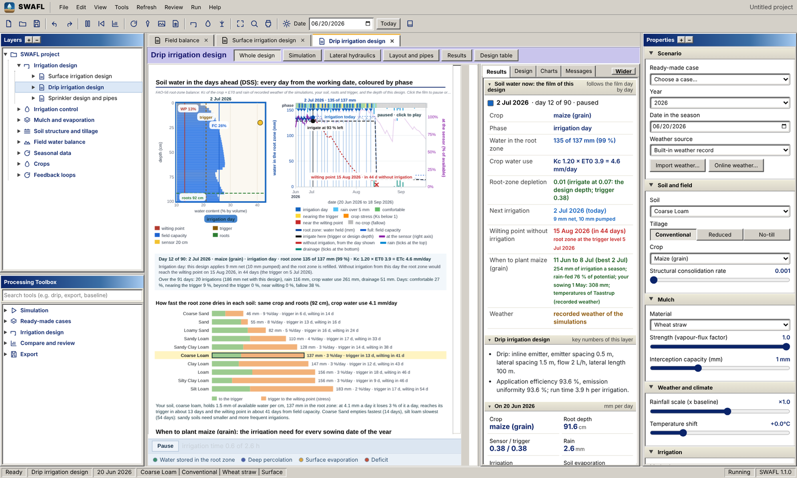

# SWAFL Desktop: versions

**Download the SWAFL manual (PDF):** version 1.1.0, the latest: [open in the browser](https://github.com/halilunaziru73-creator/Coupled-Water-Fluxes-Pore-Scale-Dynamics-Precision-Irrigation-Mulching-Feedback-Loops/raw/main/Software/v1.1.0/SWAFL_Desktop/docs/manual_v1.1.0/SWAFL_Manual_v1.1.0.pdf) or [download](https://github.com/halilunaziru73-creator/Coupled-Water-Fluxes-Pore-Scale-Dynamics-Precision-Irrigation-Mulching-Feedback-Loops/raw/main/Software/v1.1.0/SWAFL_Desktop/docs/manual_v1.1.0/SWAFL_Manual_v1.1.0.pdf)

Each version of SWAFL Desktop has its own folder with its source, its manual and its zip. Author: Naziru Halilu. MIT licence. The simulations behind the software were made with the [Daisy model](https://github.com/daisy-model), developed at the University of Copenhagen.

| Version | Folder | Zip | Manual | Online workbench |
|:--|:--|:--|:--|:--|
| **1.1.0** (current) | [`v1.1.0/SWAFL_Desktop`](v1.1.0/SWAFL_Desktop) | [SWAFL_Desktop.zip](https://github.com/halilunaziru73-creator/Coupled-Water-Fluxes-Pore-Scale-Dynamics-Precision-Irrigation-Mulching-Feedback-Loops/raw/main/Software/v1.1.0/SWAFL_Desktop.zip) | [SWAFL_Manual_v1.1.0.pdf](https://github.com/halilunaziru73-creator/Coupled-Water-Fluxes-Pore-Scale-Dynamics-Precision-Irrigation-Mulching-Feedback-Loops/raw/main/Software/v1.1.0/SWAFL_Desktop/docs/manual_v1.1.0/SWAFL_Manual_v1.1.0.pdf) | [open](https://halilunaziru73-creator.github.io/Coupled-Water-Fluxes-Pore-Scale-Dynamics-Precision-Irrigation-Mulching-Feedback-Loops/Software/v1.1.0/SWAFL_Desktop/app/index.html?v=1.1.0) |

**Weather options.** SWAFL does not depend on one weather record. The user chooses the weather of the whole project, and every layer, the dashboard and the Daisy runs follow it: (1) the built-in benchmark record (Taastrup, Denmark); (2) the bundled Daisy stations Taastrup, Foulum, Jyndevad (Denmark), Bologna (Italy), Jadwisin (Poland), Bratislava (Slovakia) and Valecov (Czech Republic), and the Daisy sample stations of other sites; (3) the user's own file (CSV, TXT, Excel, Daisy DWF, DLF or DAI); (4) online weather of any place on Earth from the Open-Meteo archive (checked for complete years); (5) DMI open data with the user's own free key. Any working date from 1980 to 2100 can be typed in the toolbar. The 10,190 archived runs used one fixed weather, Taastrup 1980 to 1999, so that the experiments are comparable; that is a choice of the experiment, not a limit of the software.

**What 1.1.0 adds to 1.0:** the graphical Daisy workbench (guided path, 17 prepared experiments, process map, soil column, response curves, calibration) with Daisy bundled for Windows, and its connection to the decision layers (decision table, chemical budget); a library of 48 crops; deterministic phenotyping of a plant under well-watered and drought treatments; the field sketch; the field on the map (Sentinel-2 indices, image analysis of the satellite photograph, water sources and irrigation systems, the season of the field, variable-rate irrigation simulated zone by zone, ephemeral gullies and soil loss, report at a chosen dpi); planting advice; weather import and online weather with a forecast in every design; design runs on request with value inputs, design charts and the soil-water film of every design; the full Trigger law and Soil hydraulic drivers dashboards; and a rewritten manual in which every screen is documented.

**Build either version** (Windows, needs Node.js LTS): open the inner `SWAFL_Desktop` folder of that version in VS Code and run `npm.cmd install` then `npm.cmd run get-app`.
