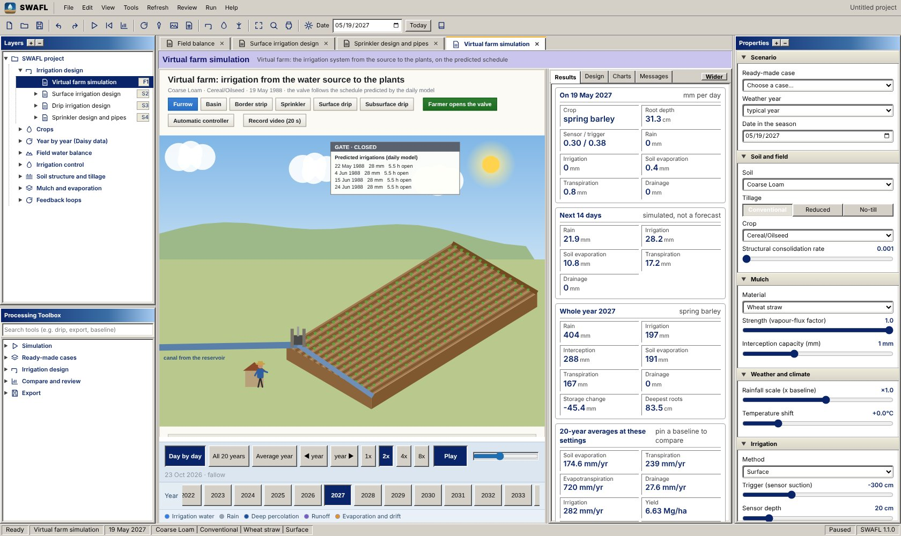
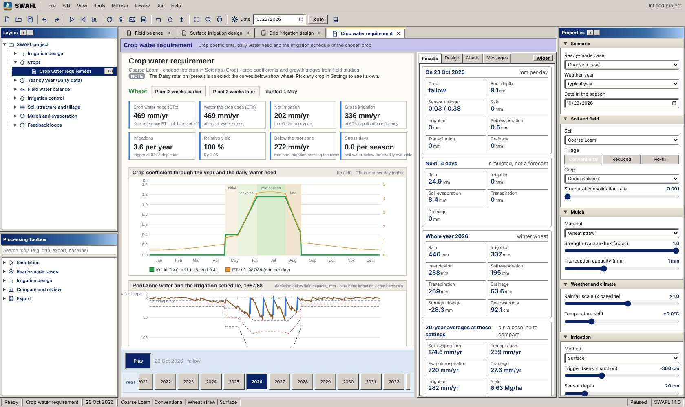

# Virtual farm, crops and year-by-year layers (release 1.1)

Release 1.1 adds four groups of layers and three workbench functions. Every new layer follows the controls of the Properties panel (soil, tillage, crop, mulch, rainfall, warming, irrigation method, trigger, sensor depth and nitrogen) and is redrawn when any of them changes.

## F1 Virtual farm simulation

The virtual farm (Layers → Irrigation design → *Virtual farm simulation*) draws a field in perspective with the water moving from the source to the plants. Six layouts are available:

| Layout | Head works drawn | Water on the field |
|:--|:--|:--|
| Furrow | canal from the reservoir, lifting gate, siphons | advance front along each furrow, tail-water ditch with the runoff share |
| Basin | canal, gate | sheet of water filling each basin |
| Border strip | canal, gate, siphons | sheet advancing down each strip, tail water |
| Sprinkler | well, pump, filters, fertiliser tank, mainline, control valve | rotating sprays with wind drift |
| Surface drip | well, pump, filters, fertiliser tank, mainline, control valve | emitters and wet spots along the laterals |
| Subsurface drip | as surface drip | buried laterals and wetted bands below the surface |

**The gate or valve follows the predicted schedule.** The daily model (Engine 2, chapter 5) predicts the dates and depths of irrigation for the present settings. The board at the gate lists the next four irrigations with the hours the gate or valve stays open; tap a line to jump to that date. During an irrigation the gate is lifted (or the valve opened) and water flows; between irrigations it is closed. *Farmer opens the valve* shows a farmer walking to the gate; *Automatic controller* shows a controller box wired to the soil-water sensor, whose lamp lights when the trigger is reached.

**Below the farm** are three panels: (i) a cross-section through the field showing the water in each soil layer of the daily model, the wetting front, the roots of the chosen crop and the sensor; (ii) the predicted schedule for the next 30 days (rain, irrigation, valve open, sensor depletion and trigger); (iii) the fate of the next irrigation (stored in the root zone, deep percolation, surface runoff, evaporation and drift), taken from the surface (S2), drip (S3) or sprinkler (S4) design of the same layout.

**Record video (20 s)** records the farm for 20 seconds and saves it as a WebM film.

{width=100%}

## Crops and C1 Crop water requirement

Properties → Crop lists the Daisy cereal rotation (simulated) and 48 library crops in five groups:

| Group | Crops |
|:--|:--|
| Staple food crops | cassava, yam, rice (paddy), maize, sorghum, millet, cowpea, wheat, potato |
| Cash and oil crops | groundnut, soybean, cotton, mustard, green gram, chickpea, oil palm, cocoa |
| Vegetables | tomato, onion, cabbage, sweet pepper |
| Trees, vines and palms | table and wine grapes, kiwi, blueberry, hop, citrus, olive, apple, pear, cherry, peach, apricot, almond, walnut, pistachio, pecan, hazelnut, pomegranate, fig, persimmon, avocado, mango, guava, date palm, coconut, papaya, cherimoya |

The crop coefficients of the staple and cash crops are: cassava 0.30 / 0.80 / 0.30, yam 0.50 / 1.10 / 0.85, rice 1.05 / 1.20 / 0.90, maize 0.30 / 1.20 / 0.60, sorghum 0.30 / 1.00 / 0.55, millet 0.30 / 1.00 / 0.30, cowpea 0.40 / 1.05 / 0.50, groundnut 0.40 / 1.15 / 0.60, soybean 0.40 / 1.15 / 0.50, oil palm 0.90 / 0.95 / 0.95, cocoa 1.00 / 1.05 / 1.05 (initial / mid-season / end). The former legume and vegetable categories, which only multiplied the cereal yield, are removed; projects saved with them open with soybean and tomato. Each library crop carries crop coefficients for the initial, mid-season and late stages, stage lengths, height, maximum rooting depth, the depletion fraction $p$ and the yield-response factor $K_y$; tree and vine crops have several planting densities (ground cover and height).

For a library crop the program runs a daily root-zone water balance on the same 20 weather years as the Daisy simulations: the crop water need is $ET_c = K_c\,ET_0$, the soil is refilled to field capacity when the depletion reaches the trigger, and the relative yield follows $1-Y_a/Y_m = K_y\,(1-ET_a/ET_c)$. The Daisy results of the cereal are then transferred to the crop by the ratio of the two balances (irrigation, transpiration, evaporation and drainage), so that every other layer responds to the crop. The bar under the drawing states which model is in use. Yield of a library crop is shown as a percentage of the potential.

The layer **C1 Crop water requirement** shows the crop's tiles (water need, water used, net and gross irrigation, number of irrigations, relative yield, water below the root zone, stress days), the $K_c$ curve with the stage bands and the daily water need, the root-zone depletion with the irrigations and rain of the selected year, and a table of every crop on the present soil ranked by net irrigation. Tap a row to select that crop.

{width=100%}

## Daily records that follow the settings (V1, V2)

The 20-year sensor record (V1) and the season profiles (V2) start from your Daisy daily output, which exists for the coarse loam and the coarse sand at the standard settings (conventional tillage, bare soil, surface irrigation, trigger −300 cm at 20 cm, cereal, unscaled rain, no warming, full nitrogen). For any other soil or setting the daily model is run twice, at your settings and at the standard settings, and the difference in depletion of available water at the sensor depth is added day by day to the Daisy record, which is then converted to suction with the van Genuchten curve of your soil. The real weather sequence of the record is kept, and every control moves the traces.

## Year by year: Y1, W1 and N4

These layers use the per-year output of 1 003 Daisy runs (experiments E00, E02, E03, E04, E05 and E07, 20 years each), extracted from the complete simulation output by `tools/make_peryear.py`. The run matching the present settings is selected automatically (mulch, method, trigger, sensor depth, tillage and consolidation rate).

* **Y1 Reliability over 20 seasons**: yield, irrigation, drainage, nitrogen leaching, water-stress days and water productivity of each year; a reliability table (median, 10 % and 90 % years) and exceedance curves.
* The Daisy run gives the year-to-year pattern; controls that its experiment does not vary (crop, rainfall scale, warming and nitrogen rate) are applied by the response of the annual model, so that the 20-year mean of every series equals the annual result at your settings.
* **W1 Full water balance**: the water balance of each year as stacked bars; the evapotranspiration split into transpiration, soil evaporation, canopy evaporation, litter evaporation, evaporation of ponded water and snow evaporation, which together close ET to within 1.1 mm; potential and actual evapotranspiration; the infiltration path (matrix and macropores) and drainage.
* **N4 Nitrogen budget**: fertiliser, mineralisation, plant uptake, denitrification, volatilisation and leaching per year, with leaching against drainage.

{width=100%}

## Consolidation rate

In your Daisy runs (E5) the consolidation rate of the tilled layer changes the results only in the five finer soils (loam to silty clay loam: up to 6 mm/yr of drainage and 14 kg N/ha of leaching); in the five coarser soils all rates give the same result, and the program shows the same.

## Workbench functions

* **F1** opens this manual directly (Help → *Manual (PDF)*, or the book button on the toolbar).
* **Save full report as PDF** (File menu, *Report* toolbar button, `Ctrl+Shift+P`) writes the complete report of all layers to a PDF file at a place you choose.
* **Long layers** are fitted to their content: the drawing grows to show every panel and the centre window scrolls to the end of the layer.

## Correction of the surface layer (release 1.1.0)

In release 1.0.0 the infiltration of the steady-intake term $f_0$ during advance was divided by $(1+r)$ with a fixed advance exponent $r=0.55$ (Eq. 11.9). Release 1.1.0 uses the iterated advance exponent of the volume-balance solution. With the correction the shipped layer reproduces the 13 advance times of the FAO-45 border examples within $-0.2$ to $+0.5$ % (before: $-2.2$ to $+2.9$ %) and the eight advance times of Example 6.1 within $-0.2$ to $+1.8$ % (before: up to $-29$ % when advance is slow). Results with the pure Kostiakov law ($f_0=0$) are unchanged.
