# About this volume {-}

This volume shows every screen of SWAFL Desktop 1.1.0 at the default settings (Coarse Loam, conventional tillage, the cereal/oilseed rotation, wheat-straw mulch of strength 1.0, surface irrigation, trigger −300 cm at 20 cm, the built-in weather record, the working date of the capture). Each layer is shown first in the window, then drawn from top to bottom and cut into page-size parts at its section headings; the caption of each part names the sections it holds. After the drawing, every equation that the layer draws on is printed in full with its provenance. The three designs are shown after their run, and the virtual farm is shown for each design on an irrigation day.

\newpage

# The window

## The workbench

{width=100%}

{width=100%}

\newpage

## The menus

{width=100%}

{width=100%}

{width=100%}

{width=100%}

{width=100%}

{width=100%}

{width=100%}

{width=100%}

\newpage

## The dialogs

{width=100%}

{width=100%}

{width=100%}

{width=100%}

{width=100%}

{width=100%}

{width=100%}

{width=100%}

{width=100%}

\newpage

## The Properties panel

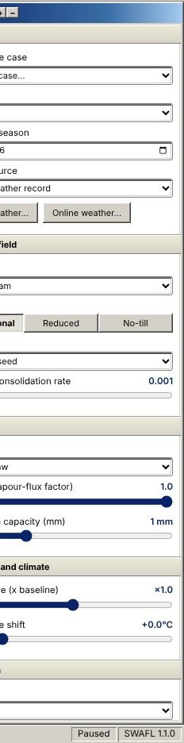{width=40%}

## The dashboard

{width=100%}

{width=100%}

{width=100%}

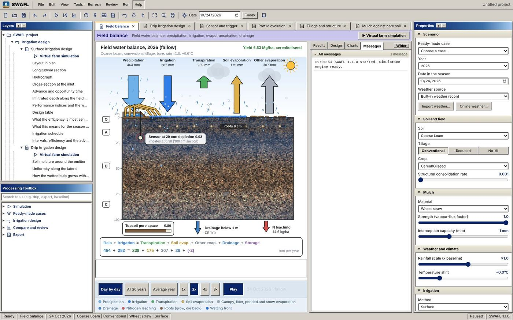{width=100%}

\newpage

{width=100%}

{width=100%}

{width=100%}

{width=100%}

\newpage

{width=100%}

{width=100%}

{width=100%}

{width=100%}

\newpage

{width=100%}

{width=100%}

{width=100%}

{width=100%}

\newpage

{width=100%}

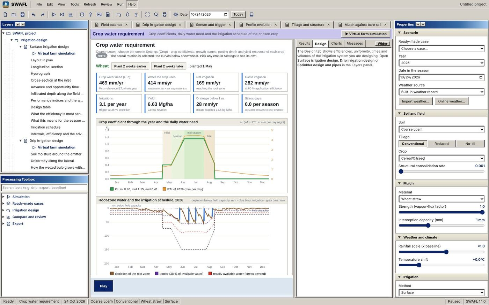{width=100%}

{width=100%}

{width=100%}

\newpage

## Before a design runs

{width=100%}

{width=100%}

{width=100%}

{width=100%}

{width=100%}

{width=100%}

\newpage

# Irrigation design

## Surface irrigation design

{width=100%}

{width=100%}

\newpage

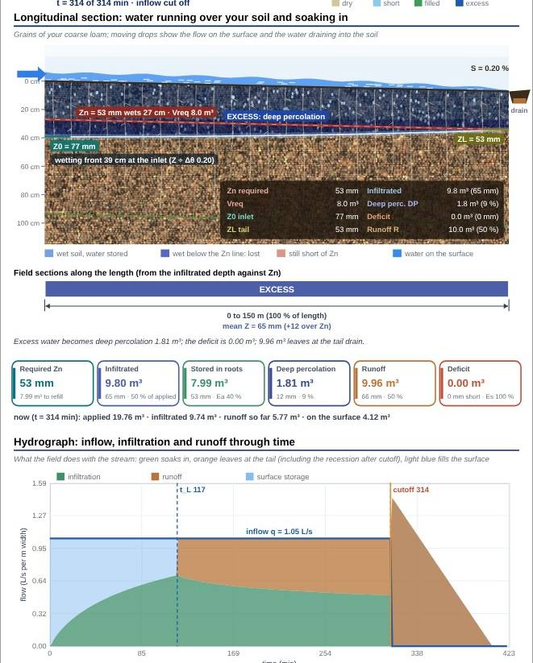{width=100%}

\newpage

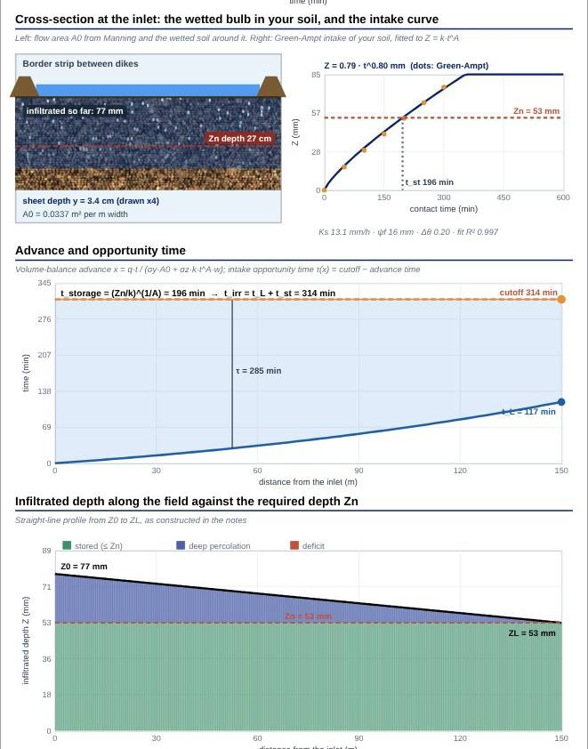{width=100%}

\newpage

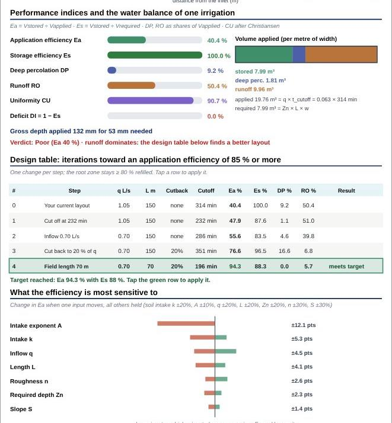{width=100%}

\newpage

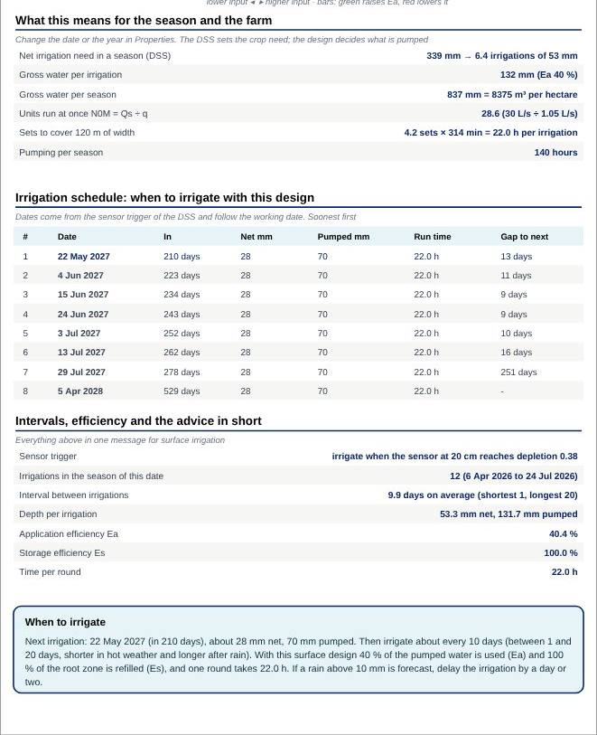{width=100%}

\newpage

### The equations of this layer

Every number and picture of the layer comes from the equations below (numbers as in Volume 1, with the chapter that explains each).

**Eq. 4.1** (Volume 1, dates)

$$
k_{\mathrm{start}} = 365\,a + d_{\mathrm{oy}}, \qquad
\text{date}(k) = \text{1 Jan of year } \bigl(Y_0 + \lfloor k/365\rfloor - a\bigr) + \bigl(k - 365\lfloor k/365\rfloor\bigr)\ \text{days},
\tag{4.1}
$$

*Provenance (Eq. 4.1):* **[Engineered]**: calendar bookkeeping and choice of analogue year; no physical law.

**Eq. 5.1** (Volume 1, engine)

$$
S_e(h) = \Bigl[\,1 + (\alpha |h|)^{n}\Bigr]^{-m},\quad m = 1 - \tfrac{1}{n}, \qquad
\theta(h) = \theta_r + (\theta_s - \theta_r)\,S_e(h)
\tag{5.1}
$$

*Provenance (Eq. 5.1):* **[Literature]**: van Genuchten (1980).

**Eq. 5.2** (Volume 1, engine)

$$
K_r(S_e) = S_e^{\,1/2}\Bigl[\,1 - \bigl(1 - S_e^{\,1/m}\bigr)^{m}\Bigr]^{2}.
\tag{5.2}
$$

*Provenance (Eq. 5.2):* **[Literature]**: Mualem (1976) with van Genuchten (1980).

**Eq. 5.3** (Volume 1, engine)

$$
f(h) \;=\; \frac{S_e(100) - S_e(|h|)}{S_e(100) - S_e(15\,849)},
\qquad f_{\mathrm{used}} = \min\{1,\max\{0, f\}\}.
\tag{5.3}
$$

*Provenance (Eq. 5.3):* **[Literature]**: standard definition of plant-available water between field capacity and wilting point.

**Eq. 5.4** (Volume 1, engine)

$$
\begin{aligned}
E &= \bar E(\mathrm{soil},\varphi,c)\ \Bigl[\tfrac{\mathrm{now}.E}{\mathrm{ref}.E}\Bigr]\Bigl[\tfrac{\mathrm{tN}.E}{\mathrm{tB}.E}\Bigr]\Bigl[\tfrac{E_b}{E_{b,\mathrm{ref}}}\Bigr] &&(5.4)\\
T &= T_b\ \Bigl[\tfrac{\mathrm{now}.T}{\mathrm{bare}.T}\Bigr]\ \mathrm{clip}\Bigl(\tfrac{\mathrm{tN}.T}{\mathrm{tB}.T};\,0.3,\,2.5\Bigr) &&(5.5)\\
ET &= ET_b\ \Bigl[\tfrac{\mathrm{now}.ET}{\mathrm{bare}.ET}\Bigr]\ \mathrm{clip}\Bigl(\tfrac{\mathrm{tN}.ET}{\mathrm{tB}.ET};\,0.5,\,2\Bigr) &&(5.6)\\
I &= I_b\ \Bigl[\tfrac{\mathrm{now}.I}{\mathrm{bare}.I}\Bigr]\ \mathrm{clip}\Bigl(\tfrac{\mathrm{tN}.I}{\mathrm{tB}.I};\,0.4,\,2.5\Bigr) &&(5.7)\\
Y &= Y_b\ \Bigl[\tfrac{\mathrm{tN}.Y}{\mathrm{tR}.Y}\Bigr]\Bigl[\tfrac{\mathrm{now}.Y}{\mathrm{nm}.Y}\Bigr] &&(5.8)\\
D &= D_b + (\mathrm{now}.D-\mathrm{bare}.D) + (\mathrm{tN}.D-\mathrm{tB}.D) &&(5.9)\\
N_L &= N_b + (\mathrm{now}.N-\mathrm{bare}.N) + (\mathrm{tN}.N-\mathrm{tB}.N) &&(5.10)
\end{aligned}
$$

*Provenance (Eq. 5.4--5.10):* **[Data-driven]**: ratios of Daisy ensemble results (run sets E2--E14); the clip bounds are engineered limits.

**Eq. 5.5** (Volume 1, engine)

$$
\begin{aligned}
E &= \bar E(\mathrm{soil},\varphi,c)\ \Bigl[\tfrac{\mathrm{now}.E}{\mathrm{ref}.E}\Bigr]\Bigl[\tfrac{\mathrm{tN}.E}{\mathrm{tB}.E}\Bigr]\Bigl[\tfrac{E_b}{E_{b,\mathrm{ref}}}\Bigr] &&(5.4)\\
T &= T_b\ \Bigl[\tfrac{\mathrm{now}.T}{\mathrm{bare}.T}\Bigr]\ \mathrm{clip}\Bigl(\tfrac{\mathrm{tN}.T}{\mathrm{tB}.T};\,0.3,\,2.5\Bigr) &&(5.5)\\
ET &= ET_b\ \Bigl[\tfrac{\mathrm{now}.ET}{\mathrm{bare}.ET}\Bigr]\ \mathrm{clip}\Bigl(\tfrac{\mathrm{tN}.ET}{\mathrm{tB}.ET};\,0.5,\,2\Bigr) &&(5.6)\\
I &= I_b\ \Bigl[\tfrac{\mathrm{now}.I}{\mathrm{bare}.I}\Bigr]\ \mathrm{clip}\Bigl(\tfrac{\mathrm{tN}.I}{\mathrm{tB}.I};\,0.4,\,2.5\Bigr) &&(5.7)\\
Y &= Y_b\ \Bigl[\tfrac{\mathrm{tN}.Y}{\mathrm{tR}.Y}\Bigr]\Bigl[\tfrac{\mathrm{now}.Y}{\mathrm{nm}.Y}\Bigr] &&(5.8)\\
D &= D_b + (\mathrm{now}.D-\mathrm{bare}.D) + (\mathrm{tN}.D-\mathrm{tB}.D) &&(5.9)\\
N_L &= N_b + (\mathrm{now}.N-\mathrm{bare}.N) + (\mathrm{tN}.N-\mathrm{tB}.N) &&(5.10)
\end{aligned}
$$

*Provenance (Eq. 5.4--5.10):* **[Data-driven]**: ratios of Daisy ensemble results (run sets E2--E14); the clip bounds are engineered limits.

**Eq. 5.6** (Volume 1, engine)

$$
\begin{aligned}
E &= \bar E(\mathrm{soil},\varphi,c)\ \Bigl[\tfrac{\mathrm{now}.E}{\mathrm{ref}.E}\Bigr]\Bigl[\tfrac{\mathrm{tN}.E}{\mathrm{tB}.E}\Bigr]\Bigl[\tfrac{E_b}{E_{b,\mathrm{ref}}}\Bigr] &&(5.4)\\
T &= T_b\ \Bigl[\tfrac{\mathrm{now}.T}{\mathrm{bare}.T}\Bigr]\ \mathrm{clip}\Bigl(\tfrac{\mathrm{tN}.T}{\mathrm{tB}.T};\,0.3,\,2.5\Bigr) &&(5.5)\\
ET &= ET_b\ \Bigl[\tfrac{\mathrm{now}.ET}{\mathrm{bare}.ET}\Bigr]\ \mathrm{clip}\Bigl(\tfrac{\mathrm{tN}.ET}{\mathrm{tB}.ET};\,0.5,\,2\Bigr) &&(5.6)\\
I &= I_b\ \Bigl[\tfrac{\mathrm{now}.I}{\mathrm{bare}.I}\Bigr]\ \mathrm{clip}\Bigl(\tfrac{\mathrm{tN}.I}{\mathrm{tB}.I};\,0.4,\,2.5\Bigr) &&(5.7)\\
Y &= Y_b\ \Bigl[\tfrac{\mathrm{tN}.Y}{\mathrm{tR}.Y}\Bigr]\Bigl[\tfrac{\mathrm{now}.Y}{\mathrm{nm}.Y}\Bigr] &&(5.8)\\
D &= D_b + (\mathrm{now}.D-\mathrm{bare}.D) + (\mathrm{tN}.D-\mathrm{tB}.D) &&(5.9)\\
N_L &= N_b + (\mathrm{now}.N-\mathrm{bare}.N) + (\mathrm{tN}.N-\mathrm{tB}.N) &&(5.10)
\end{aligned}
$$

*Provenance (Eq. 5.4--5.10):* **[Data-driven]**: ratios of Daisy ensemble results (run sets E2--E14); the clip bounds are engineered limits.

**Eq. 5.7** (Volume 1, engine)

$$
\begin{aligned}
E &= \bar E(\mathrm{soil},\varphi,c)\ \Bigl[\tfrac{\mathrm{now}.E}{\mathrm{ref}.E}\Bigr]\Bigl[\tfrac{\mathrm{tN}.E}{\mathrm{tB}.E}\Bigr]\Bigl[\tfrac{E_b}{E_{b,\mathrm{ref}}}\Bigr] &&(5.4)\\
T &= T_b\ \Bigl[\tfrac{\mathrm{now}.T}{\mathrm{bare}.T}\Bigr]\ \mathrm{clip}\Bigl(\tfrac{\mathrm{tN}.T}{\mathrm{tB}.T};\,0.3,\,2.5\Bigr) &&(5.5)\\
ET &= ET_b\ \Bigl[\tfrac{\mathrm{now}.ET}{\mathrm{bare}.ET}\Bigr]\ \mathrm{clip}\Bigl(\tfrac{\mathrm{tN}.ET}{\mathrm{tB}.ET};\,0.5,\,2\Bigr) &&(5.6)\\
I &= I_b\ \Bigl[\tfrac{\mathrm{now}.I}{\mathrm{bare}.I}\Bigr]\ \mathrm{clip}\Bigl(\tfrac{\mathrm{tN}.I}{\mathrm{tB}.I};\,0.4,\,2.5\Bigr) &&(5.7)\\
Y &= Y_b\ \Bigl[\tfrac{\mathrm{tN}.Y}{\mathrm{tR}.Y}\Bigr]\Bigl[\tfrac{\mathrm{now}.Y}{\mathrm{nm}.Y}\Bigr] &&(5.8)\\
D &= D_b + (\mathrm{now}.D-\mathrm{bare}.D) + (\mathrm{tN}.D-\mathrm{tB}.D) &&(5.9)\\
N_L &= N_b + (\mathrm{now}.N-\mathrm{bare}.N) + (\mathrm{tN}.N-\mathrm{tB}.N) &&(5.10)
\end{aligned}
$$

*Provenance (Eq. 5.4--5.10):* **[Data-driven]**: ratios of Daisy ensemble results (run sets E2--E14); the clip bounds are engineered limits.

**Eq. 5.8** (Volume 1, engine)

$$
\begin{aligned}
E &= \bar E(\mathrm{soil},\varphi,c)\ \Bigl[\tfrac{\mathrm{now}.E}{\mathrm{ref}.E}\Bigr]\Bigl[\tfrac{\mathrm{tN}.E}{\mathrm{tB}.E}\Bigr]\Bigl[\tfrac{E_b}{E_{b,\mathrm{ref}}}\Bigr] &&(5.4)\\
T &= T_b\ \Bigl[\tfrac{\mathrm{now}.T}{\mathrm{bare}.T}\Bigr]\ \mathrm{clip}\Bigl(\tfrac{\mathrm{tN}.T}{\mathrm{tB}.T};\,0.3,\,2.5\Bigr) &&(5.5)\\
ET &= ET_b\ \Bigl[\tfrac{\mathrm{now}.ET}{\mathrm{bare}.ET}\Bigr]\ \mathrm{clip}\Bigl(\tfrac{\mathrm{tN}.ET}{\mathrm{tB}.ET};\,0.5,\,2\Bigr) &&(5.6)\\
I &= I_b\ \Bigl[\tfrac{\mathrm{now}.I}{\mathrm{bare}.I}\Bigr]\ \mathrm{clip}\Bigl(\tfrac{\mathrm{tN}.I}{\mathrm{tB}.I};\,0.4,\,2.5\Bigr) &&(5.7)\\
Y &= Y_b\ \Bigl[\tfrac{\mathrm{tN}.Y}{\mathrm{tR}.Y}\Bigr]\Bigl[\tfrac{\mathrm{now}.Y}{\mathrm{nm}.Y}\Bigr] &&(5.8)\\
D &= D_b + (\mathrm{now}.D-\mathrm{bare}.D) + (\mathrm{tN}.D-\mathrm{tB}.D) &&(5.9)\\
N_L &= N_b + (\mathrm{now}.N-\mathrm{bare}.N) + (\mathrm{tN}.N-\mathrm{tB}.N) &&(5.10)
\end{aligned}
$$

*Provenance (Eq. 5.4--5.10):* **[Data-driven]**: ratios of Daisy ensemble results (run sets E2--E14); the clip bounds are engineered limits.

**Eq. 5.9** (Volume 1, engine)

$$
\begin{aligned}
E &= \bar E(\mathrm{soil},\varphi,c)\ \Bigl[\tfrac{\mathrm{now}.E}{\mathrm{ref}.E}\Bigr]\Bigl[\tfrac{\mathrm{tN}.E}{\mathrm{tB}.E}\Bigr]\Bigl[\tfrac{E_b}{E_{b,\mathrm{ref}}}\Bigr] &&(5.4)\\
T &= T_b\ \Bigl[\tfrac{\mathrm{now}.T}{\mathrm{bare}.T}\Bigr]\ \mathrm{clip}\Bigl(\tfrac{\mathrm{tN}.T}{\mathrm{tB}.T};\,0.3,\,2.5\Bigr) &&(5.5)\\
ET &= ET_b\ \Bigl[\tfrac{\mathrm{now}.ET}{\mathrm{bare}.ET}\Bigr]\ \mathrm{clip}\Bigl(\tfrac{\mathrm{tN}.ET}{\mathrm{tB}.ET};\,0.5,\,2\Bigr) &&(5.6)\\
I &= I_b\ \Bigl[\tfrac{\mathrm{now}.I}{\mathrm{bare}.I}\Bigr]\ \mathrm{clip}\Bigl(\tfrac{\mathrm{tN}.I}{\mathrm{tB}.I};\,0.4,\,2.5\Bigr) &&(5.7)\\
Y &= Y_b\ \Bigl[\tfrac{\mathrm{tN}.Y}{\mathrm{tR}.Y}\Bigr]\Bigl[\tfrac{\mathrm{now}.Y}{\mathrm{nm}.Y}\Bigr] &&(5.8)\\
D &= D_b + (\mathrm{now}.D-\mathrm{bare}.D) + (\mathrm{tN}.D-\mathrm{tB}.D) &&(5.9)\\
N_L &= N_b + (\mathrm{now}.N-\mathrm{bare}.N) + (\mathrm{tN}.N-\mathrm{tB}.N) &&(5.10)
\end{aligned}
$$

*Provenance (Eq. 5.4--5.10):* **[Data-driven]**: ratios of Daisy ensemble results (run sets E2--E14); the clip bounds are engineered limits.

**Eq. 5.10** (Volume 1, engine)

$$
\begin{aligned}
E &= \bar E(\mathrm{soil},\varphi,c)\ \Bigl[\tfrac{\mathrm{now}.E}{\mathrm{ref}.E}\Bigr]\Bigl[\tfrac{\mathrm{tN}.E}{\mathrm{tB}.E}\Bigr]\Bigl[\tfrac{E_b}{E_{b,\mathrm{ref}}}\Bigr] &&(5.4)\\
T &= T_b\ \Bigl[\tfrac{\mathrm{now}.T}{\mathrm{bare}.T}\Bigr]\ \mathrm{clip}\Bigl(\tfrac{\mathrm{tN}.T}{\mathrm{tB}.T};\,0.3,\,2.5\Bigr) &&(5.5)\\
ET &= ET_b\ \Bigl[\tfrac{\mathrm{now}.ET}{\mathrm{bare}.ET}\Bigr]\ \mathrm{clip}\Bigl(\tfrac{\mathrm{tN}.ET}{\mathrm{tB}.ET};\,0.5,\,2\Bigr) &&(5.6)\\
I &= I_b\ \Bigl[\tfrac{\mathrm{now}.I}{\mathrm{bare}.I}\Bigr]\ \mathrm{clip}\Bigl(\tfrac{\mathrm{tN}.I}{\mathrm{tB}.I};\,0.4,\,2.5\Bigr) &&(5.7)\\
Y &= Y_b\ \Bigl[\tfrac{\mathrm{tN}.Y}{\mathrm{tR}.Y}\Bigr]\Bigl[\tfrac{\mathrm{now}.Y}{\mathrm{nm}.Y}\Bigr] &&(5.8)\\
D &= D_b + (\mathrm{now}.D-\mathrm{bare}.D) + (\mathrm{tN}.D-\mathrm{tB}.D) &&(5.9)\\
N_L &= N_b + (\mathrm{now}.N-\mathrm{bare}.N) + (\mathrm{tN}.N-\mathrm{tB}.N) &&(5.10)
\end{aligned}
$$

*Provenance (Eq. 5.4--5.10):* **[Data-driven]**: ratios of Daisy ensemble results (run sets E2--E14); the clip bounds are engineered limits.

**Eq. 5.11** (Volume 1, engine)

$$
Q \leftarrow Q\ \mathrm{clip}\Bigl(\tfrac{r_\kappa.Q}{r_{\kappa_0}.Q};\,0.05,\,6\Bigr)\ \ (Q\in\{E,T,ET,I,Y\}),\qquad
D \leftarrow D + (r_\kappa.D - r_{\kappa_0}.D),\quad N_L \leftarrow N_L + (r_\kappa.N - r_{\kappa_0}.N).
\tag{5.11}
$$

*Provenance (Eq. 5.11):* **[Data-driven]**: set-specific corrections from the Daisy run sets; clip bounds engineered.

**Eq. 5.12** (Volume 1, engine)

$$
\begin{gathered}
ET \in [\,P + I - D - 30,\ P + I - D + 15\,]\ \text{(if not, } ET\ \text{is clipped and } E, T \text{ are scaled by the same factor)},\\
E_{\mathrm{other}} = \max(0,\ ET - T - E),\qquad \Delta S = P + I - ET - D,\qquad
\mathrm{IE} = \frac{100\,Y}{I}\ \ [\mathrm{kg\ m^{-3}}].
\end{gathered}
\tag{5.12}
$$

*Provenance (Eq. 5.12):* **[Engineered]**: closure constraint and bounds chosen for the workbench.

**Eq. 5.27** (Volume 1, engine)

$$
Z_n = \mathrm{clip}\bigl(f_T\cdot \mathrm{AWC}\cdot R_{\max};\ 25,\ 150\bigr)\ \mathrm{mm}\qquad(\text{surface; drip and sprinkler use their own limits})
\tag{5.27}
$$

*Provenance (Eq. 5.27):* **[Literature]**: readily available water as in FAO-56 practice, with an engineered clip.

**Eq. 11.1** (Volume 1, surface)

$$
\begin{aligned}
\theta_{1500,t} &= -0.024\,S + 0.487\,C + 0.006\,\mathrm{OM} + 0.005\,S\,\mathrm{OM} - 0.013\,C\,\mathrm{OM} + 0.068\,S\,C + 0.031,\\
\theta_{1500} &= \theta_{1500,t} + \bigl(0.14\,\theta_{1500,t} - 0.02\bigr),\\
\theta_{33,t} &= -0.251\,S + 0.195\,C + 0.011\,\mathrm{OM} + 0.006\,S\,\mathrm{OM} - 0.027\,C\,\mathrm{OM} + 0.452\,S\,C + 0.299,\\
\theta_{33} &= \theta_{33,t} + \bigl(1.283\,\theta_{33,t}^{2} - 0.374\,\theta_{33,t} - 0.015\bigr),
\end{aligned}
\tag{11.1}
$$

*Provenance (Eq. 11.1):* **[Literature]**: Saxton and Rawls (2006), implemented as written.

**Eq. 11.2** (Volume 1, surface)

$$
\begin{aligned}
\theta_{(S-33),t} &= 0.278\,S + 0.034\,C + 0.022\,\mathrm{OM} - 0.018\,S\,\mathrm{OM} - 0.027\,C\,\mathrm{OM} - 0.584\,S\,C + 0.078,\\
\theta_{(S-33)} &= \theta_{(S-33),t} + \bigl(0.636\,\theta_{(S-33),t} - 0.107\bigr),\qquad
\theta_{s} = \theta_{33} + \theta_{(S-33)} - 0.097\,S + 0.043,\\
B &= \frac{\ln 1500 - \ln 33}{\ln\theta_{33} - \ln\theta_{1500}},\qquad \lambda = \frac1B,\qquad
K_s = 1930\,(\theta_s - \theta_{33})^{\,3-\lambda}.
\end{aligned}
\tag{11.2}
$$

*Provenance (Eq. 11.2):* **[Literature]**: Saxton and Rawls (2006), implemented as written.

**Eq. 11.3** (Volume 1, surface)

$$
\psi_f = \frac{10}{\alpha}\,\frac{0.046\,m + 2.07\,m^{2} + 19.5\,m^{3}}{1 + 4.7\,m + 16\,m^{2}}.
\tag{11.3}
$$

*Provenance (Eq. 11.3):* **[Engineered]**: rational-polynomial approximation of a Rawls-type suction.

**Eq. 11.4** (Volume 1, surface)

$$
\theta_0 = \theta_{fc} - f_T\,(\theta_{fc} - \theta_{wp}),\qquad
\Delta\theta = \max\{0.05,\ 0.95\,\theta_s - \theta_0\}.
\tag{11.4}
$$

*Provenance (Eq. 11.4):* **[Engineered]**: initial and wetted water contents chosen for the workbench.

**Eq. 11.5** (Volume 1, surface)

$$
F - \psi_f\,\Delta\theta\,\ln\!\Bigl(1 + \frac{F}{\psi_f\,\Delta\theta}\Bigr) = K_s\,\frac{t}{60}\quad(t\ \text{in min}),
\tag{11.5}
$$

*Provenance (Eq. 11.5):* **[Literature]**: Green and Ampt (1911).

**Eq. 11.6** (Volume 1, surface)

$$
Z(\tau) = k\,\tau^{A}\qquad (Z\ \text{in m},\ \tau\ \text{in min}),
\tag{11.6}
$$

*Provenance (Eq. 11.6):* **[Literature]**: Kostiakov (1932).

**Eq. 11.7** (Volume 1, surface)

$$
A = \frac{\sum (x_i - \bar x)(y_i - \bar y)}{\sum (x_i - \bar x)^2},\quad
\ln k = \bar y - A\,\bar x,\qquad x_i=\ln\tau_i,\ y_i=\ln\bigl(F(\tau_i)/1000\bigr),
\tag{11.7}
$$

*Provenance (Eq. 11.7):* **[Literature]**: ordinary least squares on the log--log plot.

**Eq. 11.8** (Volume 1, surface)

$$
Q = \frac{1}{n}\,A\,R_h^{2/3}\,S^{1/2},\qquad R_h=\frac{A}{P}.
\tag{11.8}
$$

*Provenance (Eq. 11.8):* **[Literature]**: Manning (1891).

**Eq. 11.9** (Volume 1, surface)

$$
Q\,t = \sigma_y\,A_0\,x + \sigma_z\,k\,t^{A}\,w\,x
\ \Longrightarrow\ x(t) = \frac{Q\,t}{\sigma_y A_0 + \sigma_z\,k\,t^{A}\,w}.
\tag{11.9}
$$

*Provenance (Eq. 11.9):* **[Literature]**: volume balance of Walker and Skogerboe (1987) and Elliott and Walker (1982); tested against FAO-45 examples (Paper 3).

**Eq. 11.10** (Volume 1, surface)

$$
\sigma_z = \frac{A + r\,(1 - A) + 1}{(1 + A)(1 + r)},
\tag{11.10}
$$

*Provenance (Eq. 11.10):* **[Literature]**: volume balance of Walker and Skogerboe (1987) and Elliott and Walker (1982); tested against FAO-45 examples (Paper 3).

**Eq. 11.11** (Volume 1, surface)

$$
r = \frac{\ln 2}{\ln (t_L / t_{L/2})},
\tag{11.11}
$$

*Provenance (Eq. 11.11):* **[Literature]**: volume balance of Walker and Skogerboe (1987) and Elliott and Walker (1982); tested against FAO-45 examples (Paper 3).

**Eq. 11.12** (Volume 1, surface)

$$
t_x(x)=t_L\Bigl(\frac{x}{L}\Bigr)^{1/r}\quad\text{(given advance)},\qquad t_x(x)=c\,q^{-q_e}\,x^{x_e}\quad\text{(field advance)}.
\tag{11.12}
$$

*Provenance (Eq. 11.12):* **[Engineered]**: alternative advance models set by worked examples and course notes.

**Eq. 11.13** (Volume 1, surface)

$$
t_L = (1 + 0.15\,A)\,\frac{A_0 L}{Q} + \Bigl(\frac{\sigma_F\,k\,w\,L}{Q}\Bigr)^{\frac{1}{1-A}},\qquad
\sigma_F = \frac{\pi A (1 - A)}{\sin(\pi A)},\qquad t_x(x) = t_{V}(x)\,\frac{t_L}{t_{V}(L)},
\tag{11.13}
$$

*Provenance (Eq. 11.13):* **[Engineered]**: alternative advance models set by worked examples and course notes.

**Eq. 11.15** (Volume 1, surface)

$$
t_{st} = \Bigl(\frac{Z_n}{k}\Bigr)^{1/A}.
\tag{11.15}
$$

*Provenance (Eq. 11.15):* **[Literature]**: inversion of the Kostiakov law.

**Eq. 11.16** (Volume 1, surface)

$$
t_{co} = \begin{cases}
t_L + t_{st} & \text{“}E_s=1\text{”: the tail receives exactly } Z_n\\
t_x(0.85\,L) + t_{st} & \text{“85 \% of L”}\\
t_{co}^{\,\mathrm{set}} & \text{“Manual”}
\end{cases}
\tag{11.16}
$$

*Provenance (Eq. 11.16):* **[Engineered]**: cut-off rules chosen as design options.

**Eq. 11.17** (Volume 1, surface)

$$
Z(x) = k\,\bigl[t_{co} - t_x(x)\bigr]^{A},\quad Z_0 = k\,t_{co}^{A}\ (\text{inlet}),\qquad Z_L = k\,(t_{co}-t_L)^{A}\ (\text{tail}).
\tag{11.17}
$$

*Provenance (Eq. 11.17):* **[Literature]**: standard opportunity-time and performance-index definitions (Walker and Skogerboe, 1987; Burt et al., 1997).

**Eq. 11.18** (Volume 1, surface)

$$
\begin{aligned}
V_{\mathrm{app}} &= Q\,t_{co}\quad\bigl(\text{with cutback } c_b<1:\ Q\,t_L + c_b\,Q\,(t_{co}-t_L)\bigr), & V_{\mathrm{req}} &= Z_n\,L\,w,\\
V_{\mathrm{inf}} &= w\!\int_0^L Z\,dx, & V_{\mathrm{st}} &= w\!\int_0^L \min(Z, Z_n)\,dx,\\
V_{\mathrm{dp}} &= w\!\int_0^L \max(Z-Z_n,0)\,dx, & V_{\mathrm{df}} &= w\!\int_0^L \max(Z_n - Z,0)\,dx,\\
V_{\mathrm{ro}} &= \max(V_{\mathrm{app}} - V_{\mathrm{inf}},\ 0).
\end{aligned}
\tag{11.18}
$$

*Provenance (Eq. 11.18):* **[Literature]**: standard opportunity-time and performance-index definitions (Walker and Skogerboe, 1987; Burt et al., 1997).

**Eq. 11.19** (Volume 1, surface)

$$
E_a = \frac{V_{\mathrm{st}}}{V_{\mathrm{app}}},\quad
E_s = \frac{V_{\mathrm{st}}}{V_{\mathrm{req}}},\quad
\mathrm{DP} = \frac{V_{\mathrm{dp}}}{V_{\mathrm{app}}},\quad
\mathrm{RO} = \frac{V_{\mathrm{ro}}}{V_{\mathrm{app}}},\quad
\mathrm{CU} = 100\Bigl(1 - \frac{\tfrac{1}{N+1}\sum_{i=0}^{N}|Z_i-\bar Z|}{\bar Z}\Bigr)\ \%.
\tag{11.19}
$$

*Provenance (Eq. 11.19):* **[Literature]**: standard opportunity-time and performance-index definitions (Walker and Skogerboe, 1987; Burt et al., 1997).

**Eq. 11.20** (Volume 1, surface)

$$
V_c(t) = w\sum_i k\,\bigl[\min(t,t_{co}) - \bar t_{x,i}\bigr]_{+}^{A}\,\Delta x\ \cdot s_c,\qquad
s_c = \frac{V_{\mathrm{inf}}}{V_c(t_{co})},\qquad I(t)=\frac{dV_c}{dt},
\tag{11.20}
$$

*Provenance (Eq. 11.20):* **[Engineered]**: hydrograph shapes chosen for drawing; volume conserving.

**Eq. 11.21** (Volume 1, surface)

$$
R(t) = \frac{2V_s}{t_r}\Bigl(1 - \frac{t - t_{co}}{t_r}\Bigr),\quad t_{co}<t<t_{co}+t_r.
\tag{11.21}
$$

*Provenance (Eq. 11.21):* **[Engineered]**: hydrograph shapes chosen for drawing; volume conserving.

**Eq. 11.22** (Volume 1, surface)

$$
q_{\max} = \min\Bigl\{q_{\max}^{\mathrm{sys}},\ \frac{0.04}{S}\cdot\frac{1000}{60}\Bigr\}\ \mathrm{L\,s^{-1}}\quad(S\ \text{in \%}),
\tag{11.22}
$$

*Provenance (Eq. 11.22):* **[Engineered]**: search limit; the furrow stream limit follows Criddle et al. (1956).

**Eq. 11.23** (Volume 1, surface)

$$
\mathrm{score} = \min(E_a,1) - 3\max(0,\,0.8 - E_s) - 3\,[c_b<1]\,\max(0,\,0.05 - \mathrm{RO}) - 5\max(0,\,E_a-1).
\tag{11.23}
$$

*Provenance (Eq. 11.23):* **[Engineered]**: optimisation score and seasonal bookkeeping chosen for the workbench.

**Eq. 11.24** (Volume 1, surface)

$$
\begin{aligned}
n_{\mathrm{ev}} &= \sum I\,/\,Z_n, & Z_g &= \frac{V_{\mathrm{app}}}{L\,w}\times1000\ \ (\mathrm{mm}), & Z_{\mathrm{season}} &= n_{\mathrm{ev}}\,Z_g,\\
N_{0M} &= \frac{Q_s}{q}, & N_{\mathrm{units}} &= \frac{W_f}{w},\quad N_{\mathrm{sets}}=\max\Bigl(1,\frac{N_{\mathrm{units}}}{N_{0M}}\Bigr), & T_{\mathrm{tot}} &= \frac{N_{\mathrm{sets}}\,t_{co}}{60}\ \ (\mathrm h),
\end{aligned}
\tag{11.24}
$$

*Provenance (Eq. 11.24):* **[Engineered]**: optimisation score and seasonal bookkeeping chosen for the workbench.

**Eq. 18.0** (Volume 1, runs)

$$
\kappa(\text{state now}) = \kappa_{\mathrm{run}},\qquad \kappa = \bigl(\text{every Properties control except the irrigation method},\ \text{weather mode}\bigr),
\tag{18.0}
$$

*Provenance (Eq. 18.0):* **[Engineered]**: bookkeeping of the run.

**Eq. 18.2** (Volume 1, runs)

$$
s = E_a - 3\,\max\bigl(0,\ 0.95-E_s\bigr) + \begin{cases} 0 & \text{surface}\\ 0.05\,E_u & \text{drip}\\ 0.05\,\mathrm{CU} - 2\,R_o & \text{sprinkler}\end{cases}
\tag{18.2}
$$

*Provenance (Eq. 18.2):* **[Engineered]**: the application efficiency, with a penalty when the root zone is refilled to less than 95 % (an efficient design that leaves the crop short is not efficient) and a small reward for uniformity.

**Eq. 14.6** (Volume 1, dashboard)

$$
Q_{\mathrm{pump}}(t)=Q_z\quad\text{for}\ t\in[\,0,\ n_z\,t_{\mathrm{run}}\,),\qquad 0\ \text{afterwards},
\tag{14.6}
$$

*Provenance (Eq. 14.6):* **[Engineered]**: zones of the layout (Eqs. 12.20–12.23 and the sprinkler analogue) run in turn.

\newpage

## Drip irrigation design

{width=100%}

{width=100%}

\newpage

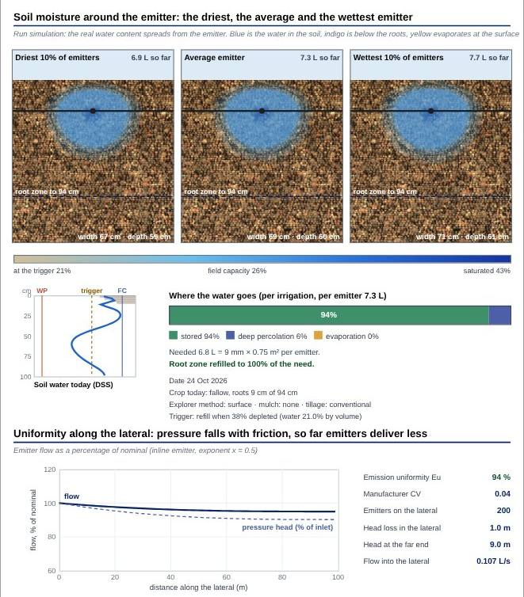{width=100%}

\newpage

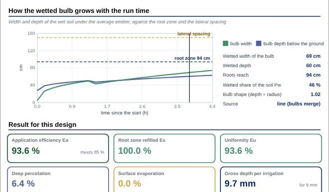{width=100%}

\newpage

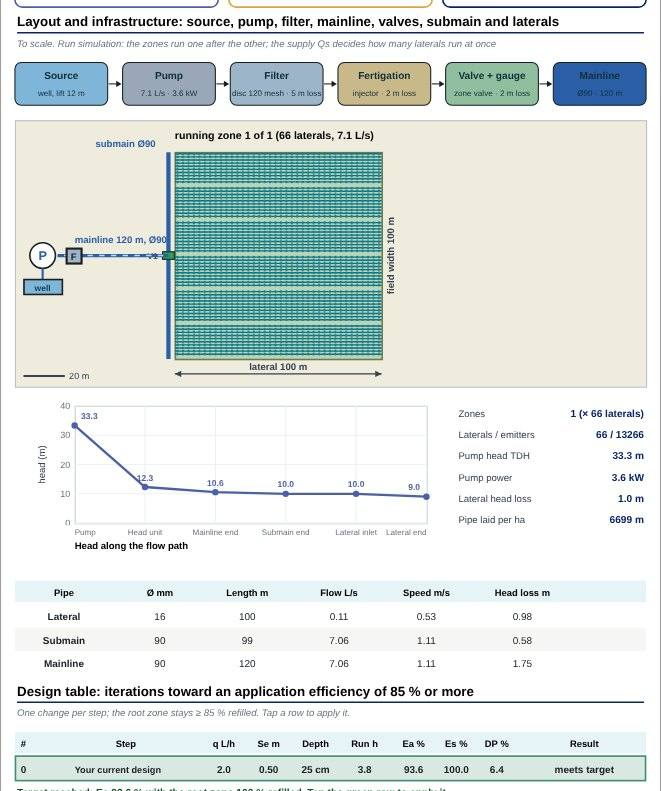{width=100%}

\newpage

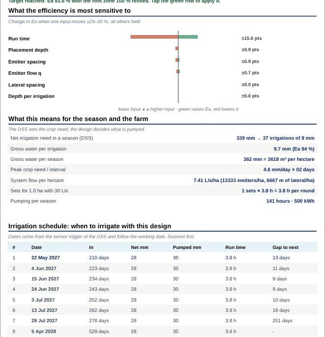{width=100%}

\newpage

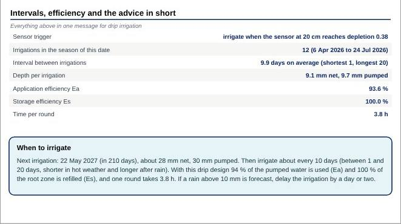{width=100%}

\newpage

### The equations of this layer

Every number and picture of the layer comes from the equations below (numbers as in Volume 1, with the chapter that explains each).

**Eq. 5.3** (Volume 1, engine)

$$
f(h) \;=\; \frac{S_e(100) - S_e(|h|)}{S_e(100) - S_e(15\,849)},
\qquad f_{\mathrm{used}} = \min\{1,\max\{0, f\}\}.
\tag{5.3}
$$

*Provenance (Eq. 5.3):* **[Literature]**: standard definition of plant-available water between field capacity and wilting point.

**Eq. 5.27** (Volume 1, engine)

$$
Z_n = \mathrm{clip}\bigl(f_T\cdot \mathrm{AWC}\cdot R_{\max};\ 25,\ 150\bigr)\ \mathrm{mm}\qquad(\text{surface; drip and sprinkler use their own limits})
\tag{5.27}
$$

*Provenance (Eq. 5.27):* **[Literature]**: readily available water as in FAO-56 practice, with an engineered clip.

**Eq. 11.3** (Volume 1, surface)

$$
\psi_f = \frac{10}{\alpha}\,\frac{0.046\,m + 2.07\,m^{2} + 19.5\,m^{3}}{1 + 4.7\,m + 16\,m^{2}}.
\tag{11.3}
$$

*Provenance (Eq. 11.3):* **[Engineered]**: rational-polynomial approximation of a Rawls-type suction.

**Eq. 12.1** (Volume 1, drip)

$$
Z_n = \min\bigl\{Z_{n}^{\mathrm{DSS}},\ \max(4,\ \mathrm{ET}_{\mathrm{pk}}\,\Delta t)\bigr\}\ \ \mathrm{mm},
\tag{12.1}
$$

*Provenance (Eq. 12.1):* **[Engineered]**: depth and demand rules chosen for the workbench.

**Eq. 12.2** (Volume 1, drip)

$$
\mathrm{ET}_{\mathrm{pk}} = \mathrm{clip}\Bigl\{\max_d \tfrac15\sum_{j=0}^{4}\bigl(E_{d+j}+T_{d+j}\bigr);\ 2.5,\ 9\Bigr\}.
\tag{12.2}
$$

*Provenance (Eq. 12.2):* **[Engineered]**: depth and demand rules chosen for the workbench.

**Eq. 12.3** (Volume 1, drip)

$$
h_{f,j} = \frac{10.67\,S_e\,Q_j^{1.852}}{C^{1.852}\,D^{4.871}},\qquad Q_j=\sum_{i\ge j+1} q_i\ \ (\mathrm{m^3\,s^{-1}}),\quad D\ \text{in m}.
\tag{12.3}
$$

*Provenance (Eq. 12.3):* **[Literature]**: Hazen and Williams (1905).

**Eq. 12.4** (Volume 1, drip)

$$
q_j = q\Bigl(\frac{h_j}{H_0}\Bigr)^{x}\quad(\text{non-compensating; } h_j/H_0\ge0.01),
\tag{12.4}
$$

*Provenance (Eq. 12.4):* **[Literature]**: Keller and Karmeli (1974) emitter law.

**Eq. 12.5** (Volume 1, drip)

$$
q_j = \begin{cases} q\bigl[1 + 0.04\,(h_j-H_0)/H_0\bigr], & h_j\ge H_{\min},\\[2pt] q\,\bigl(\max(h_j,0.1)/H_{\min}\bigr)^{0.5}, & h_j<H_{\min},\end{cases}
\tag{12.5}
$$

*Provenance (Eq. 12.5):* **[Engineered]**: pressure-compensating emitter model with chosen constants.

**Eq. 12.6** (Volume 1, drip)

$$
\bar q = \frac{1}{N+1}\sum_{j=0}^{N} q_j,\qquad q_{\min}=\min_j q_j,\qquad
Q_{\mathrm{lat}} = \frac{N\,\bar q}{3600}\ \ (\mathrm{L\,s^{-1}}),
\tag{12.6}
$$

*Provenance (Eq. 12.6):* **[Literature]**: definitions of mean and minimum discharge.

**Eq. 12.7** (Volume 1, drip)

$$
E_u = \mathrm{clip}\Bigl\{\Bigl(1 - \frac{1.27\,c_v}{\sqrt{n_e}}\Bigr)\frac{q_{\min}}{\bar q};\ 0.3,\ 1\Bigr\}.
\tag{12.7}
$$

*Provenance (Eq. 12.7):* **[Literature]**: Keller and Karmeli (1974).

**Eq. 12.8** (Volume 1, drip)

$$
\sigma_q = \sqrt{c_v^{2} + \sigma_P^{2}},\qquad
\sigma_P^{2} = \frac{1}{N+1}\sum_{j=0}^{N}\Bigl(\frac{q_j}{\bar q}-1\Bigr)^{2}.
\tag{12.8}
$$

*Provenance (Eq. 12.8):* **[Engineered]**: combined spread chosen to drive the bulb quantiles.

**Eq. 12.9** (Volume 1, drip)

$$
\Delta\theta = \max\{0.03,\ f_T\,(\theta_{fc}-\theta_{wp})\}.
\tag{12.9}
$$

*Provenance (Eq. 12.9):* **[Engineered]**: wetted-bulb geometry and loss partition; constants chosen for the workbench.

**Eq. 12.10** (Volume 1, drip)

$$
\rho(z) = r\,\sqrt{1 - \zeta^{2}},\qquad
\zeta = \begin{cases} (z - z_d)/(a\,r), & z\ge z_d,\\ (z_d - z)/(u\,r), & z<z_d,\end{cases}\qquad \rho=0\ \text{for}\ |\zeta|\ge1.
\tag{12.10}
$$

*Provenance (Eq. 12.10):* **[Engineered]**: wetted-bulb geometry and loss partition; constants chosen for the workbench.

**Eq. 12.11** (Volume 1, drip)

$$
a = \mathrm{clip}\Bigl\{1 + 0.6\,\log_{10}\Bigl(1 + \frac{K_s}{q\cdot10^{6}/(2\pi\lambda^{2})}\Bigr);\ 1,\ 1.9\Bigr\},\qquad \lambda=\max(40,\psi_f),
\tag{12.11}
$$

*Provenance (Eq. 12.11):* **[Engineered]**: wetted-bulb geometry and loss partition; constants chosen for the workbench.

**Eq. 12.12** (Volume 1, drip)

$$
V_w = \int \pi\,\rho(z)^{2}\,dz,
\tag{12.12}
$$

*Provenance (Eq. 12.12):* **[Engineered]**: wetted-bulb geometry and loss partition; constants chosen for the workbench.

**Eq. 12.13** (Volume 1, drip)

$$
P_w = \mathrm{clip}\Bigl\{\frac{2r}{1000\,S_l};\ 0,\ 1\Bigr\}.
\tag{12.13}
$$

*Provenance (Eq. 12.13):* **[Engineered]**: wetted-bulb geometry and loss partition; constants chosen for the workbench.

**Eq. 12.14** (Volume 1, drip)

$$
V_{\mathrm{dp}}^{(1)} = V\,\frac{\int_{z>R_{\max}}\pi\rho^{2}\,dz}{V_w},
\tag{12.14}
$$

*Provenance (Eq. 12.14):* **[Engineered]**: wetted-bulb geometry and loss partition; constants chosen for the workbench.

**Eq. 12.15** (Volume 1, drip)

$$
V_{\mathrm{ev}} = \min\bigl\{0.5\,V,\ \pi\rho(0)^{2}\cdot10^{-6}\cdot 2E_0\bigr\}\quad(\text{L},\ \text{area in m}^{2},\ E_0\ \text{in mm d}^{-1}),
\tag{12.15}
$$

*Provenance (Eq. 12.15):* **[Engineered]**: wetted-bulb geometry and loss partition; constants chosen for the workbench.

**Eq. 12.16** (Volume 1, drip)

$$
V_i = \max\bigl\{0.02\,\bar V,\ \bar V\,(1+\sigma_q z_i)\bigr\},\qquad \bar V=\bar q\,t,
\tag{12.16}
$$

*Provenance (Eq. 12.16):* **[Engineered]**: five-quantile delivery and run-time rules chosen for the workbench.

**Eq. 12.17** (Volume 1, drip)

$$
V_{\mathrm{req}} = Z_n\,S_e\,S_l\ \ (\mathrm L),\qquad
V_{\mathrm{st},i}=\min\{V_{\mathrm{root},i},\ V_{\mathrm{req}}\},\qquad V_{\mathrm{ex},i} = V_{\mathrm{root},i}-V_{\mathrm{st},i}.
\tag{12.17}
$$

*Provenance (Eq. 12.17):* **[Literature]**: definition of the requirement over the area served by one emitter.

**Eq. 12.18** (Volume 1, drip)

$$
t = \mathrm{clip}\Bigl\{\frac{V_{\mathrm{req}}}{\bar q\,E_u};\ 0.05,\ 96\Bigr\}\ \ \mathrm h.
\tag{12.18}
$$

*Provenance (Eq. 12.18):* **[Engineered]**: five-quantile delivery and run-time rules chosen for the workbench.

**Eq. 12.19** (Volume 1, drip)

$$
E_a = \frac{\langle V_{\mathrm{st}}\rangle}{\langle V\rangle},\quad
E_s = \frac{\langle V_{\mathrm{st}}\rangle}{V_{\mathrm{req}}},\quad
\mathrm{DP} = \frac{\langle V_{\mathrm{dp}}^{(1)}+V_{\mathrm{ex}}\rangle}{\langle V\rangle},\quad
\mathrm{EV} = \frac{\langle V_{\mathrm{ev}}\rangle}{\langle V\rangle},\quad
Z_{\mathrm{gross}}=\frac{\bar V}{S_eS_l},
\tag{12.19}
$$

*Provenance (Eq. 12.19):* **[Engineered]**: five-quantile delivery and run-time rules chosen for the workbench.

**Eq. 12.20** (Volume 1, drip)

$$
W_f=\frac{10^{4}A_f}{L_L},\quad N_L=\Bigl\lfloor \frac{W_f}{S_l}\Bigr\rfloor,\quad
n_{\mathrm{zone}}=\Bigl\lceil \frac{N_L\,Q_{\mathrm{lat}}}{Q_s}\Bigr\rceil,\quad
n_{l}=\Bigl\lceil\frac{N_L}{n_{\mathrm{zone}}}\Bigr\rceil,\quad Q_z=n_l\,Q_{\mathrm{lat}},
\tag{12.20}
$$

*Provenance (Eq. 12.20):* **[Engineered]**: layout, sizing and scoring rules; the 1.5 m/s velocity limit is a common practice.

**Eq. 12.21** (Volume 1, drip)

$$
D\in\{32,40,50,63,75,90,110,125,160,200,250,315\}\ \mathrm{mm}
\tag{12.21}
$$

*Provenance (Eq. 12.21):* **[Engineered]**: layout, sizing and scoring rules; the 1.5 m/s velocity limit is a common practice.

**Eq. 12.22** (Volume 1, drip)

$$
h_{f,sm}=0.4\,\frac{10.67\,L_{sm}\,Q_z^{1.852}}{C^{1.852}D_{sm}^{4.871}},\qquad
h_{f,m}=\frac{10.67\,L_m\,Q_z^{1.852}}{C^{1.852}D_m^{4.871}}.
\tag{12.22}
$$

*Provenance (Eq. 12.22):* **[Engineered]**: Christiansen-type reduction with a chosen factor 0.4.

**Eq. 12.23** (Volume 1, drip)

$$
\mathrm{TDH} = z_{\mathrm{lift}} + H_0 + h_{f,sm} + h_{f,m} + 9\ \mathrm m,\qquad
P = \frac{\rho g\,Q_z\,\mathrm{TDH}}{\eta} = \frac{9.81\,(Q_z/1000)\,\mathrm{TDH}}{0.65}\ \ \mathrm{kW}.
\tag{12.23}
$$

*Provenance (Eq. 12.23):* **[Engineered]**: layout, sizing and scoring rules; the 1.5 m/s velocity limit is a common practice.

**Eq. 12.24** (Volume 1, drip)

$$
n_{\mathrm{ev}}=\frac{y_I}{Z_n},\quad
Z_{\mathrm{season}} = n_{\mathrm{ev}}\,Z_{\mathrm{gross}},\quad
q_{ha}=\frac{q}{3600}\,\frac{10^{4}}{S_eS_l}\ \ (\mathrm{L\,s^{-1}\,ha^{-1}}),
\tag{12.24}
$$

*Provenance (Eq. 12.24):* **[Engineered]**: layout, sizing and scoring rules; the 1.5 m/s velocity limit is a common practice.

**Eq. 12.25** (Volume 1, drip)

$$
n_{\mathrm{set}}=\Bigl\lceil \frac{q_{ha}A_f}{Q_s}\Bigr\rceil,\qquad
t_{\mathrm{round}}=n_{\mathrm{set}}\,t,\qquad
H_{\mathrm{pump}}=n_{\mathrm{ev}}\,t_{\mathrm{round}},\qquad
E_{\mathrm{kWh}}=H_{\mathrm{pump}}\,P.
\tag{12.25}
$$

*Provenance (Eq. 12.25):* **[Engineered]**: layout, sizing and scoring rules; the 1.5 m/s velocity limit is a common practice.

**Eq. 12.26** (Volume 1, drip)

$$
\mathrm{score} = \min(E_a,1) - 2.5\,\max(0,\ 0.9 - E_s),
\tag{12.26}
$$

*Provenance (Eq. 12.26):* **[Engineered]**: layout, sizing and scoring rules; the 1.5 m/s velocity limit is a common practice.

**Eq. 18.0** (Volume 1, runs)

$$
\kappa(\text{state now}) = \kappa_{\mathrm{run}},\qquad \kappa = \bigl(\text{every Properties control except the irrigation method},\ \text{weather mode}\bigr),
\tag{18.0}
$$

*Provenance (Eq. 18.0):* **[Engineered]**: bookkeeping of the run.

**Eq. 18.1** (Volume 1, runs)

$$
A_f=\frac{L\,W}{10^4}\ \ [\mathrm{ha}],\qquad L_{\mathrm{lat}}=\mathrm{clip}\Bigl(\frac{L}{\lceil L/L_{\max}\rceil};\ L_{\min},\ L_{\max}\Bigr),
\tag{18.1}
$$

*Provenance (Eq. 18.1):* **[Engineered]**: geometry; laterals longer than $L_{\max}$ are split into equal runs from a central submain.

**Eq. 18.2** (Volume 1, runs)

$$
s = E_a - 3\,\max\bigl(0,\ 0.95-E_s\bigr) + \begin{cases} 0 & \text{surface}\\ 0.05\,E_u & \text{drip}\\ 0.05\,\mathrm{CU} - 2\,R_o & \text{sprinkler}\end{cases}
\tag{18.2}
$$

*Provenance (Eq. 18.2):* **[Engineered]**: the application efficiency, with a penalty when the root zone is refilled to less than 95 % (an efficient design that leaves the crop short is not efficient) and a small reward for uniformity.

**Eq. 14.6** (Volume 1, dashboard)

$$
Q_{\mathrm{pump}}(t)=Q_z\quad\text{for}\ t\in[\,0,\ n_z\,t_{\mathrm{run}}\,),\qquad 0\ \text{afterwards},
\tag{14.6}
$$

*Provenance (Eq. 14.6):* **[Engineered]**: zones of the layout (Eqs. 12.20–12.23 and the sprinkler analogue) run in turn.

\newpage

## Sprinkler design and pipes

{width=100%}

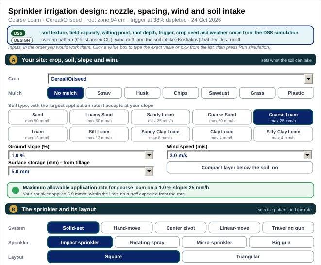{width=100%}

\newpage

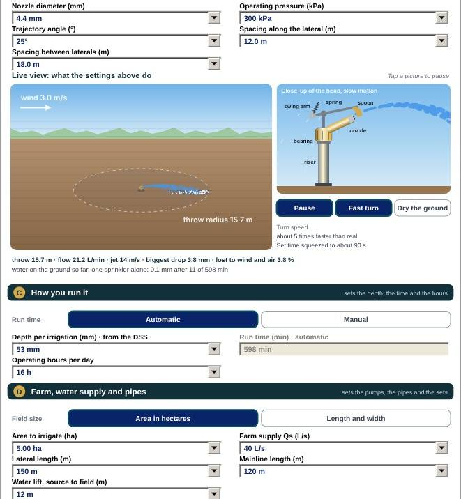{width=100%}

\newpage

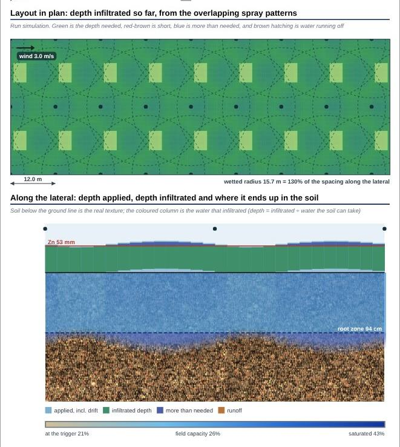{width=100%}

\newpage

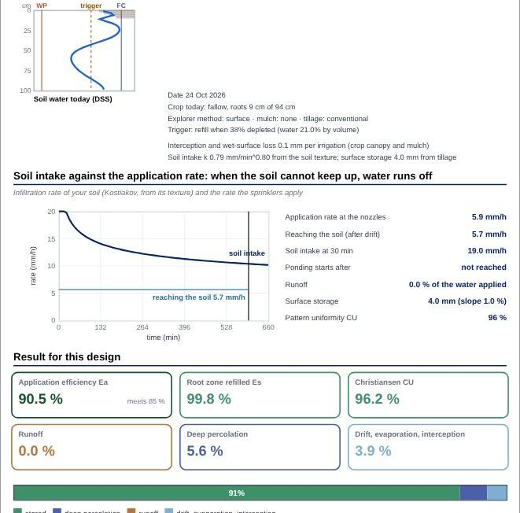{width=100%}

\newpage

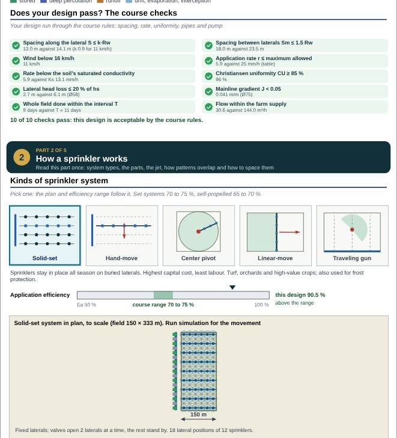{width=100%}

\newpage

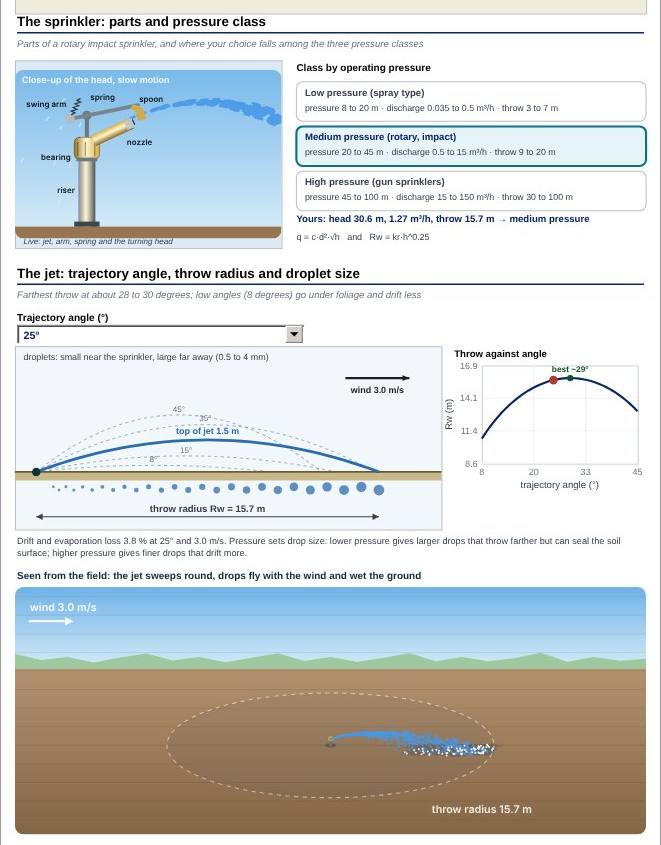{width=100%}

\newpage

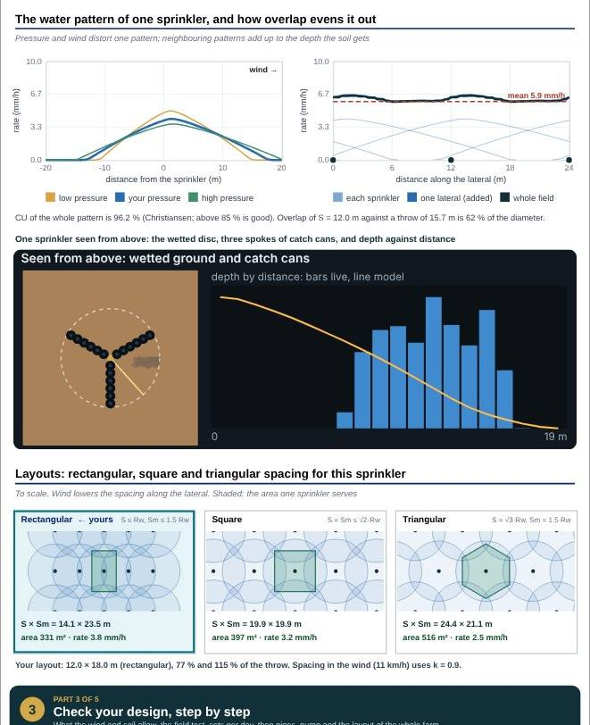{width=100%}

\newpage

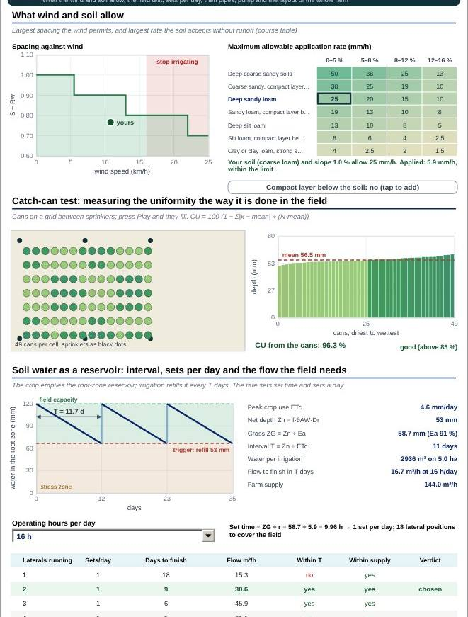{width=100%}

\newpage

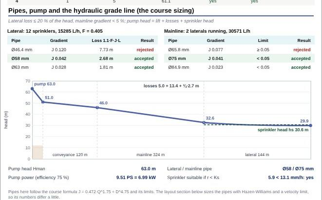{width=100%}

\newpage

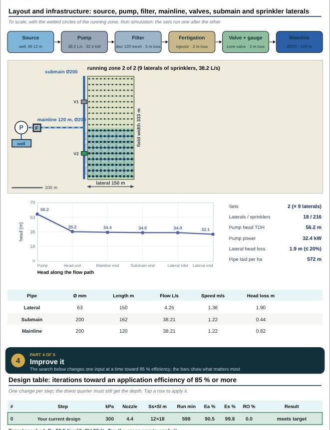{width=100%}

\newpage

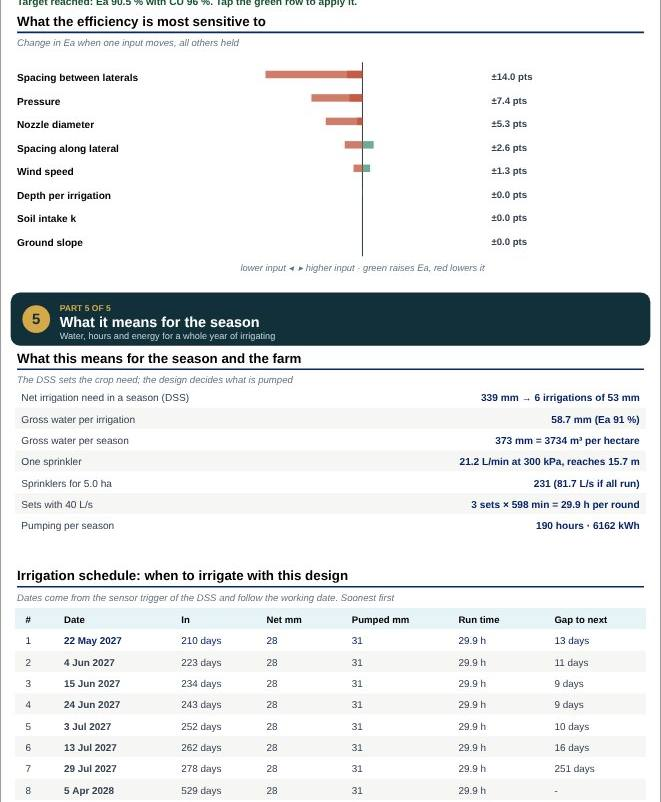{width=100%}

\newpage

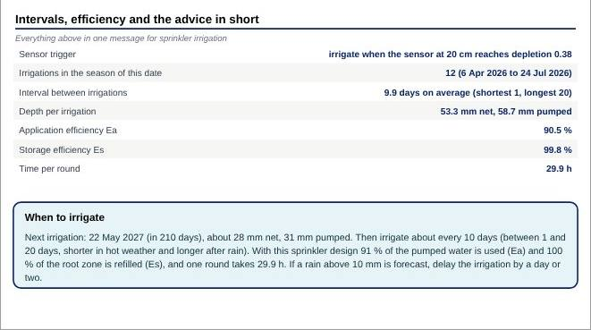{width=100%}

\newpage

### The equations of this layer

Every number and picture of the layer comes from the equations below (numbers as in Volume 1, with the chapter that explains each).

**Eq. 5.3** (Volume 1, engine)

$$
f(h) \;=\; \frac{S_e(100) - S_e(|h|)}{S_e(100) - S_e(15\,849)},
\qquad f_{\mathrm{used}} = \min\{1,\max\{0, f\}\}.
\tag{5.3}
$$

*Provenance (Eq. 5.3):* **[Literature]**: standard definition of plant-available water between field capacity and wilting point.

**Eq. 5.27** (Volume 1, engine)

$$
Z_n = \mathrm{clip}\bigl(f_T\cdot \mathrm{AWC}\cdot R_{\max};\ 25,\ 150\bigr)\ \mathrm{mm}\qquad(\text{surface; drip and sprinkler use their own limits})
\tag{5.27}
$$

*Provenance (Eq. 5.27):* **[Literature]**: readily available water as in FAO-56 practice, with an engineered clip.

**Eq. 11.6** (Volume 1, surface)

$$
Z(\tau) = k\,\tau^{A}\qquad (Z\ \text{in m},\ \tau\ \text{in min}),
\tag{11.6}
$$

*Provenance (Eq. 11.6):* **[Literature]**: Kostiakov (1932).

**Eq. 12.3** (Volume 1, drip)

$$
h_{f,j} = \frac{10.67\,S_e\,Q_j^{1.852}}{C^{1.852}\,D^{4.871}},\qquad Q_j=\sum_{i\ge j+1} q_i\ \ (\mathrm{m^3\,s^{-1}}),\quad D\ \text{in m}.
\tag{12.3}
$$

*Provenance (Eq. 12.3):* **[Literature]**: Hazen and Williams (1905).

**Eq. 12.21** (Volume 1, drip)

$$
D\in\{32,40,50,63,75,90,110,125,160,200,250,315\}\ \mathrm{mm}
\tag{12.21}
$$

*Provenance (Eq. 12.21):* **[Engineered]**: layout, sizing and scoring rules; the 1.5 m/s velocity limit is a common practice.

**Eq. 12.22** (Volume 1, drip)

$$
h_{f,sm}=0.4\,\frac{10.67\,L_{sm}\,Q_z^{1.852}}{C^{1.852}D_{sm}^{4.871}},\qquad
h_{f,m}=\frac{10.67\,L_m\,Q_z^{1.852}}{C^{1.852}D_m^{4.871}}.
\tag{12.22}
$$

*Provenance (Eq. 12.22):* **[Engineered]**: Christiansen-type reduction with a chosen factor 0.4.

**Eq. 12.23** (Volume 1, drip)

$$
\mathrm{TDH} = z_{\mathrm{lift}} + H_0 + h_{f,sm} + h_{f,m} + 9\ \mathrm m,\qquad
P = \frac{\rho g\,Q_z\,\mathrm{TDH}}{\eta} = \frac{9.81\,(Q_z/1000)\,\mathrm{TDH}}{0.65}\ \ \mathrm{kW}.
\tag{12.23}
$$

*Provenance (Eq. 12.23):* **[Engineered]**: layout, sizing and scoring rules; the 1.5 m/s velocity limit is a common practice.

**Eq. 12.26** (Volume 1, drip)

$$
\mathrm{score} = \min(E_a,1) - 2.5\,\max(0,\ 0.9 - E_s),
\tag{12.26}
$$

*Provenance (Eq. 12.26):* **[Engineered]**: layout, sizing and scoring rules; the 1.5 m/s velocity limit is a common practice.

**Eq. 13.1** (Volume 1, sprinkler)

$$
S_{d}^{\mathrm{eff}} = \frac{\max(0,S_d)}{1+0.25\,S}\qquad(S\ \text{in \%}).
\tag{13.1}
$$

*Provenance (Eq. 13.1):* **[Engineered]**: depression storage reduction with slope.

**Eq. 13.2** (Volume 1, sprinkler)

$$
q = 0.95\,A_n\sqrt{2g\,h}\times6\times10^{4}\ \ (\mathrm{L\,min^{-1}}),\qquad A_n=\pi\Bigl(\frac{d}{2000}\Bigr)^{2}\ \mathrm{m^2},
\tag{13.2}
$$

*Provenance (Eq. 13.2):* **[Literature]**: Torricelli orifice equation.

**Eq. 13.3** (Volume 1, sprinkler)

$$
R = c_R\sqrt{d\,h}\;f_\alpha(\alpha),\qquad
f_\alpha(\alpha)=\Bigl[\frac{\max\{0.05,\ \sin(3.1\,\alpha)\}}{0.9763}\Bigr]^{0.45},
\tag{13.3}
$$

*Provenance (Eq. 13.3):* **[Engineered]**: range law of the Keller and Bliesner (1990) form; the impact coefficient 1.35 is the published value and is verified against their worked example (Paper 3); the coefficients of the other types and the angle function are chosen.

**Eq. 13.4** (Volume 1, sprinkler)

$$
\hat p(x)=\begin{cases}
1-x^{m}, & \text{impact } (m=1.3),\ \text{gun } (m=1),\\
(0.5+0.5x)(1-x^{6}), & \text{rotating spray (ring)},\\
(0.55+0.45x)(1-x^{5}), & \text{micro-sprinkler (ring-2)},
\end{cases}\qquad \hat p=0\ \text{for}\ x\ge1.
\tag{13.4}
$$

*Provenance (Eq. 13.4):* **[Engineered]**: pattern and wind shapes chosen to reproduce published qualitative patterns.

**Eq. 13.5** (Volume 1, sprinkler)

$$
R_e(\theta)=R\,\mathrm{clip}\{1+0.022\,u\cos\theta;\ 0.7,\ 1.4\},\qquad \text{shift}=0.03\,u\,R,
\tag{13.5}
$$

*Provenance (Eq. 13.5):* **[Engineered]**: pattern and wind shapes chosen to reproduce published qualitative patterns.

**Eq. 13.6** (Volume 1, sprinkler)

$$
a(x,y) = \sum_{i,j} p\bigl(x-x_{ij},\,y-y_{ij}\bigr)\quad(\mathrm{mm\,min^{-1}}),\qquad
\bar a=\frac1n\sum_k a_k,
\tag{13.6}
$$

*Provenance (Eq. 13.6):* **[Literature]**: overlap by superposition of single-sprinkler patterns.

**Eq. 13.7** (Volume 1, sprinkler)

$$
\mathrm{CU}=1-\frac{\sum_k |a_k-\bar a|}{n\,\bar a}.
\tag{13.7}
$$

*Provenance (Eq. 13.7):* **[Literature]**: Christiansen (1942).

**Eq. 13.8** (Volume 1, sprinkler)

$$
w_d=\frac{1}{100}\,\mathrm{clip}\Bigl\{\bigl(1.2+0.5u+0.04u^{2}\bigr)\,F\Bigl(\frac{P}{250}\Bigr)^{0.7}\bigl[1+0.025\,(T_a-20)\bigr]\Bigl[0.6+0.4\,\frac{\sin\alpha}{0.4226}\Bigr];\ 0.5,\ 45\Bigr\}.
\tag{13.8}
$$

*Provenance (Eq. 13.8):* **[Engineered]**: loss and ponding rules chosen for the workbench.

**Eq. 13.9** (Volume 1, sprinkler)

$$
t_p=\Bigl(\frac aK\Bigr)^{1/(A-1)},\qquad
F=\begin{cases}\mathrm{sup}, & T\le t_p\\ K\,T^{A}, & T>t_p\end{cases}\qquad
R=\mathrm{sup}-F,\quad \mathrm{RO}=\max(0,R-S_d^{\mathrm{eff}}),\quad I=\mathrm{sup}-\mathrm{RO}.
\tag{13.9}
$$

*Provenance (Eq. 13.9):* **[Engineered]**: loss and ponding rules chosen for the workbench.

**Eq. 13.10** (Volume 1, sprinkler)

$$
I_c=\min\{I,\ I_{\mathrm{int}}\},\qquad I_{\mathrm{int}} = 0.6\,\mathrm{CAP}\,[\mathrm{VFF}<0.95] + 1.2\,\mathrm{LAI}_{\mathrm{live}},
\tag{13.10}
$$

*Provenance (Eq. 13.10):* **[Engineered]**: loss and ponding rules chosen for the workbench.

**Eq. 13.11** (Volume 1, sprinkler)

$$
\begin{aligned}
E_a &= \frac{\overline{\min(Z_k,Z_n)}}{\mathrm{gross}}, & E_s &= \frac{\overline{\min(Z_k,Z_n)}}{Z_n}, & \mathrm{DU}&=\frac{\overline{Z}_{25}}{\overline{Z}},\\
\mathrm{DP} &= \frac{\overline{\max(Z_k-Z_n,0)}}{\mathrm{gross}}, & \mathrm{RO}&=\frac{\overline{\mathrm{RO}_k}}{\mathrm{gross}}, & \mathrm{WD}&=w_d+\frac{\overline{I_c}}{\mathrm{gross}},
\end{aligned}
\tag{13.11}
$$

*Provenance (Eq. 13.11):* **[Literature]**: efficiency and distribution uniformity of Merriam and Keller (1978).

**Eq. 13.12** (Volume 1, sprinkler)

$$
T=\min\{T:\ \overline{Z}_{25}(T)\ge Z_n\},\qquad T\in[1,\,2400]\ \mathrm{min},
\tag{13.12}
$$

*Provenance (Eq. 13.12):* **[Engineered]**: run-time, wind-spacing and set rules; the wind factors follow the practice of Keller and Bliesner (1990) but are not independently verified.

**Eq. 13.13** (Volume 1, sprinkler)

$$
k=\begin{cases}1,&W\le5.5\\0.9,&5.5<W\le13\\0.8,&13<W\le22\\0.7,&W>22.\end{cases}
\tag{13.13}
$$

*Provenance (Eq. 13.13):* **[Engineered]**: run-time, wind-spacing and set rules; the wind factors follow the practice of Keller and Bliesner (1990) but are not independently verified.

**Eq. 13.14** (Volume 1, sprinkler)

$$
S_s\le k\,R_w,\qquad S_l\le1.5\,R_w,\qquad
L_y=\frac{10^{4}A_f}{L_x},\quad N=\lfloor L_x/S_s\rfloor,\quad N_m=\lfloor L_y/S_l\rfloor,
\tag{13.14}
$$

*Provenance (Eq. 13.14):* **[Engineered]**: run-time, wind-spacing and set rules; the wind factors follow the practice of Keller and Bliesner (1990) but are not independently verified.

**Eq. 13.15** (Volume 1, sprinkler)

$$
t_{\mathrm{set}}=\frac{Z_{\mathrm{gross}}}{\mathrm{AR}}\ \ (\mathrm h),\qquad
n_{\mathrm{sets/day}}=\Bigl\lfloor\frac{h_{\mathrm{op}}}{t_{\mathrm{set}}}\Bigr\rfloor,\qquad T_{\mathrm{int}}=\max\Bigl(1,\Bigl\lfloor\frac{Z_n}{\mathrm{ET}_{\mathrm{pk}}}\Bigr\rfloor\Bigr)\ \mathrm{days},
\tag{13.15}
$$

*Provenance (Eq. 13.15):* **[Engineered]**: run-time, wind-spacing and set rules; the wind factors follow the practice of Keller and Bliesner (1990) but are not independently verified.

**Eq. 13.16** (Volume 1, sprinkler)

$$
N_d(n)=\Bigl\lceil\frac{N_m}{n\,n_{\mathrm{sets/day}}}\Bigr\rceil,\qquad Q_{\mathrm{in}}(n)=n\,N\,q_h,
\tag{13.16}
$$

*Provenance (Eq. 13.16):* **[Engineered]**: run-time, wind-spacing and set rules; the wind factors follow the practice of Keller and Bliesner (1990) but are not independently verified.

**Eq. 13.17** (Volume 1, sprinkler)

$$
J=\frac{0.472\,Q^{1.75}}{D^{4.75}}\ \ (\mathrm{m\,m^{-1}};\ Q\ \text{in L h}^{-1},\ D\ \text{in mm}),
\tag{13.17}
$$

*Provenance (Eq. 13.17):* **[Literature]**: Blasius friction law for smooth pipe.

**Eq. 13.18** (Volume 1, sprinkler)

$$
h_{f,\mathrm{lat}}=1.1\,F\,J(Q_L,D)\,\bigl(L_x-S_s/2\bigr)\le0.2\,h_s,\qquad Q_L=1000\,N\,q_h,
\tag{13.18}
$$

*Provenance (Eq. 13.18):* **[Literature]**: 20 % rule of Keller and Bliesner (1990).

**Eq. 13.19** (Volume 1, sprinkler)

$$
H_{\mathrm{man}} = z_{\mathrm{lift}} + J\,L_{\mathrm{conv}} + J\,L_{\mathrm{main}} + h_s + 0.75\,h_{f,\mathrm{lat}},
\tag{13.19}
$$

*Provenance (Eq. 13.19):* **[Engineered]**: head and sets bookkeeping.

**Eq. 13.20** (Volume 1, sprinkler)

$$
P_{\mathrm{CV}} = \frac{1000\,(Q_m/3.6\times10^{6})\,H_{\mathrm{man}}}{75\,\eta},\quad \eta=0.75,\qquad P_{\mathrm{kW}}=0.7355\,P_{\mathrm{CV}},
\tag{13.20}
$$

*Provenance (Eq. 13.20):* **[Literature]**: hydraulic power definition.

**Eq. 13.21** (Volume 1, sprinkler)

$$
N_L=\Bigl\lfloor\frac{10^4A_f/L_L}{S_l}\Bigr\rfloor,\quad
n_l=\min\Bigl(N_L,\ \Bigl\lfloor\frac{Q_s}{Q_{\mathrm{lat}}}\Bigr\rfloor\Bigr),\quad
n_{\mathrm{set}}=\Bigl\lceil\frac{N_L}{n_l}\Bigr\rceil,\quad Q_z=n_l Q_{\mathrm{lat}}.
\tag{13.21}
$$

*Provenance (Eq. 13.21):* **[Engineered]**: head and sets bookkeeping.

**Eq. 13.22** (Volume 1, sprinkler)

$$
F_m=\frac1{2.852}+\frac1{2N_s}+\frac{\sqrt{0.852}}{6N_s^{2}},\qquad h_{f,\mathrm{lat}}=F_m\,h_{HW}(Q_{\mathrm{lat}},D,L_L),
\tag{13.22}
$$

*Provenance (Eq. 13.22):* **[Literature]**: Christiansen reduction factor with Hazen--Williams exponent.

**Eq. 13.23** (Volume 1, sprinkler)

$$
n_{\mathrm{ev}}=\frac{y_I}{Z_n},\qquad n_{\mathrm{sp}}=\mathrm{round}\Bigl(\frac{10^{4}A_f}{S_sS_l}\Bigr),\qquad
Q_{\mathrm{tot}}=\frac{n_{\mathrm{sp}}\,q}{60},\qquad n_{\mathrm{set}}=\Bigl\lceil\frac{Q_{\mathrm{tot}}}{Q_s}\Bigr\rceil,\qquad t_{\mathrm{round}}=\frac{n_{\mathrm{set}}\,T}{60}\ \mathrm h.
\tag{13.23}
$$

*Provenance (Eq. 13.23):* **[Engineered]**: head and sets bookkeeping.

**Eq. 18.0** (Volume 1, runs)

$$
\kappa(\text{state now}) = \kappa_{\mathrm{run}},\qquad \kappa = \bigl(\text{every Properties control except the irrigation method},\ \text{weather mode}\bigr),
\tag{18.0}
$$

*Provenance (Eq. 18.0):* **[Engineered]**: bookkeeping of the run.

**Eq. 18.1** (Volume 1, runs)

$$
A_f=\frac{L\,W}{10^4}\ \ [\mathrm{ha}],\qquad L_{\mathrm{lat}}=\mathrm{clip}\Bigl(\frac{L}{\lceil L/L_{\max}\rceil};\ L_{\min},\ L_{\max}\Bigr),
\tag{18.1}
$$

*Provenance (Eq. 18.1):* **[Engineered]**: geometry; laterals longer than $L_{\max}$ are split into equal runs from a central submain.

**Eq. 18.2** (Volume 1, runs)

$$
s = E_a - 3\,\max\bigl(0,\ 0.95-E_s\bigr) + \begin{cases} 0 & \text{surface}\\ 0.05\,E_u & \text{drip}\\ 0.05\,\mathrm{CU} - 2\,R_o & \text{sprinkler}\end{cases}
\tag{18.2}
$$

*Provenance (Eq. 18.2):* **[Engineered]**: the application efficiency, with a penalty when the root zone is refilled to less than 95 % (an efficient design that leaves the crop short is not efficient) and a small reward for uniformity.

**Eq. 14.6** (Volume 1, dashboard)

$$
Q_{\mathrm{pump}}(t)=Q_z\quad\text{for}\ t\in[\,0,\ n_z\,t_{\mathrm{run}}\,),\qquad 0\ \text{afterwards},
\tag{14.6}
$$

*Provenance (Eq. 14.6):* **[Engineered]**: zones of the layout (Eqs. 12.20–12.23 and the sprinkler analogue) run in turn.

\newpage

## Virtual farm simulation

### The farm of the surface design

{width=100%}

\newpage

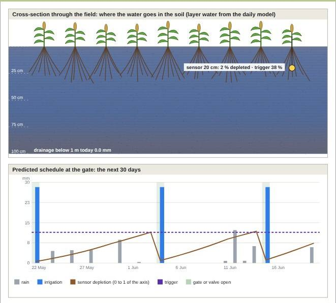{width=100%}

\newpage

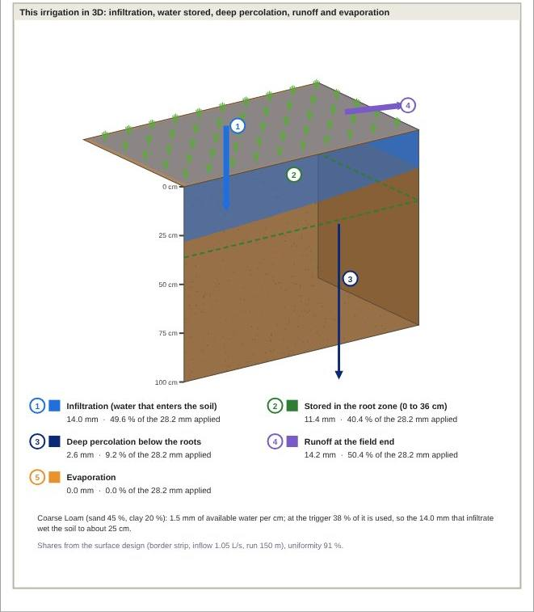{width=100%}

\newpage

### The farm of the drip design

{width=100%}

\newpage

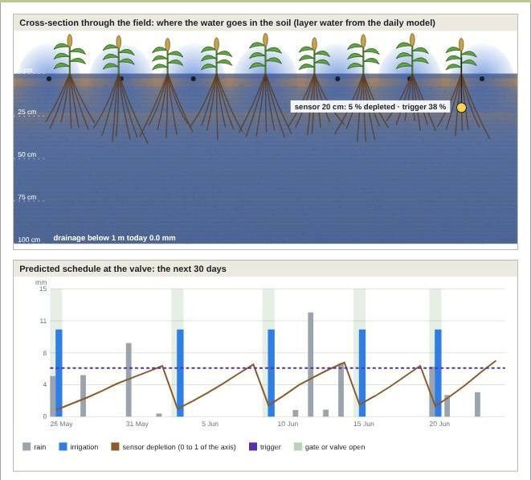{width=100%}

\newpage

{width=100%}

\newpage

### The farm of the sprinkler design

{width=100%}

\newpage

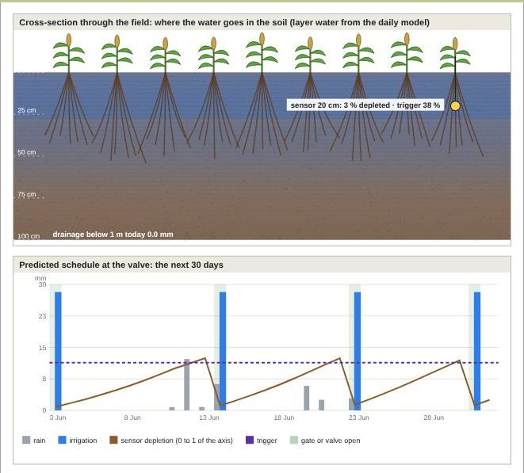{width=100%}

\newpage

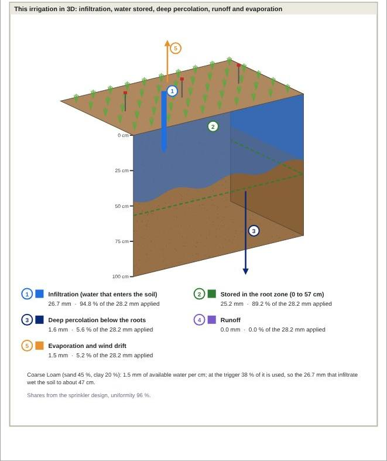{width=100%}

\newpage

### The equations of this layer

Every number and picture of the layer comes from the equations below (numbers as in Volume 1, with the chapter that explains each).

**Eq. 5.3** (Volume 1, engine)

$$
f(h) \;=\; \frac{S_e(100) - S_e(|h|)}{S_e(100) - S_e(15\,849)},
\qquad f_{\mathrm{used}} = \min\{1,\max\{0, f\}\}.
\tag{5.3}
$$

*Provenance (Eq. 5.3):* **[Literature]**: standard definition of plant-available water between field capacity and wilting point.

**Eq. 5.27** (Volume 1, engine)

$$
Z_n = \mathrm{clip}\bigl(f_T\cdot \mathrm{AWC}\cdot R_{\max};\ 25,\ 150\bigr)\ \mathrm{mm}\qquad(\text{surface; drip and sprinkler use their own limits})
\tag{5.27}
$$

*Provenance (Eq. 5.27):* **[Literature]**: readily available water as in FAO-56 practice, with an engineered clip.

**Eq. 11.16** (Volume 1, surface)

$$
t_{co} = \begin{cases}
t_L + t_{st} & \text{“}E_s=1\text{”: the tail receives exactly } Z_n\\
t_x(0.85\,L) + t_{st} & \text{“85 \% of L”}\\
t_{co}^{\,\mathrm{set}} & \text{“Manual”}
\end{cases}
\tag{11.16}
$$

*Provenance (Eq. 11.16):* **[Engineered]**: cut-off rules chosen as design options.

**Eq. 11.18** (Volume 1, surface)

$$
\begin{aligned}
V_{\mathrm{app}} &= Q\,t_{co}\quad\bigl(\text{with cutback } c_b<1:\ Q\,t_L + c_b\,Q\,(t_{co}-t_L)\bigr), & V_{\mathrm{req}} &= Z_n\,L\,w,\\
V_{\mathrm{inf}} &= w\!\int_0^L Z\,dx, & V_{\mathrm{st}} &= w\!\int_0^L \min(Z, Z_n)\,dx,\\
V_{\mathrm{dp}} &= w\!\int_0^L \max(Z-Z_n,0)\,dx, & V_{\mathrm{df}} &= w\!\int_0^L \max(Z_n - Z,0)\,dx,\\
V_{\mathrm{ro}} &= \max(V_{\mathrm{app}} - V_{\mathrm{inf}},\ 0).
\end{aligned}
\tag{11.18}
$$

*Provenance (Eq. 11.18):* **[Literature]**: standard opportunity-time and performance-index definitions (Walker and Skogerboe, 1987; Burt et al., 1997).

**Eq. 11.19** (Volume 1, surface)

$$
E_a = \frac{V_{\mathrm{st}}}{V_{\mathrm{app}}},\quad
E_s = \frac{V_{\mathrm{st}}}{V_{\mathrm{req}}},\quad
\mathrm{DP} = \frac{V_{\mathrm{dp}}}{V_{\mathrm{app}}},\quad
\mathrm{RO} = \frac{V_{\mathrm{ro}}}{V_{\mathrm{app}}},\quad
\mathrm{CU} = 100\Bigl(1 - \frac{\tfrac{1}{N+1}\sum_{i=0}^{N}|Z_i-\bar Z|}{\bar Z}\Bigr)\ \%.
\tag{11.19}
$$

*Provenance (Eq. 11.19):* **[Literature]**: standard opportunity-time and performance-index definitions (Walker and Skogerboe, 1987; Burt et al., 1997).

**Eq. 12.19** (Volume 1, drip)

$$
E_a = \frac{\langle V_{\mathrm{st}}\rangle}{\langle V\rangle},\quad
E_s = \frac{\langle V_{\mathrm{st}}\rangle}{V_{\mathrm{req}}},\quad
\mathrm{DP} = \frac{\langle V_{\mathrm{dp}}^{(1)}+V_{\mathrm{ex}}\rangle}{\langle V\rangle},\quad
\mathrm{EV} = \frac{\langle V_{\mathrm{ev}}\rangle}{\langle V\rangle},\quad
Z_{\mathrm{gross}}=\frac{\bar V}{S_eS_l},
\tag{12.19}
$$

*Provenance (Eq. 12.19):* **[Engineered]**: five-quantile delivery and run-time rules chosen for the workbench.

**Eq. 13.11** (Volume 1, sprinkler)

$$
\begin{aligned}
E_a &= \frac{\overline{\min(Z_k,Z_n)}}{\mathrm{gross}}, & E_s &= \frac{\overline{\min(Z_k,Z_n)}}{Z_n}, & \mathrm{DU}&=\frac{\overline{Z}_{25}}{\overline{Z}},\\
\mathrm{DP} &= \frac{\overline{\max(Z_k-Z_n,0)}}{\mathrm{gross}}, & \mathrm{RO}&=\frac{\overline{\mathrm{RO}_k}}{\mathrm{gross}}, & \mathrm{WD}&=w_d+\frac{\overline{I_c}}{\mathrm{gross}},
\end{aligned}
\tag{13.11}
$$

*Provenance (Eq. 13.11):* **[Literature]**: efficiency and distribution uniformity of Merriam and Keller (1978).

**Eq. 20.1** (Volume 1, farm)

$$
\bigl(f_{\mathrm{st}},f_{\mathrm{dp}},f_{\mathrm{ro}},f_{\mathrm{ev}}\bigr)=\frac{\bigl(E_a,\ DP,\ RO,\ EV\bigr)}{E_a+DP+RO+EV},\qquad
d_x = f_x\,d_{\mathrm{gross}},
\tag{20.1}
$$

*Provenance (Eq. 20.1):* **[Engineered]**: the partition of the design run (Eqs. 11.18, 12.19, 13.11) applied to the gross depth of the event predicted by the daily model.

**Eq. 20.2** (Volume 1, farm)

$$
z_w = \mathrm{clip}\Bigl(\frac{d_{\mathrm{gross}}\,(f_{\mathrm{st}}+f_{\mathrm{dp}})}{f_T\,\mathrm{AWC}};\ 3,\ 100\Bigr)\ \ [\mathrm{cm}],
\tag{20.2}
$$

*Provenance (Eq. 20.2):* **[Literature]**: the infiltrated water refills the depleted share $f_T$ of the available water $\mathrm{AWC}$ (mm per cm) of each centimetre in turn, from the top (the "piston" refill of the FAO-56 root-zone balance).

**Eq. 18.0** (Volume 1, runs)

$$
\kappa(\text{state now}) = \kappa_{\mathrm{run}},\qquad \kappa = \bigl(\text{every Properties control except the irrigation method},\ \text{weather mode}\bigr),
\tag{18.0}
$$

*Provenance (Eq. 18.0):* **[Engineered]**: bookkeeping of the run.

**Eq. 14.6** (Volume 1, dashboard)

$$
Q_{\mathrm{pump}}(t)=Q_z\quad\text{for}\ t\in[\,0,\ n_z\,t_{\mathrm{run}}\,),\qquad 0\ \text{afterwards},
\tag{14.6}
$$

*Provenance (Eq. 14.6):* **[Engineered]**: zones of the layout (Eqs. 12.20–12.23 and the sprinkler analogue) run in turn.

\newpage

# Irrigation control

## Sensor and trigger

{width=100%}

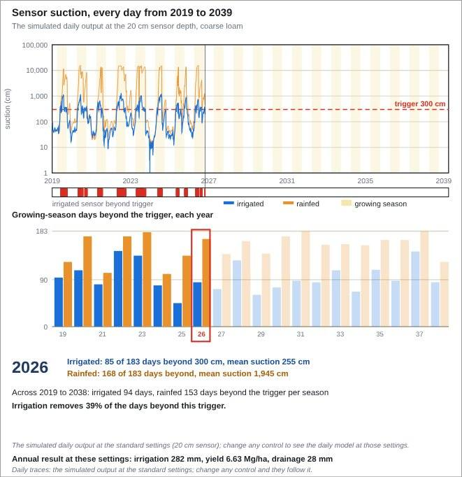{width=100%}

\newpage

### The equations of this layer

Every number and picture of the layer comes from the equations below (numbers as in Volume 1, with the chapter that explains each).

**Eq. 5.4** (Volume 1, engine)

$$
\begin{aligned}
E &= \bar E(\mathrm{soil},\varphi,c)\ \Bigl[\tfrac{\mathrm{now}.E}{\mathrm{ref}.E}\Bigr]\Bigl[\tfrac{\mathrm{tN}.E}{\mathrm{tB}.E}\Bigr]\Bigl[\tfrac{E_b}{E_{b,\mathrm{ref}}}\Bigr] &&(5.4)\\
T &= T_b\ \Bigl[\tfrac{\mathrm{now}.T}{\mathrm{bare}.T}\Bigr]\ \mathrm{clip}\Bigl(\tfrac{\mathrm{tN}.T}{\mathrm{tB}.T};\,0.3,\,2.5\Bigr) &&(5.5)\\
ET &= ET_b\ \Bigl[\tfrac{\mathrm{now}.ET}{\mathrm{bare}.ET}\Bigr]\ \mathrm{clip}\Bigl(\tfrac{\mathrm{tN}.ET}{\mathrm{tB}.ET};\,0.5,\,2\Bigr) &&(5.6)\\
I &= I_b\ \Bigl[\tfrac{\mathrm{now}.I}{\mathrm{bare}.I}\Bigr]\ \mathrm{clip}\Bigl(\tfrac{\mathrm{tN}.I}{\mathrm{tB}.I};\,0.4,\,2.5\Bigr) &&(5.7)\\
Y &= Y_b\ \Bigl[\tfrac{\mathrm{tN}.Y}{\mathrm{tR}.Y}\Bigr]\Bigl[\tfrac{\mathrm{now}.Y}{\mathrm{nm}.Y}\Bigr] &&(5.8)\\
D &= D_b + (\mathrm{now}.D-\mathrm{bare}.D) + (\mathrm{tN}.D-\mathrm{tB}.D) &&(5.9)\\
N_L &= N_b + (\mathrm{now}.N-\mathrm{bare}.N) + (\mathrm{tN}.N-\mathrm{tB}.N) &&(5.10)
\end{aligned}
$$

*Provenance (Eq. 5.4--5.10):* **[Data-driven]**: ratios of Daisy ensemble results (run sets E2--E14); the clip bounds are engineered limits.

**Eq. 5.5** (Volume 1, engine)

$$
\begin{aligned}
E &= \bar E(\mathrm{soil},\varphi,c)\ \Bigl[\tfrac{\mathrm{now}.E}{\mathrm{ref}.E}\Bigr]\Bigl[\tfrac{\mathrm{tN}.E}{\mathrm{tB}.E}\Bigr]\Bigl[\tfrac{E_b}{E_{b,\mathrm{ref}}}\Bigr] &&(5.4)\\
T &= T_b\ \Bigl[\tfrac{\mathrm{now}.T}{\mathrm{bare}.T}\Bigr]\ \mathrm{clip}\Bigl(\tfrac{\mathrm{tN}.T}{\mathrm{tB}.T};\,0.3,\,2.5\Bigr) &&(5.5)\\
ET &= ET_b\ \Bigl[\tfrac{\mathrm{now}.ET}{\mathrm{bare}.ET}\Bigr]\ \mathrm{clip}\Bigl(\tfrac{\mathrm{tN}.ET}{\mathrm{tB}.ET};\,0.5,\,2\Bigr) &&(5.6)\\
I &= I_b\ \Bigl[\tfrac{\mathrm{now}.I}{\mathrm{bare}.I}\Bigr]\ \mathrm{clip}\Bigl(\tfrac{\mathrm{tN}.I}{\mathrm{tB}.I};\,0.4,\,2.5\Bigr) &&(5.7)\\
Y &= Y_b\ \Bigl[\tfrac{\mathrm{tN}.Y}{\mathrm{tR}.Y}\Bigr]\Bigl[\tfrac{\mathrm{now}.Y}{\mathrm{nm}.Y}\Bigr] &&(5.8)\\
D &= D_b + (\mathrm{now}.D-\mathrm{bare}.D) + (\mathrm{tN}.D-\mathrm{tB}.D) &&(5.9)\\
N_L &= N_b + (\mathrm{now}.N-\mathrm{bare}.N) + (\mathrm{tN}.N-\mathrm{tB}.N) &&(5.10)
\end{aligned}
$$

*Provenance (Eq. 5.4--5.10):* **[Data-driven]**: ratios of Daisy ensemble results (run sets E2--E14); the clip bounds are engineered limits.

**Eq. 5.6** (Volume 1, engine)

$$
\begin{aligned}
E &= \bar E(\mathrm{soil},\varphi,c)\ \Bigl[\tfrac{\mathrm{now}.E}{\mathrm{ref}.E}\Bigr]\Bigl[\tfrac{\mathrm{tN}.E}{\mathrm{tB}.E}\Bigr]\Bigl[\tfrac{E_b}{E_{b,\mathrm{ref}}}\Bigr] &&(5.4)\\
T &= T_b\ \Bigl[\tfrac{\mathrm{now}.T}{\mathrm{bare}.T}\Bigr]\ \mathrm{clip}\Bigl(\tfrac{\mathrm{tN}.T}{\mathrm{tB}.T};\,0.3,\,2.5\Bigr) &&(5.5)\\
ET &= ET_b\ \Bigl[\tfrac{\mathrm{now}.ET}{\mathrm{bare}.ET}\Bigr]\ \mathrm{clip}\Bigl(\tfrac{\mathrm{tN}.ET}{\mathrm{tB}.ET};\,0.5,\,2\Bigr) &&(5.6)\\
I &= I_b\ \Bigl[\tfrac{\mathrm{now}.I}{\mathrm{bare}.I}\Bigr]\ \mathrm{clip}\Bigl(\tfrac{\mathrm{tN}.I}{\mathrm{tB}.I};\,0.4,\,2.5\Bigr) &&(5.7)\\
Y &= Y_b\ \Bigl[\tfrac{\mathrm{tN}.Y}{\mathrm{tR}.Y}\Bigr]\Bigl[\tfrac{\mathrm{now}.Y}{\mathrm{nm}.Y}\Bigr] &&(5.8)\\
D &= D_b + (\mathrm{now}.D-\mathrm{bare}.D) + (\mathrm{tN}.D-\mathrm{tB}.D) &&(5.9)\\
N_L &= N_b + (\mathrm{now}.N-\mathrm{bare}.N) + (\mathrm{tN}.N-\mathrm{tB}.N) &&(5.10)
\end{aligned}
$$

*Provenance (Eq. 5.4--5.10):* **[Data-driven]**: ratios of Daisy ensemble results (run sets E2--E14); the clip bounds are engineered limits.

**Eq. 5.7** (Volume 1, engine)

$$
\begin{aligned}
E &= \bar E(\mathrm{soil},\varphi,c)\ \Bigl[\tfrac{\mathrm{now}.E}{\mathrm{ref}.E}\Bigr]\Bigl[\tfrac{\mathrm{tN}.E}{\mathrm{tB}.E}\Bigr]\Bigl[\tfrac{E_b}{E_{b,\mathrm{ref}}}\Bigr] &&(5.4)\\
T &= T_b\ \Bigl[\tfrac{\mathrm{now}.T}{\mathrm{bare}.T}\Bigr]\ \mathrm{clip}\Bigl(\tfrac{\mathrm{tN}.T}{\mathrm{tB}.T};\,0.3,\,2.5\Bigr) &&(5.5)\\
ET &= ET_b\ \Bigl[\tfrac{\mathrm{now}.ET}{\mathrm{bare}.ET}\Bigr]\ \mathrm{clip}\Bigl(\tfrac{\mathrm{tN}.ET}{\mathrm{tB}.ET};\,0.5,\,2\Bigr) &&(5.6)\\
I &= I_b\ \Bigl[\tfrac{\mathrm{now}.I}{\mathrm{bare}.I}\Bigr]\ \mathrm{clip}\Bigl(\tfrac{\mathrm{tN}.I}{\mathrm{tB}.I};\,0.4,\,2.5\Bigr) &&(5.7)\\
Y &= Y_b\ \Bigl[\tfrac{\mathrm{tN}.Y}{\mathrm{tR}.Y}\Bigr]\Bigl[\tfrac{\mathrm{now}.Y}{\mathrm{nm}.Y}\Bigr] &&(5.8)\\
D &= D_b + (\mathrm{now}.D-\mathrm{bare}.D) + (\mathrm{tN}.D-\mathrm{tB}.D) &&(5.9)\\
N_L &= N_b + (\mathrm{now}.N-\mathrm{bare}.N) + (\mathrm{tN}.N-\mathrm{tB}.N) &&(5.10)
\end{aligned}
$$

*Provenance (Eq. 5.4--5.10):* **[Data-driven]**: ratios of Daisy ensemble results (run sets E2--E14); the clip bounds are engineered limits.

**Eq. 5.8** (Volume 1, engine)

$$
\begin{aligned}
E &= \bar E(\mathrm{soil},\varphi,c)\ \Bigl[\tfrac{\mathrm{now}.E}{\mathrm{ref}.E}\Bigr]\Bigl[\tfrac{\mathrm{tN}.E}{\mathrm{tB}.E}\Bigr]\Bigl[\tfrac{E_b}{E_{b,\mathrm{ref}}}\Bigr] &&(5.4)\\
T &= T_b\ \Bigl[\tfrac{\mathrm{now}.T}{\mathrm{bare}.T}\Bigr]\ \mathrm{clip}\Bigl(\tfrac{\mathrm{tN}.T}{\mathrm{tB}.T};\,0.3,\,2.5\Bigr) &&(5.5)\\
ET &= ET_b\ \Bigl[\tfrac{\mathrm{now}.ET}{\mathrm{bare}.ET}\Bigr]\ \mathrm{clip}\Bigl(\tfrac{\mathrm{tN}.ET}{\mathrm{tB}.ET};\,0.5,\,2\Bigr) &&(5.6)\\
I &= I_b\ \Bigl[\tfrac{\mathrm{now}.I}{\mathrm{bare}.I}\Bigr]\ \mathrm{clip}\Bigl(\tfrac{\mathrm{tN}.I}{\mathrm{tB}.I};\,0.4,\,2.5\Bigr) &&(5.7)\\
Y &= Y_b\ \Bigl[\tfrac{\mathrm{tN}.Y}{\mathrm{tR}.Y}\Bigr]\Bigl[\tfrac{\mathrm{now}.Y}{\mathrm{nm}.Y}\Bigr] &&(5.8)\\
D &= D_b + (\mathrm{now}.D-\mathrm{bare}.D) + (\mathrm{tN}.D-\mathrm{tB}.D) &&(5.9)\\
N_L &= N_b + (\mathrm{now}.N-\mathrm{bare}.N) + (\mathrm{tN}.N-\mathrm{tB}.N) &&(5.10)
\end{aligned}
$$

*Provenance (Eq. 5.4--5.10):* **[Data-driven]**: ratios of Daisy ensemble results (run sets E2--E14); the clip bounds are engineered limits.

**Eq. 5.9** (Volume 1, engine)

$$
\begin{aligned}
E &= \bar E(\mathrm{soil},\varphi,c)\ \Bigl[\tfrac{\mathrm{now}.E}{\mathrm{ref}.E}\Bigr]\Bigl[\tfrac{\mathrm{tN}.E}{\mathrm{tB}.E}\Bigr]\Bigl[\tfrac{E_b}{E_{b,\mathrm{ref}}}\Bigr] &&(5.4)\\
T &= T_b\ \Bigl[\tfrac{\mathrm{now}.T}{\mathrm{bare}.T}\Bigr]\ \mathrm{clip}\Bigl(\tfrac{\mathrm{tN}.T}{\mathrm{tB}.T};\,0.3,\,2.5\Bigr) &&(5.5)\\
ET &= ET_b\ \Bigl[\tfrac{\mathrm{now}.ET}{\mathrm{bare}.ET}\Bigr]\ \mathrm{clip}\Bigl(\tfrac{\mathrm{tN}.ET}{\mathrm{tB}.ET};\,0.5,\,2\Bigr) &&(5.6)\\
I &= I_b\ \Bigl[\tfrac{\mathrm{now}.I}{\mathrm{bare}.I}\Bigr]\ \mathrm{clip}\Bigl(\tfrac{\mathrm{tN}.I}{\mathrm{tB}.I};\,0.4,\,2.5\Bigr) &&(5.7)\\
Y &= Y_b\ \Bigl[\tfrac{\mathrm{tN}.Y}{\mathrm{tR}.Y}\Bigr]\Bigl[\tfrac{\mathrm{now}.Y}{\mathrm{nm}.Y}\Bigr] &&(5.8)\\
D &= D_b + (\mathrm{now}.D-\mathrm{bare}.D) + (\mathrm{tN}.D-\mathrm{tB}.D) &&(5.9)\\
N_L &= N_b + (\mathrm{now}.N-\mathrm{bare}.N) + (\mathrm{tN}.N-\mathrm{tB}.N) &&(5.10)
\end{aligned}
$$

*Provenance (Eq. 5.4--5.10):* **[Data-driven]**: ratios of Daisy ensemble results (run sets E2--E14); the clip bounds are engineered limits.

**Eq. 5.10** (Volume 1, engine)

$$
\begin{aligned}
E &= \bar E(\mathrm{soil},\varphi,c)\ \Bigl[\tfrac{\mathrm{now}.E}{\mathrm{ref}.E}\Bigr]\Bigl[\tfrac{\mathrm{tN}.E}{\mathrm{tB}.E}\Bigr]\Bigl[\tfrac{E_b}{E_{b,\mathrm{ref}}}\Bigr] &&(5.4)\\
T &= T_b\ \Bigl[\tfrac{\mathrm{now}.T}{\mathrm{bare}.T}\Bigr]\ \mathrm{clip}\Bigl(\tfrac{\mathrm{tN}.T}{\mathrm{tB}.T};\,0.3,\,2.5\Bigr) &&(5.5)\\
ET &= ET_b\ \Bigl[\tfrac{\mathrm{now}.ET}{\mathrm{bare}.ET}\Bigr]\ \mathrm{clip}\Bigl(\tfrac{\mathrm{tN}.ET}{\mathrm{tB}.ET};\,0.5,\,2\Bigr) &&(5.6)\\
I &= I_b\ \Bigl[\tfrac{\mathrm{now}.I}{\mathrm{bare}.I}\Bigr]\ \mathrm{clip}\Bigl(\tfrac{\mathrm{tN}.I}{\mathrm{tB}.I};\,0.4,\,2.5\Bigr) &&(5.7)\\
Y &= Y_b\ \Bigl[\tfrac{\mathrm{tN}.Y}{\mathrm{tR}.Y}\Bigr]\Bigl[\tfrac{\mathrm{now}.Y}{\mathrm{nm}.Y}\Bigr] &&(5.8)\\
D &= D_b + (\mathrm{now}.D-\mathrm{bare}.D) + (\mathrm{tN}.D-\mathrm{tB}.D) &&(5.9)\\
N_L &= N_b + (\mathrm{now}.N-\mathrm{bare}.N) + (\mathrm{tN}.N-\mathrm{tB}.N) &&(5.10)
\end{aligned}
$$

*Provenance (Eq. 5.4--5.10):* **[Data-driven]**: ratios of Daisy ensemble results (run sets E2--E14); the clip bounds are engineered limits.

**Eq. 5.11** (Volume 1, engine)

$$
Q \leftarrow Q\ \mathrm{clip}\Bigl(\tfrac{r_\kappa.Q}{r_{\kappa_0}.Q};\,0.05,\,6\Bigr)\ \ (Q\in\{E,T,ET,I,Y\}),\qquad
D \leftarrow D + (r_\kappa.D - r_{\kappa_0}.D),\quad N_L \leftarrow N_L + (r_\kappa.N - r_{\kappa_0}.N).
\tag{5.11}
$$

*Provenance (Eq. 5.11):* **[Data-driven]**: set-specific corrections from the Daisy run sets; clip bounds engineered.

**Eq. 5.12** (Volume 1, engine)

$$
\begin{gathered}
ET \in [\,P + I - D - 30,\ P + I - D + 15\,]\ \text{(if not, } ET\ \text{is clipped and } E, T \text{ are scaled by the same factor)},\\
E_{\mathrm{other}} = \max(0,\ ET - T - E),\qquad \Delta S = P + I - ET - D,\qquad
\mathrm{IE} = \frac{100\,Y}{I}\ \ [\mathrm{kg\ m^{-3}}].
\end{gathered}
\tag{5.12}
$$

*Provenance (Eq. 5.12):* **[Engineered]**: closure constraint and bounds chosen for the workbench.

**Eq. 6.1** (Volume 1, control)

$$
N_y(h_T) = \#\bigl\{\,d \in \text{growing season of year } y : h_d > h_T\,\bigr\}\quad(183\ \text{days from 1 April}),
\tag{6.1}
$$

*Provenance (Eq. 6.1):* **[Data-driven]**: counts over the simulated daily series.

**Eq. 6.2** (Volume 1, control)

$$
X = 100\Bigl(1 - \frac{\bar N_{\mathrm{irr}}}{\bar N_{\mathrm{rainfed}}}\Bigr),\qquad \bar N = \tfrac{1}{20}\sum_{y} N_y.
\tag{6.2}
$$

*Provenance (Eq. 6.2):* **[Data-driven]**: counts over the simulated daily series.

**Eq. 6.4a** (Volume 1, control)

$$
h^{\mathrm{x}}_d = h_{\mathrm{soil}}\!\Bigl(f_{\mathrm{ref}}\bigl(h^{\mathrm{rec}}_d\bigr) + \tfrac17\sum_{q=-3}^{3}\bigl[f^{\mathrm{set}}_{d+q}-f^{\mathrm{std}}_{d+q}\bigr]\Bigr),
\tag{6.4a}
$$

*Provenance (Eq. 6.4a):* **[Data-driven + Engineered]**: the stored simulated record carries the real weather sequence; the change made by your settings is the difference of two runs of the daily model, converted with the van Genuchten curve of your soil (the inverse of Eq. 5.3, tabulated).

\newpage

## Trigger law

{width=100%}

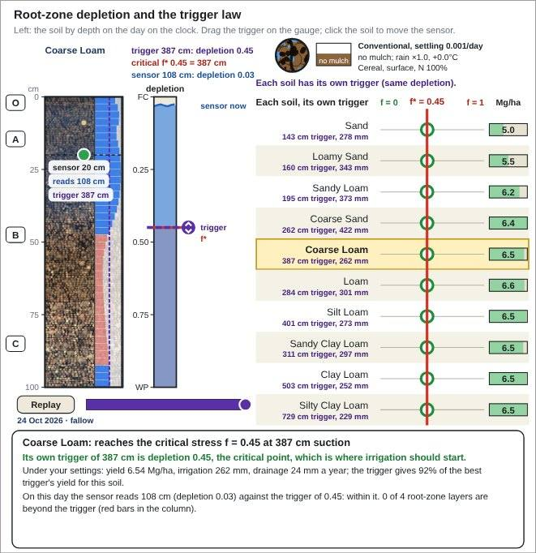{width=100%}

\newpage

### The equations of this layer

Every number and picture of the layer comes from the equations below (numbers as in Volume 1, with the chapter that explains each).

**Eq. 5.3** (Volume 1, engine)

$$
f(h) \;=\; \frac{S_e(100) - S_e(|h|)}{S_e(100) - S_e(15\,849)},
\qquad f_{\mathrm{used}} = \min\{1,\max\{0, f\}\}.
\tag{5.3}
$$

*Provenance (Eq. 5.3):* **[Literature]**: standard definition of plant-available water between field capacity and wilting point.

**Eq. 5.27** (Volume 1, engine)

$$
Z_n = \mathrm{clip}\bigl(f_T\cdot \mathrm{AWC}\cdot R_{\max};\ 25,\ 150\bigr)\ \mathrm{mm}\qquad(\text{surface; drip and sprinkler use their own limits})
\tag{5.27}
$$

*Provenance (Eq. 5.27):* **[Literature]**: readily available water as in FAO-56 practice, with an engineered clip.

**Eq. 6.3** (Volume 1, control)

$$
h(f) = \Bigl\{\,h : f(h) = f\,\Bigr\},
\tag{6.3}
$$

*Provenance (Eq. 6.3):* **[Literature]**: inverse of the van Genuchten curve, solved by bisection.

**Eq. 6.4** (Volume 1, control)

$$
Z_n = f\cdot \mathrm{AWC}\cdot R_{\max}\quad[\mathrm{mm}]
\tag{6.4}
$$

*Provenance (Eq. 6.4):* **[Literature]**: same relation as Eq. (5.27) without the clip.

**Eq. 6.5** (Volume 1, control)

$$
Y_{\mathrm{rel}} = \frac{Y(h_T)}{\max_{h}\,Y(h)},
\tag{6.5}
$$

*Provenance (Eq. 6.5):* **[Data-driven]**: ratio of Daisy run-set E2 yields.

\newpage

# Mulch and evaporation

## Mulch against bare soil

{width=100%}

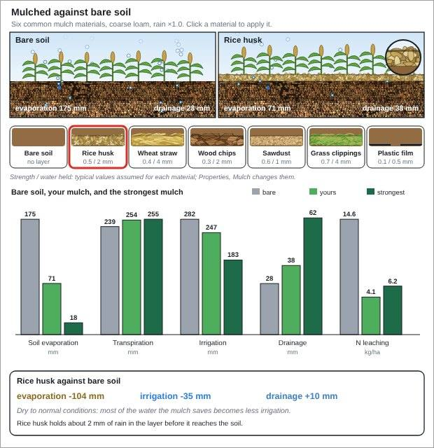{width=100%}

\newpage

### The equations of this layer

Every number and picture of the layer comes from the equations below (numbers as in Volume 1, with the chapter that explains each).

**Eq. 5.4** (Volume 1, engine)

$$
\begin{aligned}
E &= \bar E(\mathrm{soil},\varphi,c)\ \Bigl[\tfrac{\mathrm{now}.E}{\mathrm{ref}.E}\Bigr]\Bigl[\tfrac{\mathrm{tN}.E}{\mathrm{tB}.E}\Bigr]\Bigl[\tfrac{E_b}{E_{b,\mathrm{ref}}}\Bigr] &&(5.4)\\
T &= T_b\ \Bigl[\tfrac{\mathrm{now}.T}{\mathrm{bare}.T}\Bigr]\ \mathrm{clip}\Bigl(\tfrac{\mathrm{tN}.T}{\mathrm{tB}.T};\,0.3,\,2.5\Bigr) &&(5.5)\\
ET &= ET_b\ \Bigl[\tfrac{\mathrm{now}.ET}{\mathrm{bare}.ET}\Bigr]\ \mathrm{clip}\Bigl(\tfrac{\mathrm{tN}.ET}{\mathrm{tB}.ET};\,0.5,\,2\Bigr) &&(5.6)\\
I &= I_b\ \Bigl[\tfrac{\mathrm{now}.I}{\mathrm{bare}.I}\Bigr]\ \mathrm{clip}\Bigl(\tfrac{\mathrm{tN}.I}{\mathrm{tB}.I};\,0.4,\,2.5\Bigr) &&(5.7)\\
Y &= Y_b\ \Bigl[\tfrac{\mathrm{tN}.Y}{\mathrm{tR}.Y}\Bigr]\Bigl[\tfrac{\mathrm{now}.Y}{\mathrm{nm}.Y}\Bigr] &&(5.8)\\
D &= D_b + (\mathrm{now}.D-\mathrm{bare}.D) + (\mathrm{tN}.D-\mathrm{tB}.D) &&(5.9)\\
N_L &= N_b + (\mathrm{now}.N-\mathrm{bare}.N) + (\mathrm{tN}.N-\mathrm{tB}.N) &&(5.10)
\end{aligned}
$$

*Provenance (Eq. 5.4--5.10):* **[Data-driven]**: ratios of Daisy ensemble results (run sets E2--E14); the clip bounds are engineered limits.

**Eq. 5.5** (Volume 1, engine)

$$
\begin{aligned}
E &= \bar E(\mathrm{soil},\varphi,c)\ \Bigl[\tfrac{\mathrm{now}.E}{\mathrm{ref}.E}\Bigr]\Bigl[\tfrac{\mathrm{tN}.E}{\mathrm{tB}.E}\Bigr]\Bigl[\tfrac{E_b}{E_{b,\mathrm{ref}}}\Bigr] &&(5.4)\\
T &= T_b\ \Bigl[\tfrac{\mathrm{now}.T}{\mathrm{bare}.T}\Bigr]\ \mathrm{clip}\Bigl(\tfrac{\mathrm{tN}.T}{\mathrm{tB}.T};\,0.3,\,2.5\Bigr) &&(5.5)\\
ET &= ET_b\ \Bigl[\tfrac{\mathrm{now}.ET}{\mathrm{bare}.ET}\Bigr]\ \mathrm{clip}\Bigl(\tfrac{\mathrm{tN}.ET}{\mathrm{tB}.ET};\,0.5,\,2\Bigr) &&(5.6)\\
I &= I_b\ \Bigl[\tfrac{\mathrm{now}.I}{\mathrm{bare}.I}\Bigr]\ \mathrm{clip}\Bigl(\tfrac{\mathrm{tN}.I}{\mathrm{tB}.I};\,0.4,\,2.5\Bigr) &&(5.7)\\
Y &= Y_b\ \Bigl[\tfrac{\mathrm{tN}.Y}{\mathrm{tR}.Y}\Bigr]\Bigl[\tfrac{\mathrm{now}.Y}{\mathrm{nm}.Y}\Bigr] &&(5.8)\\
D &= D_b + (\mathrm{now}.D-\mathrm{bare}.D) + (\mathrm{tN}.D-\mathrm{tB}.D) &&(5.9)\\
N_L &= N_b + (\mathrm{now}.N-\mathrm{bare}.N) + (\mathrm{tN}.N-\mathrm{tB}.N) &&(5.10)
\end{aligned}
$$

*Provenance (Eq. 5.4--5.10):* **[Data-driven]**: ratios of Daisy ensemble results (run sets E2--E14); the clip bounds are engineered limits.

**Eq. 5.6** (Volume 1, engine)

$$
\begin{aligned}
E &= \bar E(\mathrm{soil},\varphi,c)\ \Bigl[\tfrac{\mathrm{now}.E}{\mathrm{ref}.E}\Bigr]\Bigl[\tfrac{\mathrm{tN}.E}{\mathrm{tB}.E}\Bigr]\Bigl[\tfrac{E_b}{E_{b,\mathrm{ref}}}\Bigr] &&(5.4)\\
T &= T_b\ \Bigl[\tfrac{\mathrm{now}.T}{\mathrm{bare}.T}\Bigr]\ \mathrm{clip}\Bigl(\tfrac{\mathrm{tN}.T}{\mathrm{tB}.T};\,0.3,\,2.5\Bigr) &&(5.5)\\
ET &= ET_b\ \Bigl[\tfrac{\mathrm{now}.ET}{\mathrm{bare}.ET}\Bigr]\ \mathrm{clip}\Bigl(\tfrac{\mathrm{tN}.ET}{\mathrm{tB}.ET};\,0.5,\,2\Bigr) &&(5.6)\\
I &= I_b\ \Bigl[\tfrac{\mathrm{now}.I}{\mathrm{bare}.I}\Bigr]\ \mathrm{clip}\Bigl(\tfrac{\mathrm{tN}.I}{\mathrm{tB}.I};\,0.4,\,2.5\Bigr) &&(5.7)\\
Y &= Y_b\ \Bigl[\tfrac{\mathrm{tN}.Y}{\mathrm{tR}.Y}\Bigr]\Bigl[\tfrac{\mathrm{now}.Y}{\mathrm{nm}.Y}\Bigr] &&(5.8)\\
D &= D_b + (\mathrm{now}.D-\mathrm{bare}.D) + (\mathrm{tN}.D-\mathrm{tB}.D) &&(5.9)\\
N_L &= N_b + (\mathrm{now}.N-\mathrm{bare}.N) + (\mathrm{tN}.N-\mathrm{tB}.N) &&(5.10)
\end{aligned}
$$

*Provenance (Eq. 5.4--5.10):* **[Data-driven]**: ratios of Daisy ensemble results (run sets E2--E14); the clip bounds are engineered limits.

**Eq. 5.7** (Volume 1, engine)

$$
\begin{aligned}
E &= \bar E(\mathrm{soil},\varphi,c)\ \Bigl[\tfrac{\mathrm{now}.E}{\mathrm{ref}.E}\Bigr]\Bigl[\tfrac{\mathrm{tN}.E}{\mathrm{tB}.E}\Bigr]\Bigl[\tfrac{E_b}{E_{b,\mathrm{ref}}}\Bigr] &&(5.4)\\
T &= T_b\ \Bigl[\tfrac{\mathrm{now}.T}{\mathrm{bare}.T}\Bigr]\ \mathrm{clip}\Bigl(\tfrac{\mathrm{tN}.T}{\mathrm{tB}.T};\,0.3,\,2.5\Bigr) &&(5.5)\\
ET &= ET_b\ \Bigl[\tfrac{\mathrm{now}.ET}{\mathrm{bare}.ET}\Bigr]\ \mathrm{clip}\Bigl(\tfrac{\mathrm{tN}.ET}{\mathrm{tB}.ET};\,0.5,\,2\Bigr) &&(5.6)\\
I &= I_b\ \Bigl[\tfrac{\mathrm{now}.I}{\mathrm{bare}.I}\Bigr]\ \mathrm{clip}\Bigl(\tfrac{\mathrm{tN}.I}{\mathrm{tB}.I};\,0.4,\,2.5\Bigr) &&(5.7)\\
Y &= Y_b\ \Bigl[\tfrac{\mathrm{tN}.Y}{\mathrm{tR}.Y}\Bigr]\Bigl[\tfrac{\mathrm{now}.Y}{\mathrm{nm}.Y}\Bigr] &&(5.8)\\
D &= D_b + (\mathrm{now}.D-\mathrm{bare}.D) + (\mathrm{tN}.D-\mathrm{tB}.D) &&(5.9)\\
N_L &= N_b + (\mathrm{now}.N-\mathrm{bare}.N) + (\mathrm{tN}.N-\mathrm{tB}.N) &&(5.10)
\end{aligned}
$$

*Provenance (Eq. 5.4--5.10):* **[Data-driven]**: ratios of Daisy ensemble results (run sets E2--E14); the clip bounds are engineered limits.

**Eq. 5.8** (Volume 1, engine)

$$
\begin{aligned}
E &= \bar E(\mathrm{soil},\varphi,c)\ \Bigl[\tfrac{\mathrm{now}.E}{\mathrm{ref}.E}\Bigr]\Bigl[\tfrac{\mathrm{tN}.E}{\mathrm{tB}.E}\Bigr]\Bigl[\tfrac{E_b}{E_{b,\mathrm{ref}}}\Bigr] &&(5.4)\\
T &= T_b\ \Bigl[\tfrac{\mathrm{now}.T}{\mathrm{bare}.T}\Bigr]\ \mathrm{clip}\Bigl(\tfrac{\mathrm{tN}.T}{\mathrm{tB}.T};\,0.3,\,2.5\Bigr) &&(5.5)\\
ET &= ET_b\ \Bigl[\tfrac{\mathrm{now}.ET}{\mathrm{bare}.ET}\Bigr]\ \mathrm{clip}\Bigl(\tfrac{\mathrm{tN}.ET}{\mathrm{tB}.ET};\,0.5,\,2\Bigr) &&(5.6)\\
I &= I_b\ \Bigl[\tfrac{\mathrm{now}.I}{\mathrm{bare}.I}\Bigr]\ \mathrm{clip}\Bigl(\tfrac{\mathrm{tN}.I}{\mathrm{tB}.I};\,0.4,\,2.5\Bigr) &&(5.7)\\
Y &= Y_b\ \Bigl[\tfrac{\mathrm{tN}.Y}{\mathrm{tR}.Y}\Bigr]\Bigl[\tfrac{\mathrm{now}.Y}{\mathrm{nm}.Y}\Bigr] &&(5.8)\\
D &= D_b + (\mathrm{now}.D-\mathrm{bare}.D) + (\mathrm{tN}.D-\mathrm{tB}.D) &&(5.9)\\
N_L &= N_b + (\mathrm{now}.N-\mathrm{bare}.N) + (\mathrm{tN}.N-\mathrm{tB}.N) &&(5.10)
\end{aligned}
$$

*Provenance (Eq. 5.4--5.10):* **[Data-driven]**: ratios of Daisy ensemble results (run sets E2--E14); the clip bounds are engineered limits.

**Eq. 5.9** (Volume 1, engine)

$$
\begin{aligned}
E &= \bar E(\mathrm{soil},\varphi,c)\ \Bigl[\tfrac{\mathrm{now}.E}{\mathrm{ref}.E}\Bigr]\Bigl[\tfrac{\mathrm{tN}.E}{\mathrm{tB}.E}\Bigr]\Bigl[\tfrac{E_b}{E_{b,\mathrm{ref}}}\Bigr] &&(5.4)\\
T &= T_b\ \Bigl[\tfrac{\mathrm{now}.T}{\mathrm{bare}.T}\Bigr]\ \mathrm{clip}\Bigl(\tfrac{\mathrm{tN}.T}{\mathrm{tB}.T};\,0.3,\,2.5\Bigr) &&(5.5)\\
ET &= ET_b\ \Bigl[\tfrac{\mathrm{now}.ET}{\mathrm{bare}.ET}\Bigr]\ \mathrm{clip}\Bigl(\tfrac{\mathrm{tN}.ET}{\mathrm{tB}.ET};\,0.5,\,2\Bigr) &&(5.6)\\
I &= I_b\ \Bigl[\tfrac{\mathrm{now}.I}{\mathrm{bare}.I}\Bigr]\ \mathrm{clip}\Bigl(\tfrac{\mathrm{tN}.I}{\mathrm{tB}.I};\,0.4,\,2.5\Bigr) &&(5.7)\\
Y &= Y_b\ \Bigl[\tfrac{\mathrm{tN}.Y}{\mathrm{tR}.Y}\Bigr]\Bigl[\tfrac{\mathrm{now}.Y}{\mathrm{nm}.Y}\Bigr] &&(5.8)\\
D &= D_b + (\mathrm{now}.D-\mathrm{bare}.D) + (\mathrm{tN}.D-\mathrm{tB}.D) &&(5.9)\\
N_L &= N_b + (\mathrm{now}.N-\mathrm{bare}.N) + (\mathrm{tN}.N-\mathrm{tB}.N) &&(5.10)
\end{aligned}
$$

*Provenance (Eq. 5.4--5.10):* **[Data-driven]**: ratios of Daisy ensemble results (run sets E2--E14); the clip bounds are engineered limits.

**Eq. 5.10** (Volume 1, engine)

$$
\begin{aligned}
E &= \bar E(\mathrm{soil},\varphi,c)\ \Bigl[\tfrac{\mathrm{now}.E}{\mathrm{ref}.E}\Bigr]\Bigl[\tfrac{\mathrm{tN}.E}{\mathrm{tB}.E}\Bigr]\Bigl[\tfrac{E_b}{E_{b,\mathrm{ref}}}\Bigr] &&(5.4)\\
T &= T_b\ \Bigl[\tfrac{\mathrm{now}.T}{\mathrm{bare}.T}\Bigr]\ \mathrm{clip}\Bigl(\tfrac{\mathrm{tN}.T}{\mathrm{tB}.T};\,0.3,\,2.5\Bigr) &&(5.5)\\
ET &= ET_b\ \Bigl[\tfrac{\mathrm{now}.ET}{\mathrm{bare}.ET}\Bigr]\ \mathrm{clip}\Bigl(\tfrac{\mathrm{tN}.ET}{\mathrm{tB}.ET};\,0.5,\,2\Bigr) &&(5.6)\\
I &= I_b\ \Bigl[\tfrac{\mathrm{now}.I}{\mathrm{bare}.I}\Bigr]\ \mathrm{clip}\Bigl(\tfrac{\mathrm{tN}.I}{\mathrm{tB}.I};\,0.4,\,2.5\Bigr) &&(5.7)\\
Y &= Y_b\ \Bigl[\tfrac{\mathrm{tN}.Y}{\mathrm{tR}.Y}\Bigr]\Bigl[\tfrac{\mathrm{now}.Y}{\mathrm{nm}.Y}\Bigr] &&(5.8)\\
D &= D_b + (\mathrm{now}.D-\mathrm{bare}.D) + (\mathrm{tN}.D-\mathrm{tB}.D) &&(5.9)\\
N_L &= N_b + (\mathrm{now}.N-\mathrm{bare}.N) + (\mathrm{tN}.N-\mathrm{tB}.N) &&(5.10)
\end{aligned}
$$

*Provenance (Eq. 5.4--5.10):* **[Data-driven]**: ratios of Daisy ensemble results (run sets E2--E14); the clip bounds are engineered limits.

**Eq. 9.1** (Volume 1, mulch)

$$
\Delta E = E_{1.0} - E_{\varphi},\qquad
\Delta I = I_{1.0} - I_{\varphi},\qquad
\Delta D = D_{\varphi} - D_{1.0},
\tag{9.1}
$$

*Provenance (Eq. 9.1):* **[Data-driven]**: differences and ratios of Daisy run-set E14 and E11 results.

\newpage

## Mulch control

{width=100%}

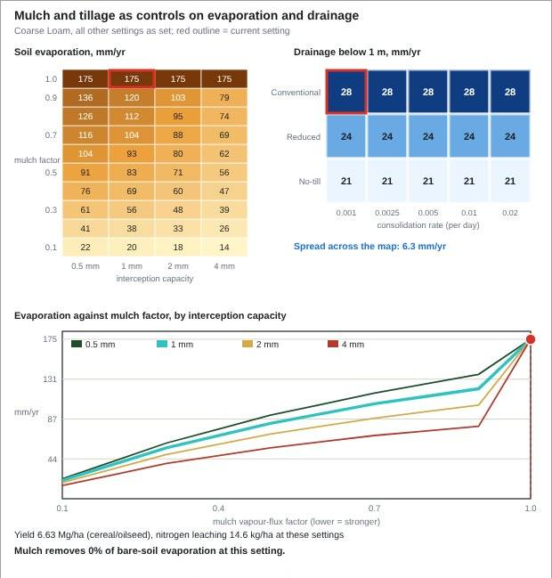{width=100%}

\newpage

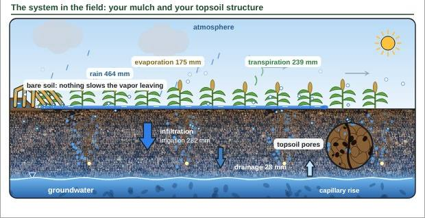{width=100%}

\newpage

### The equations of this layer

Every number and picture of the layer comes from the equations below (numbers as in Volume 1, with the chapter that explains each).

**Eq. 5.4** (Volume 1, engine)

$$
\begin{aligned}
E &= \bar E(\mathrm{soil},\varphi,c)\ \Bigl[\tfrac{\mathrm{now}.E}{\mathrm{ref}.E}\Bigr]\Bigl[\tfrac{\mathrm{tN}.E}{\mathrm{tB}.E}\Bigr]\Bigl[\tfrac{E_b}{E_{b,\mathrm{ref}}}\Bigr] &&(5.4)\\
T &= T_b\ \Bigl[\tfrac{\mathrm{now}.T}{\mathrm{bare}.T}\Bigr]\ \mathrm{clip}\Bigl(\tfrac{\mathrm{tN}.T}{\mathrm{tB}.T};\,0.3,\,2.5\Bigr) &&(5.5)\\
ET &= ET_b\ \Bigl[\tfrac{\mathrm{now}.ET}{\mathrm{bare}.ET}\Bigr]\ \mathrm{clip}\Bigl(\tfrac{\mathrm{tN}.ET}{\mathrm{tB}.ET};\,0.5,\,2\Bigr) &&(5.6)\\
I &= I_b\ \Bigl[\tfrac{\mathrm{now}.I}{\mathrm{bare}.I}\Bigr]\ \mathrm{clip}\Bigl(\tfrac{\mathrm{tN}.I}{\mathrm{tB}.I};\,0.4,\,2.5\Bigr) &&(5.7)\\
Y &= Y_b\ \Bigl[\tfrac{\mathrm{tN}.Y}{\mathrm{tR}.Y}\Bigr]\Bigl[\tfrac{\mathrm{now}.Y}{\mathrm{nm}.Y}\Bigr] &&(5.8)\\
D &= D_b + (\mathrm{now}.D-\mathrm{bare}.D) + (\mathrm{tN}.D-\mathrm{tB}.D) &&(5.9)\\
N_L &= N_b + (\mathrm{now}.N-\mathrm{bare}.N) + (\mathrm{tN}.N-\mathrm{tB}.N) &&(5.10)
\end{aligned}
$$

*Provenance (Eq. 5.4--5.10):* **[Data-driven]**: ratios of Daisy ensemble results (run sets E2--E14); the clip bounds are engineered limits.

**Eq. 5.5** (Volume 1, engine)

$$
\begin{aligned}
E &= \bar E(\mathrm{soil},\varphi,c)\ \Bigl[\tfrac{\mathrm{now}.E}{\mathrm{ref}.E}\Bigr]\Bigl[\tfrac{\mathrm{tN}.E}{\mathrm{tB}.E}\Bigr]\Bigl[\tfrac{E_b}{E_{b,\mathrm{ref}}}\Bigr] &&(5.4)\\
T &= T_b\ \Bigl[\tfrac{\mathrm{now}.T}{\mathrm{bare}.T}\Bigr]\ \mathrm{clip}\Bigl(\tfrac{\mathrm{tN}.T}{\mathrm{tB}.T};\,0.3,\,2.5\Bigr) &&(5.5)\\
ET &= ET_b\ \Bigl[\tfrac{\mathrm{now}.ET}{\mathrm{bare}.ET}\Bigr]\ \mathrm{clip}\Bigl(\tfrac{\mathrm{tN}.ET}{\mathrm{tB}.ET};\,0.5,\,2\Bigr) &&(5.6)\\
I &= I_b\ \Bigl[\tfrac{\mathrm{now}.I}{\mathrm{bare}.I}\Bigr]\ \mathrm{clip}\Bigl(\tfrac{\mathrm{tN}.I}{\mathrm{tB}.I};\,0.4,\,2.5\Bigr) &&(5.7)\\
Y &= Y_b\ \Bigl[\tfrac{\mathrm{tN}.Y}{\mathrm{tR}.Y}\Bigr]\Bigl[\tfrac{\mathrm{now}.Y}{\mathrm{nm}.Y}\Bigr] &&(5.8)\\
D &= D_b + (\mathrm{now}.D-\mathrm{bare}.D) + (\mathrm{tN}.D-\mathrm{tB}.D) &&(5.9)\\
N_L &= N_b + (\mathrm{now}.N-\mathrm{bare}.N) + (\mathrm{tN}.N-\mathrm{tB}.N) &&(5.10)
\end{aligned}
$$

*Provenance (Eq. 5.4--5.10):* **[Data-driven]**: ratios of Daisy ensemble results (run sets E2--E14); the clip bounds are engineered limits.

**Eq. 5.6** (Volume 1, engine)

$$
\begin{aligned}
E &= \bar E(\mathrm{soil},\varphi,c)\ \Bigl[\tfrac{\mathrm{now}.E}{\mathrm{ref}.E}\Bigr]\Bigl[\tfrac{\mathrm{tN}.E}{\mathrm{tB}.E}\Bigr]\Bigl[\tfrac{E_b}{E_{b,\mathrm{ref}}}\Bigr] &&(5.4)\\
T &= T_b\ \Bigl[\tfrac{\mathrm{now}.T}{\mathrm{bare}.T}\Bigr]\ \mathrm{clip}\Bigl(\tfrac{\mathrm{tN}.T}{\mathrm{tB}.T};\,0.3,\,2.5\Bigr) &&(5.5)\\
ET &= ET_b\ \Bigl[\tfrac{\mathrm{now}.ET}{\mathrm{bare}.ET}\Bigr]\ \mathrm{clip}\Bigl(\tfrac{\mathrm{tN}.ET}{\mathrm{tB}.ET};\,0.5,\,2\Bigr) &&(5.6)\\
I &= I_b\ \Bigl[\tfrac{\mathrm{now}.I}{\mathrm{bare}.I}\Bigr]\ \mathrm{clip}\Bigl(\tfrac{\mathrm{tN}.I}{\mathrm{tB}.I};\,0.4,\,2.5\Bigr) &&(5.7)\\
Y &= Y_b\ \Bigl[\tfrac{\mathrm{tN}.Y}{\mathrm{tR}.Y}\Bigr]\Bigl[\tfrac{\mathrm{now}.Y}{\mathrm{nm}.Y}\Bigr] &&(5.8)\\
D &= D_b + (\mathrm{now}.D-\mathrm{bare}.D) + (\mathrm{tN}.D-\mathrm{tB}.D) &&(5.9)\\
N_L &= N_b + (\mathrm{now}.N-\mathrm{bare}.N) + (\mathrm{tN}.N-\mathrm{tB}.N) &&(5.10)
\end{aligned}
$$

*Provenance (Eq. 5.4--5.10):* **[Data-driven]**: ratios of Daisy ensemble results (run sets E2--E14); the clip bounds are engineered limits.

**Eq. 5.7** (Volume 1, engine)

$$
\begin{aligned}
E &= \bar E(\mathrm{soil},\varphi,c)\ \Bigl[\tfrac{\mathrm{now}.E}{\mathrm{ref}.E}\Bigr]\Bigl[\tfrac{\mathrm{tN}.E}{\mathrm{tB}.E}\Bigr]\Bigl[\tfrac{E_b}{E_{b,\mathrm{ref}}}\Bigr] &&(5.4)\\
T &= T_b\ \Bigl[\tfrac{\mathrm{now}.T}{\mathrm{bare}.T}\Bigr]\ \mathrm{clip}\Bigl(\tfrac{\mathrm{tN}.T}{\mathrm{tB}.T};\,0.3,\,2.5\Bigr) &&(5.5)\\
ET &= ET_b\ \Bigl[\tfrac{\mathrm{now}.ET}{\mathrm{bare}.ET}\Bigr]\ \mathrm{clip}\Bigl(\tfrac{\mathrm{tN}.ET}{\mathrm{tB}.ET};\,0.5,\,2\Bigr) &&(5.6)\\
I &= I_b\ \Bigl[\tfrac{\mathrm{now}.I}{\mathrm{bare}.I}\Bigr]\ \mathrm{clip}\Bigl(\tfrac{\mathrm{tN}.I}{\mathrm{tB}.I};\,0.4,\,2.5\Bigr) &&(5.7)\\
Y &= Y_b\ \Bigl[\tfrac{\mathrm{tN}.Y}{\mathrm{tR}.Y}\Bigr]\Bigl[\tfrac{\mathrm{now}.Y}{\mathrm{nm}.Y}\Bigr] &&(5.8)\\
D &= D_b + (\mathrm{now}.D-\mathrm{bare}.D) + (\mathrm{tN}.D-\mathrm{tB}.D) &&(5.9)\\
N_L &= N_b + (\mathrm{now}.N-\mathrm{bare}.N) + (\mathrm{tN}.N-\mathrm{tB}.N) &&(5.10)
\end{aligned}
$$

*Provenance (Eq. 5.4--5.10):* **[Data-driven]**: ratios of Daisy ensemble results (run sets E2--E14); the clip bounds are engineered limits.

**Eq. 5.8** (Volume 1, engine)

$$
\begin{aligned}
E &= \bar E(\mathrm{soil},\varphi,c)\ \Bigl[\tfrac{\mathrm{now}.E}{\mathrm{ref}.E}\Bigr]\Bigl[\tfrac{\mathrm{tN}.E}{\mathrm{tB}.E}\Bigr]\Bigl[\tfrac{E_b}{E_{b,\mathrm{ref}}}\Bigr] &&(5.4)\\
T &= T_b\ \Bigl[\tfrac{\mathrm{now}.T}{\mathrm{bare}.T}\Bigr]\ \mathrm{clip}\Bigl(\tfrac{\mathrm{tN}.T}{\mathrm{tB}.T};\,0.3,\,2.5\Bigr) &&(5.5)\\
ET &= ET_b\ \Bigl[\tfrac{\mathrm{now}.ET}{\mathrm{bare}.ET}\Bigr]\ \mathrm{clip}\Bigl(\tfrac{\mathrm{tN}.ET}{\mathrm{tB}.ET};\,0.5,\,2\Bigr) &&(5.6)\\
I &= I_b\ \Bigl[\tfrac{\mathrm{now}.I}{\mathrm{bare}.I}\Bigr]\ \mathrm{clip}\Bigl(\tfrac{\mathrm{tN}.I}{\mathrm{tB}.I};\,0.4,\,2.5\Bigr) &&(5.7)\\
Y &= Y_b\ \Bigl[\tfrac{\mathrm{tN}.Y}{\mathrm{tR}.Y}\Bigr]\Bigl[\tfrac{\mathrm{now}.Y}{\mathrm{nm}.Y}\Bigr] &&(5.8)\\
D &= D_b + (\mathrm{now}.D-\mathrm{bare}.D) + (\mathrm{tN}.D-\mathrm{tB}.D) &&(5.9)\\
N_L &= N_b + (\mathrm{now}.N-\mathrm{bare}.N) + (\mathrm{tN}.N-\mathrm{tB}.N) &&(5.10)
\end{aligned}
$$

*Provenance (Eq. 5.4--5.10):* **[Data-driven]**: ratios of Daisy ensemble results (run sets E2--E14); the clip bounds are engineered limits.

**Eq. 5.9** (Volume 1, engine)

$$
\begin{aligned}
E &= \bar E(\mathrm{soil},\varphi,c)\ \Bigl[\tfrac{\mathrm{now}.E}{\mathrm{ref}.E}\Bigr]\Bigl[\tfrac{\mathrm{tN}.E}{\mathrm{tB}.E}\Bigr]\Bigl[\tfrac{E_b}{E_{b,\mathrm{ref}}}\Bigr] &&(5.4)\\
T &= T_b\ \Bigl[\tfrac{\mathrm{now}.T}{\mathrm{bare}.T}\Bigr]\ \mathrm{clip}\Bigl(\tfrac{\mathrm{tN}.T}{\mathrm{tB}.T};\,0.3,\,2.5\Bigr) &&(5.5)\\
ET &= ET_b\ \Bigl[\tfrac{\mathrm{now}.ET}{\mathrm{bare}.ET}\Bigr]\ \mathrm{clip}\Bigl(\tfrac{\mathrm{tN}.ET}{\mathrm{tB}.ET};\,0.5,\,2\Bigr) &&(5.6)\\
I &= I_b\ \Bigl[\tfrac{\mathrm{now}.I}{\mathrm{bare}.I}\Bigr]\ \mathrm{clip}\Bigl(\tfrac{\mathrm{tN}.I}{\mathrm{tB}.I};\,0.4,\,2.5\Bigr) &&(5.7)\\
Y &= Y_b\ \Bigl[\tfrac{\mathrm{tN}.Y}{\mathrm{tR}.Y}\Bigr]\Bigl[\tfrac{\mathrm{now}.Y}{\mathrm{nm}.Y}\Bigr] &&(5.8)\\
D &= D_b + (\mathrm{now}.D-\mathrm{bare}.D) + (\mathrm{tN}.D-\mathrm{tB}.D) &&(5.9)\\
N_L &= N_b + (\mathrm{now}.N-\mathrm{bare}.N) + (\mathrm{tN}.N-\mathrm{tB}.N) &&(5.10)
\end{aligned}
$$

*Provenance (Eq. 5.4--5.10):* **[Data-driven]**: ratios of Daisy ensemble results (run sets E2--E14); the clip bounds are engineered limits.

**Eq. 5.10** (Volume 1, engine)

$$
\begin{aligned}
E &= \bar E(\mathrm{soil},\varphi,c)\ \Bigl[\tfrac{\mathrm{now}.E}{\mathrm{ref}.E}\Bigr]\Bigl[\tfrac{\mathrm{tN}.E}{\mathrm{tB}.E}\Bigr]\Bigl[\tfrac{E_b}{E_{b,\mathrm{ref}}}\Bigr] &&(5.4)\\
T &= T_b\ \Bigl[\tfrac{\mathrm{now}.T}{\mathrm{bare}.T}\Bigr]\ \mathrm{clip}\Bigl(\tfrac{\mathrm{tN}.T}{\mathrm{tB}.T};\,0.3,\,2.5\Bigr) &&(5.5)\\
ET &= ET_b\ \Bigl[\tfrac{\mathrm{now}.ET}{\mathrm{bare}.ET}\Bigr]\ \mathrm{clip}\Bigl(\tfrac{\mathrm{tN}.ET}{\mathrm{tB}.ET};\,0.5,\,2\Bigr) &&(5.6)\\
I &= I_b\ \Bigl[\tfrac{\mathrm{now}.I}{\mathrm{bare}.I}\Bigr]\ \mathrm{clip}\Bigl(\tfrac{\mathrm{tN}.I}{\mathrm{tB}.I};\,0.4,\,2.5\Bigr) &&(5.7)\\
Y &= Y_b\ \Bigl[\tfrac{\mathrm{tN}.Y}{\mathrm{tR}.Y}\Bigr]\Bigl[\tfrac{\mathrm{now}.Y}{\mathrm{nm}.Y}\Bigr] &&(5.8)\\
D &= D_b + (\mathrm{now}.D-\mathrm{bare}.D) + (\mathrm{tN}.D-\mathrm{tB}.D) &&(5.9)\\
N_L &= N_b + (\mathrm{now}.N-\mathrm{bare}.N) + (\mathrm{tN}.N-\mathrm{tB}.N) &&(5.10)
\end{aligned}
$$

*Provenance (Eq. 5.4--5.10):* **[Data-driven]**: ratios of Daisy ensemble results (run sets E2--E14); the clip bounds are engineered limits.

**Eq. 9.1** (Volume 1, mulch)

$$
\Delta E = E_{1.0} - E_{\varphi},\qquad
\Delta I = I_{1.0} - I_{\varphi},\qquad
\Delta D = D_{\varphi} - D_{1.0},
\tag{9.1}
$$

*Provenance (Eq. 9.1):* **[Data-driven]**: differences and ratios of Daisy run-set E14 and E11 results.

\newpage

## Evaporation physics

{width=100%}

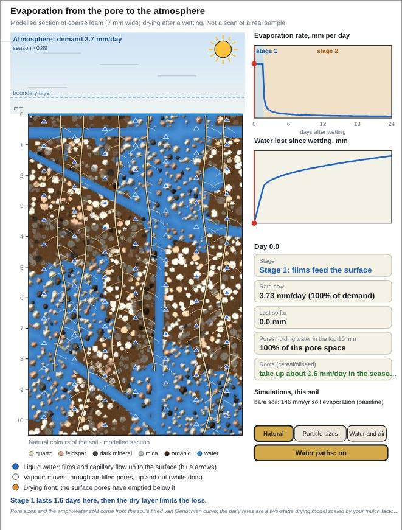{width=100%}

\newpage

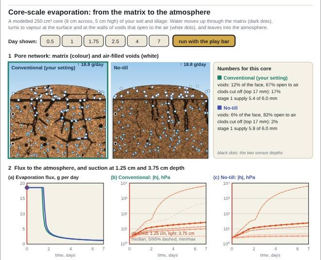{width=100%}

\newpage

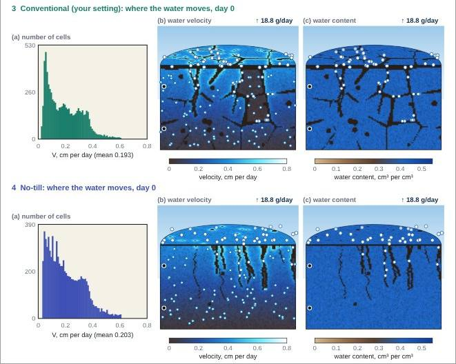{width=100%}

\newpage

### The equations of this layer

Every number and picture of the layer comes from the equations below (numbers as in Volume 1, with the chapter that explains each).

**Eq. 5.4** (Volume 1, engine)

$$
\begin{aligned}
E &= \bar E(\mathrm{soil},\varphi,c)\ \Bigl[\tfrac{\mathrm{now}.E}{\mathrm{ref}.E}\Bigr]\Bigl[\tfrac{\mathrm{tN}.E}{\mathrm{tB}.E}\Bigr]\Bigl[\tfrac{E_b}{E_{b,\mathrm{ref}}}\Bigr] &&(5.4)\\
T &= T_b\ \Bigl[\tfrac{\mathrm{now}.T}{\mathrm{bare}.T}\Bigr]\ \mathrm{clip}\Bigl(\tfrac{\mathrm{tN}.T}{\mathrm{tB}.T};\,0.3,\,2.5\Bigr) &&(5.5)\\
ET &= ET_b\ \Bigl[\tfrac{\mathrm{now}.ET}{\mathrm{bare}.ET}\Bigr]\ \mathrm{clip}\Bigl(\tfrac{\mathrm{tN}.ET}{\mathrm{tB}.ET};\,0.5,\,2\Bigr) &&(5.6)\\
I &= I_b\ \Bigl[\tfrac{\mathrm{now}.I}{\mathrm{bare}.I}\Bigr]\ \mathrm{clip}\Bigl(\tfrac{\mathrm{tN}.I}{\mathrm{tB}.I};\,0.4,\,2.5\Bigr) &&(5.7)\\
Y &= Y_b\ \Bigl[\tfrac{\mathrm{tN}.Y}{\mathrm{tR}.Y}\Bigr]\Bigl[\tfrac{\mathrm{now}.Y}{\mathrm{nm}.Y}\Bigr] &&(5.8)\\
D &= D_b + (\mathrm{now}.D-\mathrm{bare}.D) + (\mathrm{tN}.D-\mathrm{tB}.D) &&(5.9)\\
N_L &= N_b + (\mathrm{now}.N-\mathrm{bare}.N) + (\mathrm{tN}.N-\mathrm{tB}.N) &&(5.10)
\end{aligned}
$$

*Provenance (Eq. 5.4--5.10):* **[Data-driven]**: ratios of Daisy ensemble results (run sets E2--E14); the clip bounds are engineered limits.

**Eq. 5.5** (Volume 1, engine)

$$
\begin{aligned}
E &= \bar E(\mathrm{soil},\varphi,c)\ \Bigl[\tfrac{\mathrm{now}.E}{\mathrm{ref}.E}\Bigr]\Bigl[\tfrac{\mathrm{tN}.E}{\mathrm{tB}.E}\Bigr]\Bigl[\tfrac{E_b}{E_{b,\mathrm{ref}}}\Bigr] &&(5.4)\\
T &= T_b\ \Bigl[\tfrac{\mathrm{now}.T}{\mathrm{bare}.T}\Bigr]\ \mathrm{clip}\Bigl(\tfrac{\mathrm{tN}.T}{\mathrm{tB}.T};\,0.3,\,2.5\Bigr) &&(5.5)\\
ET &= ET_b\ \Bigl[\tfrac{\mathrm{now}.ET}{\mathrm{bare}.ET}\Bigr]\ \mathrm{clip}\Bigl(\tfrac{\mathrm{tN}.ET}{\mathrm{tB}.ET};\,0.5,\,2\Bigr) &&(5.6)\\
I &= I_b\ \Bigl[\tfrac{\mathrm{now}.I}{\mathrm{bare}.I}\Bigr]\ \mathrm{clip}\Bigl(\tfrac{\mathrm{tN}.I}{\mathrm{tB}.I};\,0.4,\,2.5\Bigr) &&(5.7)\\
Y &= Y_b\ \Bigl[\tfrac{\mathrm{tN}.Y}{\mathrm{tR}.Y}\Bigr]\Bigl[\tfrac{\mathrm{now}.Y}{\mathrm{nm}.Y}\Bigr] &&(5.8)\\
D &= D_b + (\mathrm{now}.D-\mathrm{bare}.D) + (\mathrm{tN}.D-\mathrm{tB}.D) &&(5.9)\\
N_L &= N_b + (\mathrm{now}.N-\mathrm{bare}.N) + (\mathrm{tN}.N-\mathrm{tB}.N) &&(5.10)
\end{aligned}
$$

*Provenance (Eq. 5.4--5.10):* **[Data-driven]**: ratios of Daisy ensemble results (run sets E2--E14); the clip bounds are engineered limits.

**Eq. 5.6** (Volume 1, engine)

$$
\begin{aligned}
E &= \bar E(\mathrm{soil},\varphi,c)\ \Bigl[\tfrac{\mathrm{now}.E}{\mathrm{ref}.E}\Bigr]\Bigl[\tfrac{\mathrm{tN}.E}{\mathrm{tB}.E}\Bigr]\Bigl[\tfrac{E_b}{E_{b,\mathrm{ref}}}\Bigr] &&(5.4)\\
T &= T_b\ \Bigl[\tfrac{\mathrm{now}.T}{\mathrm{bare}.T}\Bigr]\ \mathrm{clip}\Bigl(\tfrac{\mathrm{tN}.T}{\mathrm{tB}.T};\,0.3,\,2.5\Bigr) &&(5.5)\\
ET &= ET_b\ \Bigl[\tfrac{\mathrm{now}.ET}{\mathrm{bare}.ET}\Bigr]\ \mathrm{clip}\Bigl(\tfrac{\mathrm{tN}.ET}{\mathrm{tB}.ET};\,0.5,\,2\Bigr) &&(5.6)\\
I &= I_b\ \Bigl[\tfrac{\mathrm{now}.I}{\mathrm{bare}.I}\Bigr]\ \mathrm{clip}\Bigl(\tfrac{\mathrm{tN}.I}{\mathrm{tB}.I};\,0.4,\,2.5\Bigr) &&(5.7)\\
Y &= Y_b\ \Bigl[\tfrac{\mathrm{tN}.Y}{\mathrm{tR}.Y}\Bigr]\Bigl[\tfrac{\mathrm{now}.Y}{\mathrm{nm}.Y}\Bigr] &&(5.8)\\
D &= D_b + (\mathrm{now}.D-\mathrm{bare}.D) + (\mathrm{tN}.D-\mathrm{tB}.D) &&(5.9)\\
N_L &= N_b + (\mathrm{now}.N-\mathrm{bare}.N) + (\mathrm{tN}.N-\mathrm{tB}.N) &&(5.10)
\end{aligned}
$$

*Provenance (Eq. 5.4--5.10):* **[Data-driven]**: ratios of Daisy ensemble results (run sets E2--E14); the clip bounds are engineered limits.

**Eq. 5.7** (Volume 1, engine)

$$
\begin{aligned}
E &= \bar E(\mathrm{soil},\varphi,c)\ \Bigl[\tfrac{\mathrm{now}.E}{\mathrm{ref}.E}\Bigr]\Bigl[\tfrac{\mathrm{tN}.E}{\mathrm{tB}.E}\Bigr]\Bigl[\tfrac{E_b}{E_{b,\mathrm{ref}}}\Bigr] &&(5.4)\\
T &= T_b\ \Bigl[\tfrac{\mathrm{now}.T}{\mathrm{bare}.T}\Bigr]\ \mathrm{clip}\Bigl(\tfrac{\mathrm{tN}.T}{\mathrm{tB}.T};\,0.3,\,2.5\Bigr) &&(5.5)\\
ET &= ET_b\ \Bigl[\tfrac{\mathrm{now}.ET}{\mathrm{bare}.ET}\Bigr]\ \mathrm{clip}\Bigl(\tfrac{\mathrm{tN}.ET}{\mathrm{tB}.ET};\,0.5,\,2\Bigr) &&(5.6)\\
I &= I_b\ \Bigl[\tfrac{\mathrm{now}.I}{\mathrm{bare}.I}\Bigr]\ \mathrm{clip}\Bigl(\tfrac{\mathrm{tN}.I}{\mathrm{tB}.I};\,0.4,\,2.5\Bigr) &&(5.7)\\
Y &= Y_b\ \Bigl[\tfrac{\mathrm{tN}.Y}{\mathrm{tR}.Y}\Bigr]\Bigl[\tfrac{\mathrm{now}.Y}{\mathrm{nm}.Y}\Bigr] &&(5.8)\\
D &= D_b + (\mathrm{now}.D-\mathrm{bare}.D) + (\mathrm{tN}.D-\mathrm{tB}.D) &&(5.9)\\
N_L &= N_b + (\mathrm{now}.N-\mathrm{bare}.N) + (\mathrm{tN}.N-\mathrm{tB}.N) &&(5.10)
\end{aligned}
$$

*Provenance (Eq. 5.4--5.10):* **[Data-driven]**: ratios of Daisy ensemble results (run sets E2--E14); the clip bounds are engineered limits.

**Eq. 5.8** (Volume 1, engine)

$$
\begin{aligned}
E &= \bar E(\mathrm{soil},\varphi,c)\ \Bigl[\tfrac{\mathrm{now}.E}{\mathrm{ref}.E}\Bigr]\Bigl[\tfrac{\mathrm{tN}.E}{\mathrm{tB}.E}\Bigr]\Bigl[\tfrac{E_b}{E_{b,\mathrm{ref}}}\Bigr] &&(5.4)\\
T &= T_b\ \Bigl[\tfrac{\mathrm{now}.T}{\mathrm{bare}.T}\Bigr]\ \mathrm{clip}\Bigl(\tfrac{\mathrm{tN}.T}{\mathrm{tB}.T};\,0.3,\,2.5\Bigr) &&(5.5)\\
ET &= ET_b\ \Bigl[\tfrac{\mathrm{now}.ET}{\mathrm{bare}.ET}\Bigr]\ \mathrm{clip}\Bigl(\tfrac{\mathrm{tN}.ET}{\mathrm{tB}.ET};\,0.5,\,2\Bigr) &&(5.6)\\
I &= I_b\ \Bigl[\tfrac{\mathrm{now}.I}{\mathrm{bare}.I}\Bigr]\ \mathrm{clip}\Bigl(\tfrac{\mathrm{tN}.I}{\mathrm{tB}.I};\,0.4,\,2.5\Bigr) &&(5.7)\\
Y &= Y_b\ \Bigl[\tfrac{\mathrm{tN}.Y}{\mathrm{tR}.Y}\Bigr]\Bigl[\tfrac{\mathrm{now}.Y}{\mathrm{nm}.Y}\Bigr] &&(5.8)\\
D &= D_b + (\mathrm{now}.D-\mathrm{bare}.D) + (\mathrm{tN}.D-\mathrm{tB}.D) &&(5.9)\\
N_L &= N_b + (\mathrm{now}.N-\mathrm{bare}.N) + (\mathrm{tN}.N-\mathrm{tB}.N) &&(5.10)
\end{aligned}
$$

*Provenance (Eq. 5.4--5.10):* **[Data-driven]**: ratios of Daisy ensemble results (run sets E2--E14); the clip bounds are engineered limits.

**Eq. 5.9** (Volume 1, engine)

$$
\begin{aligned}
E &= \bar E(\mathrm{soil},\varphi,c)\ \Bigl[\tfrac{\mathrm{now}.E}{\mathrm{ref}.E}\Bigr]\Bigl[\tfrac{\mathrm{tN}.E}{\mathrm{tB}.E}\Bigr]\Bigl[\tfrac{E_b}{E_{b,\mathrm{ref}}}\Bigr] &&(5.4)\\
T &= T_b\ \Bigl[\tfrac{\mathrm{now}.T}{\mathrm{bare}.T}\Bigr]\ \mathrm{clip}\Bigl(\tfrac{\mathrm{tN}.T}{\mathrm{tB}.T};\,0.3,\,2.5\Bigr) &&(5.5)\\
ET &= ET_b\ \Bigl[\tfrac{\mathrm{now}.ET}{\mathrm{bare}.ET}\Bigr]\ \mathrm{clip}\Bigl(\tfrac{\mathrm{tN}.ET}{\mathrm{tB}.ET};\,0.5,\,2\Bigr) &&(5.6)\\
I &= I_b\ \Bigl[\tfrac{\mathrm{now}.I}{\mathrm{bare}.I}\Bigr]\ \mathrm{clip}\Bigl(\tfrac{\mathrm{tN}.I}{\mathrm{tB}.I};\,0.4,\,2.5\Bigr) &&(5.7)\\
Y &= Y_b\ \Bigl[\tfrac{\mathrm{tN}.Y}{\mathrm{tR}.Y}\Bigr]\Bigl[\tfrac{\mathrm{now}.Y}{\mathrm{nm}.Y}\Bigr] &&(5.8)\\
D &= D_b + (\mathrm{now}.D-\mathrm{bare}.D) + (\mathrm{tN}.D-\mathrm{tB}.D) &&(5.9)\\
N_L &= N_b + (\mathrm{now}.N-\mathrm{bare}.N) + (\mathrm{tN}.N-\mathrm{tB}.N) &&(5.10)
\end{aligned}
$$

*Provenance (Eq. 5.4--5.10):* **[Data-driven]**: ratios of Daisy ensemble results (run sets E2--E14); the clip bounds are engineered limits.

**Eq. 5.10** (Volume 1, engine)

$$
\begin{aligned}
E &= \bar E(\mathrm{soil},\varphi,c)\ \Bigl[\tfrac{\mathrm{now}.E}{\mathrm{ref}.E}\Bigr]\Bigl[\tfrac{\mathrm{tN}.E}{\mathrm{tB}.E}\Bigr]\Bigl[\tfrac{E_b}{E_{b,\mathrm{ref}}}\Bigr] &&(5.4)\\
T &= T_b\ \Bigl[\tfrac{\mathrm{now}.T}{\mathrm{bare}.T}\Bigr]\ \mathrm{clip}\Bigl(\tfrac{\mathrm{tN}.T}{\mathrm{tB}.T};\,0.3,\,2.5\Bigr) &&(5.5)\\
ET &= ET_b\ \Bigl[\tfrac{\mathrm{now}.ET}{\mathrm{bare}.ET}\Bigr]\ \mathrm{clip}\Bigl(\tfrac{\mathrm{tN}.ET}{\mathrm{tB}.ET};\,0.5,\,2\Bigr) &&(5.6)\\
I &= I_b\ \Bigl[\tfrac{\mathrm{now}.I}{\mathrm{bare}.I}\Bigr]\ \mathrm{clip}\Bigl(\tfrac{\mathrm{tN}.I}{\mathrm{tB}.I};\,0.4,\,2.5\Bigr) &&(5.7)\\
Y &= Y_b\ \Bigl[\tfrac{\mathrm{tN}.Y}{\mathrm{tR}.Y}\Bigr]\Bigl[\tfrac{\mathrm{now}.Y}{\mathrm{nm}.Y}\Bigr] &&(5.8)\\
D &= D_b + (\mathrm{now}.D-\mathrm{bare}.D) + (\mathrm{tN}.D-\mathrm{tB}.D) &&(5.9)\\
N_L &= N_b + (\mathrm{now}.N-\mathrm{bare}.N) + (\mathrm{tN}.N-\mathrm{tB}.N) &&(5.10)
\end{aligned}
$$

*Provenance (Eq. 5.4--5.10):* **[Data-driven]**: ratios of Daisy ensemble results (run sets E2--E14); the clip bounds are engineered limits.

**Eq. 5.26** (Volume 1, engine)

$$
E_{0,\mathrm{bare}} = 4.2\,(1 + 0.07\,\Delta T)\,\frac{0.35 + 0.65\cdot\tfrac12[1 + \sin(2\pi(\mathrm{doy}-100)/365)]}{0.675}\,\mathrm{clip}\bigl(1 - 0.12(\rho-1);\,0.85,\,1.12\bigr)\sqrt{\gamma_y}\ \ \mathrm{mm\,d^{-1}},
\tag{5.26}
$$

*Provenance (Eq. 5.26):* **[Engineered]**: atmosphere factor with chosen constants.

**Eq. 8.3** (Volume 1, structure)

$$
\theta(h) = \theta_r + (\phi - \theta_r)\,S_e(h).
\tag{8.3}
$$

*Provenance (Eq. 8.3):* **[Literature]**: van Genuchten (1980).

**Eq. 8.4** (Volume 1, structure)

$$
r_c = \frac{2\,\sigma\cos\gamma}{\rho_w\, g\, h} \;\approx\; \frac{0.149\ \mathrm{cm^2}}{h}\quad(\mathrm{or}\ r_c[\mathrm{mm}] \approx 1.49/h[\mathrm{cm}]),
\tag{8.4}
$$

*Provenance (Eq. 8.4):* **[Literature]**: Young--Laplace (Jurin) capillary law.

**Eq. 9.2** (Volume 1, mulch)

$$
t_1 = \frac{Q_1 - q_0}{e_0},\qquad
e(t) = \begin{cases} e_0, & t \le t_1\\[3pt] \dfrac{e_0}{\sqrt{1 + (t - t_1)/\tau}}, & t > t_1\end{cases}
\tag{9.2}
$$

*Provenance (Eq. 9.2):* **[Engineered]**: two-stage evaporation of the type described by Ritchie (1972) and Philip, with parameters chosen for the workbench.

**Eq. 9.3** (Volume 1, mulch)

$$
Q(t) = q_0 + \begin{cases} e_0\,t, & t \le t_1\\[3pt] (Q_1 - q_0) + 2\,e_0\,\tau\Bigl(\sqrt{1 + (t - t_1)/\tau} - 1\Bigr), & t > t_1\end{cases}
\tag{9.3}
$$

*Provenance (Eq. 9.3):* **[Engineered]**: two-stage evaporation of the type described by Ritchie (1972) and Philip, with parameters chosen for the workbench.

**Eq. 9.4** (Volume 1, mulch)

$$
\ell(t) = \min\Bigl\{60,\ \frac{Q(t) - Q_1}{\Delta\theta}\Bigr\}\ \mathrm{mm}\quad (Q > Q_1),
\tag{9.4}
$$

*Provenance (Eq. 9.4):* **[Engineered]**: drying-front geometry chosen for drawing.

**Eq. 9.5** (Volume 1, mulch)

$$
\log_{10}h(z) = \log_{10}h_s + \bigl(\log_{10}h_i - \log_{10}h_s\bigr)\bigl(1 - e^{-(z-\ell)/\lambda}\bigr)\quad (z \ge \ell),\qquad h = 10^{5}\ \mathrm{cm\ for}\ z<\ell.
\tag{9.5}
$$

*Provenance (Eq. 9.5):* **[Engineered]**: drying-front geometry chosen for drawing.

\newpage

## Fate of saved water

{width=100%}

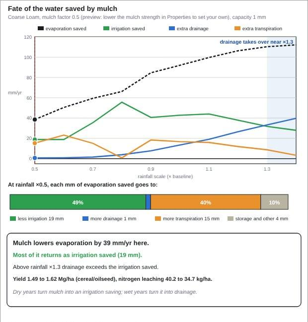{width=100%}

\newpage

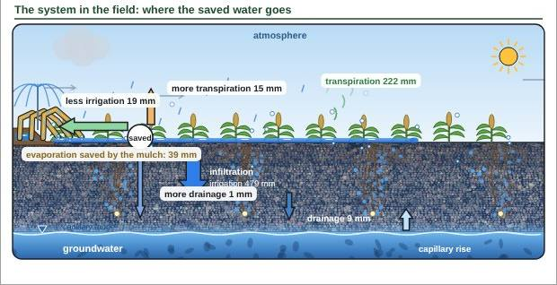{width=100%}

\newpage

### The equations of this layer

Every number and picture of the layer comes from the equations below (numbers as in Volume 1, with the chapter that explains each).

**Eq. 9.6** (Volume 1, mulch)

$$
\begin{aligned}
\Delta E(\rho) &= E_{1.0}(\rho) - E_{\varphi^\ast}(\rho), & \Delta I(\rho) &= I_{1.0}(\rho) - I_{\varphi^\ast}(\rho),\\
\Delta D(\rho) &= D_{\varphi^\ast}(\rho) - D_{1.0}(\rho), & \Delta T(\rho) &= T_{\varphi^\ast}(\rho) - T_{1.0}(\rho),
\end{aligned}
\tag{9.6}
$$

*Provenance (Eq. 9.6):* **[Data-driven]**: differences and ratios of Daisy run-set E14 and E11 results.

**Eq. 9.7** (Volume 1, mulch)

$$
f_I = \frac{\max\{\Delta I,0\}}{\max\{\Delta E,0.1\}},\ f_D = \frac{\max\{\Delta D,0\}}{\max\{\Delta E,0.1\}},\ f_T = \frac{\max\{\Delta T,0\}}{\max\{\Delta E,0.1\}},\ f_{\mathrm{rest}} = \max\{0,\ 1 - f_I - f_D - f_T\}.
\tag{9.7}
$$

*Provenance (Eq. 9.7):* **[Data-driven]**: differences and ratios of Daisy run-set E14 and E11 results.

\newpage

## Regime map

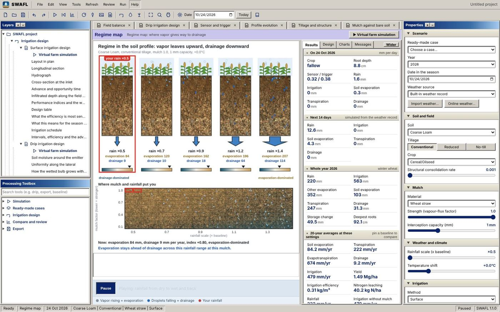{width=100%}

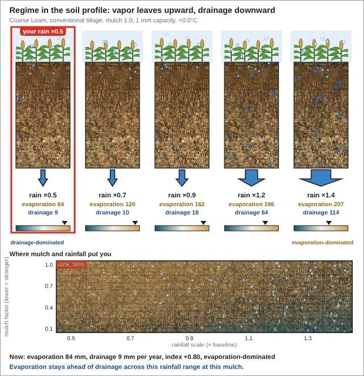{width=100%}

\newpage

### The equations of this layer

Every number and picture of the layer comes from the equations below (numbers as in Volume 1, with the chapter that explains each).

**Eq. 5.4** (Volume 1, engine)

$$
\begin{aligned}
E &= \bar E(\mathrm{soil},\varphi,c)\ \Bigl[\tfrac{\mathrm{now}.E}{\mathrm{ref}.E}\Bigr]\Bigl[\tfrac{\mathrm{tN}.E}{\mathrm{tB}.E}\Bigr]\Bigl[\tfrac{E_b}{E_{b,\mathrm{ref}}}\Bigr] &&(5.4)\\
T &= T_b\ \Bigl[\tfrac{\mathrm{now}.T}{\mathrm{bare}.T}\Bigr]\ \mathrm{clip}\Bigl(\tfrac{\mathrm{tN}.T}{\mathrm{tB}.T};\,0.3,\,2.5\Bigr) &&(5.5)\\
ET &= ET_b\ \Bigl[\tfrac{\mathrm{now}.ET}{\mathrm{bare}.ET}\Bigr]\ \mathrm{clip}\Bigl(\tfrac{\mathrm{tN}.ET}{\mathrm{tB}.ET};\,0.5,\,2\Bigr) &&(5.6)\\
I &= I_b\ \Bigl[\tfrac{\mathrm{now}.I}{\mathrm{bare}.I}\Bigr]\ \mathrm{clip}\Bigl(\tfrac{\mathrm{tN}.I}{\mathrm{tB}.I};\,0.4,\,2.5\Bigr) &&(5.7)\\
Y &= Y_b\ \Bigl[\tfrac{\mathrm{tN}.Y}{\mathrm{tR}.Y}\Bigr]\Bigl[\tfrac{\mathrm{now}.Y}{\mathrm{nm}.Y}\Bigr] &&(5.8)\\
D &= D_b + (\mathrm{now}.D-\mathrm{bare}.D) + (\mathrm{tN}.D-\mathrm{tB}.D) &&(5.9)\\
N_L &= N_b + (\mathrm{now}.N-\mathrm{bare}.N) + (\mathrm{tN}.N-\mathrm{tB}.N) &&(5.10)
\end{aligned}
$$

*Provenance (Eq. 5.4--5.10):* **[Data-driven]**: ratios of Daisy ensemble results (run sets E2--E14); the clip bounds are engineered limits.

**Eq. 9.8** (Volume 1, mulch)

$$
\mathcal{I} = \frac{E - D}{\max\{1,\ E + D\}},\qquad
\text{regime} = \begin{cases}
\text{evaporation-dominated} & \mathcal I > +0.05\\
\text{drainage-dominated} & \mathcal I < -0.05\\
\text{on the boundary} & |\mathcal I|\le 0.05
\end{cases}
\tag{9.8}
$$

*Provenance (Eq. 9.8):* **[Engineered]**: index defined for the workbench.

\newpage

# Soil structure and tillage

## Tillage and structure

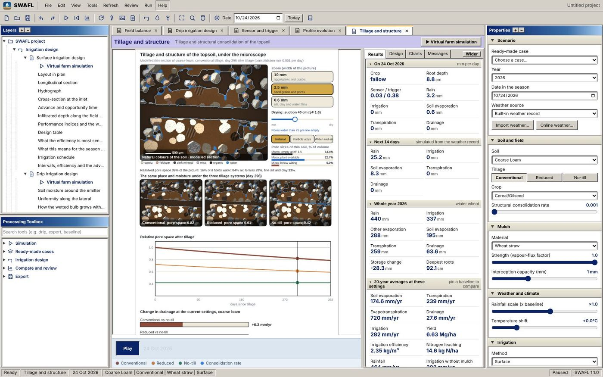{width=100%}

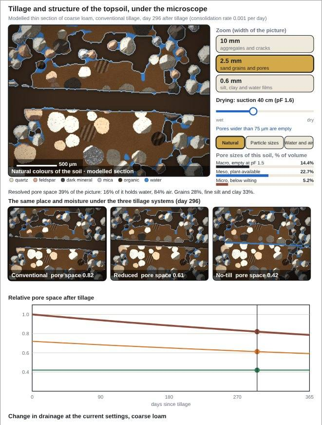{width=100%}

\newpage

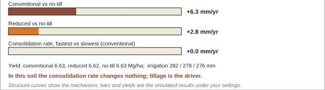{width=100%}

\newpage

### The equations of this layer

Every number and picture of the layer comes from the equations below (numbers as in Volume 1, with the chapter that explains each).

**Eq. 5.1** (Volume 1, engine)

$$
S_e(h) = \Bigl[\,1 + (\alpha |h|)^{n}\Bigr]^{-m},\quad m = 1 - \tfrac{1}{n}, \qquad
\theta(h) = \theta_r + (\theta_s - \theta_r)\,S_e(h)
\tag{5.1}
$$

*Provenance (Eq. 5.1):* **[Literature]**: van Genuchten (1980).

**Eq. 8.1** (Volume 1, structure)

$$
p(t) = p_c + (p_0 - p_c)\,e^{-\tau_c t},\qquad p_0 = 1.00\ (\text{conventional}),\ 0.72\ (\text{reduced}),
\tag{8.1}
$$

*Provenance (Eq. 8.1):* **[Engineered]**: exponential relaxation with chosen constants.

**Eq. 8.2** (Volume 1, structure)

$$
\phi = \mathrm{clip}\bigl(0.36 + 0.0016\,\mathrm{clay} + 0.0009\,\mathrm{silt};\ 0.34,\ 0.50\bigr),\qquad
\theta_r = 0.01 + 0.0006\,\mathrm{clay},
\tag{8.2}
$$

*Provenance (Eq. 8.2):* **[Engineered]**: porosity relation with chosen coefficients.

**Eq. 8.3** (Volume 1, structure)

$$
\theta(h) = \theta_r + (\phi - \theta_r)\,S_e(h).
\tag{8.3}
$$

*Provenance (Eq. 8.3):* **[Literature]**: van Genuchten (1980).

**Eq. 8.4** (Volume 1, structure)

$$
r_c = \frac{2\,\sigma\cos\gamma}{\rho_w\, g\, h} \;\approx\; \frac{0.149\ \mathrm{cm^2}}{h}\quad(\mathrm{or}\ r_c[\mathrm{mm}] \approx 1.49/h[\mathrm{cm}]),
\tag{8.4}
$$

*Provenance (Eq. 8.4):* **[Literature]**: Young--Laplace (Jurin) capillary law.

\newpage

## Soil hydraulic drivers

{width=100%}

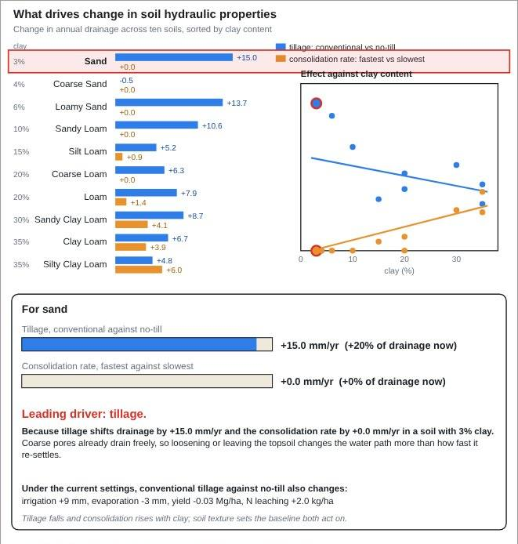{width=100%}

\newpage

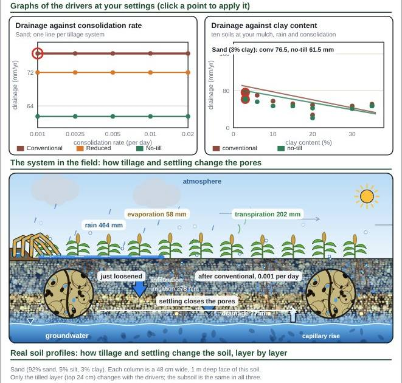{width=100%}

\newpage

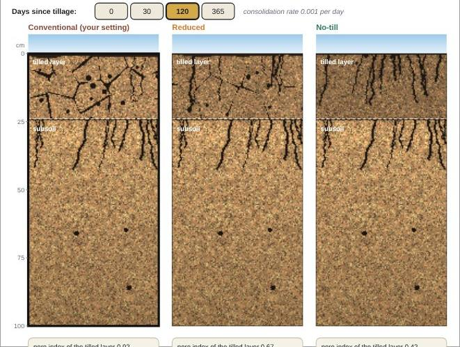{width=100%}

\newpage

### The equations of this layer

Every number and picture of the layer comes from the equations below (numbers as in Volume 1, with the chapter that explains each).

**Eq. 5.4** (Volume 1, engine)

$$
\begin{aligned}
E &= \bar E(\mathrm{soil},\varphi,c)\ \Bigl[\tfrac{\mathrm{now}.E}{\mathrm{ref}.E}\Bigr]\Bigl[\tfrac{\mathrm{tN}.E}{\mathrm{tB}.E}\Bigr]\Bigl[\tfrac{E_b}{E_{b,\mathrm{ref}}}\Bigr] &&(5.4)\\
T &= T_b\ \Bigl[\tfrac{\mathrm{now}.T}{\mathrm{bare}.T}\Bigr]\ \mathrm{clip}\Bigl(\tfrac{\mathrm{tN}.T}{\mathrm{tB}.T};\,0.3,\,2.5\Bigr) &&(5.5)\\
ET &= ET_b\ \Bigl[\tfrac{\mathrm{now}.ET}{\mathrm{bare}.ET}\Bigr]\ \mathrm{clip}\Bigl(\tfrac{\mathrm{tN}.ET}{\mathrm{tB}.ET};\,0.5,\,2\Bigr) &&(5.6)\\
I &= I_b\ \Bigl[\tfrac{\mathrm{now}.I}{\mathrm{bare}.I}\Bigr]\ \mathrm{clip}\Bigl(\tfrac{\mathrm{tN}.I}{\mathrm{tB}.I};\,0.4,\,2.5\Bigr) &&(5.7)\\
Y &= Y_b\ \Bigl[\tfrac{\mathrm{tN}.Y}{\mathrm{tR}.Y}\Bigr]\Bigl[\tfrac{\mathrm{now}.Y}{\mathrm{nm}.Y}\Bigr] &&(5.8)\\
D &= D_b + (\mathrm{now}.D-\mathrm{bare}.D) + (\mathrm{tN}.D-\mathrm{tB}.D) &&(5.9)\\
N_L &= N_b + (\mathrm{now}.N-\mathrm{bare}.N) + (\mathrm{tN}.N-\mathrm{tB}.N) &&(5.10)
\end{aligned}
$$

*Provenance (Eq. 5.4--5.10):* **[Data-driven]**: ratios of Daisy ensemble results (run sets E2--E14); the clip bounds are engineered limits.

**Eq. 5.5** (Volume 1, engine)

$$
\begin{aligned}
E &= \bar E(\mathrm{soil},\varphi,c)\ \Bigl[\tfrac{\mathrm{now}.E}{\mathrm{ref}.E}\Bigr]\Bigl[\tfrac{\mathrm{tN}.E}{\mathrm{tB}.E}\Bigr]\Bigl[\tfrac{E_b}{E_{b,\mathrm{ref}}}\Bigr] &&(5.4)\\
T &= T_b\ \Bigl[\tfrac{\mathrm{now}.T}{\mathrm{bare}.T}\Bigr]\ \mathrm{clip}\Bigl(\tfrac{\mathrm{tN}.T}{\mathrm{tB}.T};\,0.3,\,2.5\Bigr) &&(5.5)\\
ET &= ET_b\ \Bigl[\tfrac{\mathrm{now}.ET}{\mathrm{bare}.ET}\Bigr]\ \mathrm{clip}\Bigl(\tfrac{\mathrm{tN}.ET}{\mathrm{tB}.ET};\,0.5,\,2\Bigr) &&(5.6)\\
I &= I_b\ \Bigl[\tfrac{\mathrm{now}.I}{\mathrm{bare}.I}\Bigr]\ \mathrm{clip}\Bigl(\tfrac{\mathrm{tN}.I}{\mathrm{tB}.I};\,0.4,\,2.5\Bigr) &&(5.7)\\
Y &= Y_b\ \Bigl[\tfrac{\mathrm{tN}.Y}{\mathrm{tR}.Y}\Bigr]\Bigl[\tfrac{\mathrm{now}.Y}{\mathrm{nm}.Y}\Bigr] &&(5.8)\\
D &= D_b + (\mathrm{now}.D-\mathrm{bare}.D) + (\mathrm{tN}.D-\mathrm{tB}.D) &&(5.9)\\
N_L &= N_b + (\mathrm{now}.N-\mathrm{bare}.N) + (\mathrm{tN}.N-\mathrm{tB}.N) &&(5.10)
\end{aligned}
$$

*Provenance (Eq. 5.4--5.10):* **[Data-driven]**: ratios of Daisy ensemble results (run sets E2--E14); the clip bounds are engineered limits.

**Eq. 5.6** (Volume 1, engine)

$$
\begin{aligned}
E &= \bar E(\mathrm{soil},\varphi,c)\ \Bigl[\tfrac{\mathrm{now}.E}{\mathrm{ref}.E}\Bigr]\Bigl[\tfrac{\mathrm{tN}.E}{\mathrm{tB}.E}\Bigr]\Bigl[\tfrac{E_b}{E_{b,\mathrm{ref}}}\Bigr] &&(5.4)\\
T &= T_b\ \Bigl[\tfrac{\mathrm{now}.T}{\mathrm{bare}.T}\Bigr]\ \mathrm{clip}\Bigl(\tfrac{\mathrm{tN}.T}{\mathrm{tB}.T};\,0.3,\,2.5\Bigr) &&(5.5)\\
ET &= ET_b\ \Bigl[\tfrac{\mathrm{now}.ET}{\mathrm{bare}.ET}\Bigr]\ \mathrm{clip}\Bigl(\tfrac{\mathrm{tN}.ET}{\mathrm{tB}.ET};\,0.5,\,2\Bigr) &&(5.6)\\
I &= I_b\ \Bigl[\tfrac{\mathrm{now}.I}{\mathrm{bare}.I}\Bigr]\ \mathrm{clip}\Bigl(\tfrac{\mathrm{tN}.I}{\mathrm{tB}.I};\,0.4,\,2.5\Bigr) &&(5.7)\\
Y &= Y_b\ \Bigl[\tfrac{\mathrm{tN}.Y}{\mathrm{tR}.Y}\Bigr]\Bigl[\tfrac{\mathrm{now}.Y}{\mathrm{nm}.Y}\Bigr] &&(5.8)\\
D &= D_b + (\mathrm{now}.D-\mathrm{bare}.D) + (\mathrm{tN}.D-\mathrm{tB}.D) &&(5.9)\\
N_L &= N_b + (\mathrm{now}.N-\mathrm{bare}.N) + (\mathrm{tN}.N-\mathrm{tB}.N) &&(5.10)
\end{aligned}
$$

*Provenance (Eq. 5.4--5.10):* **[Data-driven]**: ratios of Daisy ensemble results (run sets E2--E14); the clip bounds are engineered limits.

**Eq. 5.7** (Volume 1, engine)

$$
\begin{aligned}
E &= \bar E(\mathrm{soil},\varphi,c)\ \Bigl[\tfrac{\mathrm{now}.E}{\mathrm{ref}.E}\Bigr]\Bigl[\tfrac{\mathrm{tN}.E}{\mathrm{tB}.E}\Bigr]\Bigl[\tfrac{E_b}{E_{b,\mathrm{ref}}}\Bigr] &&(5.4)\\
T &= T_b\ \Bigl[\tfrac{\mathrm{now}.T}{\mathrm{bare}.T}\Bigr]\ \mathrm{clip}\Bigl(\tfrac{\mathrm{tN}.T}{\mathrm{tB}.T};\,0.3,\,2.5\Bigr) &&(5.5)\\
ET &= ET_b\ \Bigl[\tfrac{\mathrm{now}.ET}{\mathrm{bare}.ET}\Bigr]\ \mathrm{clip}\Bigl(\tfrac{\mathrm{tN}.ET}{\mathrm{tB}.ET};\,0.5,\,2\Bigr) &&(5.6)\\
I &= I_b\ \Bigl[\tfrac{\mathrm{now}.I}{\mathrm{bare}.I}\Bigr]\ \mathrm{clip}\Bigl(\tfrac{\mathrm{tN}.I}{\mathrm{tB}.I};\,0.4,\,2.5\Bigr) &&(5.7)\\
Y &= Y_b\ \Bigl[\tfrac{\mathrm{tN}.Y}{\mathrm{tR}.Y}\Bigr]\Bigl[\tfrac{\mathrm{now}.Y}{\mathrm{nm}.Y}\Bigr] &&(5.8)\\
D &= D_b + (\mathrm{now}.D-\mathrm{bare}.D) + (\mathrm{tN}.D-\mathrm{tB}.D) &&(5.9)\\
N_L &= N_b + (\mathrm{now}.N-\mathrm{bare}.N) + (\mathrm{tN}.N-\mathrm{tB}.N) &&(5.10)
\end{aligned}
$$

*Provenance (Eq. 5.4--5.10):* **[Data-driven]**: ratios of Daisy ensemble results (run sets E2--E14); the clip bounds are engineered limits.

**Eq. 5.8** (Volume 1, engine)

$$
\begin{aligned}
E &= \bar E(\mathrm{soil},\varphi,c)\ \Bigl[\tfrac{\mathrm{now}.E}{\mathrm{ref}.E}\Bigr]\Bigl[\tfrac{\mathrm{tN}.E}{\mathrm{tB}.E}\Bigr]\Bigl[\tfrac{E_b}{E_{b,\mathrm{ref}}}\Bigr] &&(5.4)\\
T &= T_b\ \Bigl[\tfrac{\mathrm{now}.T}{\mathrm{bare}.T}\Bigr]\ \mathrm{clip}\Bigl(\tfrac{\mathrm{tN}.T}{\mathrm{tB}.T};\,0.3,\,2.5\Bigr) &&(5.5)\\
ET &= ET_b\ \Bigl[\tfrac{\mathrm{now}.ET}{\mathrm{bare}.ET}\Bigr]\ \mathrm{clip}\Bigl(\tfrac{\mathrm{tN}.ET}{\mathrm{tB}.ET};\,0.5,\,2\Bigr) &&(5.6)\\
I &= I_b\ \Bigl[\tfrac{\mathrm{now}.I}{\mathrm{bare}.I}\Bigr]\ \mathrm{clip}\Bigl(\tfrac{\mathrm{tN}.I}{\mathrm{tB}.I};\,0.4,\,2.5\Bigr) &&(5.7)\\
Y &= Y_b\ \Bigl[\tfrac{\mathrm{tN}.Y}{\mathrm{tR}.Y}\Bigr]\Bigl[\tfrac{\mathrm{now}.Y}{\mathrm{nm}.Y}\Bigr] &&(5.8)\\
D &= D_b + (\mathrm{now}.D-\mathrm{bare}.D) + (\mathrm{tN}.D-\mathrm{tB}.D) &&(5.9)\\
N_L &= N_b + (\mathrm{now}.N-\mathrm{bare}.N) + (\mathrm{tN}.N-\mathrm{tB}.N) &&(5.10)
\end{aligned}
$$

*Provenance (Eq. 5.4--5.10):* **[Data-driven]**: ratios of Daisy ensemble results (run sets E2--E14); the clip bounds are engineered limits.

**Eq. 5.9** (Volume 1, engine)

$$
\begin{aligned}
E &= \bar E(\mathrm{soil},\varphi,c)\ \Bigl[\tfrac{\mathrm{now}.E}{\mathrm{ref}.E}\Bigr]\Bigl[\tfrac{\mathrm{tN}.E}{\mathrm{tB}.E}\Bigr]\Bigl[\tfrac{E_b}{E_{b,\mathrm{ref}}}\Bigr] &&(5.4)\\
T &= T_b\ \Bigl[\tfrac{\mathrm{now}.T}{\mathrm{bare}.T}\Bigr]\ \mathrm{clip}\Bigl(\tfrac{\mathrm{tN}.T}{\mathrm{tB}.T};\,0.3,\,2.5\Bigr) &&(5.5)\\
ET &= ET_b\ \Bigl[\tfrac{\mathrm{now}.ET}{\mathrm{bare}.ET}\Bigr]\ \mathrm{clip}\Bigl(\tfrac{\mathrm{tN}.ET}{\mathrm{tB}.ET};\,0.5,\,2\Bigr) &&(5.6)\\
I &= I_b\ \Bigl[\tfrac{\mathrm{now}.I}{\mathrm{bare}.I}\Bigr]\ \mathrm{clip}\Bigl(\tfrac{\mathrm{tN}.I}{\mathrm{tB}.I};\,0.4,\,2.5\Bigr) &&(5.7)\\
Y &= Y_b\ \Bigl[\tfrac{\mathrm{tN}.Y}{\mathrm{tR}.Y}\Bigr]\Bigl[\tfrac{\mathrm{now}.Y}{\mathrm{nm}.Y}\Bigr] &&(5.8)\\
D &= D_b + (\mathrm{now}.D-\mathrm{bare}.D) + (\mathrm{tN}.D-\mathrm{tB}.D) &&(5.9)\\
N_L &= N_b + (\mathrm{now}.N-\mathrm{bare}.N) + (\mathrm{tN}.N-\mathrm{tB}.N) &&(5.10)
\end{aligned}
$$

*Provenance (Eq. 5.4--5.10):* **[Data-driven]**: ratios of Daisy ensemble results (run sets E2--E14); the clip bounds are engineered limits.

**Eq. 5.10** (Volume 1, engine)

$$
\begin{aligned}
E &= \bar E(\mathrm{soil},\varphi,c)\ \Bigl[\tfrac{\mathrm{now}.E}{\mathrm{ref}.E}\Bigr]\Bigl[\tfrac{\mathrm{tN}.E}{\mathrm{tB}.E}\Bigr]\Bigl[\tfrac{E_b}{E_{b,\mathrm{ref}}}\Bigr] &&(5.4)\\
T &= T_b\ \Bigl[\tfrac{\mathrm{now}.T}{\mathrm{bare}.T}\Bigr]\ \mathrm{clip}\Bigl(\tfrac{\mathrm{tN}.T}{\mathrm{tB}.T};\,0.3,\,2.5\Bigr) &&(5.5)\\
ET &= ET_b\ \Bigl[\tfrac{\mathrm{now}.ET}{\mathrm{bare}.ET}\Bigr]\ \mathrm{clip}\Bigl(\tfrac{\mathrm{tN}.ET}{\mathrm{tB}.ET};\,0.5,\,2\Bigr) &&(5.6)\\
I &= I_b\ \Bigl[\tfrac{\mathrm{now}.I}{\mathrm{bare}.I}\Bigr]\ \mathrm{clip}\Bigl(\tfrac{\mathrm{tN}.I}{\mathrm{tB}.I};\,0.4,\,2.5\Bigr) &&(5.7)\\
Y &= Y_b\ \Bigl[\tfrac{\mathrm{tN}.Y}{\mathrm{tR}.Y}\Bigr]\Bigl[\tfrac{\mathrm{now}.Y}{\mathrm{nm}.Y}\Bigr] &&(5.8)\\
D &= D_b + (\mathrm{now}.D-\mathrm{bare}.D) + (\mathrm{tN}.D-\mathrm{tB}.D) &&(5.9)\\
N_L &= N_b + (\mathrm{now}.N-\mathrm{bare}.N) + (\mathrm{tN}.N-\mathrm{tB}.N) &&(5.10)
\end{aligned}
$$

*Provenance (Eq. 5.4--5.10):* **[Data-driven]**: ratios of Daisy ensemble results (run sets E2--E14); the clip bounds are engineered limits.

**Eq. 5.11** (Volume 1, engine)

$$
Q \leftarrow Q\ \mathrm{clip}\Bigl(\tfrac{r_\kappa.Q}{r_{\kappa_0}.Q};\,0.05,\,6\Bigr)\ \ (Q\in\{E,T,ET,I,Y\}),\qquad
D \leftarrow D + (r_\kappa.D - r_{\kappa_0}.D),\quad N_L \leftarrow N_L + (r_\kappa.N - r_{\kappa_0}.N).
\tag{5.11}
$$

*Provenance (Eq. 5.11):* **[Data-driven]**: set-specific corrections from the Daisy run sets; clip bounds engineered.

**Eq. 5.12** (Volume 1, engine)

$$
\begin{gathered}
ET \in [\,P + I - D - 30,\ P + I - D + 15\,]\ \text{(if not, } ET\ \text{is clipped and } E, T \text{ are scaled by the same factor)},\\
E_{\mathrm{other}} = \max(0,\ ET - T - E),\qquad \Delta S = P + I - ET - D,\qquad
\mathrm{IE} = \frac{100\,Y}{I}\ \ [\mathrm{kg\ m^{-3}}].
\end{gathered}
\tag{5.12}
$$

*Provenance (Eq. 5.12):* **[Engineered]**: closure constraint and bounds chosen for the workbench.

**Eq. 8.1** (Volume 1, structure)

$$
p(t) = p_c + (p_0 - p_c)\,e^{-\tau_c t},\qquad p_0 = 1.00\ (\text{conventional}),\ 0.72\ (\text{reduced}),
\tag{8.1}
$$

*Provenance (Eq. 8.1):* **[Engineered]**: exponential relaxation with chosen constants.

**Eq. 8.5** (Volume 1, structure)

$$
\Delta_{\mathrm{till}}(s) = D_s(\mathrm{conv},\tau^\ast) - D_s(\mathrm{notill},\tau^\ast),\qquad
\Delta_{\mathrm{cons}}(s) = D_s(\mathrm{till}^\ast,\tau_{\mathrm{fast}}) - D_s(\mathrm{till}^\ast,\tau_{\mathrm{slow}}),
\tag{8.5}
$$

*Provenance (Eq. 8.5):* **[Data-driven]**: differences of Daisy run-set E5 results.

**Eq. 8.6** (Volume 1, structure)

$$
\hat\Delta = a + b\,c,\qquad b = \frac{\sum_s (c_s - \bar c)(\Delta_s - \bar\Delta)}{\sum_s (c_s - \bar c)^2},\quad a = \bar\Delta - b\,\bar c .
\tag{8.6}
$$

*Provenance (Eq. 8.6):* **[Data-driven]**: ordinary least squares applied to Daisy results.

\newpage

## Root structure

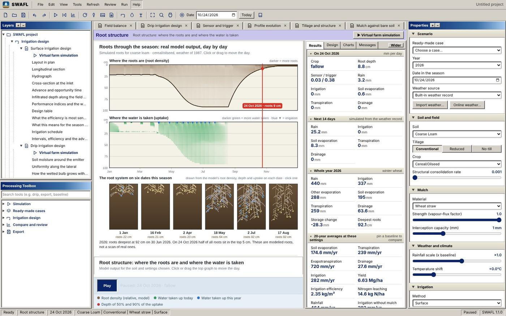{width=100%}

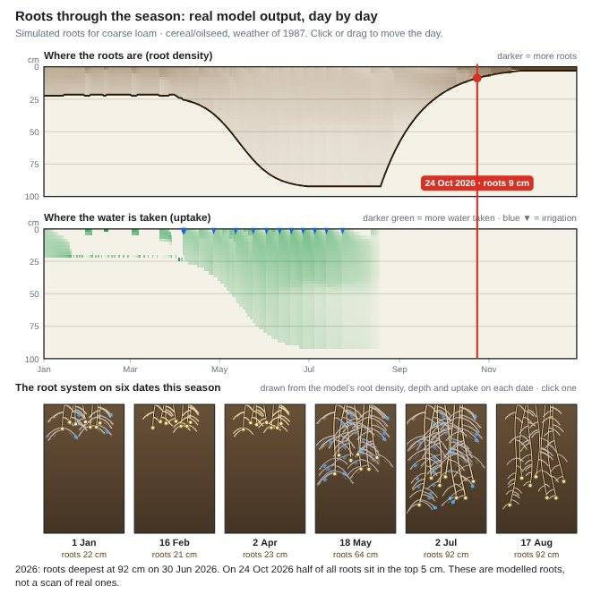{width=100%}

\newpage

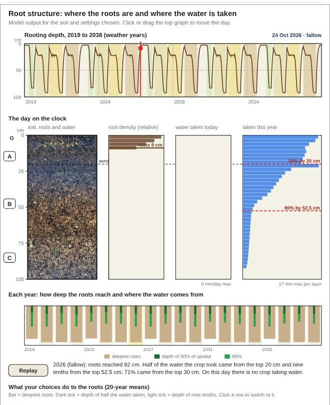{width=100%}

\newpage

{width=100%}

\newpage

{width=100%}

\newpage

### The equations of this layer

Every number and picture of the layer comes from the equations below (numbers as in Volume 1, with the chapter that explains each).

**Eq. 5.18** (Volume 1, engine)

$$
R_{\max} = \mathrm{clip}\Bigl(R_{c}\,(0.85 + 0.3\,\mathrm{sand})\bigl[1 + 0.12\log_{10}(|h_T|/300)\bigr]\bigl[1 - 0.18\,\tfrac{N-100}{100}\bigr];\ 25,\ 100\Bigr)\ \mathrm{cm},
\tag{5.18}
$$

*Provenance (Eq. 5.18):* **[Engineered]**: rooting rules with constants chosen for the workbench.

**Eq. 5.19** (Volume 1, engine)

$$
R_d \leftarrow \max\Bigl\{R_d,\ \min\bigl\{R_{\max}\,\mathrm{clip}\bigl(\tfrac{c-0.04}{0.96};0,1\bigr)^{0.8},\ R_{\max},\ R_d + 1.7\,(0.35 + \bar s_{\mathrm{wet}})\,\kappa\bigr\}\Bigr\},
\tag{5.19}
$$

*Provenance (Eq. 5.19):* **[Engineered]**: rooting rules with constants chosen for the workbench.

**Eq. 5.20** (Volume 1, engine)

$$
\rho_i \propto \exp\!\Bigl(-\frac{z_i}{\lambda R_d + 8}\Bigr)\bigl(0.45 + 0.9\,s_i\bigr)\Bigl[1 + 3\,e^{-((z_i - z_d)/12)^2}\Bigr]_{\text{drip only}},\quad z_i\le R_d,\qquad \sum_i \rho_i = 1,
\tag{5.20}
$$

*Provenance (Eq. 5.20):* **[Engineered]**: rooting rules with constants chosen for the workbench.

**Eq. 5.21** (Volume 1, engine)

$$
E_d = E_{\mathrm{yr}}\,\frac{w(\mathrm{doy})}{\sum_{k=0}^{364} w(k)}\,(1 - 0.3\,c),\qquad w(\mathrm{doy}) = 0.35 + 0.65\cdot\tfrac12\Bigl[1 + \sin\tfrac{2\pi(\mathrm{doy} - 100)}{365}\Bigr],
\tag{5.21}
$$

*Provenance (Eq. 5.21):* **[Engineered]**: demand partitioning with chosen weights and a calibration factor.

**Eq. 5.22** (Volume 1, engine)

$$
T_d = k_t\,T_{\mathrm{yr}}\,\frac{c(d)}{\bar C},\qquad \bar C = \tfrac{1}{20}\sum_{\text{20 yr}} c,
\tag{5.22}
$$

*Provenance (Eq. 5.22):* **[Engineered]**: demand partitioning with chosen weights and a calibration factor.

**Eq. 5.23** (Volume 1, engine)

$$
q^{T}_i = T_d\,\frac{\rho_i\,a_i}{\sum_j \rho_j a_j},\qquad a_i = \mathrm{clip}\Bigl(\frac{s_i - 0.15}{0.6};\,0,\,1\Bigr),
\tag{5.23}
$$

*Provenance (Eq. 5.23):* **[Engineered]**: demand partitioning with chosen weights and a calibration factor.

**Eq. 8.7** (Volume 1, structure)

$$
z_p = k_p\,\Delta z,\qquad k_p = \min\Bigl\{k :\ \frac{\sum_{i\le k} U_i}{\sum_{i} U_i} \ge p\Bigr\},\qquad U_i=\sum_{d\in\text{year}}u_i(d),\quad p = 0.5,\ 0.9,
\tag{8.7}
$$

*Provenance (Eq. 8.7):* **[Engineered]**: diagnostic defined for the workbench.

\newpage

# Field water balance

## Field balance

{width=100%}

{width=100%}

\newpage

### The equations of this layer

Every number and picture of the layer comes from the equations below (numbers as in Volume 1, with the chapter that explains each).

**Eq. 5.3** (Volume 1, engine)

$$
f(h) \;=\; \frac{S_e(100) - S_e(|h|)}{S_e(100) - S_e(15\,849)},
\qquad f_{\mathrm{used}} = \min\{1,\max\{0, f\}\}.
\tag{5.3}
$$

*Provenance (Eq. 5.3):* **[Literature]**: standard definition of plant-available water between field capacity and wilting point.

**Eq. 5.4** (Volume 1, engine)

$$
\begin{aligned}
E &= \bar E(\mathrm{soil},\varphi,c)\ \Bigl[\tfrac{\mathrm{now}.E}{\mathrm{ref}.E}\Bigr]\Bigl[\tfrac{\mathrm{tN}.E}{\mathrm{tB}.E}\Bigr]\Bigl[\tfrac{E_b}{E_{b,\mathrm{ref}}}\Bigr] &&(5.4)\\
T &= T_b\ \Bigl[\tfrac{\mathrm{now}.T}{\mathrm{bare}.T}\Bigr]\ \mathrm{clip}\Bigl(\tfrac{\mathrm{tN}.T}{\mathrm{tB}.T};\,0.3,\,2.5\Bigr) &&(5.5)\\
ET &= ET_b\ \Bigl[\tfrac{\mathrm{now}.ET}{\mathrm{bare}.ET}\Bigr]\ \mathrm{clip}\Bigl(\tfrac{\mathrm{tN}.ET}{\mathrm{tB}.ET};\,0.5,\,2\Bigr) &&(5.6)\\
I &= I_b\ \Bigl[\tfrac{\mathrm{now}.I}{\mathrm{bare}.I}\Bigr]\ \mathrm{clip}\Bigl(\tfrac{\mathrm{tN}.I}{\mathrm{tB}.I};\,0.4,\,2.5\Bigr) &&(5.7)\\
Y &= Y_b\ \Bigl[\tfrac{\mathrm{tN}.Y}{\mathrm{tR}.Y}\Bigr]\Bigl[\tfrac{\mathrm{now}.Y}{\mathrm{nm}.Y}\Bigr] &&(5.8)\\
D &= D_b + (\mathrm{now}.D-\mathrm{bare}.D) + (\mathrm{tN}.D-\mathrm{tB}.D) &&(5.9)\\
N_L &= N_b + (\mathrm{now}.N-\mathrm{bare}.N) + (\mathrm{tN}.N-\mathrm{tB}.N) &&(5.10)
\end{aligned}
$$

*Provenance (Eq. 5.4--5.10):* **[Data-driven]**: ratios of Daisy ensemble results (run sets E2--E14); the clip bounds are engineered limits.

**Eq. 5.5** (Volume 1, engine)

$$
\begin{aligned}
E &= \bar E(\mathrm{soil},\varphi,c)\ \Bigl[\tfrac{\mathrm{now}.E}{\mathrm{ref}.E}\Bigr]\Bigl[\tfrac{\mathrm{tN}.E}{\mathrm{tB}.E}\Bigr]\Bigl[\tfrac{E_b}{E_{b,\mathrm{ref}}}\Bigr] &&(5.4)\\
T &= T_b\ \Bigl[\tfrac{\mathrm{now}.T}{\mathrm{bare}.T}\Bigr]\ \mathrm{clip}\Bigl(\tfrac{\mathrm{tN}.T}{\mathrm{tB}.T};\,0.3,\,2.5\Bigr) &&(5.5)\\
ET &= ET_b\ \Bigl[\tfrac{\mathrm{now}.ET}{\mathrm{bare}.ET}\Bigr]\ \mathrm{clip}\Bigl(\tfrac{\mathrm{tN}.ET}{\mathrm{tB}.ET};\,0.5,\,2\Bigr) &&(5.6)\\
I &= I_b\ \Bigl[\tfrac{\mathrm{now}.I}{\mathrm{bare}.I}\Bigr]\ \mathrm{clip}\Bigl(\tfrac{\mathrm{tN}.I}{\mathrm{tB}.I};\,0.4,\,2.5\Bigr) &&(5.7)\\
Y &= Y_b\ \Bigl[\tfrac{\mathrm{tN}.Y}{\mathrm{tR}.Y}\Bigr]\Bigl[\tfrac{\mathrm{now}.Y}{\mathrm{nm}.Y}\Bigr] &&(5.8)\\
D &= D_b + (\mathrm{now}.D-\mathrm{bare}.D) + (\mathrm{tN}.D-\mathrm{tB}.D) &&(5.9)\\
N_L &= N_b + (\mathrm{now}.N-\mathrm{bare}.N) + (\mathrm{tN}.N-\mathrm{tB}.N) &&(5.10)
\end{aligned}
$$

*Provenance (Eq. 5.4--5.10):* **[Data-driven]**: ratios of Daisy ensemble results (run sets E2--E14); the clip bounds are engineered limits.

**Eq. 5.6** (Volume 1, engine)

$$
\begin{aligned}
E &= \bar E(\mathrm{soil},\varphi,c)\ \Bigl[\tfrac{\mathrm{now}.E}{\mathrm{ref}.E}\Bigr]\Bigl[\tfrac{\mathrm{tN}.E}{\mathrm{tB}.E}\Bigr]\Bigl[\tfrac{E_b}{E_{b,\mathrm{ref}}}\Bigr] &&(5.4)\\
T &= T_b\ \Bigl[\tfrac{\mathrm{now}.T}{\mathrm{bare}.T}\Bigr]\ \mathrm{clip}\Bigl(\tfrac{\mathrm{tN}.T}{\mathrm{tB}.T};\,0.3,\,2.5\Bigr) &&(5.5)\\
ET &= ET_b\ \Bigl[\tfrac{\mathrm{now}.ET}{\mathrm{bare}.ET}\Bigr]\ \mathrm{clip}\Bigl(\tfrac{\mathrm{tN}.ET}{\mathrm{tB}.ET};\,0.5,\,2\Bigr) &&(5.6)\\
I &= I_b\ \Bigl[\tfrac{\mathrm{now}.I}{\mathrm{bare}.I}\Bigr]\ \mathrm{clip}\Bigl(\tfrac{\mathrm{tN}.I}{\mathrm{tB}.I};\,0.4,\,2.5\Bigr) &&(5.7)\\
Y &= Y_b\ \Bigl[\tfrac{\mathrm{tN}.Y}{\mathrm{tR}.Y}\Bigr]\Bigl[\tfrac{\mathrm{now}.Y}{\mathrm{nm}.Y}\Bigr] &&(5.8)\\
D &= D_b + (\mathrm{now}.D-\mathrm{bare}.D) + (\mathrm{tN}.D-\mathrm{tB}.D) &&(5.9)\\
N_L &= N_b + (\mathrm{now}.N-\mathrm{bare}.N) + (\mathrm{tN}.N-\mathrm{tB}.N) &&(5.10)
\end{aligned}
$$

*Provenance (Eq. 5.4--5.10):* **[Data-driven]**: ratios of Daisy ensemble results (run sets E2--E14); the clip bounds are engineered limits.

**Eq. 5.7** (Volume 1, engine)

$$
\begin{aligned}
E &= \bar E(\mathrm{soil},\varphi,c)\ \Bigl[\tfrac{\mathrm{now}.E}{\mathrm{ref}.E}\Bigr]\Bigl[\tfrac{\mathrm{tN}.E}{\mathrm{tB}.E}\Bigr]\Bigl[\tfrac{E_b}{E_{b,\mathrm{ref}}}\Bigr] &&(5.4)\\
T &= T_b\ \Bigl[\tfrac{\mathrm{now}.T}{\mathrm{bare}.T}\Bigr]\ \mathrm{clip}\Bigl(\tfrac{\mathrm{tN}.T}{\mathrm{tB}.T};\,0.3,\,2.5\Bigr) &&(5.5)\\
ET &= ET_b\ \Bigl[\tfrac{\mathrm{now}.ET}{\mathrm{bare}.ET}\Bigr]\ \mathrm{clip}\Bigl(\tfrac{\mathrm{tN}.ET}{\mathrm{tB}.ET};\,0.5,\,2\Bigr) &&(5.6)\\
I &= I_b\ \Bigl[\tfrac{\mathrm{now}.I}{\mathrm{bare}.I}\Bigr]\ \mathrm{clip}\Bigl(\tfrac{\mathrm{tN}.I}{\mathrm{tB}.I};\,0.4,\,2.5\Bigr) &&(5.7)\\
Y &= Y_b\ \Bigl[\tfrac{\mathrm{tN}.Y}{\mathrm{tR}.Y}\Bigr]\Bigl[\tfrac{\mathrm{now}.Y}{\mathrm{nm}.Y}\Bigr] &&(5.8)\\
D &= D_b + (\mathrm{now}.D-\mathrm{bare}.D) + (\mathrm{tN}.D-\mathrm{tB}.D) &&(5.9)\\
N_L &= N_b + (\mathrm{now}.N-\mathrm{bare}.N) + (\mathrm{tN}.N-\mathrm{tB}.N) &&(5.10)
\end{aligned}
$$

*Provenance (Eq. 5.4--5.10):* **[Data-driven]**: ratios of Daisy ensemble results (run sets E2--E14); the clip bounds are engineered limits.

**Eq. 5.8** (Volume 1, engine)

$$
\begin{aligned}
E &= \bar E(\mathrm{soil},\varphi,c)\ \Bigl[\tfrac{\mathrm{now}.E}{\mathrm{ref}.E}\Bigr]\Bigl[\tfrac{\mathrm{tN}.E}{\mathrm{tB}.E}\Bigr]\Bigl[\tfrac{E_b}{E_{b,\mathrm{ref}}}\Bigr] &&(5.4)\\
T &= T_b\ \Bigl[\tfrac{\mathrm{now}.T}{\mathrm{bare}.T}\Bigr]\ \mathrm{clip}\Bigl(\tfrac{\mathrm{tN}.T}{\mathrm{tB}.T};\,0.3,\,2.5\Bigr) &&(5.5)\\
ET &= ET_b\ \Bigl[\tfrac{\mathrm{now}.ET}{\mathrm{bare}.ET}\Bigr]\ \mathrm{clip}\Bigl(\tfrac{\mathrm{tN}.ET}{\mathrm{tB}.ET};\,0.5,\,2\Bigr) &&(5.6)\\
I &= I_b\ \Bigl[\tfrac{\mathrm{now}.I}{\mathrm{bare}.I}\Bigr]\ \mathrm{clip}\Bigl(\tfrac{\mathrm{tN}.I}{\mathrm{tB}.I};\,0.4,\,2.5\Bigr) &&(5.7)\\
Y &= Y_b\ \Bigl[\tfrac{\mathrm{tN}.Y}{\mathrm{tR}.Y}\Bigr]\Bigl[\tfrac{\mathrm{now}.Y}{\mathrm{nm}.Y}\Bigr] &&(5.8)\\
D &= D_b + (\mathrm{now}.D-\mathrm{bare}.D) + (\mathrm{tN}.D-\mathrm{tB}.D) &&(5.9)\\
N_L &= N_b + (\mathrm{now}.N-\mathrm{bare}.N) + (\mathrm{tN}.N-\mathrm{tB}.N) &&(5.10)
\end{aligned}
$$

*Provenance (Eq. 5.4--5.10):* **[Data-driven]**: ratios of Daisy ensemble results (run sets E2--E14); the clip bounds are engineered limits.

**Eq. 5.9** (Volume 1, engine)

$$
\begin{aligned}
E &= \bar E(\mathrm{soil},\varphi,c)\ \Bigl[\tfrac{\mathrm{now}.E}{\mathrm{ref}.E}\Bigr]\Bigl[\tfrac{\mathrm{tN}.E}{\mathrm{tB}.E}\Bigr]\Bigl[\tfrac{E_b}{E_{b,\mathrm{ref}}}\Bigr] &&(5.4)\\
T &= T_b\ \Bigl[\tfrac{\mathrm{now}.T}{\mathrm{bare}.T}\Bigr]\ \mathrm{clip}\Bigl(\tfrac{\mathrm{tN}.T}{\mathrm{tB}.T};\,0.3,\,2.5\Bigr) &&(5.5)\\
ET &= ET_b\ \Bigl[\tfrac{\mathrm{now}.ET}{\mathrm{bare}.ET}\Bigr]\ \mathrm{clip}\Bigl(\tfrac{\mathrm{tN}.ET}{\mathrm{tB}.ET};\,0.5,\,2\Bigr) &&(5.6)\\
I &= I_b\ \Bigl[\tfrac{\mathrm{now}.I}{\mathrm{bare}.I}\Bigr]\ \mathrm{clip}\Bigl(\tfrac{\mathrm{tN}.I}{\mathrm{tB}.I};\,0.4,\,2.5\Bigr) &&(5.7)\\
Y &= Y_b\ \Bigl[\tfrac{\mathrm{tN}.Y}{\mathrm{tR}.Y}\Bigr]\Bigl[\tfrac{\mathrm{now}.Y}{\mathrm{nm}.Y}\Bigr] &&(5.8)\\
D &= D_b + (\mathrm{now}.D-\mathrm{bare}.D) + (\mathrm{tN}.D-\mathrm{tB}.D) &&(5.9)\\
N_L &= N_b + (\mathrm{now}.N-\mathrm{bare}.N) + (\mathrm{tN}.N-\mathrm{tB}.N) &&(5.10)
\end{aligned}
$$

*Provenance (Eq. 5.4--5.10):* **[Data-driven]**: ratios of Daisy ensemble results (run sets E2--E14); the clip bounds are engineered limits.

**Eq. 5.10** (Volume 1, engine)

$$
\begin{aligned}
E &= \bar E(\mathrm{soil},\varphi,c)\ \Bigl[\tfrac{\mathrm{now}.E}{\mathrm{ref}.E}\Bigr]\Bigl[\tfrac{\mathrm{tN}.E}{\mathrm{tB}.E}\Bigr]\Bigl[\tfrac{E_b}{E_{b,\mathrm{ref}}}\Bigr] &&(5.4)\\
T &= T_b\ \Bigl[\tfrac{\mathrm{now}.T}{\mathrm{bare}.T}\Bigr]\ \mathrm{clip}\Bigl(\tfrac{\mathrm{tN}.T}{\mathrm{tB}.T};\,0.3,\,2.5\Bigr) &&(5.5)\\
ET &= ET_b\ \Bigl[\tfrac{\mathrm{now}.ET}{\mathrm{bare}.ET}\Bigr]\ \mathrm{clip}\Bigl(\tfrac{\mathrm{tN}.ET}{\mathrm{tB}.ET};\,0.5,\,2\Bigr) &&(5.6)\\
I &= I_b\ \Bigl[\tfrac{\mathrm{now}.I}{\mathrm{bare}.I}\Bigr]\ \mathrm{clip}\Bigl(\tfrac{\mathrm{tN}.I}{\mathrm{tB}.I};\,0.4,\,2.5\Bigr) &&(5.7)\\
Y &= Y_b\ \Bigl[\tfrac{\mathrm{tN}.Y}{\mathrm{tR}.Y}\Bigr]\Bigl[\tfrac{\mathrm{now}.Y}{\mathrm{nm}.Y}\Bigr] &&(5.8)\\
D &= D_b + (\mathrm{now}.D-\mathrm{bare}.D) + (\mathrm{tN}.D-\mathrm{tB}.D) &&(5.9)\\
N_L &= N_b + (\mathrm{now}.N-\mathrm{bare}.N) + (\mathrm{tN}.N-\mathrm{tB}.N) &&(5.10)
\end{aligned}
$$

*Provenance (Eq. 5.4--5.10):* **[Data-driven]**: ratios of Daisy ensemble results (run sets E2--E14); the clip bounds are engineered limits.

**Eq. 5.11** (Volume 1, engine)

$$
Q \leftarrow Q\ \mathrm{clip}\Bigl(\tfrac{r_\kappa.Q}{r_{\kappa_0}.Q};\,0.05,\,6\Bigr)\ \ (Q\in\{E,T,ET,I,Y\}),\qquad
D \leftarrow D + (r_\kappa.D - r_{\kappa_0}.D),\quad N_L \leftarrow N_L + (r_\kappa.N - r_{\kappa_0}.N).
\tag{5.11}
$$

*Provenance (Eq. 5.11):* **[Data-driven]**: set-specific corrections from the Daisy run sets; clip bounds engineered.

**Eq. 5.12** (Volume 1, engine)

$$
\begin{gathered}
ET \in [\,P + I - D - 30,\ P + I - D + 15\,]\ \text{(if not, } ET\ \text{is clipped and } E, T \text{ are scaled by the same factor)},\\
E_{\mathrm{other}} = \max(0,\ ET - T - E),\qquad \Delta S = P + I - ET - D,\qquad
\mathrm{IE} = \frac{100\,Y}{I}\ \ [\mathrm{kg\ m^{-3}}].
\end{gathered}
\tag{5.12}
$$

*Provenance (Eq. 5.12):* **[Engineered]**: closure constraint and bounds chosen for the workbench.

**Eq. 5.13** (Volume 1, engine)

$$
c_{\text{spring}}(d) = \frac{1}{1 + \exp\bigl(-(d - d_{\mathrm{mid}})/s\bigr)},\quad s = 13\ (\text{vegetable } 8),
\tag{5.13}
$$

*Provenance (Eq. 5.13):* **[Engineered]**: canopy curves, parameters chosen for the workbench; not a measured leaf-area record.

**Eq. 5.14** (Volume 1, engine)

$$
c_{\text{winter}}(d) = \begin{cases}0.08 + 0.12\,\min\{1,(d-d_{\mathrm{sow}})/60\} & d < d_{\mathrm{pk}} - 90\\[2pt] 0.2 + \dfrac{0.8}{1 + \exp\bigl(-(d - d_{\mathrm{pk}} + 45)/12\bigr)} & \text{otherwise}\end{cases}
\tag{5.14}
$$

*Provenance (Eq. 5.14):* **[Engineered]**: canopy curves, parameters chosen for the workbench; not a measured leaf-area record.

**Eq. 5.15** (Volume 1, engine)

$$
R = \min\bigl\{70,\ \mu_0\,\gamma_y\,(-\ln U)\bigr\},\qquad U\sim\mathrm{Uniform}(0,1),
\tag{5.15}
$$

*Provenance (Eq. 5.15):* **[Engineered]**: stochastic rain and interception generator; the exponential wet-day depth is a standard weather-generator form, the constants are chosen.

**Eq. 5.16** (Volume 1, engine)

$$
I_c = \mu_0 \ln\!\frac{1}{r},\qquad r = \frac{\max\{40,\ P - P_{\mathrm{other}}\}}{P},
\qquad T_f = \max\{0,\,R - I_c\}.
\tag{5.16}
$$

*Provenance (Eq. 5.16):* **[Engineered]**: stochastic rain and interception generator; the exponential wet-day depth is a standard weather-generator form, the constants are chosen.

**Eq. 5.17** (Volume 1, engine)

$$
q_{i} = 0.08\,(w_{i+1} - w_i),\qquad w_i \leftarrow w_i + q_i,\ \ w_{i+1}\leftarrow w_{i+1} - q_i,
\tag{5.17}
$$

*Provenance (Eq. 5.17):* **[Engineered]**: tipping-bucket redistribution with a chosen coefficient.

**Eq. 5.18** (Volume 1, engine)

$$
R_{\max} = \mathrm{clip}\Bigl(R_{c}\,(0.85 + 0.3\,\mathrm{sand})\bigl[1 + 0.12\log_{10}(|h_T|/300)\bigr]\bigl[1 - 0.18\,\tfrac{N-100}{100}\bigr];\ 25,\ 100\Bigr)\ \mathrm{cm},
\tag{5.18}
$$

*Provenance (Eq. 5.18):* **[Engineered]**: rooting rules with constants chosen for the workbench.

**Eq. 5.19** (Volume 1, engine)

$$
R_d \leftarrow \max\Bigl\{R_d,\ \min\bigl\{R_{\max}\,\mathrm{clip}\bigl(\tfrac{c-0.04}{0.96};0,1\bigr)^{0.8},\ R_{\max},\ R_d + 1.7\,(0.35 + \bar s_{\mathrm{wet}})\,\kappa\bigr\}\Bigr\},
\tag{5.19}
$$

*Provenance (Eq. 5.19):* **[Engineered]**: rooting rules with constants chosen for the workbench.

**Eq. 5.20** (Volume 1, engine)

$$
\rho_i \propto \exp\!\Bigl(-\frac{z_i}{\lambda R_d + 8}\Bigr)\bigl(0.45 + 0.9\,s_i\bigr)\Bigl[1 + 3\,e^{-((z_i - z_d)/12)^2}\Bigr]_{\text{drip only}},\quad z_i\le R_d,\qquad \sum_i \rho_i = 1,
\tag{5.20}
$$

*Provenance (Eq. 5.20):* **[Engineered]**: rooting rules with constants chosen for the workbench.

**Eq. 5.21** (Volume 1, engine)

$$
E_d = E_{\mathrm{yr}}\,\frac{w(\mathrm{doy})}{\sum_{k=0}^{364} w(k)}\,(1 - 0.3\,c),\qquad w(\mathrm{doy}) = 0.35 + 0.65\cdot\tfrac12\Bigl[1 + \sin\tfrac{2\pi(\mathrm{doy} - 100)}{365}\Bigr],
\tag{5.21}
$$

*Provenance (Eq. 5.21):* **[Engineered]**: demand partitioning with chosen weights and a calibration factor.

**Eq. 5.22** (Volume 1, engine)

$$
T_d = k_t\,T_{\mathrm{yr}}\,\frac{c(d)}{\bar C},\qquad \bar C = \tfrac{1}{20}\sum_{\text{20 yr}} c,
\tag{5.22}
$$

*Provenance (Eq. 5.22):* **[Engineered]**: demand partitioning with chosen weights and a calibration factor.

**Eq. 5.23** (Volume 1, engine)

$$
q^{T}_i = T_d\,\frac{\rho_i\,a_i}{\sum_j \rho_j a_j},\qquad a_i = \mathrm{clip}\Bigl(\frac{s_i - 0.15}{0.6};\,0,\,1\Bigr),
\tag{5.23}
$$

*Provenance (Eq. 5.23):* **[Engineered]**: demand partitioning with chosen weights and a calibration factor.

**Eq. 5.24** (Volume 1, engine)

$$
S_P = \frac{P}{\overline{P_{\mathrm{sim}}}},\quad
S_{\mathrm{thr}} = \frac{P - P_{\mathrm{other}}}{\overline{T_{f,\mathrm{sim}}}},\quad
S_E = \frac{E}{\overline{E_{\mathrm{sim}}}},\quad
S_T = \frac{T}{\overline{T_{\mathrm{sim}}}},\quad
S_D = \frac{D}{\overline{D_{\mathrm{sim}}}},
\tag{5.24}
$$

*Provenance (Eq. 5.24):* **[Data-driven]**: scaling of the daily series to the Engine 1 twenty-year means.

**Eq. 5.25** (Volume 1, engine)

$$
\Delta S_d = T_f + I - E - T - D.
\tag{5.25}
$$

*Provenance (Eq. 5.25):* **[Literature]**: water-balance identity.

**Eq. 5.26** (Volume 1, engine)

$$
E_{0,\mathrm{bare}} = 4.2\,(1 + 0.07\,\Delta T)\,\frac{0.35 + 0.65\cdot\tfrac12[1 + \sin(2\pi(\mathrm{doy}-100)/365)]}{0.675}\,\mathrm{clip}\bigl(1 - 0.12(\rho-1);\,0.85,\,1.12\bigr)\sqrt{\gamma_y}\ \ \mathrm{mm\,d^{-1}},
\tag{5.26}
$$

*Provenance (Eq. 5.26):* **[Engineered]**: atmosphere factor with chosen constants.

**Eq. 8.1** (Volume 1, structure)

$$
p(t) = p_c + (p_0 - p_c)\,e^{-\tau_c t},\qquad p_0 = 1.00\ (\text{conventional}),\ 0.72\ (\text{reduced}),
\tag{8.1}
$$

*Provenance (Eq. 8.1):* **[Engineered]**: exponential relaxation with chosen constants.

\newpage

## Soil, plant and air

{width=100%}

{width=100%}

\newpage

{width=100%}

\newpage

{width=100%}

\newpage

### The equations of this layer

Every number and picture of the layer comes from the equations below (numbers as in Volume 1, with the chapter that explains each).

**Eq. 5.1** (Volume 1, engine)

$$
S_e(h) = \Bigl[\,1 + (\alpha |h|)^{n}\Bigr]^{-m},\quad m = 1 - \tfrac{1}{n}, \qquad
\theta(h) = \theta_r + (\theta_s - \theta_r)\,S_e(h)
\tag{5.1}
$$

*Provenance (Eq. 5.1):* **[Literature]**: van Genuchten (1980).

**Eq. 5.2** (Volume 1, engine)

$$
K_r(S_e) = S_e^{\,1/2}\Bigl[\,1 - \bigl(1 - S_e^{\,1/m}\bigr)^{m}\Bigr]^{2}.
\tag{5.2}
$$

*Provenance (Eq. 5.2):* **[Literature]**: Mualem (1976) with van Genuchten (1980).

**Eq. 5.3** (Volume 1, engine)

$$
f(h) \;=\; \frac{S_e(100) - S_e(|h|)}{S_e(100) - S_e(15\,849)},
\qquad f_{\mathrm{used}} = \min\{1,\max\{0, f\}\}.
\tag{5.3}
$$

*Provenance (Eq. 5.3):* **[Literature]**: standard definition of plant-available water between field capacity and wilting point.

**Eq. 5.25** (Volume 1, engine)

$$
\Delta S_d = T_f + I - E - T - D.
\tag{5.25}
$$

*Provenance (Eq. 5.25):* **[Literature]**: water-balance identity.

**Eq. 7.1** (Volume 1, field)

$$
h_i = \max\{30,\ h(f_i)\},\qquad f_i = 1 - s_i,\qquad
\psi_{\mathrm{soil},i} = -h_i\cdot 9.807\times10^{-5}\ \mathrm{MPa\ cm^{-1}}.
\tag{7.1}
$$

*Provenance (Eq. 7.1):* **[Literature]**: inverse of Eq. (5.3); the 30 cm floor is engineered.

**Eq. 7.2** (Volume 1, field)

$$
\begin{aligned}
R_{\mathrm{soil}} &= 0.03\,\max\{K_r,\,0.002\}^{-0.55}, \quad R_{\mathrm{root}} = 0.10,\quad R_{\mathrm{xyl}} = 0.05,\quad R_{\mathrm{leaf}} = 0.08 &&(7.2)\\
\psi_{\mathrm{root}} &= \psi_{RZ} - a\,E\,R_{\mathrm{soil}}, \qquad
\psi_{\mathrm{stem}} = \psi_{\mathrm{root}} - a\,E\,R_{\mathrm{root}}, &&(7.3)\\
\psi_{\mathrm{leaf}} &= \mathrm{clip}\bigl(\psi_{\mathrm{stem}} - a\,E\,(R_{\mathrm{xyl}} + R_{\mathrm{leaf}});\ -3.2,\ 0\bigr), &&(7.4)
\end{aligned}
$$

*Provenance (Eq. 7.2--7.4):* **[Engineered]**: series-resistance chain after van den Honert (1948); resistance values chosen for the workbench.

**Eq. 7.3** (Volume 1, field)

$$
\begin{aligned}
R_{\mathrm{soil}} &= 0.03\,\max\{K_r,\,0.002\}^{-0.55}, \quad R_{\mathrm{root}} = 0.10,\quad R_{\mathrm{xyl}} = 0.05,\quad R_{\mathrm{leaf}} = 0.08 &&(7.2)\\
\psi_{\mathrm{root}} &= \psi_{RZ} - a\,E\,R_{\mathrm{soil}}, \qquad
\psi_{\mathrm{stem}} = \psi_{\mathrm{root}} - a\,E\,R_{\mathrm{root}}, &&(7.3)\\
\psi_{\mathrm{leaf}} &= \mathrm{clip}\bigl(\psi_{\mathrm{stem}} - a\,E\,(R_{\mathrm{xyl}} + R_{\mathrm{leaf}});\ -3.2,\ 0\bigr), &&(7.4)
\end{aligned}
$$

*Provenance (Eq. 7.2--7.4):* **[Engineered]**: series-resistance chain after van den Honert (1948); resistance values chosen for the workbench.

**Eq. 7.4** (Volume 1, field)

$$
\begin{aligned}
R_{\mathrm{soil}} &= 0.03\,\max\{K_r,\,0.002\}^{-0.55}, \quad R_{\mathrm{root}} = 0.10,\quad R_{\mathrm{xyl}} = 0.05,\quad R_{\mathrm{leaf}} = 0.08 &&(7.2)\\
\psi_{\mathrm{root}} &= \psi_{RZ} - a\,E\,R_{\mathrm{soil}}, \qquad
\psi_{\mathrm{stem}} = \psi_{\mathrm{root}} - a\,E\,R_{\mathrm{root}}, &&(7.3)\\
\psi_{\mathrm{leaf}} &= \mathrm{clip}\bigl(\psi_{\mathrm{stem}} - a\,E\,(R_{\mathrm{xyl}} + R_{\mathrm{leaf}});\ -3.2,\ 0\bigr), &&(7.4)
\end{aligned}
$$

*Provenance (Eq. 7.2--7.4):* **[Engineered]**: series-resistance chain after van den Honert (1948); resistance values chosen for the workbench.

**Eq. 7.5** (Volume 1, field)

$$
\psi_{\mathrm{air}} = \frac{R\,T}{V_w}\,\ln \mathrm{RH} \;\approx\; 135.5\,\ln\mathrm{RH}\ \ \mathrm{MPa}
\tag{7.5}
$$

*Provenance (Eq. 7.5):* **[Literature]**: Nobel (2009).

\newpage

## Profile evolution

{width=100%}

{width=100%}

\newpage

### The equations of this layer

Every number and picture of the layer comes from the equations below (numbers as in Volume 1, with the chapter that explains each).

**Eq. 5.15** (Volume 1, engine)

$$
R = \min\bigl\{70,\ \mu_0\,\gamma_y\,(-\ln U)\bigr\},\qquad U\sim\mathrm{Uniform}(0,1),
\tag{5.15}
$$

*Provenance (Eq. 5.15):* **[Engineered]**: stochastic rain and interception generator; the exponential wet-day depth is a standard weather-generator form, the constants are chosen.

**Eq. 5.17** (Volume 1, engine)

$$
q_{i} = 0.08\,(w_{i+1} - w_i),\qquad w_i \leftarrow w_i + q_i,\ \ w_{i+1}\leftarrow w_{i+1} - q_i,
\tag{5.17}
$$

*Provenance (Eq. 5.17):* **[Engineered]**: tipping-bucket redistribution with a chosen coefficient.

**Eq. 7.6** (Volume 1, field)

$$
\mathrm{share} = \frac{\sum_{i:\ z_i\le 60\,\mathrm{cm},\ h_i>h_T}\Delta z_i}{\sum_{i:\ z_i\le 60\,\mathrm{cm}}\Delta z_i},
\tag{7.6}
$$

*Provenance (Eq. 7.6):* **[Engineered]**: indicator defined for the workbench.

**Eq. 6.4a** (Volume 1, control)

$$
h^{\mathrm{x}}_d = h_{\mathrm{soil}}\!\Bigl(f_{\mathrm{ref}}\bigl(h^{\mathrm{rec}}_d\bigr) + \tfrac17\sum_{q=-3}^{3}\bigl[f^{\mathrm{set}}_{d+q}-f^{\mathrm{std}}_{d+q}\bigr]\Bigr),
\tag{6.4a}
$$

*Provenance (Eq. 6.4a):* **[Data-driven + Engineered]**: the stored simulated record carries the real weather sequence; the change made by your settings is the difference of two runs of the daily model, converted with the van Genuchten curve of your soil (the inverse of Eq. 5.3, tabulated).

\newpage

## Field balance: all 20 years

{width=100%}

\newpage

## Field balance: the average year

{width=100%}

\newpage

# Seasonal data

## Reliability over 20 seasons

{width=100%}

{width=100%}

\newpage

{width=100%}

\newpage

### The equations of this layer

Every number and picture of the layer comes from the equations below (numbers as in Volume 1, with the chapter that explains each).

**Eq. 5.1** (Volume 1, engine)

$$
S_e(h) = \Bigl[\,1 + (\alpha |h|)^{n}\Bigr]^{-m},\quad m = 1 - \tfrac{1}{n}, \qquad
\theta(h) = \theta_r + (\theta_s - \theta_r)\,S_e(h)
\tag{5.1}
$$

*Provenance (Eq. 5.1):* **[Literature]**: van Genuchten (1980).

**Eq. 5.2** (Volume 1, engine)

$$
K_r(S_e) = S_e^{\,1/2}\Bigl[\,1 - \bigl(1 - S_e^{\,1/m}\bigr)^{m}\Bigr]^{2}.
\tag{5.2}
$$

*Provenance (Eq. 5.2):* **[Literature]**: Mualem (1976) with van Genuchten (1980).

**Eq. 5.3** (Volume 1, engine)

$$
f(h) \;=\; \frac{S_e(100) - S_e(|h|)}{S_e(100) - S_e(15\,849)},
\qquad f_{\mathrm{used}} = \min\{1,\max\{0, f\}\}.
\tag{5.3}
$$

*Provenance (Eq. 5.3):* **[Literature]**: standard definition of plant-available water between field capacity and wilting point.

**Eq. 5.4** (Volume 1, engine)

$$
\begin{aligned}
E &= \bar E(\mathrm{soil},\varphi,c)\ \Bigl[\tfrac{\mathrm{now}.E}{\mathrm{ref}.E}\Bigr]\Bigl[\tfrac{\mathrm{tN}.E}{\mathrm{tB}.E}\Bigr]\Bigl[\tfrac{E_b}{E_{b,\mathrm{ref}}}\Bigr] &&(5.4)\\
T &= T_b\ \Bigl[\tfrac{\mathrm{now}.T}{\mathrm{bare}.T}\Bigr]\ \mathrm{clip}\Bigl(\tfrac{\mathrm{tN}.T}{\mathrm{tB}.T};\,0.3,\,2.5\Bigr) &&(5.5)\\
ET &= ET_b\ \Bigl[\tfrac{\mathrm{now}.ET}{\mathrm{bare}.ET}\Bigr]\ \mathrm{clip}\Bigl(\tfrac{\mathrm{tN}.ET}{\mathrm{tB}.ET};\,0.5,\,2\Bigr) &&(5.6)\\
I &= I_b\ \Bigl[\tfrac{\mathrm{now}.I}{\mathrm{bare}.I}\Bigr]\ \mathrm{clip}\Bigl(\tfrac{\mathrm{tN}.I}{\mathrm{tB}.I};\,0.4,\,2.5\Bigr) &&(5.7)\\
Y &= Y_b\ \Bigl[\tfrac{\mathrm{tN}.Y}{\mathrm{tR}.Y}\Bigr]\Bigl[\tfrac{\mathrm{now}.Y}{\mathrm{nm}.Y}\Bigr] &&(5.8)\\
D &= D_b + (\mathrm{now}.D-\mathrm{bare}.D) + (\mathrm{tN}.D-\mathrm{tB}.D) &&(5.9)\\
N_L &= N_b + (\mathrm{now}.N-\mathrm{bare}.N) + (\mathrm{tN}.N-\mathrm{tB}.N) &&(5.10)
\end{aligned}
$$

*Provenance (Eq. 5.4--5.10):* **[Data-driven]**: ratios of Daisy ensemble results (run sets E2--E14); the clip bounds are engineered limits.

**Eq. 5.5** (Volume 1, engine)

$$
\begin{aligned}
E &= \bar E(\mathrm{soil},\varphi,c)\ \Bigl[\tfrac{\mathrm{now}.E}{\mathrm{ref}.E}\Bigr]\Bigl[\tfrac{\mathrm{tN}.E}{\mathrm{tB}.E}\Bigr]\Bigl[\tfrac{E_b}{E_{b,\mathrm{ref}}}\Bigr] &&(5.4)\\
T &= T_b\ \Bigl[\tfrac{\mathrm{now}.T}{\mathrm{bare}.T}\Bigr]\ \mathrm{clip}\Bigl(\tfrac{\mathrm{tN}.T}{\mathrm{tB}.T};\,0.3,\,2.5\Bigr) &&(5.5)\\
ET &= ET_b\ \Bigl[\tfrac{\mathrm{now}.ET}{\mathrm{bare}.ET}\Bigr]\ \mathrm{clip}\Bigl(\tfrac{\mathrm{tN}.ET}{\mathrm{tB}.ET};\,0.5,\,2\Bigr) &&(5.6)\\
I &= I_b\ \Bigl[\tfrac{\mathrm{now}.I}{\mathrm{bare}.I}\Bigr]\ \mathrm{clip}\Bigl(\tfrac{\mathrm{tN}.I}{\mathrm{tB}.I};\,0.4,\,2.5\Bigr) &&(5.7)\\
Y &= Y_b\ \Bigl[\tfrac{\mathrm{tN}.Y}{\mathrm{tR}.Y}\Bigr]\Bigl[\tfrac{\mathrm{now}.Y}{\mathrm{nm}.Y}\Bigr] &&(5.8)\\
D &= D_b + (\mathrm{now}.D-\mathrm{bare}.D) + (\mathrm{tN}.D-\mathrm{tB}.D) &&(5.9)\\
N_L &= N_b + (\mathrm{now}.N-\mathrm{bare}.N) + (\mathrm{tN}.N-\mathrm{tB}.N) &&(5.10)
\end{aligned}
$$

*Provenance (Eq. 5.4--5.10):* **[Data-driven]**: ratios of Daisy ensemble results (run sets E2--E14); the clip bounds are engineered limits.

**Eq. 5.6** (Volume 1, engine)

$$
\begin{aligned}
E &= \bar E(\mathrm{soil},\varphi,c)\ \Bigl[\tfrac{\mathrm{now}.E}{\mathrm{ref}.E}\Bigr]\Bigl[\tfrac{\mathrm{tN}.E}{\mathrm{tB}.E}\Bigr]\Bigl[\tfrac{E_b}{E_{b,\mathrm{ref}}}\Bigr] &&(5.4)\\
T &= T_b\ \Bigl[\tfrac{\mathrm{now}.T}{\mathrm{bare}.T}\Bigr]\ \mathrm{clip}\Bigl(\tfrac{\mathrm{tN}.T}{\mathrm{tB}.T};\,0.3,\,2.5\Bigr) &&(5.5)\\
ET &= ET_b\ \Bigl[\tfrac{\mathrm{now}.ET}{\mathrm{bare}.ET}\Bigr]\ \mathrm{clip}\Bigl(\tfrac{\mathrm{tN}.ET}{\mathrm{tB}.ET};\,0.5,\,2\Bigr) &&(5.6)\\
I &= I_b\ \Bigl[\tfrac{\mathrm{now}.I}{\mathrm{bare}.I}\Bigr]\ \mathrm{clip}\Bigl(\tfrac{\mathrm{tN}.I}{\mathrm{tB}.I};\,0.4,\,2.5\Bigr) &&(5.7)\\
Y &= Y_b\ \Bigl[\tfrac{\mathrm{tN}.Y}{\mathrm{tR}.Y}\Bigr]\Bigl[\tfrac{\mathrm{now}.Y}{\mathrm{nm}.Y}\Bigr] &&(5.8)\\
D &= D_b + (\mathrm{now}.D-\mathrm{bare}.D) + (\mathrm{tN}.D-\mathrm{tB}.D) &&(5.9)\\
N_L &= N_b + (\mathrm{now}.N-\mathrm{bare}.N) + (\mathrm{tN}.N-\mathrm{tB}.N) &&(5.10)
\end{aligned}
$$

*Provenance (Eq. 5.4--5.10):* **[Data-driven]**: ratios of Daisy ensemble results (run sets E2--E14); the clip bounds are engineered limits.

**Eq. 5.7** (Volume 1, engine)

$$
\begin{aligned}
E &= \bar E(\mathrm{soil},\varphi,c)\ \Bigl[\tfrac{\mathrm{now}.E}{\mathrm{ref}.E}\Bigr]\Bigl[\tfrac{\mathrm{tN}.E}{\mathrm{tB}.E}\Bigr]\Bigl[\tfrac{E_b}{E_{b,\mathrm{ref}}}\Bigr] &&(5.4)\\
T &= T_b\ \Bigl[\tfrac{\mathrm{now}.T}{\mathrm{bare}.T}\Bigr]\ \mathrm{clip}\Bigl(\tfrac{\mathrm{tN}.T}{\mathrm{tB}.T};\,0.3,\,2.5\Bigr) &&(5.5)\\
ET &= ET_b\ \Bigl[\tfrac{\mathrm{now}.ET}{\mathrm{bare}.ET}\Bigr]\ \mathrm{clip}\Bigl(\tfrac{\mathrm{tN}.ET}{\mathrm{tB}.ET};\,0.5,\,2\Bigr) &&(5.6)\\
I &= I_b\ \Bigl[\tfrac{\mathrm{now}.I}{\mathrm{bare}.I}\Bigr]\ \mathrm{clip}\Bigl(\tfrac{\mathrm{tN}.I}{\mathrm{tB}.I};\,0.4,\,2.5\Bigr) &&(5.7)\\
Y &= Y_b\ \Bigl[\tfrac{\mathrm{tN}.Y}{\mathrm{tR}.Y}\Bigr]\Bigl[\tfrac{\mathrm{now}.Y}{\mathrm{nm}.Y}\Bigr] &&(5.8)\\
D &= D_b + (\mathrm{now}.D-\mathrm{bare}.D) + (\mathrm{tN}.D-\mathrm{tB}.D) &&(5.9)\\
N_L &= N_b + (\mathrm{now}.N-\mathrm{bare}.N) + (\mathrm{tN}.N-\mathrm{tB}.N) &&(5.10)
\end{aligned}
$$

*Provenance (Eq. 5.4--5.10):* **[Data-driven]**: ratios of Daisy ensemble results (run sets E2--E14); the clip bounds are engineered limits.

**Eq. 5.8** (Volume 1, engine)

$$
\begin{aligned}
E &= \bar E(\mathrm{soil},\varphi,c)\ \Bigl[\tfrac{\mathrm{now}.E}{\mathrm{ref}.E}\Bigr]\Bigl[\tfrac{\mathrm{tN}.E}{\mathrm{tB}.E}\Bigr]\Bigl[\tfrac{E_b}{E_{b,\mathrm{ref}}}\Bigr] &&(5.4)\\
T &= T_b\ \Bigl[\tfrac{\mathrm{now}.T}{\mathrm{bare}.T}\Bigr]\ \mathrm{clip}\Bigl(\tfrac{\mathrm{tN}.T}{\mathrm{tB}.T};\,0.3,\,2.5\Bigr) &&(5.5)\\
ET &= ET_b\ \Bigl[\tfrac{\mathrm{now}.ET}{\mathrm{bare}.ET}\Bigr]\ \mathrm{clip}\Bigl(\tfrac{\mathrm{tN}.ET}{\mathrm{tB}.ET};\,0.5,\,2\Bigr) &&(5.6)\\
I &= I_b\ \Bigl[\tfrac{\mathrm{now}.I}{\mathrm{bare}.I}\Bigr]\ \mathrm{clip}\Bigl(\tfrac{\mathrm{tN}.I}{\mathrm{tB}.I};\,0.4,\,2.5\Bigr) &&(5.7)\\
Y &= Y_b\ \Bigl[\tfrac{\mathrm{tN}.Y}{\mathrm{tR}.Y}\Bigr]\Bigl[\tfrac{\mathrm{now}.Y}{\mathrm{nm}.Y}\Bigr] &&(5.8)\\
D &= D_b + (\mathrm{now}.D-\mathrm{bare}.D) + (\mathrm{tN}.D-\mathrm{tB}.D) &&(5.9)\\
N_L &= N_b + (\mathrm{now}.N-\mathrm{bare}.N) + (\mathrm{tN}.N-\mathrm{tB}.N) &&(5.10)
\end{aligned}
$$

*Provenance (Eq. 5.4--5.10):* **[Data-driven]**: ratios of Daisy ensemble results (run sets E2--E14); the clip bounds are engineered limits.

**Eq. 5.9** (Volume 1, engine)

$$
\begin{aligned}
E &= \bar E(\mathrm{soil},\varphi,c)\ \Bigl[\tfrac{\mathrm{now}.E}{\mathrm{ref}.E}\Bigr]\Bigl[\tfrac{\mathrm{tN}.E}{\mathrm{tB}.E}\Bigr]\Bigl[\tfrac{E_b}{E_{b,\mathrm{ref}}}\Bigr] &&(5.4)\\
T &= T_b\ \Bigl[\tfrac{\mathrm{now}.T}{\mathrm{bare}.T}\Bigr]\ \mathrm{clip}\Bigl(\tfrac{\mathrm{tN}.T}{\mathrm{tB}.T};\,0.3,\,2.5\Bigr) &&(5.5)\\
ET &= ET_b\ \Bigl[\tfrac{\mathrm{now}.ET}{\mathrm{bare}.ET}\Bigr]\ \mathrm{clip}\Bigl(\tfrac{\mathrm{tN}.ET}{\mathrm{tB}.ET};\,0.5,\,2\Bigr) &&(5.6)\\
I &= I_b\ \Bigl[\tfrac{\mathrm{now}.I}{\mathrm{bare}.I}\Bigr]\ \mathrm{clip}\Bigl(\tfrac{\mathrm{tN}.I}{\mathrm{tB}.I};\,0.4,\,2.5\Bigr) &&(5.7)\\
Y &= Y_b\ \Bigl[\tfrac{\mathrm{tN}.Y}{\mathrm{tR}.Y}\Bigr]\Bigl[\tfrac{\mathrm{now}.Y}{\mathrm{nm}.Y}\Bigr] &&(5.8)\\
D &= D_b + (\mathrm{now}.D-\mathrm{bare}.D) + (\mathrm{tN}.D-\mathrm{tB}.D) &&(5.9)\\
N_L &= N_b + (\mathrm{now}.N-\mathrm{bare}.N) + (\mathrm{tN}.N-\mathrm{tB}.N) &&(5.10)
\end{aligned}
$$

*Provenance (Eq. 5.4--5.10):* **[Data-driven]**: ratios of Daisy ensemble results (run sets E2--E14); the clip bounds are engineered limits.

**Eq. 5.10** (Volume 1, engine)

$$
\begin{aligned}
E &= \bar E(\mathrm{soil},\varphi,c)\ \Bigl[\tfrac{\mathrm{now}.E}{\mathrm{ref}.E}\Bigr]\Bigl[\tfrac{\mathrm{tN}.E}{\mathrm{tB}.E}\Bigr]\Bigl[\tfrac{E_b}{E_{b,\mathrm{ref}}}\Bigr] &&(5.4)\\
T &= T_b\ \Bigl[\tfrac{\mathrm{now}.T}{\mathrm{bare}.T}\Bigr]\ \mathrm{clip}\Bigl(\tfrac{\mathrm{tN}.T}{\mathrm{tB}.T};\,0.3,\,2.5\Bigr) &&(5.5)\\
ET &= ET_b\ \Bigl[\tfrac{\mathrm{now}.ET}{\mathrm{bare}.ET}\Bigr]\ \mathrm{clip}\Bigl(\tfrac{\mathrm{tN}.ET}{\mathrm{tB}.ET};\,0.5,\,2\Bigr) &&(5.6)\\
I &= I_b\ \Bigl[\tfrac{\mathrm{now}.I}{\mathrm{bare}.I}\Bigr]\ \mathrm{clip}\Bigl(\tfrac{\mathrm{tN}.I}{\mathrm{tB}.I};\,0.4,\,2.5\Bigr) &&(5.7)\\
Y &= Y_b\ \Bigl[\tfrac{\mathrm{tN}.Y}{\mathrm{tR}.Y}\Bigr]\Bigl[\tfrac{\mathrm{now}.Y}{\mathrm{nm}.Y}\Bigr] &&(5.8)\\
D &= D_b + (\mathrm{now}.D-\mathrm{bare}.D) + (\mathrm{tN}.D-\mathrm{tB}.D) &&(5.9)\\
N_L &= N_b + (\mathrm{now}.N-\mathrm{bare}.N) + (\mathrm{tN}.N-\mathrm{tB}.N) &&(5.10)
\end{aligned}
$$

*Provenance (Eq. 5.4--5.10):* **[Data-driven]**: ratios of Daisy ensemble results (run sets E2--E14); the clip bounds are engineered limits.

**Eq. 5.11** (Volume 1, engine)

$$
Q \leftarrow Q\ \mathrm{clip}\Bigl(\tfrac{r_\kappa.Q}{r_{\kappa_0}.Q};\,0.05,\,6\Bigr)\ \ (Q\in\{E,T,ET,I,Y\}),\qquad
D \leftarrow D + (r_\kappa.D - r_{\kappa_0}.D),\quad N_L \leftarrow N_L + (r_\kappa.N - r_{\kappa_0}.N).
\tag{5.11}
$$

*Provenance (Eq. 5.11):* **[Data-driven]**: set-specific corrections from the Daisy run sets; clip bounds engineered.

**Eq. 5.12** (Volume 1, engine)

$$
\begin{gathered}
ET \in [\,P + I - D - 30,\ P + I - D + 15\,]\ \text{(if not, } ET\ \text{is clipped and } E, T \text{ are scaled by the same factor)},\\
E_{\mathrm{other}} = \max(0,\ ET - T - E),\qquad \Delta S = P + I - ET - D,\qquad
\mathrm{IE} = \frac{100\,Y}{I}\ \ [\mathrm{kg\ m^{-3}}].
\end{gathered}
\tag{5.12}
$$

*Provenance (Eq. 5.12):* **[Engineered]**: closure constraint and bounds chosen for the workbench.

**Eq. 22.1** (Volume 1, seasonal)

$$
P_y'=\rho\,P_y,\qquad X_y' = X_y\ \mathrm{clip}\Bigl(\frac{X^{\mathrm{model}}(\text{your settings})}{X^{\mathrm{model}}(\text{reference})};\ 0,\ 6\Bigr)\ \ (X\in\{I,T,E,E_{\mathrm{other}},N_L,Y\}),
$$
$$
D_y'=\begin{cases}D_y\,\dfrac{D^{\mathrm{model}}}{D^{\mathrm{model}}_{\mathrm{ref}}} & \bar D>5,\ D^{\mathrm{model}}_{\mathrm{ref}}>5\\[4pt] D_y+\bigl(D^{\mathrm{model}}-D^{\mathrm{model}}_{\mathrm{ref}}\bigr) & \text{otherwise}\end{cases},\qquad ET_0'=ET_0\,(1+0.035\,\Delta T),
\tag{22.1}
$$

*Provenance (Eq. 22.1):* **[Data-driven]**: the yearly values of the simulations, moved by the ratio (or, for small drainage, the difference) of Engine 1 between your settings and the reference of the run (your mulch, rain ×1.0, no warming, nitrogen 100 %); for a library crop the yield is the relative yield of Eq. (21.5) year by year and the irrigation follows the ratio of the two crop balances of Section 21.4.

\newpage

## Full water balance

{width=100%}

{width=100%}

\newpage

{width=100%}

\newpage

### The equations of this layer

Every number and picture of the layer comes from the equations below (numbers as in Volume 1, with the chapter that explains each).

**Eq. 5.1** (Volume 1, engine)

$$
S_e(h) = \Bigl[\,1 + (\alpha |h|)^{n}\Bigr]^{-m},\quad m = 1 - \tfrac{1}{n}, \qquad
\theta(h) = \theta_r + (\theta_s - \theta_r)\,S_e(h)
\tag{5.1}
$$

*Provenance (Eq. 5.1):* **[Literature]**: van Genuchten (1980).

**Eq. 5.2** (Volume 1, engine)

$$
K_r(S_e) = S_e^{\,1/2}\Bigl[\,1 - \bigl(1 - S_e^{\,1/m}\bigr)^{m}\Bigr]^{2}.
\tag{5.2}
$$

*Provenance (Eq. 5.2):* **[Literature]**: Mualem (1976) with van Genuchten (1980).

**Eq. 5.3** (Volume 1, engine)

$$
f(h) \;=\; \frac{S_e(100) - S_e(|h|)}{S_e(100) - S_e(15\,849)},
\qquad f_{\mathrm{used}} = \min\{1,\max\{0, f\}\}.
\tag{5.3}
$$

*Provenance (Eq. 5.3):* **[Literature]**: standard definition of plant-available water between field capacity and wilting point.

**Eq. 5.4** (Volume 1, engine)

$$
\begin{aligned}
E &= \bar E(\mathrm{soil},\varphi,c)\ \Bigl[\tfrac{\mathrm{now}.E}{\mathrm{ref}.E}\Bigr]\Bigl[\tfrac{\mathrm{tN}.E}{\mathrm{tB}.E}\Bigr]\Bigl[\tfrac{E_b}{E_{b,\mathrm{ref}}}\Bigr] &&(5.4)\\
T &= T_b\ \Bigl[\tfrac{\mathrm{now}.T}{\mathrm{bare}.T}\Bigr]\ \mathrm{clip}\Bigl(\tfrac{\mathrm{tN}.T}{\mathrm{tB}.T};\,0.3,\,2.5\Bigr) &&(5.5)\\
ET &= ET_b\ \Bigl[\tfrac{\mathrm{now}.ET}{\mathrm{bare}.ET}\Bigr]\ \mathrm{clip}\Bigl(\tfrac{\mathrm{tN}.ET}{\mathrm{tB}.ET};\,0.5,\,2\Bigr) &&(5.6)\\
I &= I_b\ \Bigl[\tfrac{\mathrm{now}.I}{\mathrm{bare}.I}\Bigr]\ \mathrm{clip}\Bigl(\tfrac{\mathrm{tN}.I}{\mathrm{tB}.I};\,0.4,\,2.5\Bigr) &&(5.7)\\
Y &= Y_b\ \Bigl[\tfrac{\mathrm{tN}.Y}{\mathrm{tR}.Y}\Bigr]\Bigl[\tfrac{\mathrm{now}.Y}{\mathrm{nm}.Y}\Bigr] &&(5.8)\\
D &= D_b + (\mathrm{now}.D-\mathrm{bare}.D) + (\mathrm{tN}.D-\mathrm{tB}.D) &&(5.9)\\
N_L &= N_b + (\mathrm{now}.N-\mathrm{bare}.N) + (\mathrm{tN}.N-\mathrm{tB}.N) &&(5.10)
\end{aligned}
$$

*Provenance (Eq. 5.4--5.10):* **[Data-driven]**: ratios of Daisy ensemble results (run sets E2--E14); the clip bounds are engineered limits.

**Eq. 5.5** (Volume 1, engine)

$$
\begin{aligned}
E &= \bar E(\mathrm{soil},\varphi,c)\ \Bigl[\tfrac{\mathrm{now}.E}{\mathrm{ref}.E}\Bigr]\Bigl[\tfrac{\mathrm{tN}.E}{\mathrm{tB}.E}\Bigr]\Bigl[\tfrac{E_b}{E_{b,\mathrm{ref}}}\Bigr] &&(5.4)\\
T &= T_b\ \Bigl[\tfrac{\mathrm{now}.T}{\mathrm{bare}.T}\Bigr]\ \mathrm{clip}\Bigl(\tfrac{\mathrm{tN}.T}{\mathrm{tB}.T};\,0.3,\,2.5\Bigr) &&(5.5)\\
ET &= ET_b\ \Bigl[\tfrac{\mathrm{now}.ET}{\mathrm{bare}.ET}\Bigr]\ \mathrm{clip}\Bigl(\tfrac{\mathrm{tN}.ET}{\mathrm{tB}.ET};\,0.5,\,2\Bigr) &&(5.6)\\
I &= I_b\ \Bigl[\tfrac{\mathrm{now}.I}{\mathrm{bare}.I}\Bigr]\ \mathrm{clip}\Bigl(\tfrac{\mathrm{tN}.I}{\mathrm{tB}.I};\,0.4,\,2.5\Bigr) &&(5.7)\\
Y &= Y_b\ \Bigl[\tfrac{\mathrm{tN}.Y}{\mathrm{tR}.Y}\Bigr]\Bigl[\tfrac{\mathrm{now}.Y}{\mathrm{nm}.Y}\Bigr] &&(5.8)\\
D &= D_b + (\mathrm{now}.D-\mathrm{bare}.D) + (\mathrm{tN}.D-\mathrm{tB}.D) &&(5.9)\\
N_L &= N_b + (\mathrm{now}.N-\mathrm{bare}.N) + (\mathrm{tN}.N-\mathrm{tB}.N) &&(5.10)
\end{aligned}
$$

*Provenance (Eq. 5.4--5.10):* **[Data-driven]**: ratios of Daisy ensemble results (run sets E2--E14); the clip bounds are engineered limits.

**Eq. 5.6** (Volume 1, engine)

$$
\begin{aligned}
E &= \bar E(\mathrm{soil},\varphi,c)\ \Bigl[\tfrac{\mathrm{now}.E}{\mathrm{ref}.E}\Bigr]\Bigl[\tfrac{\mathrm{tN}.E}{\mathrm{tB}.E}\Bigr]\Bigl[\tfrac{E_b}{E_{b,\mathrm{ref}}}\Bigr] &&(5.4)\\
T &= T_b\ \Bigl[\tfrac{\mathrm{now}.T}{\mathrm{bare}.T}\Bigr]\ \mathrm{clip}\Bigl(\tfrac{\mathrm{tN}.T}{\mathrm{tB}.T};\,0.3,\,2.5\Bigr) &&(5.5)\\
ET &= ET_b\ \Bigl[\tfrac{\mathrm{now}.ET}{\mathrm{bare}.ET}\Bigr]\ \mathrm{clip}\Bigl(\tfrac{\mathrm{tN}.ET}{\mathrm{tB}.ET};\,0.5,\,2\Bigr) &&(5.6)\\
I &= I_b\ \Bigl[\tfrac{\mathrm{now}.I}{\mathrm{bare}.I}\Bigr]\ \mathrm{clip}\Bigl(\tfrac{\mathrm{tN}.I}{\mathrm{tB}.I};\,0.4,\,2.5\Bigr) &&(5.7)\\
Y &= Y_b\ \Bigl[\tfrac{\mathrm{tN}.Y}{\mathrm{tR}.Y}\Bigr]\Bigl[\tfrac{\mathrm{now}.Y}{\mathrm{nm}.Y}\Bigr] &&(5.8)\\
D &= D_b + (\mathrm{now}.D-\mathrm{bare}.D) + (\mathrm{tN}.D-\mathrm{tB}.D) &&(5.9)\\
N_L &= N_b + (\mathrm{now}.N-\mathrm{bare}.N) + (\mathrm{tN}.N-\mathrm{tB}.N) &&(5.10)
\end{aligned}
$$

*Provenance (Eq. 5.4--5.10):* **[Data-driven]**: ratios of Daisy ensemble results (run sets E2--E14); the clip bounds are engineered limits.

**Eq. 5.7** (Volume 1, engine)

$$
\begin{aligned}
E &= \bar E(\mathrm{soil},\varphi,c)\ \Bigl[\tfrac{\mathrm{now}.E}{\mathrm{ref}.E}\Bigr]\Bigl[\tfrac{\mathrm{tN}.E}{\mathrm{tB}.E}\Bigr]\Bigl[\tfrac{E_b}{E_{b,\mathrm{ref}}}\Bigr] &&(5.4)\\
T &= T_b\ \Bigl[\tfrac{\mathrm{now}.T}{\mathrm{bare}.T}\Bigr]\ \mathrm{clip}\Bigl(\tfrac{\mathrm{tN}.T}{\mathrm{tB}.T};\,0.3,\,2.5\Bigr) &&(5.5)\\
ET &= ET_b\ \Bigl[\tfrac{\mathrm{now}.ET}{\mathrm{bare}.ET}\Bigr]\ \mathrm{clip}\Bigl(\tfrac{\mathrm{tN}.ET}{\mathrm{tB}.ET};\,0.5,\,2\Bigr) &&(5.6)\\
I &= I_b\ \Bigl[\tfrac{\mathrm{now}.I}{\mathrm{bare}.I}\Bigr]\ \mathrm{clip}\Bigl(\tfrac{\mathrm{tN}.I}{\mathrm{tB}.I};\,0.4,\,2.5\Bigr) &&(5.7)\\
Y &= Y_b\ \Bigl[\tfrac{\mathrm{tN}.Y}{\mathrm{tR}.Y}\Bigr]\Bigl[\tfrac{\mathrm{now}.Y}{\mathrm{nm}.Y}\Bigr] &&(5.8)\\
D &= D_b + (\mathrm{now}.D-\mathrm{bare}.D) + (\mathrm{tN}.D-\mathrm{tB}.D) &&(5.9)\\
N_L &= N_b + (\mathrm{now}.N-\mathrm{bare}.N) + (\mathrm{tN}.N-\mathrm{tB}.N) &&(5.10)
\end{aligned}
$$

*Provenance (Eq. 5.4--5.10):* **[Data-driven]**: ratios of Daisy ensemble results (run sets E2--E14); the clip bounds are engineered limits.

**Eq. 5.8** (Volume 1, engine)

$$
\begin{aligned}
E &= \bar E(\mathrm{soil},\varphi,c)\ \Bigl[\tfrac{\mathrm{now}.E}{\mathrm{ref}.E}\Bigr]\Bigl[\tfrac{\mathrm{tN}.E}{\mathrm{tB}.E}\Bigr]\Bigl[\tfrac{E_b}{E_{b,\mathrm{ref}}}\Bigr] &&(5.4)\\
T &= T_b\ \Bigl[\tfrac{\mathrm{now}.T}{\mathrm{bare}.T}\Bigr]\ \mathrm{clip}\Bigl(\tfrac{\mathrm{tN}.T}{\mathrm{tB}.T};\,0.3,\,2.5\Bigr) &&(5.5)\\
ET &= ET_b\ \Bigl[\tfrac{\mathrm{now}.ET}{\mathrm{bare}.ET}\Bigr]\ \mathrm{clip}\Bigl(\tfrac{\mathrm{tN}.ET}{\mathrm{tB}.ET};\,0.5,\,2\Bigr) &&(5.6)\\
I &= I_b\ \Bigl[\tfrac{\mathrm{now}.I}{\mathrm{bare}.I}\Bigr]\ \mathrm{clip}\Bigl(\tfrac{\mathrm{tN}.I}{\mathrm{tB}.I};\,0.4,\,2.5\Bigr) &&(5.7)\\
Y &= Y_b\ \Bigl[\tfrac{\mathrm{tN}.Y}{\mathrm{tR}.Y}\Bigr]\Bigl[\tfrac{\mathrm{now}.Y}{\mathrm{nm}.Y}\Bigr] &&(5.8)\\
D &= D_b + (\mathrm{now}.D-\mathrm{bare}.D) + (\mathrm{tN}.D-\mathrm{tB}.D) &&(5.9)\\
N_L &= N_b + (\mathrm{now}.N-\mathrm{bare}.N) + (\mathrm{tN}.N-\mathrm{tB}.N) &&(5.10)
\end{aligned}
$$

*Provenance (Eq. 5.4--5.10):* **[Data-driven]**: ratios of Daisy ensemble results (run sets E2--E14); the clip bounds are engineered limits.

**Eq. 5.9** (Volume 1, engine)

$$
\begin{aligned}
E &= \bar E(\mathrm{soil},\varphi,c)\ \Bigl[\tfrac{\mathrm{now}.E}{\mathrm{ref}.E}\Bigr]\Bigl[\tfrac{\mathrm{tN}.E}{\mathrm{tB}.E}\Bigr]\Bigl[\tfrac{E_b}{E_{b,\mathrm{ref}}}\Bigr] &&(5.4)\\
T &= T_b\ \Bigl[\tfrac{\mathrm{now}.T}{\mathrm{bare}.T}\Bigr]\ \mathrm{clip}\Bigl(\tfrac{\mathrm{tN}.T}{\mathrm{tB}.T};\,0.3,\,2.5\Bigr) &&(5.5)\\
ET &= ET_b\ \Bigl[\tfrac{\mathrm{now}.ET}{\mathrm{bare}.ET}\Bigr]\ \mathrm{clip}\Bigl(\tfrac{\mathrm{tN}.ET}{\mathrm{tB}.ET};\,0.5,\,2\Bigr) &&(5.6)\\
I &= I_b\ \Bigl[\tfrac{\mathrm{now}.I}{\mathrm{bare}.I}\Bigr]\ \mathrm{clip}\Bigl(\tfrac{\mathrm{tN}.I}{\mathrm{tB}.I};\,0.4,\,2.5\Bigr) &&(5.7)\\
Y &= Y_b\ \Bigl[\tfrac{\mathrm{tN}.Y}{\mathrm{tR}.Y}\Bigr]\Bigl[\tfrac{\mathrm{now}.Y}{\mathrm{nm}.Y}\Bigr] &&(5.8)\\
D &= D_b + (\mathrm{now}.D-\mathrm{bare}.D) + (\mathrm{tN}.D-\mathrm{tB}.D) &&(5.9)\\
N_L &= N_b + (\mathrm{now}.N-\mathrm{bare}.N) + (\mathrm{tN}.N-\mathrm{tB}.N) &&(5.10)
\end{aligned}
$$

*Provenance (Eq. 5.4--5.10):* **[Data-driven]**: ratios of Daisy ensemble results (run sets E2--E14); the clip bounds are engineered limits.

**Eq. 5.10** (Volume 1, engine)

$$
\begin{aligned}
E &= \bar E(\mathrm{soil},\varphi,c)\ \Bigl[\tfrac{\mathrm{now}.E}{\mathrm{ref}.E}\Bigr]\Bigl[\tfrac{\mathrm{tN}.E}{\mathrm{tB}.E}\Bigr]\Bigl[\tfrac{E_b}{E_{b,\mathrm{ref}}}\Bigr] &&(5.4)\\
T &= T_b\ \Bigl[\tfrac{\mathrm{now}.T}{\mathrm{bare}.T}\Bigr]\ \mathrm{clip}\Bigl(\tfrac{\mathrm{tN}.T}{\mathrm{tB}.T};\,0.3,\,2.5\Bigr) &&(5.5)\\
ET &= ET_b\ \Bigl[\tfrac{\mathrm{now}.ET}{\mathrm{bare}.ET}\Bigr]\ \mathrm{clip}\Bigl(\tfrac{\mathrm{tN}.ET}{\mathrm{tB}.ET};\,0.5,\,2\Bigr) &&(5.6)\\
I &= I_b\ \Bigl[\tfrac{\mathrm{now}.I}{\mathrm{bare}.I}\Bigr]\ \mathrm{clip}\Bigl(\tfrac{\mathrm{tN}.I}{\mathrm{tB}.I};\,0.4,\,2.5\Bigr) &&(5.7)\\
Y &= Y_b\ \Bigl[\tfrac{\mathrm{tN}.Y}{\mathrm{tR}.Y}\Bigr]\Bigl[\tfrac{\mathrm{now}.Y}{\mathrm{nm}.Y}\Bigr] &&(5.8)\\
D &= D_b + (\mathrm{now}.D-\mathrm{bare}.D) + (\mathrm{tN}.D-\mathrm{tB}.D) &&(5.9)\\
N_L &= N_b + (\mathrm{now}.N-\mathrm{bare}.N) + (\mathrm{tN}.N-\mathrm{tB}.N) &&(5.10)
\end{aligned}
$$

*Provenance (Eq. 5.4--5.10):* **[Data-driven]**: ratios of Daisy ensemble results (run sets E2--E14); the clip bounds are engineered limits.

**Eq. 5.11** (Volume 1, engine)

$$
Q \leftarrow Q\ \mathrm{clip}\Bigl(\tfrac{r_\kappa.Q}{r_{\kappa_0}.Q};\,0.05,\,6\Bigr)\ \ (Q\in\{E,T,ET,I,Y\}),\qquad
D \leftarrow D + (r_\kappa.D - r_{\kappa_0}.D),\quad N_L \leftarrow N_L + (r_\kappa.N - r_{\kappa_0}.N).
\tag{5.11}
$$

*Provenance (Eq. 5.11):* **[Data-driven]**: set-specific corrections from the Daisy run sets; clip bounds engineered.

**Eq. 5.12** (Volume 1, engine)

$$
\begin{gathered}
ET \in [\,P + I - D - 30,\ P + I - D + 15\,]\ \text{(if not, } ET\ \text{is clipped and } E, T \text{ are scaled by the same factor)},\\
E_{\mathrm{other}} = \max(0,\ ET - T - E),\qquad \Delta S = P + I - ET - D,\qquad
\mathrm{IE} = \frac{100\,Y}{I}\ \ [\mathrm{kg\ m^{-3}}].
\end{gathered}
\tag{5.12}
$$

*Provenance (Eq. 5.12):* **[Engineered]**: closure constraint and bounds chosen for the workbench.

**Eq. 22.1** (Volume 1, seasonal)

$$
P_y'=\rho\,P_y,\qquad X_y' = X_y\ \mathrm{clip}\Bigl(\frac{X^{\mathrm{model}}(\text{your settings})}{X^{\mathrm{model}}(\text{reference})};\ 0,\ 6\Bigr)\ \ (X\in\{I,T,E,E_{\mathrm{other}},N_L,Y\}),
$$
$$
D_y'=\begin{cases}D_y\,\dfrac{D^{\mathrm{model}}}{D^{\mathrm{model}}_{\mathrm{ref}}} & \bar D>5,\ D^{\mathrm{model}}_{\mathrm{ref}}>5\\[4pt] D_y+\bigl(D^{\mathrm{model}}-D^{\mathrm{model}}_{\mathrm{ref}}\bigr) & \text{otherwise}\end{cases},\qquad ET_0'=ET_0\,(1+0.035\,\Delta T),
\tag{22.1}
$$

*Provenance (Eq. 22.1):* **[Data-driven]**: the yearly values of the simulations, moved by the ratio (or, for small drainage, the difference) of Engine 1 between your settings and the reference of the run (your mulch, rain ×1.0, no warming, nitrogen 100 %); for a library crop the yield is the relative yield of Eq. (21.5) year by year and the irrigation follows the ratio of the two crop balances of Section 21.4.

\newpage

## Nitrogen budget

{width=100%}

{width=100%}

\newpage

{width=100%}

\newpage

### The equations of this layer

Every number and picture of the layer comes from the equations below (numbers as in Volume 1, with the chapter that explains each).

**Eq. 5.1** (Volume 1, engine)

$$
S_e(h) = \Bigl[\,1 + (\alpha |h|)^{n}\Bigr]^{-m},\quad m = 1 - \tfrac{1}{n}, \qquad
\theta(h) = \theta_r + (\theta_s - \theta_r)\,S_e(h)
\tag{5.1}
$$

*Provenance (Eq. 5.1):* **[Literature]**: van Genuchten (1980).

**Eq. 5.2** (Volume 1, engine)

$$
K_r(S_e) = S_e^{\,1/2}\Bigl[\,1 - \bigl(1 - S_e^{\,1/m}\bigr)^{m}\Bigr]^{2}.
\tag{5.2}
$$

*Provenance (Eq. 5.2):* **[Literature]**: Mualem (1976) with van Genuchten (1980).

**Eq. 5.3** (Volume 1, engine)

$$
f(h) \;=\; \frac{S_e(100) - S_e(|h|)}{S_e(100) - S_e(15\,849)},
\qquad f_{\mathrm{used}} = \min\{1,\max\{0, f\}\}.
\tag{5.3}
$$

*Provenance (Eq. 5.3):* **[Literature]**: standard definition of plant-available water between field capacity and wilting point.

**Eq. 5.4** (Volume 1, engine)

$$
\begin{aligned}
E &= \bar E(\mathrm{soil},\varphi,c)\ \Bigl[\tfrac{\mathrm{now}.E}{\mathrm{ref}.E}\Bigr]\Bigl[\tfrac{\mathrm{tN}.E}{\mathrm{tB}.E}\Bigr]\Bigl[\tfrac{E_b}{E_{b,\mathrm{ref}}}\Bigr] &&(5.4)\\
T &= T_b\ \Bigl[\tfrac{\mathrm{now}.T}{\mathrm{bare}.T}\Bigr]\ \mathrm{clip}\Bigl(\tfrac{\mathrm{tN}.T}{\mathrm{tB}.T};\,0.3,\,2.5\Bigr) &&(5.5)\\
ET &= ET_b\ \Bigl[\tfrac{\mathrm{now}.ET}{\mathrm{bare}.ET}\Bigr]\ \mathrm{clip}\Bigl(\tfrac{\mathrm{tN}.ET}{\mathrm{tB}.ET};\,0.5,\,2\Bigr) &&(5.6)\\
I &= I_b\ \Bigl[\tfrac{\mathrm{now}.I}{\mathrm{bare}.I}\Bigr]\ \mathrm{clip}\Bigl(\tfrac{\mathrm{tN}.I}{\mathrm{tB}.I};\,0.4,\,2.5\Bigr) &&(5.7)\\
Y &= Y_b\ \Bigl[\tfrac{\mathrm{tN}.Y}{\mathrm{tR}.Y}\Bigr]\Bigl[\tfrac{\mathrm{now}.Y}{\mathrm{nm}.Y}\Bigr] &&(5.8)\\
D &= D_b + (\mathrm{now}.D-\mathrm{bare}.D) + (\mathrm{tN}.D-\mathrm{tB}.D) &&(5.9)\\
N_L &= N_b + (\mathrm{now}.N-\mathrm{bare}.N) + (\mathrm{tN}.N-\mathrm{tB}.N) &&(5.10)
\end{aligned}
$$

*Provenance (Eq. 5.4--5.10):* **[Data-driven]**: ratios of Daisy ensemble results (run sets E2--E14); the clip bounds are engineered limits.

**Eq. 5.5** (Volume 1, engine)

$$
\begin{aligned}
E &= \bar E(\mathrm{soil},\varphi,c)\ \Bigl[\tfrac{\mathrm{now}.E}{\mathrm{ref}.E}\Bigr]\Bigl[\tfrac{\mathrm{tN}.E}{\mathrm{tB}.E}\Bigr]\Bigl[\tfrac{E_b}{E_{b,\mathrm{ref}}}\Bigr] &&(5.4)\\
T &= T_b\ \Bigl[\tfrac{\mathrm{now}.T}{\mathrm{bare}.T}\Bigr]\ \mathrm{clip}\Bigl(\tfrac{\mathrm{tN}.T}{\mathrm{tB}.T};\,0.3,\,2.5\Bigr) &&(5.5)\\
ET &= ET_b\ \Bigl[\tfrac{\mathrm{now}.ET}{\mathrm{bare}.ET}\Bigr]\ \mathrm{clip}\Bigl(\tfrac{\mathrm{tN}.ET}{\mathrm{tB}.ET};\,0.5,\,2\Bigr) &&(5.6)\\
I &= I_b\ \Bigl[\tfrac{\mathrm{now}.I}{\mathrm{bare}.I}\Bigr]\ \mathrm{clip}\Bigl(\tfrac{\mathrm{tN}.I}{\mathrm{tB}.I};\,0.4,\,2.5\Bigr) &&(5.7)\\
Y &= Y_b\ \Bigl[\tfrac{\mathrm{tN}.Y}{\mathrm{tR}.Y}\Bigr]\Bigl[\tfrac{\mathrm{now}.Y}{\mathrm{nm}.Y}\Bigr] &&(5.8)\\
D &= D_b + (\mathrm{now}.D-\mathrm{bare}.D) + (\mathrm{tN}.D-\mathrm{tB}.D) &&(5.9)\\
N_L &= N_b + (\mathrm{now}.N-\mathrm{bare}.N) + (\mathrm{tN}.N-\mathrm{tB}.N) &&(5.10)
\end{aligned}
$$

*Provenance (Eq. 5.4--5.10):* **[Data-driven]**: ratios of Daisy ensemble results (run sets E2--E14); the clip bounds are engineered limits.

**Eq. 5.6** (Volume 1, engine)

$$
\begin{aligned}
E &= \bar E(\mathrm{soil},\varphi,c)\ \Bigl[\tfrac{\mathrm{now}.E}{\mathrm{ref}.E}\Bigr]\Bigl[\tfrac{\mathrm{tN}.E}{\mathrm{tB}.E}\Bigr]\Bigl[\tfrac{E_b}{E_{b,\mathrm{ref}}}\Bigr] &&(5.4)\\
T &= T_b\ \Bigl[\tfrac{\mathrm{now}.T}{\mathrm{bare}.T}\Bigr]\ \mathrm{clip}\Bigl(\tfrac{\mathrm{tN}.T}{\mathrm{tB}.T};\,0.3,\,2.5\Bigr) &&(5.5)\\
ET &= ET_b\ \Bigl[\tfrac{\mathrm{now}.ET}{\mathrm{bare}.ET}\Bigr]\ \mathrm{clip}\Bigl(\tfrac{\mathrm{tN}.ET}{\mathrm{tB}.ET};\,0.5,\,2\Bigr) &&(5.6)\\
I &= I_b\ \Bigl[\tfrac{\mathrm{now}.I}{\mathrm{bare}.I}\Bigr]\ \mathrm{clip}\Bigl(\tfrac{\mathrm{tN}.I}{\mathrm{tB}.I};\,0.4,\,2.5\Bigr) &&(5.7)\\
Y &= Y_b\ \Bigl[\tfrac{\mathrm{tN}.Y}{\mathrm{tR}.Y}\Bigr]\Bigl[\tfrac{\mathrm{now}.Y}{\mathrm{nm}.Y}\Bigr] &&(5.8)\\
D &= D_b + (\mathrm{now}.D-\mathrm{bare}.D) + (\mathrm{tN}.D-\mathrm{tB}.D) &&(5.9)\\
N_L &= N_b + (\mathrm{now}.N-\mathrm{bare}.N) + (\mathrm{tN}.N-\mathrm{tB}.N) &&(5.10)
\end{aligned}
$$

*Provenance (Eq. 5.4--5.10):* **[Data-driven]**: ratios of Daisy ensemble results (run sets E2--E14); the clip bounds are engineered limits.

**Eq. 5.7** (Volume 1, engine)

$$
\begin{aligned}
E &= \bar E(\mathrm{soil},\varphi,c)\ \Bigl[\tfrac{\mathrm{now}.E}{\mathrm{ref}.E}\Bigr]\Bigl[\tfrac{\mathrm{tN}.E}{\mathrm{tB}.E}\Bigr]\Bigl[\tfrac{E_b}{E_{b,\mathrm{ref}}}\Bigr] &&(5.4)\\
T &= T_b\ \Bigl[\tfrac{\mathrm{now}.T}{\mathrm{bare}.T}\Bigr]\ \mathrm{clip}\Bigl(\tfrac{\mathrm{tN}.T}{\mathrm{tB}.T};\,0.3,\,2.5\Bigr) &&(5.5)\\
ET &= ET_b\ \Bigl[\tfrac{\mathrm{now}.ET}{\mathrm{bare}.ET}\Bigr]\ \mathrm{clip}\Bigl(\tfrac{\mathrm{tN}.ET}{\mathrm{tB}.ET};\,0.5,\,2\Bigr) &&(5.6)\\
I &= I_b\ \Bigl[\tfrac{\mathrm{now}.I}{\mathrm{bare}.I}\Bigr]\ \mathrm{clip}\Bigl(\tfrac{\mathrm{tN}.I}{\mathrm{tB}.I};\,0.4,\,2.5\Bigr) &&(5.7)\\
Y &= Y_b\ \Bigl[\tfrac{\mathrm{tN}.Y}{\mathrm{tR}.Y}\Bigr]\Bigl[\tfrac{\mathrm{now}.Y}{\mathrm{nm}.Y}\Bigr] &&(5.8)\\
D &= D_b + (\mathrm{now}.D-\mathrm{bare}.D) + (\mathrm{tN}.D-\mathrm{tB}.D) &&(5.9)\\
N_L &= N_b + (\mathrm{now}.N-\mathrm{bare}.N) + (\mathrm{tN}.N-\mathrm{tB}.N) &&(5.10)
\end{aligned}
$$

*Provenance (Eq. 5.4--5.10):* **[Data-driven]**: ratios of Daisy ensemble results (run sets E2--E14); the clip bounds are engineered limits.

**Eq. 5.8** (Volume 1, engine)

$$
\begin{aligned}
E &= \bar E(\mathrm{soil},\varphi,c)\ \Bigl[\tfrac{\mathrm{now}.E}{\mathrm{ref}.E}\Bigr]\Bigl[\tfrac{\mathrm{tN}.E}{\mathrm{tB}.E}\Bigr]\Bigl[\tfrac{E_b}{E_{b,\mathrm{ref}}}\Bigr] &&(5.4)\\
T &= T_b\ \Bigl[\tfrac{\mathrm{now}.T}{\mathrm{bare}.T}\Bigr]\ \mathrm{clip}\Bigl(\tfrac{\mathrm{tN}.T}{\mathrm{tB}.T};\,0.3,\,2.5\Bigr) &&(5.5)\\
ET &= ET_b\ \Bigl[\tfrac{\mathrm{now}.ET}{\mathrm{bare}.ET}\Bigr]\ \mathrm{clip}\Bigl(\tfrac{\mathrm{tN}.ET}{\mathrm{tB}.ET};\,0.5,\,2\Bigr) &&(5.6)\\
I &= I_b\ \Bigl[\tfrac{\mathrm{now}.I}{\mathrm{bare}.I}\Bigr]\ \mathrm{clip}\Bigl(\tfrac{\mathrm{tN}.I}{\mathrm{tB}.I};\,0.4,\,2.5\Bigr) &&(5.7)\\
Y &= Y_b\ \Bigl[\tfrac{\mathrm{tN}.Y}{\mathrm{tR}.Y}\Bigr]\Bigl[\tfrac{\mathrm{now}.Y}{\mathrm{nm}.Y}\Bigr] &&(5.8)\\
D &= D_b + (\mathrm{now}.D-\mathrm{bare}.D) + (\mathrm{tN}.D-\mathrm{tB}.D) &&(5.9)\\
N_L &= N_b + (\mathrm{now}.N-\mathrm{bare}.N) + (\mathrm{tN}.N-\mathrm{tB}.N) &&(5.10)
\end{aligned}
$$

*Provenance (Eq. 5.4--5.10):* **[Data-driven]**: ratios of Daisy ensemble results (run sets E2--E14); the clip bounds are engineered limits.

**Eq. 5.9** (Volume 1, engine)

$$
\begin{aligned}
E &= \bar E(\mathrm{soil},\varphi,c)\ \Bigl[\tfrac{\mathrm{now}.E}{\mathrm{ref}.E}\Bigr]\Bigl[\tfrac{\mathrm{tN}.E}{\mathrm{tB}.E}\Bigr]\Bigl[\tfrac{E_b}{E_{b,\mathrm{ref}}}\Bigr] &&(5.4)\\
T &= T_b\ \Bigl[\tfrac{\mathrm{now}.T}{\mathrm{bare}.T}\Bigr]\ \mathrm{clip}\Bigl(\tfrac{\mathrm{tN}.T}{\mathrm{tB}.T};\,0.3,\,2.5\Bigr) &&(5.5)\\
ET &= ET_b\ \Bigl[\tfrac{\mathrm{now}.ET}{\mathrm{bare}.ET}\Bigr]\ \mathrm{clip}\Bigl(\tfrac{\mathrm{tN}.ET}{\mathrm{tB}.ET};\,0.5,\,2\Bigr) &&(5.6)\\
I &= I_b\ \Bigl[\tfrac{\mathrm{now}.I}{\mathrm{bare}.I}\Bigr]\ \mathrm{clip}\Bigl(\tfrac{\mathrm{tN}.I}{\mathrm{tB}.I};\,0.4,\,2.5\Bigr) &&(5.7)\\
Y &= Y_b\ \Bigl[\tfrac{\mathrm{tN}.Y}{\mathrm{tR}.Y}\Bigr]\Bigl[\tfrac{\mathrm{now}.Y}{\mathrm{nm}.Y}\Bigr] &&(5.8)\\
D &= D_b + (\mathrm{now}.D-\mathrm{bare}.D) + (\mathrm{tN}.D-\mathrm{tB}.D) &&(5.9)\\
N_L &= N_b + (\mathrm{now}.N-\mathrm{bare}.N) + (\mathrm{tN}.N-\mathrm{tB}.N) &&(5.10)
\end{aligned}
$$

*Provenance (Eq. 5.4--5.10):* **[Data-driven]**: ratios of Daisy ensemble results (run sets E2--E14); the clip bounds are engineered limits.

**Eq. 5.10** (Volume 1, engine)

$$
\begin{aligned}
E &= \bar E(\mathrm{soil},\varphi,c)\ \Bigl[\tfrac{\mathrm{now}.E}{\mathrm{ref}.E}\Bigr]\Bigl[\tfrac{\mathrm{tN}.E}{\mathrm{tB}.E}\Bigr]\Bigl[\tfrac{E_b}{E_{b,\mathrm{ref}}}\Bigr] &&(5.4)\\
T &= T_b\ \Bigl[\tfrac{\mathrm{now}.T}{\mathrm{bare}.T}\Bigr]\ \mathrm{clip}\Bigl(\tfrac{\mathrm{tN}.T}{\mathrm{tB}.T};\,0.3,\,2.5\Bigr) &&(5.5)\\
ET &= ET_b\ \Bigl[\tfrac{\mathrm{now}.ET}{\mathrm{bare}.ET}\Bigr]\ \mathrm{clip}\Bigl(\tfrac{\mathrm{tN}.ET}{\mathrm{tB}.ET};\,0.5,\,2\Bigr) &&(5.6)\\
I &= I_b\ \Bigl[\tfrac{\mathrm{now}.I}{\mathrm{bare}.I}\Bigr]\ \mathrm{clip}\Bigl(\tfrac{\mathrm{tN}.I}{\mathrm{tB}.I};\,0.4,\,2.5\Bigr) &&(5.7)\\
Y &= Y_b\ \Bigl[\tfrac{\mathrm{tN}.Y}{\mathrm{tR}.Y}\Bigr]\Bigl[\tfrac{\mathrm{now}.Y}{\mathrm{nm}.Y}\Bigr] &&(5.8)\\
D &= D_b + (\mathrm{now}.D-\mathrm{bare}.D) + (\mathrm{tN}.D-\mathrm{tB}.D) &&(5.9)\\
N_L &= N_b + (\mathrm{now}.N-\mathrm{bare}.N) + (\mathrm{tN}.N-\mathrm{tB}.N) &&(5.10)
\end{aligned}
$$

*Provenance (Eq. 5.4--5.10):* **[Data-driven]**: ratios of Daisy ensemble results (run sets E2--E14); the clip bounds are engineered limits.

**Eq. 5.11** (Volume 1, engine)

$$
Q \leftarrow Q\ \mathrm{clip}\Bigl(\tfrac{r_\kappa.Q}{r_{\kappa_0}.Q};\,0.05,\,6\Bigr)\ \ (Q\in\{E,T,ET,I,Y\}),\qquad
D \leftarrow D + (r_\kappa.D - r_{\kappa_0}.D),\quad N_L \leftarrow N_L + (r_\kappa.N - r_{\kappa_0}.N).
\tag{5.11}
$$

*Provenance (Eq. 5.11):* **[Data-driven]**: set-specific corrections from the Daisy run sets; clip bounds engineered.

**Eq. 5.12** (Volume 1, engine)

$$
\begin{gathered}
ET \in [\,P + I - D - 30,\ P + I - D + 15\,]\ \text{(if not, } ET\ \text{is clipped and } E, T \text{ are scaled by the same factor)},\\
E_{\mathrm{other}} = \max(0,\ ET - T - E),\qquad \Delta S = P + I - ET - D,\qquad
\mathrm{IE} = \frac{100\,Y}{I}\ \ [\mathrm{kg\ m^{-3}}].
\end{gathered}
\tag{5.12}
$$

*Provenance (Eq. 5.12):* **[Engineered]**: closure constraint and bounds chosen for the workbench.

**Eq. 22.1** (Volume 1, seasonal)

$$
P_y'=\rho\,P_y,\qquad X_y' = X_y\ \mathrm{clip}\Bigl(\frac{X^{\mathrm{model}}(\text{your settings})}{X^{\mathrm{model}}(\text{reference})};\ 0,\ 6\Bigr)\ \ (X\in\{I,T,E,E_{\mathrm{other}},N_L,Y\}),
$$
$$
D_y'=\begin{cases}D_y\,\dfrac{D^{\mathrm{model}}}{D^{\mathrm{model}}_{\mathrm{ref}}} & \bar D>5,\ D^{\mathrm{model}}_{\mathrm{ref}}>5\\[4pt] D_y+\bigl(D^{\mathrm{model}}-D^{\mathrm{model}}_{\mathrm{ref}}\bigr) & \text{otherwise}\end{cases},\qquad ET_0'=ET_0\,(1+0.035\,\Delta T),
\tag{22.1}
$$

*Provenance (Eq. 22.1):* **[Data-driven]**: the yearly values of the simulations, moved by the ratio (or, for small drainage, the difference) of Engine 1 between your settings and the reference of the run (your mulch, rain ×1.0, no warming, nitrogen 100 %); for a library crop the yield is the relative yield of Eq. (21.5) year by year and the irrigation follows the ratio of the two crop balances of Section 21.4.

\newpage

# Crops

## Crop water requirement

{width=100%}

{width=100%}

\newpage

{width=100%}

\newpage

{width=100%}

\newpage

### The equations of this layer

Every number and picture of the layer comes from the equations below (numbers as in Volume 1, with the chapter that explains each).

**Eq. 5.3** (Volume 1, engine)

$$
f(h) \;=\; \frac{S_e(100) - S_e(|h|)}{S_e(100) - S_e(15\,849)},
\qquad f_{\mathrm{used}} = \min\{1,\max\{0, f\}\}.
\tag{5.3}
$$

*Provenance (Eq. 5.3):* **[Literature]**: standard definition of plant-available water between field capacity and wilting point.

**Eq. 5.26** (Volume 1, engine)

$$
E_{0,\mathrm{bare}} = 4.2\,(1 + 0.07\,\Delta T)\,\frac{0.35 + 0.65\cdot\tfrac12[1 + \sin(2\pi(\mathrm{doy}-100)/365)]}{0.675}\,\mathrm{clip}\bigl(1 - 0.12(\rho-1);\,0.85,\,1.12\bigr)\sqrt{\gamma_y}\ \ \mathrm{mm\,d^{-1}},
\tag{5.26}
$$

*Provenance (Eq. 5.26):* **[Engineered]**: atmosphere factor with chosen constants.

**Eq. 5.27** (Volume 1, engine)

$$
Z_n = \mathrm{clip}\bigl(f_T\cdot \mathrm{AWC}\cdot R_{\max};\ 25,\ 150\bigr)\ \mathrm{mm}\qquad(\text{surface; drip and sprinkler use their own limits})
\tag{5.27}
$$

*Provenance (Eq. 5.27):* **[Literature]**: readily available water as in FAO-56 practice, with an engineered clip.

**Eq. 21.1** (Volume 1, crops)

$$
K_c(t)=\begin{cases}K_{c,\mathrm{ini}} & t<L_1\\ K_{c,\mathrm{ini}}+(K_{c,\mathrm{mid}}-K_{c,\mathrm{ini}})\frac{t-L_1}{L_2} & L_1\le t<L_1+L_2\\ K_{c,\mathrm{mid}} & L_1+L_2\le t<L_1+L_2+L_3\\ K_{c,\mathrm{mid}}+(K_{c,\mathrm{end}}-K_{c,\mathrm{mid}})\min\bigl(1,\frac{t-L_1-L_2-L_3}{L_4}\bigr) & \text{after}\end{cases}
\tag{21.1}
$$

*Provenance (Eq. 21.1):* **[Literature]**: FAO-56 crop coefficient curve (Allen et al., 1998, Fig. 25); $t$ days after planting; evergreen crops repeat it every year.

**Eq. 21.2** (Volume 1, crops)

$$
ET_{c,d}=K_c(d)\,ET_{0,d},
\tag{21.2}
$$

*Provenance (Eq. 21.2):* **[Literature]**: FAO-56 single crop coefficient approach.

**Eq. 21.3** (Volume 1, crops)

$$
z_r=\mathrm{clip}\Bigl(15+(R_{\max}-15)\min\Bigl(1,\frac{1.15\,K_c}{\max(0.3,K_{c,\mathrm{mid}})}\Bigr);\ 15,\ R_{\max}\Bigr)\ \ [\mathrm{cm}],\qquad R_{\max}\le100\ \mathrm{cm},
\tag{21.3}
$$

*Provenance (Eq. 21.3):* **[Engineered]**: root growth tied to the crop coefficient, limited to the 1 m of the model.

**Eq. 21.4** (Volume 1, crops)

$$
\begin{aligned}
\mathrm{TAW}&=\mathrm{AWC}\,z_r,\qquad p_d=\mathrm{clip}\bigl(p+0.04\,(5-K_c\,ET_0);\,0.1,\,0.8\bigr),\qquad \mathrm{RAW}=p_d\,\mathrm{TAW},\\
K_s&=\begin{cases}1 & D_r\le\mathrm{RAW}\\ \dfrac{\mathrm{TAW}-D_r}{(1-p_d)\,\mathrm{TAW}} & D_r>\mathrm{RAW}\end{cases},\qquad ET_a=K_s\,ET_c,\\
D_{r,d}&=D_{r,d-1}-(P_d-RO_d)+ET_{a,d},\qquad RO_d=0.3\,\max(0,P_d-35),
\end{aligned}
\tag{21.4}
$$

*Provenance (Eq. 21.4):* **[Literature]**: FAO-56 Eqs. 82–85 (water stress coefficient, adjustment of $p$ with the demand) and the root-zone balance Eq. 85; the runoff of heavy rain is **[Engineered]**.

**Eq. 21.5** (Volume 1, crops)

$$
Y_{\mathrm{rel}} = \mathrm{clip}\Bigl(1-K_y\Bigl(1-\frac{\sum ET_a}{\sum ET_c}\Bigr);\ 0,\ 1\Bigr),
\tag{21.5}
$$

*Provenance (Eq. 21.5):* **[Literature]**: FAO-33 yield response (Doorenbos and Kassam, 1979); $K_y=1$ when not tabulated, as the table says.

**Eq. 21.9** (Volume 1, crops)

$$
I = \begin{cases} I_m\ \mathrm{clip}\bigl(I_c/I_r;\ 0,\ 4\bigr) & I_r>5\ \mathrm{mm}\\ I_c & \text{otherwise}\end{cases}
\tag{21.6}
$$

$$
\begin{aligned}
T &= \min\Bigl(0.9\,ET,\ \ T_m\,\mathrm{clip}\Bigl(\frac{ET_{a,c}}{ET_{c,c}}\cdot\frac{ET_{c,c}}{ET_{c,r}}\cdot\Bigl(\frac{f_{c,c}}{f_{c,r}}\Bigr)^{0.3};\ 0.2,\ 3\Bigr)\Bigr),\\
E^{\ast} &= E_m\ \mathrm{clip}\Bigl(\frac{1-0.7\,f_{c,c}}{1-0.7\,f_{c,r}};\ 0.6,\ 1.6\Bigr),
\end{aligned}
\tag{21.7}
$$

$$
D=\max\bigl(0.2\,D_m,\ D_m+0.5\,(DP_c-DP_r)\bigr),\qquad ET=\mathrm{clip}\bigl(P+I-D-\Delta S_m;\ 50,\ 5000\bigr),
\tag{21.8}
$$

$$
\bigl(E,\ E_{\mathrm{other}}\bigr)=\bigl(E^{\ast},\ E^{\ast}_{\mathrm{other}}\bigr)\,\frac{ET-T}{E^{\ast}+E^{\ast}_{\mathrm{other}}},\qquad N_L=N_{L,m}\,\frac{D+5}{D_m+5},\qquad Y=100\,Y_{\mathrm{rel},c}\ [\%],
\tag{21.9}
$$

*Provenance (Eqs. 21.6–21.9):* **[Engineered]**: transfer by the ratio of two FAO-56 balances; the clips keep the transfer within the range in which the cereal result is informative; the remainder of the balance is shared between soil evaporation and the other evaporation terms in proportion to their targets, so that the balance closes without inflating either.

\newpage

# Feedback loops

## Feedback loops

{width=100%}

{width=100%}

\newpage

### The equations of this layer

Every number and picture of the layer comes from the equations below (numbers as in Volume 1, with the chapter that explains each).

**Eq. 5.4** (Volume 1, engine)

$$
\begin{aligned}
E &= \bar E(\mathrm{soil},\varphi,c)\ \Bigl[\tfrac{\mathrm{now}.E}{\mathrm{ref}.E}\Bigr]\Bigl[\tfrac{\mathrm{tN}.E}{\mathrm{tB}.E}\Bigr]\Bigl[\tfrac{E_b}{E_{b,\mathrm{ref}}}\Bigr] &&(5.4)\\
T &= T_b\ \Bigl[\tfrac{\mathrm{now}.T}{\mathrm{bare}.T}\Bigr]\ \mathrm{clip}\Bigl(\tfrac{\mathrm{tN}.T}{\mathrm{tB}.T};\,0.3,\,2.5\Bigr) &&(5.5)\\
ET &= ET_b\ \Bigl[\tfrac{\mathrm{now}.ET}{\mathrm{bare}.ET}\Bigr]\ \mathrm{clip}\Bigl(\tfrac{\mathrm{tN}.ET}{\mathrm{tB}.ET};\,0.5,\,2\Bigr) &&(5.6)\\
I &= I_b\ \Bigl[\tfrac{\mathrm{now}.I}{\mathrm{bare}.I}\Bigr]\ \mathrm{clip}\Bigl(\tfrac{\mathrm{tN}.I}{\mathrm{tB}.I};\,0.4,\,2.5\Bigr) &&(5.7)\\
Y &= Y_b\ \Bigl[\tfrac{\mathrm{tN}.Y}{\mathrm{tR}.Y}\Bigr]\Bigl[\tfrac{\mathrm{now}.Y}{\mathrm{nm}.Y}\Bigr] &&(5.8)\\
D &= D_b + (\mathrm{now}.D-\mathrm{bare}.D) + (\mathrm{tN}.D-\mathrm{tB}.D) &&(5.9)\\
N_L &= N_b + (\mathrm{now}.N-\mathrm{bare}.N) + (\mathrm{tN}.N-\mathrm{tB}.N) &&(5.10)
\end{aligned}
$$

*Provenance (Eq. 5.4--5.10):* **[Data-driven]**: ratios of Daisy ensemble results (run sets E2--E14); the clip bounds are engineered limits.

**Eq. 5.5** (Volume 1, engine)

$$
\begin{aligned}
E &= \bar E(\mathrm{soil},\varphi,c)\ \Bigl[\tfrac{\mathrm{now}.E}{\mathrm{ref}.E}\Bigr]\Bigl[\tfrac{\mathrm{tN}.E}{\mathrm{tB}.E}\Bigr]\Bigl[\tfrac{E_b}{E_{b,\mathrm{ref}}}\Bigr] &&(5.4)\\
T &= T_b\ \Bigl[\tfrac{\mathrm{now}.T}{\mathrm{bare}.T}\Bigr]\ \mathrm{clip}\Bigl(\tfrac{\mathrm{tN}.T}{\mathrm{tB}.T};\,0.3,\,2.5\Bigr) &&(5.5)\\
ET &= ET_b\ \Bigl[\tfrac{\mathrm{now}.ET}{\mathrm{bare}.ET}\Bigr]\ \mathrm{clip}\Bigl(\tfrac{\mathrm{tN}.ET}{\mathrm{tB}.ET};\,0.5,\,2\Bigr) &&(5.6)\\
I &= I_b\ \Bigl[\tfrac{\mathrm{now}.I}{\mathrm{bare}.I}\Bigr]\ \mathrm{clip}\Bigl(\tfrac{\mathrm{tN}.I}{\mathrm{tB}.I};\,0.4,\,2.5\Bigr) &&(5.7)\\
Y &= Y_b\ \Bigl[\tfrac{\mathrm{tN}.Y}{\mathrm{tR}.Y}\Bigr]\Bigl[\tfrac{\mathrm{now}.Y}{\mathrm{nm}.Y}\Bigr] &&(5.8)\\
D &= D_b + (\mathrm{now}.D-\mathrm{bare}.D) + (\mathrm{tN}.D-\mathrm{tB}.D) &&(5.9)\\
N_L &= N_b + (\mathrm{now}.N-\mathrm{bare}.N) + (\mathrm{tN}.N-\mathrm{tB}.N) &&(5.10)
\end{aligned}
$$

*Provenance (Eq. 5.4--5.10):* **[Data-driven]**: ratios of Daisy ensemble results (run sets E2--E14); the clip bounds are engineered limits.

**Eq. 5.6** (Volume 1, engine)

$$
\begin{aligned}
E &= \bar E(\mathrm{soil},\varphi,c)\ \Bigl[\tfrac{\mathrm{now}.E}{\mathrm{ref}.E}\Bigr]\Bigl[\tfrac{\mathrm{tN}.E}{\mathrm{tB}.E}\Bigr]\Bigl[\tfrac{E_b}{E_{b,\mathrm{ref}}}\Bigr] &&(5.4)\\
T &= T_b\ \Bigl[\tfrac{\mathrm{now}.T}{\mathrm{bare}.T}\Bigr]\ \mathrm{clip}\Bigl(\tfrac{\mathrm{tN}.T}{\mathrm{tB}.T};\,0.3,\,2.5\Bigr) &&(5.5)\\
ET &= ET_b\ \Bigl[\tfrac{\mathrm{now}.ET}{\mathrm{bare}.ET}\Bigr]\ \mathrm{clip}\Bigl(\tfrac{\mathrm{tN}.ET}{\mathrm{tB}.ET};\,0.5,\,2\Bigr) &&(5.6)\\
I &= I_b\ \Bigl[\tfrac{\mathrm{now}.I}{\mathrm{bare}.I}\Bigr]\ \mathrm{clip}\Bigl(\tfrac{\mathrm{tN}.I}{\mathrm{tB}.I};\,0.4,\,2.5\Bigr) &&(5.7)\\
Y &= Y_b\ \Bigl[\tfrac{\mathrm{tN}.Y}{\mathrm{tR}.Y}\Bigr]\Bigl[\tfrac{\mathrm{now}.Y}{\mathrm{nm}.Y}\Bigr] &&(5.8)\\
D &= D_b + (\mathrm{now}.D-\mathrm{bare}.D) + (\mathrm{tN}.D-\mathrm{tB}.D) &&(5.9)\\
N_L &= N_b + (\mathrm{now}.N-\mathrm{bare}.N) + (\mathrm{tN}.N-\mathrm{tB}.N) &&(5.10)
\end{aligned}
$$

*Provenance (Eq. 5.4--5.10):* **[Data-driven]**: ratios of Daisy ensemble results (run sets E2--E14); the clip bounds are engineered limits.

**Eq. 5.7** (Volume 1, engine)

$$
\begin{aligned}
E &= \bar E(\mathrm{soil},\varphi,c)\ \Bigl[\tfrac{\mathrm{now}.E}{\mathrm{ref}.E}\Bigr]\Bigl[\tfrac{\mathrm{tN}.E}{\mathrm{tB}.E}\Bigr]\Bigl[\tfrac{E_b}{E_{b,\mathrm{ref}}}\Bigr] &&(5.4)\\
T &= T_b\ \Bigl[\tfrac{\mathrm{now}.T}{\mathrm{bare}.T}\Bigr]\ \mathrm{clip}\Bigl(\tfrac{\mathrm{tN}.T}{\mathrm{tB}.T};\,0.3,\,2.5\Bigr) &&(5.5)\\
ET &= ET_b\ \Bigl[\tfrac{\mathrm{now}.ET}{\mathrm{bare}.ET}\Bigr]\ \mathrm{clip}\Bigl(\tfrac{\mathrm{tN}.ET}{\mathrm{tB}.ET};\,0.5,\,2\Bigr) &&(5.6)\\
I &= I_b\ \Bigl[\tfrac{\mathrm{now}.I}{\mathrm{bare}.I}\Bigr]\ \mathrm{clip}\Bigl(\tfrac{\mathrm{tN}.I}{\mathrm{tB}.I};\,0.4,\,2.5\Bigr) &&(5.7)\\
Y &= Y_b\ \Bigl[\tfrac{\mathrm{tN}.Y}{\mathrm{tR}.Y}\Bigr]\Bigl[\tfrac{\mathrm{now}.Y}{\mathrm{nm}.Y}\Bigr] &&(5.8)\\
D &= D_b + (\mathrm{now}.D-\mathrm{bare}.D) + (\mathrm{tN}.D-\mathrm{tB}.D) &&(5.9)\\
N_L &= N_b + (\mathrm{now}.N-\mathrm{bare}.N) + (\mathrm{tN}.N-\mathrm{tB}.N) &&(5.10)
\end{aligned}
$$

*Provenance (Eq. 5.4--5.10):* **[Data-driven]**: ratios of Daisy ensemble results (run sets E2--E14); the clip bounds are engineered limits.

**Eq. 5.8** (Volume 1, engine)

$$
\begin{aligned}
E &= \bar E(\mathrm{soil},\varphi,c)\ \Bigl[\tfrac{\mathrm{now}.E}{\mathrm{ref}.E}\Bigr]\Bigl[\tfrac{\mathrm{tN}.E}{\mathrm{tB}.E}\Bigr]\Bigl[\tfrac{E_b}{E_{b,\mathrm{ref}}}\Bigr] &&(5.4)\\
T &= T_b\ \Bigl[\tfrac{\mathrm{now}.T}{\mathrm{bare}.T}\Bigr]\ \mathrm{clip}\Bigl(\tfrac{\mathrm{tN}.T}{\mathrm{tB}.T};\,0.3,\,2.5\Bigr) &&(5.5)\\
ET &= ET_b\ \Bigl[\tfrac{\mathrm{now}.ET}{\mathrm{bare}.ET}\Bigr]\ \mathrm{clip}\Bigl(\tfrac{\mathrm{tN}.ET}{\mathrm{tB}.ET};\,0.5,\,2\Bigr) &&(5.6)\\
I &= I_b\ \Bigl[\tfrac{\mathrm{now}.I}{\mathrm{bare}.I}\Bigr]\ \mathrm{clip}\Bigl(\tfrac{\mathrm{tN}.I}{\mathrm{tB}.I};\,0.4,\,2.5\Bigr) &&(5.7)\\
Y &= Y_b\ \Bigl[\tfrac{\mathrm{tN}.Y}{\mathrm{tR}.Y}\Bigr]\Bigl[\tfrac{\mathrm{now}.Y}{\mathrm{nm}.Y}\Bigr] &&(5.8)\\
D &= D_b + (\mathrm{now}.D-\mathrm{bare}.D) + (\mathrm{tN}.D-\mathrm{tB}.D) &&(5.9)\\
N_L &= N_b + (\mathrm{now}.N-\mathrm{bare}.N) + (\mathrm{tN}.N-\mathrm{tB}.N) &&(5.10)
\end{aligned}
$$

*Provenance (Eq. 5.4--5.10):* **[Data-driven]**: ratios of Daisy ensemble results (run sets E2--E14); the clip bounds are engineered limits.

**Eq. 5.9** (Volume 1, engine)

$$
\begin{aligned}
E &= \bar E(\mathrm{soil},\varphi,c)\ \Bigl[\tfrac{\mathrm{now}.E}{\mathrm{ref}.E}\Bigr]\Bigl[\tfrac{\mathrm{tN}.E}{\mathrm{tB}.E}\Bigr]\Bigl[\tfrac{E_b}{E_{b,\mathrm{ref}}}\Bigr] &&(5.4)\\
T &= T_b\ \Bigl[\tfrac{\mathrm{now}.T}{\mathrm{bare}.T}\Bigr]\ \mathrm{clip}\Bigl(\tfrac{\mathrm{tN}.T}{\mathrm{tB}.T};\,0.3,\,2.5\Bigr) &&(5.5)\\
ET &= ET_b\ \Bigl[\tfrac{\mathrm{now}.ET}{\mathrm{bare}.ET}\Bigr]\ \mathrm{clip}\Bigl(\tfrac{\mathrm{tN}.ET}{\mathrm{tB}.ET};\,0.5,\,2\Bigr) &&(5.6)\\
I &= I_b\ \Bigl[\tfrac{\mathrm{now}.I}{\mathrm{bare}.I}\Bigr]\ \mathrm{clip}\Bigl(\tfrac{\mathrm{tN}.I}{\mathrm{tB}.I};\,0.4,\,2.5\Bigr) &&(5.7)\\
Y &= Y_b\ \Bigl[\tfrac{\mathrm{tN}.Y}{\mathrm{tR}.Y}\Bigr]\Bigl[\tfrac{\mathrm{now}.Y}{\mathrm{nm}.Y}\Bigr] &&(5.8)\\
D &= D_b + (\mathrm{now}.D-\mathrm{bare}.D) + (\mathrm{tN}.D-\mathrm{tB}.D) &&(5.9)\\
N_L &= N_b + (\mathrm{now}.N-\mathrm{bare}.N) + (\mathrm{tN}.N-\mathrm{tB}.N) &&(5.10)
\end{aligned}
$$

*Provenance (Eq. 5.4--5.10):* **[Data-driven]**: ratios of Daisy ensemble results (run sets E2--E14); the clip bounds are engineered limits.

**Eq. 5.10** (Volume 1, engine)

$$
\begin{aligned}
E &= \bar E(\mathrm{soil},\varphi,c)\ \Bigl[\tfrac{\mathrm{now}.E}{\mathrm{ref}.E}\Bigr]\Bigl[\tfrac{\mathrm{tN}.E}{\mathrm{tB}.E}\Bigr]\Bigl[\tfrac{E_b}{E_{b,\mathrm{ref}}}\Bigr] &&(5.4)\\
T &= T_b\ \Bigl[\tfrac{\mathrm{now}.T}{\mathrm{bare}.T}\Bigr]\ \mathrm{clip}\Bigl(\tfrac{\mathrm{tN}.T}{\mathrm{tB}.T};\,0.3,\,2.5\Bigr) &&(5.5)\\
ET &= ET_b\ \Bigl[\tfrac{\mathrm{now}.ET}{\mathrm{bare}.ET}\Bigr]\ \mathrm{clip}\Bigl(\tfrac{\mathrm{tN}.ET}{\mathrm{tB}.ET};\,0.5,\,2\Bigr) &&(5.6)\\
I &= I_b\ \Bigl[\tfrac{\mathrm{now}.I}{\mathrm{bare}.I}\Bigr]\ \mathrm{clip}\Bigl(\tfrac{\mathrm{tN}.I}{\mathrm{tB}.I};\,0.4,\,2.5\Bigr) &&(5.7)\\
Y &= Y_b\ \Bigl[\tfrac{\mathrm{tN}.Y}{\mathrm{tR}.Y}\Bigr]\Bigl[\tfrac{\mathrm{now}.Y}{\mathrm{nm}.Y}\Bigr] &&(5.8)\\
D &= D_b + (\mathrm{now}.D-\mathrm{bare}.D) + (\mathrm{tN}.D-\mathrm{tB}.D) &&(5.9)\\
N_L &= N_b + (\mathrm{now}.N-\mathrm{bare}.N) + (\mathrm{tN}.N-\mathrm{tB}.N) &&(5.10)
\end{aligned}
$$

*Provenance (Eq. 5.4--5.10):* **[Data-driven]**: ratios of Daisy ensemble results (run sets E2--E14); the clip bounds are engineered limits.

**Eq. 5.11** (Volume 1, engine)

$$
Q \leftarrow Q\ \mathrm{clip}\Bigl(\tfrac{r_\kappa.Q}{r_{\kappa_0}.Q};\,0.05,\,6\Bigr)\ \ (Q\in\{E,T,ET,I,Y\}),\qquad
D \leftarrow D + (r_\kappa.D - r_{\kappa_0}.D),\quad N_L \leftarrow N_L + (r_\kappa.N - r_{\kappa_0}.N).
\tag{5.11}
$$

*Provenance (Eq. 5.11):* **[Data-driven]**: set-specific corrections from the Daisy run sets; clip bounds engineered.

**Eq. 5.12** (Volume 1, engine)

$$
\begin{gathered}
ET \in [\,P + I - D - 30,\ P + I - D + 15\,]\ \text{(if not, } ET\ \text{is clipped and } E, T \text{ are scaled by the same factor)},\\
E_{\mathrm{other}} = \max(0,\ ET - T - E),\qquad \Delta S = P + I - ET - D,\qquad
\mathrm{IE} = \frac{100\,Y}{I}\ \ [\mathrm{kg\ m^{-3}}].
\end{gathered}
\tag{5.12}
$$

*Provenance (Eq. 5.12):* **[Engineered]**: closure constraint and bounds chosen for the workbench.

**Eq. 10.1** (Volume 1, loops)

$$
w_k = 5 + \mathrm{clip}(\mu_k;\,0,\,4).
\tag{10.1}
$$

*Provenance (Eq. 10.1):* **[Engineered]**: drawing rule.

**Eq. 10.2** (Volume 1, loops)

$$
\kappa_{N} = \frac{N_L^{(\mathrm{rain\ step})} - N_L}{D^{(\mathrm{rain\ step})} - D} \quad [\mathrm{kg\ N\ ha^{-1}\ mm^{-1}}],
\tag{10.2}
$$

*Provenance (Eq. 10.2):* **[Data-driven]**: one-step differences of Daisy results.

\newpage

